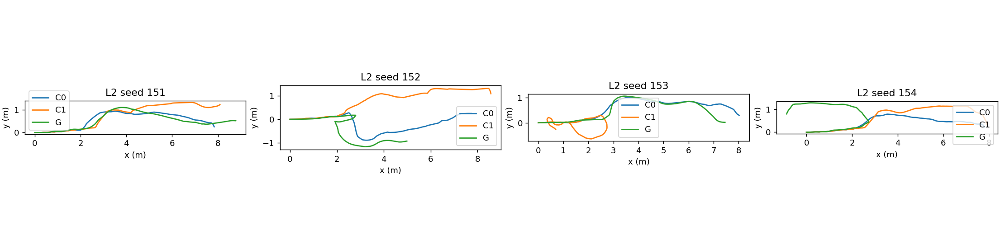

# Phase24-R2 endpoint return pilot — preregistration

Base commit: `d133909`. L2 only, G/C0/C1, paired seeds151–154 (offset10000×index), twelve new runs. Existing Phase24/R code, outcomes and labels are preserved. C1 is descriptive. No tuning; exact simulator odometry. The single L2seed95G technical smoke is excluded from results. Main execution is user initiated.

## Only method change

G DETOUR adds $J_{lat}=((p_{10}-a)^Tn/0.30)^2$, with weight1, $n=(-u_y,u_x)$ and existing unit direction $u=u_{ref}$. Its xy gradient is $2((p_{10}-a)^Tn)n/0.30^2$; all other variable derivatives are zero. Coordinates are transformed exactly into the predicted-start frame.

For the existing component-based direction, $a$ is the robot pose position at the component's depth-derived `t_new_tick`. Without a component, $a$ is the actual position when DETOUR starts. It is captured once per detour, never re-anchored at the predicted pose or taken from oracle spawn. The unchanged direction selector decides which source applies. Every DETOUR job/result logs the full line, source and anchor tick.

NORMAL is bitwise unchanged. Progress1.2m, obstacle node/midpoint constraints and soft cost, kinematics, time, curvature, initializations, 0.5s anytime rule, output/live continuous certificates, chord-priority rotation, persistent-component trigger, recovery, fallback and goal tolerance inherit Phase24-R. C0/C1 inherit their exact Phase24-R execution factory. Methods receive no oracle geometry.

## Fixed decision

Pilot `R2_PASS` iff G goal successes ≥ C0−1 AND G collisions=0 AND G box passages ≥ C0−1; otherwise `R2_FAIL`. Collision uses the frozen Phase24-R oracle obstacle/wall geometric-overlap metric; margin-only corridor stops remain separately reported. Technical failures remain visible and unsuccessful, with no retry or result-based changes.

## Metrics

All Phase24-R audit metrics remain in runs.json/execution.csv. Added: maximum |y| during accepted detour execution; |y| exactly five seconds after box passage, linearly interpolated from72Hz poses (missing if the run ends earlier); and closest-node progress after each actual detour handover. The latter is last observed closest index at handover+5s minus last at handover, with incomplete-five-second windows flagged and run-end progress also reported. Run termination during a detour is not invented as a handover. No missing observation is extrapolated.

## Validation and execution

15/15 tests passed (7new,8frozen R regression). Tests cover line anchors, rotated-frame analytic gradient within1e−5, unchanged NORMAL/constraints/runtime constants, an obstacle blocking the return line with a feasible certificated detour using the unchanged seven starts and SLSQP options, new metrics and a synthetic twelve-run report.

One excluded G smoke completed technically: command-to-pose error 0m, USD/evaluation wall error 7.45e-10m; 20 DETOUR jobs transported the fixed return line. The smoke outcome is not used to change any factor or criterion. Maximum socket length 90bytes. Estimated campaign wall time 48.9minutes including report.

Full RGB/depth retention is seed151 only; the other seeds keep the frozen compact metrics/map/archive policy. Disk guard requires estimated remaining storage plus20GB before every run. At freeze: expected 27.23GB, required 47.23GB, available 38.79GB. If insufficient, the campaign stops before launching the next run without modifying data.

Protocol and source SHA256s are frozen in online_protocol.json; old sources are checked as well. The campaign uses the Phase24-R lock/resume/atomic metadata structure and generates, commits and pushes this report after the twelve runs.

## Online results

Pilot only; n=4 paired seeds. Prior Phase24/R results are preserved and not pooled. Protocol SHA256 `f14f60fa9baf107dd143ef5d05068a1dab802385c75d29c3342a1751ba926360`. Exact simulator odometry. Seed95 smoke excluded.

| label | study | goal_within_one | zero_collisions | passage_within_one | technical_failures |
| --- | --- | --- | --- | --- | --- |
| R2_FAIL | PILOT | False | True | True | 0 |

| method | n | valid | technical_failure | success | collision | corridor | box_passage | goal_time_median_s | passage_time_median_s | minimum_clearance_m | detour_minimum_clearance_m | omega_saturation_fraction | stopped_fraction | compute_p95_s | detour_max_abs_y_m | post_passage_5s_abs_y_m |
| --- | --- | --- | --- | --- | --- | --- | --- | --- | --- | --- | --- | --- | --- | --- | --- | --- |
| G | 4 | 4 | 0 | 0 | 0 | 0 | 3 | — | 39.25 | 0.075185 | 0.075185 | 0.18086 | 0.49012 | 0.69204 | 1.1216 | 0.9861 |
| C0 | 4 | 4 | 0 | 3 | 0 | 0 | 4 | 77.903 | 25.778 | 0.1213 | 0.12633 | 0.41967 | 0.40617 | 0.42826 | 0.8353 | 0.75106 |
| C1 | 4 | 4 | 0 | 1 | 0 | 0 | 3 | 73.236 | 21.056 | 0.056083 | 0.056083 | 0.39938 | 0.40556 | 0.47041 | 1.2296 | 0.88293 |

### Paired results

| scene | index | method | classification | success | collision | box_passage | box_passage_from_spawn_s | goal_time_s | detour_max_abs_y_m | post_passage_5s_abs_y_m | post_detour_closest_progress |
| --- | --- | --- | --- | --- | --- | --- | --- | --- | --- | --- | --- |
| L2 | 151 | C0 | SUCCESS | True | False | True | 19.194 | 68.528 | 0.87455 | 0.79932 | [{'handover_s': 27.444444444444443, 'window_end_s': 32.44444444444444, 'full_5s_observed': True, 'closest_at_handover': 15, 'closest_after': 10, 'delta_5s': -5, 'delta_until_run_end': 5}, {'handover_s': 45.333333333333336, 'window_end_s': 50.333333333333336, 'full_5s_observed': True, 'closest_at_handover': 13, 'closest_after': 14, 'delta_5s': 1, 'delta_until_run_end': 7}] |
| L2 | 151 | C1 | STUCK | False | False | True | 17.819 | — | 1.3195 | 0.86659 | [{'handover_s': 29.77777777777778, 'window_end_s': 34.77777777777778, 'full_5s_observed': True, 'closest_at_handover': 16, 'closest_after': 11, 'delta_5s': -5, 'delta_until_run_end': -3}, {'handover_s': 44.0, 'window_end_s': 49.0, 'full_5s_observed': True, 'closest_at_handover': 17, 'closest_after': 0, 'delta_5s': -17, 'delta_until_run_end': -4}, {'handover_s': 54.77777777777778, 'window_end_s': 59.77777777777778, 'full_5s_observed': True, 'closest_at_handover': 5, 'closest_after': 13, 'delta_5s': 8, 'delta_until_run_end': 8}, {'handover_s': 62.111111111111114, 'window_end_s': 67.11111111111111, 'full_5s_observed': True, 'closest_at_handover': 16, 'closest_after': 16, 'delta_5s': 0, 'delta_until_run_end': -3}, {'handover_s': 68.0, 'window_end_s': 73.0, 'full_5s_observed': True, 'closest_at_handover': 17, 'closest_after': 19, 'delta_5s': 2, 'delta_until_run_end': -4}, {'handover_s': 73.55555555555556, 'window_end_s': 78.55555555555556, 'full_5s_observed': True, 'closest_at_handover': 19, 'closest_after': 20, 'delta_5s': 1, 'delta_until_run_end': -6}] |
| L2 | 151 | G | STUCK | False | False | True | 13.278 | — | 1.0827 | 1.0253 | [{'handover_s': 24.0, 'window_end_s': 29.0, 'full_5s_observed': True, 'closest_at_handover': 15, 'closest_after': 16, 'delta_5s': 1, 'delta_until_run_end': 5}, {'handover_s': 28.22222222222222, 'window_end_s': 33.22222222222222, 'full_5s_observed': True, 'closest_at_handover': 15, 'closest_after': 11, 'delta_5s': -4, 'delta_until_run_end': 5}, {'handover_s': 33.55555555555556, 'window_end_s': 38.55555555555556, 'full_5s_observed': True, 'closest_at_handover': 11, 'closest_after': 10, 'delta_5s': -1, 'delta_until_run_end': 9}, {'handover_s': 68.55555555555556, 'window_end_s': 73.55555555555556, 'full_5s_observed': True, 'closest_at_handover': 20, 'closest_after': 20, 'delta_5s': 0, 'delta_until_run_end': 0}, {'handover_s': 76.33333333333333, 'window_end_s': 81.33333333333333, 'full_5s_observed': True, 'closest_at_handover': 20, 'closest_after': 20, 'delta_5s': 0, 'delta_until_run_end': 0}] |
| L2 | 152 | C0 | STUCK | False | False | True | 29.333 | — | 0.82734 | 0.54568 | [{'handover_s': 27.333333333333332, 'window_end_s': 32.33333333333333, 'full_5s_observed': True, 'closest_at_handover': 15, 'closest_after': 19, 'delta_5s': 4, 'delta_until_run_end': 5}, {'handover_s': 40.333333333333336, 'window_end_s': 45.333333333333336, 'full_5s_observed': True, 'closest_at_handover': 17, 'closest_after': 13, 'delta_5s': -4, 'delta_until_run_end': 3}, {'handover_s': 44.44444444444444, 'window_end_s': 49.44444444444444, 'full_5s_observed': True, 'closest_at_handover': 12, 'closest_after': 8, 'delta_5s': -4, 'delta_until_run_end': 8}, {'handover_s': 56.44444444444444, 'window_end_s': 61.44444444444444, 'full_5s_observed': True, 'closest_at_handover': 9, 'closest_after': 11, 'delta_5s': 2, 'delta_until_run_end': 11}, {'handover_s': 61.333333333333336, 'window_end_s': 66.33333333333334, 'full_5s_observed': True, 'closest_at_handover': 11, 'closest_after': 13, 'delta_5s': 2, 'delta_until_run_end': 9}] |
| L2 | 152 | C1 | STUCK | False | False | True | 21.056 | — | 1.3207 | 1.0916 | [{'handover_s': 31.22222222222222, 'window_end_s': 36.22222222222222, 'full_5s_observed': True, 'closest_at_handover': 15, 'closest_after': 11, 'delta_5s': -4, 'delta_until_run_end': 5}, {'handover_s': 47.333333333333336, 'window_end_s': 52.333333333333336, 'full_5s_observed': True, 'closest_at_handover': 11, 'closest_after': 14, 'delta_5s': 3, 'delta_until_run_end': 9}, {'handover_s': 54.77777777777778, 'window_end_s': 59.77777777777778, 'full_5s_observed': True, 'closest_at_handover': 15, 'closest_after': 16, 'delta_5s': 1, 'delta_until_run_end': 5}, {'handover_s': 61.55555555555556, 'window_end_s': 66.55555555555556, 'full_5s_observed': True, 'closest_at_handover': 17, 'closest_after': 17, 'delta_5s': 0, 'delta_until_run_end': 3}, {'handover_s': 68.0, 'window_end_s': 73.0, 'full_5s_observed': True, 'closest_at_handover': 16, 'closest_after': 18, 'delta_5s': 2, 'delta_until_run_end': 4}, {'handover_s': 74.0, 'window_end_s': 79.0, 'full_5s_observed': True, 'closest_at_handover': 18, 'closest_after': 20, 'delta_5s': 2, 'delta_until_run_end': 2}, {'handover_s': 80.0, 'window_end_s': 85.0, 'full_5s_observed': True, 'closest_at_handover': 20, 'closest_after': 9, 'delta_5s': -11, 'delta_until_run_end': 0}] |
| L2 | 152 | G | STUCK | False | False | True | 59.875 | — | 1.1604 | 0.90478 | [{'handover_s': 21.77777777777778, 'window_end_s': 26.77777777777778, 'full_5s_observed': True, 'closest_at_handover': 6, 'closest_after': 16, 'delta_5s': 10, 'delta_until_run_end': 6}, {'handover_s': 43.888888888888886, 'window_end_s': 48.888888888888886, 'full_5s_observed': True, 'closest_at_handover': 19, 'closest_after': 16, 'delta_5s': -3, 'delta_until_run_end': -7}, {'handover_s': 45.77777777777778, 'window_end_s': 50.77777777777778, 'full_5s_observed': True, 'closest_at_handover': 16, 'closest_after': 16, 'delta_5s': 0, 'delta_until_run_end': -4}, {'handover_s': 53.333333333333336, 'window_end_s': 58.333333333333336, 'full_5s_observed': True, 'closest_at_handover': 17, 'closest_after': 16, 'delta_5s': -1, 'delta_until_run_end': -5}, {'handover_s': 62.666666666666664, 'window_end_s': 67.66666666666666, 'full_5s_observed': True, 'closest_at_handover': 17, 'closest_after': 20, 'delta_5s': 3, 'delta_until_run_end': -5}, {'handover_s': 67.55555555555556, 'window_end_s': 72.55555555555556, 'full_5s_observed': True, 'closest_at_handover': 20, 'closest_after': 13, 'delta_5s': -7, 'delta_until_run_end': -8}, {'handover_s': 71.33333333333333, 'window_end_s': 76.33333333333333, 'full_5s_observed': True, 'closest_at_handover': 16, 'closest_after': 8, 'delta_5s': -8, 'delta_until_run_end': -4}, {'handover_s': 75.11111111111111, 'window_end_s': 80.11111111111111, 'full_5s_observed': True, 'closest_at_handover': 8, 'closest_after': 9, 'delta_5s': 1, 'delta_until_run_end': 4}, {'handover_s': 85.55555555555556, 'window_end_s': 90.0, 'full_5s_observed': False, 'closest_at_handover': 12, 'closest_after': 12, 'delta_5s': 0, 'delta_until_run_end': 0}] |
| L2 | 153 | C0 | SUCCESS | True | False | True | 22.347 | 77.903 | 0.84326 | 0.90276 | [{'handover_s': 28.333333333333332, 'window_end_s': 33.33333333333333, 'full_5s_observed': True, 'closest_at_handover': 16, 'closest_after': 12, 'delta_5s': -4, 'delta_until_run_end': 4}, {'handover_s': 32.55555555555556, 'window_end_s': 37.55555555555556, 'full_5s_observed': True, 'closest_at_handover': 11, 'closest_after': 11, 'delta_5s': 0, 'delta_until_run_end': 9}, {'handover_s': 53.77777777777778, 'window_end_s': 58.77777777777778, 'full_5s_observed': True, 'closest_at_handover': 16, 'closest_after': 16, 'delta_5s': 0, 'delta_until_run_end': 4}] |
| L2 | 153 | C1 | STUCK | False | False | False | — | — | 0.19569 | — | [{'handover_s': 22.0, 'window_end_s': 27.0, 'full_5s_observed': True, 'closest_at_handover': 6, 'closest_after': 16, 'delta_5s': 10, 'delta_until_run_end': 12}] |
| L2 | 153 | G | STUCK | False | False | True | 39.25 | — | 0.90848 | 0.9861 | [{'handover_s': 29.333333333333332, 'window_end_s': 34.33333333333333, 'full_5s_observed': True, 'closest_at_handover': 16, 'closest_after': 16, 'delta_5s': 0, 'delta_until_run_end': 3}, {'handover_s': 34.44444444444444, 'window_end_s': 39.44444444444444, 'full_5s_observed': True, 'closest_at_handover': 16, 'closest_after': 16, 'delta_5s': 0, 'delta_until_run_end': 3}, {'handover_s': 50.666666666666664, 'window_end_s': 55.666666666666664, 'full_5s_observed': True, 'closest_at_handover': 17, 'closest_after': 12, 'delta_5s': -5, 'delta_until_run_end': 2}, {'handover_s': 66.77777777777777, 'window_end_s': 71.77777777777777, 'full_5s_observed': True, 'closest_at_handover': 11, 'closest_after': 15, 'delta_5s': 4, 'delta_until_run_end': 8}, {'handover_s': 73.0, 'window_end_s': 78.0, 'full_5s_observed': True, 'closest_at_handover': 16, 'closest_after': 16, 'delta_5s': 0, 'delta_until_run_end': 3}, {'handover_s': 76.66666666666667, 'window_end_s': 81.66666666666667, 'full_5s_observed': True, 'closest_at_handover': 16, 'closest_after': 17, 'delta_5s': 1, 'delta_until_run_end': 3}] |
| L2 | 154 | C0 | SUCCESS | True | False | True | 29.208 | 78.125 | 0.73878 | 0.70281 | [{'handover_s': 36.0, 'window_end_s': 41.0, 'full_5s_observed': True, 'closest_at_handover': 12, 'closest_after': 7, 'delta_5s': -5, 'delta_until_run_end': 8}, {'handover_s': 42.333333333333336, 'window_end_s': 47.333333333333336, 'full_5s_observed': True, 'closest_at_handover': 11, 'closest_after': 11, 'delta_5s': 0, 'delta_until_run_end': 9}] |
| L2 | 154 | C1 | SUCCESS | True | False | True | 23.028 | 73.236 | 1.1398 | 0.88293 | [{'handover_s': 21.333333333333332, 'window_end_s': 26.333333333333332, 'full_5s_observed': True, 'closest_at_handover': 13, 'closest_after': 16, 'delta_5s': 3, 'delta_until_run_end': 7}, {'handover_s': 25.0, 'window_end_s': 30.0, 'full_5s_observed': True, 'closest_at_handover': 16, 'closest_after': 15, 'delta_5s': -1, 'delta_until_run_end': 4}, {'handover_s': 31.0, 'window_end_s': 36.0, 'full_5s_observed': True, 'closest_at_handover': 18, 'closest_after': 12, 'delta_5s': -6, 'delta_until_run_end': 2}, {'handover_s': 45.333333333333336, 'window_end_s': 50.333333333333336, 'full_5s_observed': True, 'closest_at_handover': 12, 'closest_after': 15, 'delta_5s': 3, 'delta_until_run_end': 8}, {'handover_s': 51.333333333333336, 'window_end_s': 56.333333333333336, 'full_5s_observed': True, 'closest_at_handover': 16, 'closest_after': 16, 'delta_5s': 0, 'delta_until_run_end': 4}, {'handover_s': 60.55555555555556, 'window_end_s': 65.55555555555556, 'full_5s_observed': True, 'closest_at_handover': 17, 'closest_after': 19, 'delta_5s': 2, 'delta_until_run_end': 3}] |
| L2 | 154 | G | STUCK | False | False | False | — | — | 1.2867 | — | [{'handover_s': 24.22222222222222, 'window_end_s': 29.22222222222222, 'full_5s_observed': True, 'closest_at_handover': 12, 'closest_after': 19, 'delta_5s': 7, 'delta_until_run_end': 6}, {'handover_s': 31.555555555555557, 'window_end_s': 36.55555555555556, 'full_5s_observed': True, 'closest_at_handover': 20, 'closest_after': 20, 'delta_5s': 0, 'delta_until_run_end': -2}, {'handover_s': 35.111111111111114, 'window_end_s': 40.111111111111114, 'full_5s_observed': True, 'closest_at_handover': 20, 'closest_after': 16, 'delta_5s': -4, 'delta_until_run_end': -2}, {'handover_s': 45.55555555555556, 'window_end_s': 50.55555555555556, 'full_5s_observed': True, 'closest_at_handover': 17, 'closest_after': 17, 'delta_5s': 0, 'delta_until_run_end': 1}, {'handover_s': 49.55555555555556, 'window_end_s': 54.55555555555556, 'full_5s_observed': True, 'closest_at_handover': 17, 'closest_after': 17, 'delta_5s': 0, 'delta_until_run_end': 1}, {'handover_s': 56.333333333333336, 'window_end_s': 61.333333333333336, 'full_5s_observed': True, 'closest_at_handover': 18, 'closest_after': 20, 'delta_5s': 2, 'delta_until_run_end': 0}, {'handover_s': 60.0, 'window_end_s': 65.0, 'full_5s_observed': True, 'closest_at_handover': 18, 'closest_after': 20, 'delta_5s': 2, 'delta_until_run_end': 0}, {'handover_s': 64.0, 'window_end_s': 69.0, 'full_5s_observed': True, 'closest_at_handover': 20, 'closest_after': 15, 'delta_5s': -5, 'delta_until_run_end': -2}, {'handover_s': 66.0, 'window_end_s': 71.0, 'full_5s_observed': True, 'closest_at_handover': 16, 'closest_after': 18, 'delta_5s': 2, 'delta_until_run_end': 2}, {'handover_s': 72.33333333333333, 'window_end_s': 77.33333333333333, 'full_5s_observed': True, 'closest_at_handover': 18, 'closest_after': 17, 'delta_5s': -1, 'delta_until_run_end': 0}, {'handover_s': 73.55555555555556, 'window_end_s': 78.55555555555556, 'full_5s_observed': True, 'closest_at_handover': 17, 'closest_after': 18, 'delta_5s': 1, 'delta_until_run_end': 1}, {'handover_s': 80.44444444444444, 'window_end_s': 85.44444444444444, 'full_5s_observed': True, 'closest_at_handover': 18, 'closest_after': 18, 'delta_5s': 0, 'delta_until_run_end': 0}] |

### Frozen Phase24-R diagnostics

| index | method | mode_fraction | output_counts | output_fractions | compute_p50_s | compute_p95_s | job_compute_p95_s | recovery_count | rotation_priority_count | rotation_priority_time_s | theta_chord_inconsistent_count | certificate_rejection_count | certificate_alternative_count | path_became_unsafe_count | trigger_after_spawn_s |
| --- | --- | --- | --- | --- | --- | --- | --- | --- | --- | --- | --- | --- | --- | --- | --- |
| 151 | C0 | — | — | — | 0.68782 | 1.0476 | — | 0 | 0 | 0 | 0 | 0 | 0 | 1 | [2.4444444444444464, 6.555555555555557, 24.777777777777782] |
| 151 | C1 | — | — | — | 0.25689 | 0.35349 | — | 0 | 0 | 0 | 0 | 0 | 0 | 5 | [5.930555555555557, 9.26388888888889, 21.819444444444446, 31.041666666666668, 34.263888888888886, 40.15277777777777, 47.375, 53.93055555555556, 58.81944444444444, 62.15277777777777, 68.48611111111111] |
| 151 | G | {'NORMAL': 0.8358024691358026, 'DETOUR': 0.16419753086419747} | {'FEASIBLE': 59, 'KINEMATIC_TOLERATED': 10, 'STOP': 12} | {'FEASIBLE': 0.7283950617283951, 'KINEMATIC_TOLERATED': 0.12345679012345678, 'STOP': 0.14814814814814814} | 0.27706 | 0.71084 | 0.45104 | 0 | 30 | 11.556 | 19 | 5 | 0 | 1 | [6.958333333333332] |
| 152 | C0 | — | — | — | 0.31775 | 0.39571 | — | 0 | 0 | 0 | 0 | 0 | 0 | 4 | [6.111111111111111, 10.11111111111111, 13.555555555555557, 17.111111111111114, 23.111111111111114, 34.88888888888889, 39.88888888888889] |
| 152 | C1 | — | — | — | 0.22913 | 0.50948 | — | 0 | 0 | 0 | 0 | 0 | 0 | 6 | [4.638888888888889, 7.861111111111111, 13.083333333333332, 30.083333333333336, 34.083333333333336, 41.52777777777778, 49.19444444444444, 54.861111111111114, 60.75, 69.86111111111111] |
| 152 | G | {'NORMAL': 0.6308641975308643, 'DETOUR': 0.3691358024691357} | {'FEASIBLE': 48, 'KINEMATIC_TOLERATED': 2, 'STOP': 30} | {'FEASIBLE': 0.6, 'KINEMATIC_TOLERATED': 0.025, 'STOP': 0.375} | 0.27875 | 0.74652 | 0.4916 | 0 | 8 | 13.889 | 4 | 7 | 1 | 3 | [29.77777777777778, 33.333333333333336, 47.22222222222223, 63.66666666666667] |
| 153 | C0 | — | — | — | 0.30266 | 0.40811 | — | 0 | 0 | 0 | 0 | 0 | 0 | 2 | [8.208333333333332, 14.76388888888889, 33.541666666666664, 59.986111111111114] |
| 153 | C1 | — | — | — | 0.42522 | 0.50013 | — | 0 | 0 | 0 | 0 | 0 | 0 | 2 | [3.4444444444444464, 9.222222222222225, 12.555555555555557, 16.111111111111114, 19.66666666666667, 23.22222222222222, 27.22222222222222] |
| 153 | G | {'NORMAL': 0.7530864197530863, 'DETOUR': 0.2172839506172839, 'RECOVER_ROTATE': 0.019753086419753096, 'WAIT_FRESH': 0.009876543209876586} | {'FEASIBLE': 54, 'KINEMATIC_TOLERATED': 6, 'STOP': 28} | {'FEASIBLE': 0.6136363636363636, 'KINEMATIC_TOLERATED': 0.06818181818181818, 'STOP': 0.3181818181818182} | 0.27574 | 0.62239 | 0.44857 | 1 | 6 | 1.2222 | 0 | 1 | 1 | 2 | [3.791666666666668, 9.791666666666668, 28.791666666666664, 45.45833333333333, 50.90277777777777, 57.125] |
| 154 | C0 | — | — | — | 0.096715 | 0.44841 | — | 0 | 0 | 0 | 0 | 0 | 0 | 2 | [16.916666666666664, 25.02777777777778] |
| 154 | C1 | — | — | — | 0.26705 | 0.44068 | — | 0 | 0 | 0 | 0 | 0 | 0 | 7 | [4.916666666666668, 8.583333333333332, 12.25, 26.694444444444443, 32.583333333333336, 38.583333333333336, 42.138888888888886] |
| 154 | G | {'NORMAL': 0.6395061728395062, 'DETOUR': 0.354320987654321, 'RECOVER_ROTATE': 0.006172839506172857} | {'FEASIBLE': 45, 'KINEMATIC_TOLERATED': 5, 'STOP': 36} | {'FEASIBLE': 0.5232558139534884, 'KINEMATIC_TOLERATED': 0.05813953488372093, 'STOP': 0.4186046511627907} | 0.30162 | 0.67324 | 0.45761 | 1 | 12 | 5.8889 | 4 | 1 | 1 | 4 | [3.125, 15.569444444444446, 34.013888888888886, 50.013888888888886] |

Technical failures are counted as unsuccessful and preserved without retry: []

