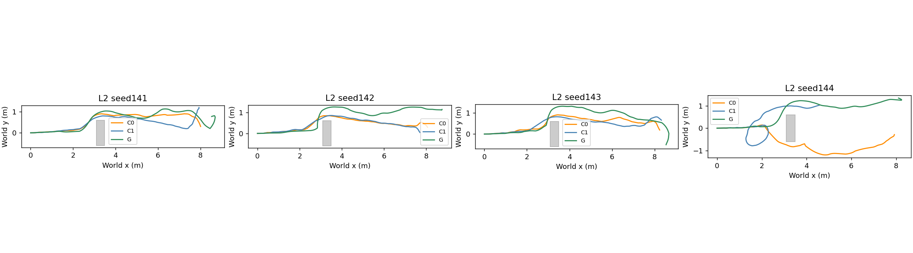
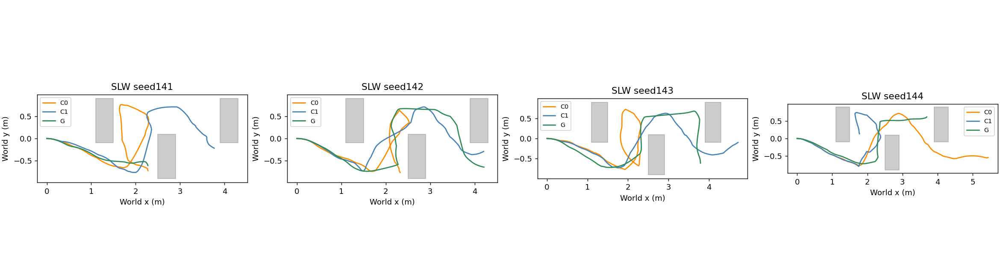

# Phase24-R pilot preparation

Phase24 results and labels are preserved. Its 12 SLW records are listed as `SCENE_BOUNDARY_NOT_PERCEIVABLE` in `research/results/phase24r/phase24_slw_validity.json` and are excluded from Phase24-R pooling.

## Registered changes from Phase24

| Area | Phase24 | Phase24-R |
|---|---|---|
| SLW walls | Renderer fixed y=±1.55 while evaluation used ±0.9 | Scene-specific inner faces are checked against all four corridor faces before navigation; mismatch refuses launch |
| G detour planning field | Base V1; unknown free | C0 R3 split field: base first0.3m, strict occupied/unknown/stale-free elsewhere |
| G certificate | Node+midpoint hard condition only | Output certificate:9points/segment, h/√2+L/16, conservative start, exact segment distance; alternate output may replace a rejected one |
| G live check | DETOUR only | Same continuous certificate in NORMAL and DETOUR |
| Alignment | Graph pose rotation segments only | Before a new/entered segment whose chord differs by>30°, rotate in place to chord±10°; record theta–chord discrepancy |
| Component lifetime | 10s t_new window | Occupied+observed cells stay active until passed along u_ref |
| No-progress | Forward3s<0.2m | Forward criterion OR fixed-current-component distance reduction<0.1m |
| Goal | Existing common async tolerance | Audited: all Phase24 runs use shared0.3m test; Phase24 L2_133_G never entered it |

The graph objective, node/midpoint hard constraints, soft obstacle term/weight, solver settings, NoMaD/checkpoint/Topomap, seeds, timeout and `G_HELPS/G_HURTS/G_INCONCLUSIVE` function are fixed before the new pilot. C0/C1 retain their existing solver implementations; decision/depth/certificate interfaces are shared.

## Verification

| scene | method | technical_validation | geometry_error_m | command_pose_error_m | launcher_wall_s |
| --- | --- | --- | --- | --- | --- |
| L2 | G | PASS | 7.4506e-10 | 0 | 211.8 |
| L2 | C0 | PASS | 7.4506e-10 | 0 | 201.12 |
| L2 | C1 | PASS | 7.4506e-10 | 0 | 185.66 |
| SLW | G | PASS | 7.4506e-10 | 0 | 225.24 |
| SLW | C0 | PASS | 7.4506e-10 | 0 | 210.47 |
| SLW | C1 | PASS | 7.4506e-10 | 0 | 209.98 |

Eight unit tests passed. Six smoke runs passed and are excluded. Every smoke USD passed the four-wall check; maximum inner-face error was 7.45e-10m. The shared runtime uses the existing `distance <= goal_tolerance_m` condition, and the stored Phase24 audit found 24/24 recorded goal entries equal to the trajectory-derived predicate.

New main matrix: seed141–144 × L2/SLW × G/C0/C1 =24 runs, seed-first random order in `online_protocol.json`. Main has not started. Max socket path length is 90 bytes. Estimated 106.6minutes.

## Online pilot results

Phase24-R pilot, four new paired seeds per scene; C1 is descriptive only. Exact simulator odometry is assumed. The six seed95 smoke runs are excluded. Phase24 SLW runs are retained as SCENE_BOUNDARY_NOT_PERCEIVABLE and are not pooled with this rerun.

Online protocol SHA256 `377e16dcb1b7d7a4555280366ce3534897c81da99d7727dc2d92438f46a29e70`. G installs the graph at36integration ticks and retains the global9Hz controller phase; C0/C1retain Phase21executors and timing.

### Registered decisions

| scene | label | goal_not_lower | collisions_not_higher | clearance_gain_3cm | omega_halved |
| --- | --- | --- | --- | --- | --- |
| L2 | PILOT_G_HURTS | False | True | False | False |
| SLW | PILOT_G_HELPS | True | True | True | True |

### Outcomes

| scene | method | n | valid | success | collision | corridor | stuck | technical_failure | goal_time_median_s | box_passage | passage_time_median_s | min_clearance_median_m | detour_min_clearance_median_m | omega_saturation_median | stopped_fraction_median | recovery_count | compute_p95_median_s |
| --- | --- | --- | --- | --- | --- | --- | --- | --- | --- | --- | --- | --- | --- | --- | --- | --- | --- |
| L2 | G | 4 | 4 | 0 | 0 | 0 | 4 | 0 | — | 4 | 16.576 | 0.099975 | 0.12912 | 0.17963 | 0.40062 | 0 | 0.65238 |
| L2 | C0 | 4 | 4 | 4 | 0 | 0 | 0 | 0 | 76.375 | 4 | 15.826 | 0.087271 | 0.16362 | 0.35226 | 0.35542 | 0 | 0.3669 |
| L2 | C1 | 4 | 4 | 1 | 0 | 0 | 3 | 0 | 85.361 | 4 | 21.229 | 0.053763 | 0.10505 | 0.43148 | 0.42531 | 0 | 0.54475 |
| SLW | G | 4 | 4 | 0 | 0 | 0 | 4 | 0 | — | 0 | — | 0.080243 | 0.085183 | 0.13272 | 0.61049 | 1 | 0.67674 |
| SLW | C0 | 4 | 4 | 0 | 0 | 0 | 4 | 0 | — | 0 | — | 0.044408 | 0.089895 | 0.43333 | 0.59136 | 4 | 0.4909 |
| SLW | C1 | 4 | 4 | 1 | 0 | 0 | 3 | 0 | 78.722 | 0 | — | 0.048352 | 0.098809 | 0.46022 | 0.55988 | 4 | 0.31907 |
| ALL | G | 8 | 8 | 0 | 0 | 0 | 8 | 0 | — | 4 | 16.576 | 0.080243 | 0.10601 | 0.15617 | 0.49074 | 1 | 0.65964 |
| ALL | C0 | 8 | 8 | 4 | 0 | 0 | 4 | 0 | 76.375 | 4 | 15.826 | 0.045422 | 0.093358 | 0.36765 | 0.42359 | 4 | 0.42593 |
| ALL | C1 | 8 | 8 | 2 | 0 | 0 | 6 | 0 | 82.042 | 4 | 21.229 | 0.048352 | 0.10216 | 0.44972 | 0.47238 | 4 | 0.4273 |

### Paired inputs

| scene | index | method | classification | success | box_passage | box_passage_from_spawn_s | goal_time_s | minimum_clearance_m | detour_minimum_clearance_m | omega_saturation_fraction | stopped_fraction | recovery_count | technical_validation |
| --- | --- | --- | --- | --- | --- | --- | --- | --- | --- | --- | --- | --- | --- |
| L2 | 141 | C0 | SUCCESS | True | True | 13.694 | 71.222 | 0.12979 | 0.16518 | 0.32449 | 0.36817 | 0 | PASS |
| L2 | 141 | C1 | STUCK | False | True | 15.069 | — | 0.024089 | 0.10679 | 0.46049 | 0.41852 | 0 | PASS |
| L2 | 141 | G | STUCK | False | True | 12.611 | — | 0.14081 | 0.14081 | 0.19753 | 0.37654 | 0 | PASS |
| L2 | 142 | C0 | SUCCESS | True | True | 16.014 | 77.458 | 0.12805 | 0.16205 | 0.36148 | 0.34714 | 0 | PASS |
| L2 | 142 | C1 | SUCCESS | True | True | 21.403 | 85.361 | 0.037744 | 0.037744 | 0.47283 | 0.49593 | 0 | PASS |
| L2 | 142 | G | STUCK | False | True | 20.056 | — | 0.13661 | 0.13661 | 0.21358 | 0.42469 | 0 | PASS |
| L2 | 143 | C0 | SUCCESS | True | True | 15.639 | 75.458 | 0.034749 | 0.039952 | 0.3637 | 0.30922 | 0 | PASS |
| L2 | 143 | C1 | STUCK | False | True | 21.056 | — | 0.069782 | 0.10331 | 0.40247 | 0.4321 | 0 | PASS |
| L2 | 143 | G | STUCK | False | True | 26.458 | — | 0.046656 | 0.046656 | 0.15062 | 0.35926 | 0 | PASS |
| L2 | 144 | C0 | SUCCESS | True | True | 20.681 | 77.292 | 0.046494 | 0.18584 | 0.34304 | 0.3637 | 0 | PASS |
| L2 | 144 | C1 | STUCK | False | True | 64.986 | — | 0.29163 | 0.38267 | 0.35062 | 0.39259 | 0 | PASS |
| L2 | 144 | G | STUCK | False | True | 13.097 | — | 0.063335 | 0.12162 | 0.16173 | 0.46667 | 0 | PASS |
| SLW | 141 | C0 | STUCK | False | False | — | — | 0.045383 | 0.091558 | 0.41111 | 0.58889 | 2 | PASS |
| SLW | 141 | C1 | STUCK | False | False | — | — | 0.043948 | 0.096608 | 0.48272 | 0.54198 | 0 | PASS |
| SLW | 141 | G | STUCK | False | False | — | — | 0.13485 | 0.20313 | 0.062963 | 0.79877 | 0 | PASS |
| SLW | 142 | C0 | STUCK | False | False | — | — | 0.043434 | 0.088233 | 0.45556 | 0.6 | 2 | PASS |
| SLW | 142 | C1 | STUCK | False | False | — | — | 0.057266 | 0.10101 | 0.48148 | 0.57778 | 0 | PASS |
| SLW | 142 | G | STUCK | False | False | — | — | 0.070093 | 0.070094 | 0.21852 | 0.51481 | 1 | PASS |
| SLW | 143 | C0 | STUCK | False | False | — | — | 0.045462 | 0.057537 | 0.4716 | 0.59383 | 0 | PASS |
| SLW | 143 | C1 | SUCCESS | True | False | — | 78.722 | 0.052755 | 0.052755 | 0.43896 | 0.44884 | 0 | PASS |
| SLW | 143 | G | STUCK | False | False | — | — | 0.041288 | 0.079971 | 0.11605 | 0.56296 | 0 | PASS |
| SLW | 144 | C0 | STUCK | False | False | — | — | 0.043354 | 0.095157 | 0.3716 | 0.47901 | 0 | PASS |
| SLW | 144 | C1 | STUCK | False | False | — | — | 0.013071 | 0.12884 | 0.3642 | 0.6321 | 4 | PASS |
| SLW | 144 | G | STUCK | False | False | — | — | 0.090393 | 0.090394 | 0.14938 | 0.65802 | 0 | PASS |

### Mode/output/timing

| scene | index | method | mode_fraction | output_counts | output_fractions | pipeline_output_counts | job_compute_p95_s | compute_p50_s | compute_p95_s | compute_definition | recovery_count | trigger_after_spawn_s | rotation_priority_count | rotation_priority_time_s | theta_chord_inconsistent_count | certificate_rejection_count | certificate_alternative_count | path_became_unsafe_count |
| --- | --- | --- | --- | --- | --- | --- | --- | --- | --- | --- | --- | --- | --- | --- | --- | --- | --- | --- |
| L2 | 141 | C0 | — | — | — | — | — | 0.23354 | 0.35927 | frozen C0/C1 repair/detour dispatch-to-complete; timeout uses recorded wait | 0 | [4.652777777777779, 22.097222222222225, 31.319444444444446, 37.31944444444444, 52.09722222222223] | 0 | 0 | 0 | 0 | 0 | 5 |
| L2 | 141 | C1 | — | — | — | — | — | 0.21073 | 0.26482 | frozen C0/C1 repair/detour dispatch-to-complete; timeout uses recorded wait | 0 | [4.750000000000002, 10.638888888888891, 13.972222222222223] | 0 | 0 | 0 | 0 | 0 | 1 |
| L2 | 141 | G | {'NORMAL': 0.6296296296296299, 'DETOUR': 0.3703703703703701} | {'FEASIBLE': 49, 'KINEMATIC_TOLERATED': 6, 'STOP': 9} | {'FEASIBLE': 0.765625, 'KINEMATIC_TOLERATED': 0.09375, 'STOP': 0.140625} | {'FEASIBLE': 49, 'KINEMATIC_TOLERATED': 6, 'STOP': 1} | 0.43807 | 0.26571 | 0.64369 | G dispatch-to-final wall time incl transport; NORMAL->DETOUR stages summed per pipeline; single-job p95 also reported | 0 | [3.7222222222222214, 21.944444444444446, 27.166666666666668, 32.388888888888886, 66.05555555555556] | 9 | 8.2222 | 3 | 5 | 0 | 3 |
| L2 | 142 | C0 | — | — | — | — | — | 0.24892 | 0.28516 | frozen C0/C1 repair/detour dispatch-to-complete; timeout uses recorded wait | 0 | [5.166666666666664, 53.722222222222214] | 0 | 0 | 0 | 0 | 0 | 2 |
| L2 | 142 | C1 | — | — | — | — | — | 0.37587 | 0.65672 | frozen C0/C1 repair/detour dispatch-to-complete; timeout uses recorded wait | 0 | [9.111111111111114, 15.0] | 0 | 0 | 0 | 0 | 0 | 1 |
| L2 | 142 | G | {'NORMAL': 0.6049382716049382, 'DETOUR': 0.39506172839506193} | {'FEASIBLE': 51, 'STOP': 13, 'KINEMATIC_TOLERATED': 4} | {'FEASIBLE': 0.75, 'STOP': 0.19117647058823528, 'KINEMATIC_TOLERATED': 0.058823529411764705} | {'FEASIBLE': 51, 'KINEMATIC_TOLERATED': 4, 'STOP': 5} | 0.48149 | 0.27529 | 0.64265 | G dispatch-to-final wall time incl transport; NORMAL->DETOUR stages summed per pipeline; single-job p95 also reported | 0 | [10.48611111111111, 29.819444444444443, 35.486111111111114, 41.486111111111114, 47.48611111111111, 55.59722222222222, 63.59722222222222, 72.375] | 22 | 9.7778 | 5 | 3 | 0 | 1 |
| L2 | 143 | C0 | — | — | — | — | — | 0.29283 | 0.38896 | frozen C0/C1 repair/detour dispatch-to-complete; timeout uses recorded wait | 0 | [5.972222222222221, 28.972222222222225, 51.638888888888886, 55.41666666666666] | 0 | 0 | 0 | 0 | 0 | 3 |
| L2 | 143 | C1 | — | — | — | — | — | 0.30171 | 0.51231 | frozen C0/C1 repair/detour dispatch-to-complete; timeout uses recorded wait | 0 | [9.611111111111114, 18.72222222222222, 65.38888888888889, 69.16666666666667] | 0 | 0 | 0 | 0 | 0 | 1 |
| L2 | 143 | G | {'NORMAL': 0.691358024691358, 'DETOUR': 0.30864197530864207} | {'FEASIBLE': 53, 'KINEMATIC_TOLERATED': 7, 'STOP': 15} | {'FEASIBLE': 0.7066666666666667, 'KINEMATIC_TOLERATED': 0.09333333333333334, 'STOP': 0.2} | {'FEASIBLE': 53, 'KINEMATIC_TOLERATED': 7, 'STOP': 4} | 0.45026 | 0.27869 | 0.66106 | G dispatch-to-final wall time incl transport; NORMAL->DETOUR stages summed per pipeline; single-job p95 also reported | 0 | [39.45833333333333, 44.79166666666667, 70.23611111111111] | 25 | 8.3333 | 6 | 4 | 0 | 1 |
| L2 | 144 | C0 | — | — | — | — | — | 0.29455 | 0.37453 | frozen C0/C1 repair/detour dispatch-to-complete; timeout uses recorded wait | 0 | [2.5833333333333357, 6.027777777777779, 12.027777777777779, 16.47222222222222, 22.583333333333336, 30.02777777777778, 36.25, 43.69444444444444] | 0 | 0 | 0 | 0 | 0 | 8 |
| L2 | 144 | C1 | — | — | — | — | — | 0.43284 | 0.57719 | frozen C0/C1 repair/detour dispatch-to-complete; timeout uses recorded wait | 0 | [3.0, 6.555555555555557, 10.0, 13.444444444444446, 17.000000000000004, 27.11111111111111, 30.666666666666668, 50.777777777777786, 54.777777777777786, 68.11111111111111] | 0 | 0 | 0 | 0 | 0 | 1 |
| L2 | 144 | G | {'NORMAL': 0.6876543209876546, 'DETOUR': 0.31234567901234545} | {'FEASIBLE': 47, 'KINEMATIC_TOLERATED': 6, 'STOP': 25} | {'FEASIBLE': 0.6025641025641025, 'KINEMATIC_TOLERATED': 0.07692307692307693, 'STOP': 0.32051282051282054} | {'FEASIBLE': 47, 'KINEMATIC_TOLERATED': 6, 'STOP': 11} | 0.46171 | 0.28516 | 0.67137 | G dispatch-to-final wall time incl transport; NORMAL->DETOUR stages summed per pipeline; single-job p95 also reported | 0 | [18.65277777777778, 23.09722222222222, 28.65277777777778, 39.986111111111114, 54.31944444444445, 58.98611111111111] | 17 | 8.3333 | 6 | 1 | 0 | 3 |
| SLW | 141 | C0 | — | — | — | — | — | 0.28204 | 0.50349 | frozen C0/C1 repair/detour dispatch-to-complete; timeout uses recorded wait | 2 | [] | 0 | 0 | 0 | 0 | 0 | 4 |
| SLW | 141 | C1 | — | — | — | — | — | 0.2027 | 0.34228 | frozen C0/C1 repair/detour dispatch-to-complete; timeout uses recorded wait | 0 | [] | 0 | 0 | 0 | 0 | 0 | 2 |
| SLW | 141 | G | {'NORMAL': 0.7802469135802467, 'DETOUR': 0.21975308641975325} | {'FEASIBLE': 52, 'STOP': 29, 'KINEMATIC_TOLERATED': 6} | {'FEASIBLE': 0.5977011494252874, 'STOP': 0.3333333333333333, 'KINEMATIC_TOLERATED': 0.06896551724137931} | {'FEASIBLE': 52, 'KINEMATIC_TOLERATED': 6, 'STOP': 22} | 0.46425 | 0.26158 | 0.62163 | G dispatch-to-final wall time incl transport; NORMAL->DETOUR stages summed per pipeline; single-job p95 also reported | 0 | [] | 8 | 2.2222 | 6 | 0 | 0 | 0 |
| SLW | 142 | C0 | — | — | — | — | — | 0.34018 | 0.53073 | frozen C0/C1 repair/detour dispatch-to-complete; timeout uses recorded wait | 2 | [] | 0 | 0 | 0 | 0 | 0 | 3 |
| SLW | 142 | C1 | — | — | — | — | — | 0.29742 | 0.71323 | frozen C0/C1 repair/detour dispatch-to-complete; timeout uses recorded wait | 0 | [] | 0 | 0 | 0 | 0 | 0 | 0 |
| SLW | 142 | G | {'NORMAL': 0.6728395061728398, 'DETOUR': 0.29753086419753055, 'RECOVER_ROTATE': 0.019753086419753096, 'WAIT_FRESH': 0.009876543209876548} | {'FEASIBLE': 36, 'KINEMATIC_TOLERATED': 18, 'STOP': 30} | {'FEASIBLE': 0.42857142857142855, 'KINEMATIC_TOLERATED': 0.21428571428571427, 'STOP': 0.35714285714285715} | {'FEASIBLE': 36, 'KINEMATIC_TOLERATED': 18, 'STOP': 14} | 0.49419 | 0.27405 | 0.69682 | G dispatch-to-final wall time incl transport; NORMAL->DETOUR stages summed per pipeline; single-job p95 also reported | 1 | [] | 15 | 5.6667 | 11 | 5 | 0 | 0 |
| SLW | 143 | C0 | — | — | — | — | — | 0.35886 | 0.47832 | frozen C0/C1 repair/detour dispatch-to-complete; timeout uses recorded wait | 0 | [] | 0 | 0 | 0 | 0 | 0 | 2 |
| SLW | 143 | C1 | — | — | — | — | — | 0.25633 | 0.29586 | frozen C0/C1 repair/detour dispatch-to-complete; timeout uses recorded wait | 0 | [] | 0 | 0 | 0 | 0 | 0 | 1 |
| SLW | 143 | G | {'NORMAL': 0.6037037037037039, 'DETOUR': 0.3962962962962962} | {'FEASIBLE': 33, 'KINEMATIC_TOLERATED': 8, 'STOP': 47} | {'FEASIBLE': 0.375, 'KINEMATIC_TOLERATED': 0.09090909090909091, 'STOP': 0.5340909090909091} | {'FEASIBLE': 33, 'KINEMATIC_TOLERATED': 8, 'STOP': 22} | 0.49825 | 0.36802 | 0.69525 | G dispatch-to-final wall time incl transport; NORMAL->DETOUR stages summed per pipeline; single-job p95 also reported | 0 | [] | 14 | 4.7639 | 3 | 0 | 0 | 1 |
| SLW | 144 | C0 | — | — | — | — | — | 0.36229 | 0.4629 | frozen C0/C1 repair/detour dispatch-to-complete; timeout uses recorded wait | 0 | [] | 0 | 0 | 0 | 0 | 0 | 3 |
| SLW | 144 | C1 | — | — | — | — | — | 0.11674 | 0.27834 | frozen C0/C1 repair/detour dispatch-to-complete; timeout uses recorded wait | 4 | [] | 0 | 0 | 0 | 0 | 0 | 2 |
| SLW | 144 | G | {'NORMAL': 0.6567901234567904, 'DETOUR': 0.34320987654320956} | {'FEASIBLE': 32, 'KINEMATIC_TOLERATED': 9, 'STOP': 61} | {'FEASIBLE': 0.3137254901960784, 'KINEMATIC_TOLERATED': 0.08823529411764706, 'STOP': 0.5980392156862745} | {'FEASIBLE': 32, 'KINEMATIC_TOLERATED': 9, 'STOP': 29} | 0.50014 | 0.36964 | 0.65822 | G dispatch-to-final wall time incl transport; NORMAL->DETOUR stages summed per pipeline; single-job p95 also reported | 0 | [] | 20 | 9.1111 | 9 | 0 | 0 | 1 |

Trigger/certificate/rotation metrics are per run in execution.csv: trigger time after box spawn, chord-priority rotations and duration, theta–chord inconsistency, certificate rejections/alternative use, and PATH_BECAME_UNSAFE count.

Technical failures (preserved; no automatic retry): []

