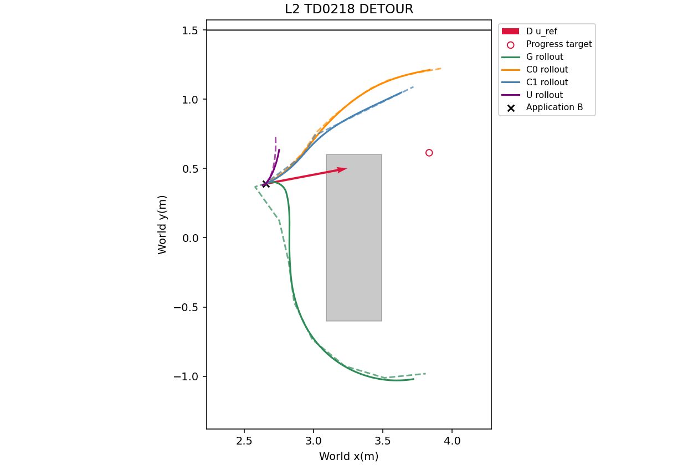
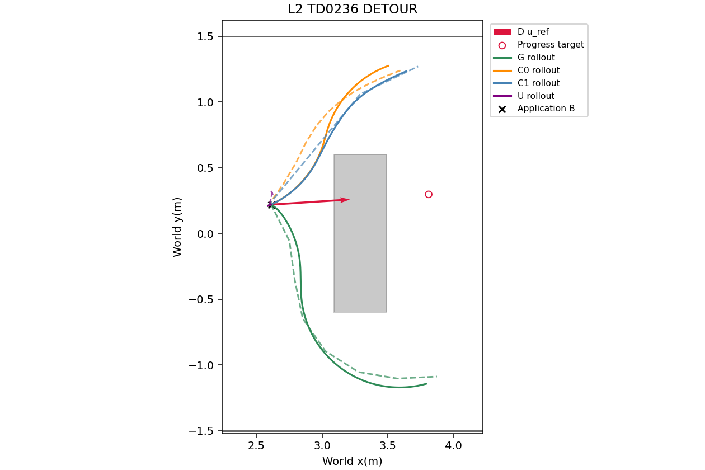
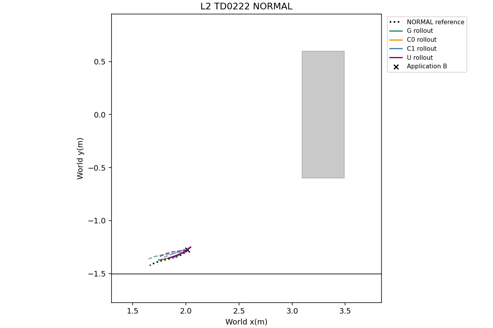
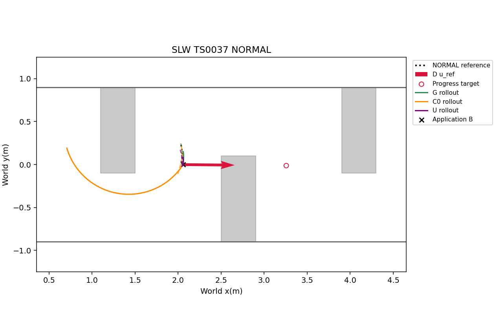
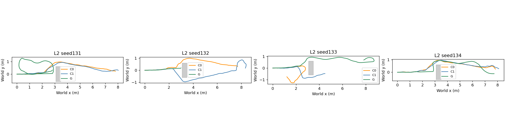
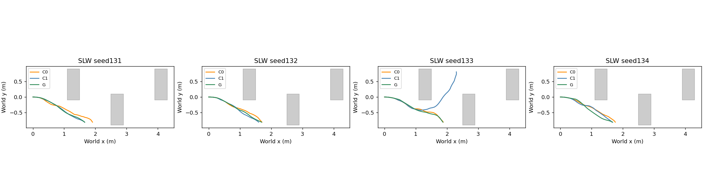

# Phase24 — decision layer and one SE(2)graph

## Input/output pipeline

| Stage | Inputs | Output |
|---|---|---|
| Decision D | Current8NoMaD candidates, observed depth, current execution state; depth-component history and odometry for the frozen20Fdirection rule | NORMAL reference r and sigma_r, or DETOUR u_ref |
| Single graph G | Predicted application pose/speed at+0.5s, base depth V1 SDF, r/sigma_r or u_ref | Eleven SE(2)poses, ten dt values, FEASIBLE / KINEMATIC_TOLERATED / STOP |
| Executor | Pose/dt trajectory and current pose/speed | Protected PP(.25m) steering, arclength-interpolated graph speed; graph omega for rotation segments |
| Evaluation only | Oracle boxes/walls, next-Topomap-node direction, saved source outcomes | Collision, clearance, progress and passage measurements |

| Mode | Entry/meaning | Reference |
|---|---|---|
| NORMAL | Ordinary operation | FRESHEST among native depth-safe suffixes; if none safe, FRESHEST among all8; no ALL_UNSAFE stop or R2 repair |
| DETOUR | Frozen20Ftrigger B or no NORMAL graph output within0.5s | Component-frozen preappearance u_ref and1.2m progress target; no path prior |
| Return to NORMAL | Frozen20F: no new obstacle ahead, endpoint,6s, or current depth safety failure | Next NORMAL candidate reference |
| Last resort | Registered no-output/fallback handling | Existing RECOVER_ROTATE, counted separately |

| Prior mechanism | New location |
|---|---|
| FRESHEST/depth selection | Decision D; reference and at most2alternative safe seeds |
| New-obstacle NO_PROGRESS, u_ref, handover | Decision D, frozen20Fconditions |
| Safety correction, kinematics, travel time | Graph factors in both modes |
| Mixed/Cauchy/history priors and learned F7direction | Removed |
| ALL_UNSAFE trigger and R2 repair | Removed |
| SP and start alignment | Removed from Gexecution; replaced by optimized speed/rotation |
| Rotation recovery | Decision D's last resort |
| A* | Comparison C1only; never a Gseed or fallback |

## Full graph definition

Let p0=0,theta0=0 in the predicted application-B frame; variables are (p_i,theta_i),i=1..10 and dt_i,i=0..9. The snapshot SDF already subtracts robot radius0.09m. All Ginput geometry is observed depth, not oracle geometry.

NORMAL reference: protected B-suffix projection, prepend B and arclength-resample to11positions (B+10future points). Short suffixes use the original allowed OLD supplementation; A*-derived OLD is withheld. sigma_r=clip(median_i sqrt(Var_j(x_ji)+Var_j(y_ji)),0.03,0.15), using the same prepared current8candidate dispersion as23-O.

$$J_{ref,N}=\sum_{i=1}^{10}\|p_i-r_i\|^2/\sigma_r^2+\|p_{10}-r_{10}\|^2/0.3^2.$$

DETOUR has no path or endpoint prior:
$$J_{ref,D}=[\max(0,1.2-(p_{10}-p_0)\cdot u_{ref})/0.10]^2.$$

Obstacle queries Q contain11nodes and10segment midpoints. Hard d(q)>=m(q), where m=min(0.025,max(0,d(B)-0.005)) on the first0.30m of current trajectory arclength, otherwise0.025m. Soft
$$J_{obs}=\sum_{q\in Q}[\max(0,0.15-d(q))/0.05]^2.$$
This is the inherited node/midpoint test, not a continuous collision certificate.

For segment l_i=|p_{i+1}-p_i|, v_i=l_i/dt_i and omega_i=wrap(theta_{i+1}-theta_i)/dt_i. Hard v_i<=0.3, |omega_i|<=0.4, dt_i in[0.05,1]. Initial acceleration a0=(v0-v_actual)/dt0; later a_i=2(v_i-v_{i-1})/(dt_i+dt_{i-1}). Soft acceleration, including the initial-speed boundary:
$$J_a=\sum_i[\max(0,|a_i|-0.5)/0.05]^2.$$

Frozen TEB-style soft terms, sigma_nh=0.03m:
$$r_{nh,i}=((\cos\theta_i+\cos\theta_{i+1})\delta y_i-(\sin\theta_i+\sin\theta_{i+1})\delta x_i)/0.03,$$
$$r_{back,i}=\min(0,\delta p_i\cdot[\cos\theta_i,\sin\theta_i])/0.03.$$
$$J_{motion,time}=J_a+\sum_i(r_{nh,i}^2+r_{back,i}^2)+1.0\sum_i dt_i+0.01\sum_i(\kappa_{i+1}-\kappa_i)^2.$$
The last sum uses the frozen Menger valid-chord mask (>=1cm); rotation segments are not assigned fabricated curvature. Total J=J_ref,mode+J_obs+J_motion,time. There is no max-mixture, Cauchy, memory prior or F7.

NORMAL starts: r, nonempty current OLD remainder (unless A*-derived), then the next2safe candidates ranked by remaining length/index. DETOUR starts: the unchanged1.5m straight fans at0,+30,-30,+60,-60,+90,-90degrees around u_ref, with11points. SLSQP, analytic Jacobians, maxiter100, ftol1e-8,4workers, shared0.5s. The same frozen initializer creates pose headings/time guesses; no native yaw/timing is assumed.

Output policy is exactly23-O3: choose the least-cost received feasible iterate; otherwise the least-cost last available iterate with every F2slack>=0 and v<=0.33,|omega|<=0.44,dt in[0.045,1.1]; otherwise STOP. The optimizer itself keeps the strict bounds. The executor retains v<=0.3,|omega|<=0.4,acceleration<=0.5. Translation uses PPdirection and graph speed by arclength; rotation uses graph omega. No SP/start-alignment fallback is added to G.

## Why decisions are outside the graph

The preserved23-O3registered GO_ONLINE used8already-passed snapshots. The corrected pre-passage label is PRE_PASSAGE_NO_GO: U3planned0/16, C0planned2/16, C1planned3/16. In the frozen diagnostic,13/16intent directions differed from corridor+x by>=45degrees. All5converted comparator detours cost more than U3; F7was the largest increasing term inall5. Additional seeds retained feasible passage candidates but the objective selected none. These are diagnostic findings, not evidence of improved obstacle avoidance. Phase24therefore supplies intent through Dand keeps physical trajectory generation in one graph.

## Registered offline interpretation

{'priority': ['MODE_RECOMPUTED: original20Fobservable trigger predicate on saved odometry/depth', 'MODE_FROM_C0: R3attempt only when required histories missing', 'MODE_FALLBACK: failed NORMAL output promotes to one DETOUR solve'], 'predicate_transient_guards': 'fresh counterfactual trigger state: busyFalse,cooldowninactive,blockedFalse,suppress-1; no prior Gstate or source-method transient state imputed', 'reference': '20F component-frozen preappearance direction; if none, approved20FAradial/start-heading fallback', 'normal_failure': 'only if neitherFEASIBLE norKINEMATIC_TOLERATED; same depth/candidates; one extra solve', 'second_start': 'propagate first0.5s OLD prefix; execute firstSTOP bounded braking during second0.5s; extend odometry with only that deterministic prefix for direction at transition', 'time': 'sum measured per-stage solves; fixed application delay0.5s/stage, total1s on fallback; no new captures/inference', 'comparators': 'reuse frozen C0/C1 only for equivalent trigger/direction arguments; otherwise recompute frozen solvers with the newly reconstructed Btrigger/component direction; Abranch retains radial direction', 'gate': 'passage count on16PRE_PASSAGE; collision on216STATIC; STOP/p95 on their232union.2PRE_SPAWN+8ALREADY_PASSED excluded; all26sudden also shown.'}

The original20Ftrigger code is evaluated on the saved pose/depth history. Snapshot-only checks use neutral busy/cooldown/rotation guards because no preceding Gexecution exists; no source method state is silently treated as Gstate. Missing histories alone use C0R3attempt records. Component directions are reconstructed on unchanged source occupancy/SDF; absent components use the approved20FAstart-to-current rule.

A failed NORMAL output triggers exactly one DETOUR solve. During its second0.5s window, the first STOP output executes bounded braking. The same saved depth is used, with no new NoMaD response; the direction is evaluated at the propagated pose using only recorded history plus that deterministic prefix. Compute time is the sum of both measured solves; application delay is1s for two stages and0.5s for one. MODE_FALLBACK records the transition; initial mode provenance is retained separately.

C0/C1keep frozen planners and controllers. Saved outputs are reused only when the new trigger/direction arguments are equivalent (or unused by the accepted SAFE/R2branch); otherwise the frozen comparator is recomputed once on the reconstructed trigger and direction. Their Abranch keeps its original radial direction. Uis a frozen reference. This avoids comparing Gwith a C0result produced from a different legacy20D/Etrigger.

This is not a complete closed-loop Drollout: recovery-driven re-inference, future captures and further mode transitions are absent. The same reused training set informed earlier designs; this is not a held-out confirmation.

| mode_source | count |
| --- | --- |
| MODE_RECOMPUTED | 210 |
| MODE_FALLBACK | 32 |

NORMAL→DETOUR cases: 32/242. Detailed per-snapshot reasons and stage times are in mode_provenance.csv and decisions.json.

## Offline comparisons

| group | method | n | collisions | min_clearance_median_m | omega_saturation_median | planned_passage | rollout_passage | progress_median | output_counts | stop_fraction | compute_p50_s | compute_p95_s |
| --- | --- | --- | --- | --- | --- | --- | --- | --- | --- | --- | --- | --- |
| STATIC | G | 216 | 14 | 0.45209 | 0.16877 | 0 | 0 | 0.20381 | {'FEASIBLE': 183, 'KINEMATIC_TOLERATED': 26, 'STOP': 7} | 0.032407 | 0.16842 | 0.38701 |
| STATIC | C0 | 216 | 41 | 0.31799 | 0.44201 | 0 | 0 | 0.18037 | {'FEASIBLE': 212, 'STOP': 4} | 0.018519 | 0.0014635 | 0.0021207 |
| STATIC | U | 216 | 13 | 0.51509 | 0 | 0 | 0 | 0.11409 | {'FEASIBLE': 200, 'STOP': 16} | 0.074074 | 0.21268 | 0.33323 |
| PRE_PASSAGE | G | 16 | 1 | 0.13105 | 0.47808 | 5 | 3 | 0 | {'FEASIBLE': 15, 'KINEMATIC_TOLERATED': 1} | 0 | 0.15738 | 0.28339 |
| PRE_PASSAGE | C0 | 16 | 0 | 0.1081 | 0.3292 | 3 | 1 | 0 | {'FEASIBLE': 14, 'STOP': 2} | 0.125 | 0.23511 | 0.44926 |
| PRE_PASSAGE | C1 | 16 | 0 | 0.054533 | 0.28436 | 3 | 2 | 0 | {'FEASIBLE': 14, 'STOP': 2} | 0.125 | 0.19092 | 0.30276 |
| PRE_PASSAGE | U | 16 | 0 | 0.30513 | 0.44169 | 0 | 0 | 0 | {'FEASIBLE': 14, 'STOP': 2} | 0.125 | 0.25124 | 0.32477 |
| PRE_SPAWN | G | 2 | 0 | 0.99021 | 0.043011 | 0 | 0 | 0 | {'FEASIBLE': 2} | 0 | 0.13874 | 0.17218 |
| PRE_SPAWN | C0 | 2 | 0 | 0.98929 | 0.048193 | 0 | 0 | 0 | {'FEASIBLE': 2} | 0 | 0.0015083 | 0.0015112 |
| PRE_SPAWN | C1 | 2 | 0 | 0.98929 | 0.048193 | 0 | 0 | 0 | {'FEASIBLE': 2} | 0 | 0.0014319 | 0.0014453 |
| PRE_SPAWN | U | 2 | 0 | 0.99024 | 0.044944 | 0 | 0 | 0 | {'FEASIBLE': 2} | 0 | 0.16945 | 0.24308 |
| ALREADY_PASSED | G | 8 | 2 | 0.084549 | 0.49257 | 7 | 8 | 1 | {'FEASIBLE': 4, 'KINEMATIC_TOLERATED': 3, 'STOP': 1} | 0.125 | 0.155 | 0.28633 |
| ALREADY_PASSED | C0 | 8 | 0 | 0.090195 | 0.40211 | 8 | 8 | 1 | {'FEASIBLE': 8} | 0 | 0.0014848 | 0.39287 |
| ALREADY_PASSED | C1 | 8 | 0 | 0.090195 | 0.448 | 8 | 8 | 1 | {'FEASIBLE': 8} | 0 | 0.0015364 | 0.26002 |
| ALREADY_PASSED | U | 8 | 2 | 0.093289 | 0.43067 | 7 | 8 | 1 | {'FEASIBLE': 7, 'STOP': 1} | 0.125 | 0.22899 | 0.34956 |
| SUDDEN_ALL | G | 26 | 3 | 0.13105 | 0.47639 | 12 | 11 | 0 | {'FEASIBLE': 21, 'KINEMATIC_TOLERATED': 4, 'STOP': 1} | 0.038462 | 0.15738 | 0.31834 |
| SUDDEN_ALL | C0 | 26 | 0 | 0.1081 | 0.26866 | 11 | 9 | 0 | {'FEASIBLE': 24, 'STOP': 2} | 0.076923 | 0.081571 | 0.51756 |
| SUDDEN_ALL | C1 | 26 | 0 | 0.060196 | 0.2684 | 11 | 10 | 0 | {'FEASIBLE': 24, 'STOP': 2} | 0.076923 | 0.16355 | 0.31465 |
| SUDDEN_ALL | U | 26 | 2 | 0.30513 | 0.39032 | 7 | 8 | 0 | {'FEASIBLE': 23, 'STOP': 3} | 0.11538 | 0.24246 | 0.32829 |

## Gate (post-passage excluded)

| criterion | passed |
| --- | --- |
| passage | True |
| static_collision | True |
| stop | True |
| timing | True |

{'label': 'GO_ONLINE', 'scope': 'STATIC_AND_PRE_PASSAGE', 'failed': [], 'pre_passage_n': 16, 'G_planned_passage': 5, 'C0_planned_passage': 3, 'static_n': 216, 'G_static_collisions': 14, 'C0_static_collisions': 41, 'stop_timing_n': 232, 'stop_fraction': 0.03017241379310345, 'compute_p95_s': 0.38296663205}

No new inference, renderer or navigation was used in this offline check. GO_ONLINE: permits pilot preparation/smoke only; the main24runs remain user-run.

## Online preparation

The registered offline gate passed. All three required final L2seed95smokes passed; the earlier Gsmoke before the timeout-prediction fix is also preserved. All four attempts are excluded from the24-run pilot. The pilot has not started.

| method | technical_validation | command_pose_error_m | inference_count | launcher_wall_s | output |
| --- | --- | --- | --- | --- | --- |
| G | PASS | 0 | 88 | 209.52 | /home/gpuadmin/Workspace/NoMaD/artifacts/isaac6/phase24_smoke_02/L2_095_G |
| C0 | PASS | 0 | 64 | 186.37 | /home/gpuadmin/Workspace/NoMaD/artifacts/isaac6/phase24_smoke_01/L2_095_C0 |
| C1 | PASS | 0 | 90 | 205.12 | /home/gpuadmin/Workspace/NoMaD/artifacts/isaac6/phase24_smoke_01/L2_095_C1 |

Tests:18/18. Short sockets:maximum89bytes. Online protocol SHA256 `fb8c22cdb5bfffbb6e6494fcd023f370aff853b4594dc56c43a48c3759e2dbac`. Main order:seed131–134→sceneL2/SLW→registered method permutation;24runs, one attempt each; lock/resume and completed-run preservation. Estimated total99.4minutes.

Application:install paths at exactlydispatch+36integration ticks; keep the global9Hzcommand phase. The first command using that path is the next eligible control tick. Every new NORMAL FRESH launches G; a no-output result applies bounded braking and launches one DETOUR solve. Mode changes invalidate obsolete-mode jobs. DETOUR keeps the frozen20Fhandover conditions (the no-new-obstacle exit applies to triggerB; the originalA/no-component branch retains endpoint/6s/depth-certificate exits). Pending native candidates are logged and selection resumes on the next FRESH after handover. Recovery is the unchanged12-turn Phase17last resort. A*is only C1.

Preflight execution fix: Predictor now propagates existing1s waypoint expiry/braking within the0.5s OLD prefix. Original Gsmoke had3/86 prediction windows crossing expiry; retained and excluded. No graph factors, constants, decision thresholds or prior phase code changed. The original Gsmoke is preserved at /home/gpuadmin/Workspace/NoMaD/artifacts/isaac6/phase24_smoke_01/L2_095_G.

Collision in both offline and online decisions means oracle geometric obstacle overlap or negative footprint wall clearance; corridor stops are also a separate column. NoMaD, geometry, constants and frozen C0/C1executors were not edited. Online Guses the exact graph factors tested offline.

The four offline figures retain their registered snapshot IDs. Unused u_refarrows are hidden in NORMAL-mode figures; numerical results and raw records are unchanged.

## Disk recovery amendment

See [operational recovery](PHASE24_DISK_RECOVERY.md). Four completed runs remain unchanged; SLW_131_C1 is an explicitly authorized disk-full retry and SLW_131_G is a preserved unstarted attempt. The original method protocol and decision function remain unchanged. Seed131keeps full frames; later seeds use reduced archives.

## Online pilot results

Pilot, four new paired seeds per scene; C1 is descriptive only. Exact simulator odometry is assumed. The three seed95 smoke runs are excluded.

Online protocol SHA256 `fb8c22cdb5bfffbb6e6494fcd023f370aff853b4594dc56c43a48c3759e2dbac`. G installs the graph at36integration ticks and retains the global9Hz controller phase; C0/C1retain Phase21executors and timing.

### Registered decisions

| scene | label | goal_not_lower | collisions_not_higher | clearance_gain_3cm | omega_halved |
| --- | --- | --- | --- | --- | --- |
| L2 | PILOT_G_HURTS | False | False | False | True |
| SLW | PILOT_G_HELPS | True | True | False | True |

### Outcomes

| scene | method | n | valid | success | collision | corridor | stuck | technical_failure | goal_time_median_s | box_passage | passage_time_median_s | min_clearance_median_m | detour_min_clearance_median_m | omega_saturation_median | stopped_fraction_median | recovery_count | compute_p95_median_s |
| --- | --- | --- | --- | --- | --- | --- | --- | --- | --- | --- | --- | --- | --- | --- | --- | --- | --- |
| L2 | G | 4 | 4 | 1 | 1 | 0 | 2 | 0 | 68.097 | 2 | 21.486 | 0.1038 | 0.14599 | 0.10832 | 0.27205 | 0 | 0.44944 |
| L2 | C0 | 4 | 4 | 2 | 0 | 0 | 2 | 0 | 65.368 | 3 | 15.764 | 0.16074 | 0.20162 | 0.4101 | 0.35923 | 1 | 0.43244 |
| L2 | C1 | 4 | 4 | 2 | 0 | 0 | 2 | 0 | 75.757 | 4 | 18.812 | 0.06524 | 0.062813 | 0.40508 | 0.34688 | 0 | 0.62047 |
| SLW | G | 4 | 4 | 0 | 4 | 4 | 0 | 0 | — | 0 | — | -0.0015963 | -0.0015339 | 0.13349 | 0.32146 | 0 | 0.33605 |
| SLW | C0 | 4 | 4 | 0 | 4 | 4 | 0 | 0 | — | 0 | — | -0.00058715 | — | 0.35696 | 0.39317 | 0 | — |
| SLW | C1 | 4 | 4 | 0 | 4 | 4 | 0 | 0 | — | 0 | — | -0.00093635 | — | 0.26194 | 0.38302 | 0 | — |
| ALL | G | 8 | 8 | 1 | 5 | 4 | 2 | 0 | 68.097 | 2 | 21.486 | -0.00032846 | 0.135 | 0.10832 | 0.28821 | 0 | 0.36954 |
| ALL | C0 | 8 | 8 | 2 | 4 | 4 | 2 | 0 | 65.368 | 3 | 15.764 | 0.0029505 | 0.20162 | 0.37959 | 0.39317 | 1 | 0.43244 |
| ALL | C1 | 8 | 8 | 2 | 4 | 4 | 2 | 0 | 75.757 | 4 | 18.812 | 0.025546 | 0.062813 | 0.36863 | 0.37242 | 0 | 0.62047 |

### Paired inputs

| scene | index | method | classification | success | box_passage | box_passage_from_spawn_s | goal_time_s | minimum_clearance_m | detour_minimum_clearance_m | omega_saturation_fraction | stopped_fraction | recovery_count | technical_validation |
| --- | --- | --- | --- | --- | --- | --- | --- | --- | --- | --- | --- | --- | --- |
| L2 | 131 | C0 | SUCCESS | True | True | 14.472 | 62.819 | 0.21221 | 0.21443 | 0.32257 | 0.29007 | 0 | PASS |
| L2 | 131 | C1 | SUCCESS | True | True | 22.25 | 78.181 | 0.062813 | 0.062813 | 0.39652 | 0.36952 | 0 | PASS |
| L2 | 131 | G | STUCK | False | False | — | — | 0.095197 | 0.15699 | 0.18272 | 0.2716 | 0 | PASS |
| L2 | 132 | C0 | STUCK | False | True | 39.125 | — | 0.0060229 | — | 0.42593 | 0.4284 | 1 | PASS |
| L2 | 132 | C1 | STUCK | False | True | 15.375 | — | 0.051618 | 0.051618 | 0.34074 | 0.29383 | 0 | PASS |
| L2 | 132 | G | COLLISION | False | False | — | — | -0.00014208 | 0.0067418 | 0.005386 | 0.36984 | 0 | PASS |
| L2 | 133 | C0 | STUCK | False | False | — | — | 0.13732 | — | 0.61728 | 0.51975 | 0 | PASS |
| L2 | 133 | C1 | STUCK | False | True | 65.792 | — | 0.085337 | — | 0.6716 | 0.61852 | 0 | PASS |
| L2 | 133 | G | STUCK | False | True | 19.375 | — | 0.13929 | 0.40668 | 0.097531 | 0.22963 | 0 | PASS |
| L2 | 134 | C0 | SUCCESS | True | True | 15.764 | 67.917 | 0.18416 | 0.18881 | 0.39427 | 0.28793 | 0 | PASS |
| L2 | 134 | C1 | SUCCESS | True | True | 13.847 | 73.333 | 0.067667 | 0.067667 | 0.41364 | 0.32424 | 0 | PASS |
| L2 | 134 | G | SUCCESS | True | True | 23.597 | 68.097 | 0.11241 | 0.135 | 0.11911 | 0.27249 | 0 | PASS |
| SLW | 131 | C0 | CORRIDOR | False | False | — | — | -0.0016513 | — | 0.39803 | 0.38329 | 0 | PASS |
| SLW | 131 | C1 | CORRIDOR | False | False | — | — | -0.0015224 | — | 0.2562 | 0.39071 | 0 | PASS |
| SLW | 131 | G | CORRIDOR | False | False | — | — | -0.0025237 | — | 0.18869 | 0.3591 | 0 | PASS |
| SLW | 132 | C0 | CORRIDOR | False | False | — | — | -0.00012175 | — | 0.33195 | 0.39834 | 0 | PASS |
| SLW | 132 | C1 | CORRIDOR | False | False | — | — | -0.0010333 | — | 0.23545 | 0.37533 | 0 | PASS |
| SLW | 132 | G | CORRIDOR | False | False | — | — | -0.0015343 | -0.0015339 | 0.16949 | 0.33898 | 0 | PASS |
| SLW | 133 | C0 | CORRIDOR | False | False | — | — | -0.00037288 | — | 0.3649 | 0.38799 | 0 | PASS |
| SLW | 133 | C1 | CORRIDOR | False | False | — | — | -0.00052663 | — | 0.50019 | 0.46346 | 0 | PASS |
| SLW | 133 | G | CORRIDOR | False | False | — | — | -0.00051484 | — | 0.097491 | 0.30394 | 0 | PASS |
| SLW | 134 | C0 | CORRIDOR | False | False | — | — | -0.00080143 | — | 0.34903 | 0.45983 | 0 | PASS |
| SLW | 134 | C1 | CORRIDOR | False | False | — | — | -0.00083935 | — | 0.26768 | 0.36502 | 0 | PASS |
| SLW | 134 | G | CORRIDOR | False | False | — | — | -0.0016583 | — | 0.086997 | 0.26193 | 0 | PASS |

### Mode/output/timing

| scene | index | method | mode_fraction | output_counts | output_fractions | pipeline_output_counts | job_compute_p95_s | compute_p50_s | compute_p95_s | compute_definition | recovery_count |
| --- | --- | --- | --- | --- | --- | --- | --- | --- | --- | --- | --- |
| L2 | 131 | C0 | — | — | — | — | — | 0.54056 | 0.54056 | frozen C0/C1 repair/detour dispatch-to-complete; timeout uses recorded wait | 0 |
| L2 | 131 | C1 | — | — | — | — | — | 0.24523 | 0.86839 | frozen C0/C1 repair/detour dispatch-to-complete; timeout uses recorded wait | 0 |
| L2 | 131 | G | {'NORMAL': 0.8629629629629632, 'DETOUR': 0.13703703703703687} | {'FEASIBLE': 73, 'STOP': 7, 'KINEMATIC_TOLERATED': 5} | {'FEASIBLE': 0.8588235294117647, 'STOP': 0.08235294117647059, 'KINEMATIC_TOLERATED': 0.058823529411764705} | {'FEASIBLE': 73, 'KINEMATIC_TOLERATED': 5} | 0.24964 | 0.19473 | 0.46647 | G dispatch-to-final wall time incl transport; NORMAL->DETOUR stages summed per pipeline; single-job p95 also reported | 0 |
| L2 | 132 | C0 | — | — | — | — | — | 0.12954 | 0.43244 | frozen C0/C1 repair/detour dispatch-to-complete; timeout uses recorded wait | 1 |
| L2 | 132 | C1 | — | — | — | — | — | 0.43317 | 0.55713 | frozen C0/C1 repair/detour dispatch-to-complete; timeout uses recorded wait | 0 |
| L2 | 132 | G | {'NORMAL': 0.8061041292639138, 'DETOUR': 0.1938958707360862} | {'FEASIBLE': 21, 'STOP': 2, 'KINEMATIC_TOLERATED': 3} | {'FEASIBLE': 0.8076923076923077, 'STOP': 0.07692307692307693, 'KINEMATIC_TOLERATED': 0.11538461538461539} | {'FEASIBLE': 21, 'KINEMATIC_TOLERATED': 3} | 0.22909 | 0.20537 | 0.33519 | G dispatch-to-final wall time incl transport; NORMAL->DETOUR stages summed per pipeline; single-job p95 also reported | 0 |
| L2 | 133 | C0 | — | — | — | — | — | — | — | frozen C0/C1 repair/detour dispatch-to-complete; timeout uses recorded wait | 0 |
| L2 | 133 | C1 | — | — | — | — | — | 0.6838 | 0.6838 | frozen C0/C1 repair/detour dispatch-to-complete; timeout uses recorded wait | 0 |
| L2 | 133 | G | {'NORMAL': 0.8703703703703703, 'DETOUR': 0.12962962962962968} | {'FEASIBLE': 71, 'KINEMATIC_TOLERATED': 7, 'STOP': 10} | {'FEASIBLE': 0.8068181818181818, 'KINEMATIC_TOLERATED': 0.07954545454545454, 'STOP': 0.11363636363636363} | {'FEASIBLE': 71, 'KINEMATIC_TOLERATED': 7, 'STOP': 3} | 0.25135 | 0.1858 | 0.44507 | G dispatch-to-final wall time incl transport; NORMAL->DETOUR stages summed per pipeline; single-job p95 also reported | 0 |
| L2 | 134 | C0 | — | — | — | — | — | 0.27354 | 0.27354 | frozen C0/C1 repair/detour dispatch-to-complete; timeout uses recorded wait | 0 |
| L2 | 134 | C1 | — | — | — | — | — | 0.53541 | 0.53541 | frozen C0/C1 repair/detour dispatch-to-complete; timeout uses recorded wait | 0 |
| L2 | 134 | G | {'NORMAL': 0.8011421578625331, 'DETOUR': 0.19885784213746696} | {'FEASIBLE': 53, 'STOP': 5, 'KINEMATIC_TOLERATED': 2} | {'FEASIBLE': 0.8833333333333333, 'STOP': 0.08333333333333333, 'KINEMATIC_TOLERATED': 0.03333333333333333} | {'FEASIBLE': 53, 'KINEMATIC_TOLERATED': 2} | 0.25563 | 0.19107 | 0.4538 | G dispatch-to-final wall time incl transport; NORMAL->DETOUR stages summed per pipeline; single-job p95 also reported | 0 |
| SLW | 131 | C0 | — | — | — | — | — | — | — | frozen C0/C1 repair/detour dispatch-to-complete; timeout uses recorded wait | 0 |
| SLW | 131 | C1 | — | — | — | — | — | — | — | frozen C0/C1 repair/detour dispatch-to-complete; timeout uses recorded wait | 0 |
| SLW | 131 | G | {'NORMAL': 1.0} | {'FEASIBLE': 10, 'KINEMATIC_TOLERATED': 4} | {'FEASIBLE': 0.7142857142857143, 'KINEMATIC_TOLERATED': 0.2857142857142857} | {'FEASIBLE': 10, 'KINEMATIC_TOLERATED': 4} | 0.3207 | 0.17351 | 0.3207 | G dispatch-to-final wall time incl transport; NORMAL->DETOUR stages summed per pipeline; single-job p95 also reported | 0 |
| SLW | 132 | C0 | — | — | — | — | — | — | — | frozen C0/C1 repair/detour dispatch-to-complete; timeout uses recorded wait | 0 |
| SLW | 132 | C1 | — | — | — | — | — | — | — | frozen C0/C1 repair/detour dispatch-to-complete; timeout uses recorded wait | 0 |
| SLW | 132 | G | {'NORMAL': 0.8389830508474576, 'DETOUR': 0.16101694915254236} | {'FEASIBLE': 9, 'STOP': 1} | {'FEASIBLE': 0.9, 'STOP': 0.1} | {'FEASIBLE': 9} | 0.3094 | 0.18092 | 0.38768 | G dispatch-to-final wall time incl transport; NORMAL->DETOUR stages summed per pipeline; single-job p95 also reported | 0 |
| SLW | 133 | C0 | — | — | — | — | — | — | — | frozen C0/C1 repair/detour dispatch-to-complete; timeout uses recorded wait | 0 |
| SLW | 133 | C1 | — | — | — | — | — | — | — | frozen C0/C1 repair/detour dispatch-to-complete; timeout uses recorded wait | 0 |
| SLW | 133 | G | {'NORMAL': 0.9770609318996416, 'DETOUR': 0.022939068100358433} | {'FEASIBLE': 16, 'KINEMATIC_TOLERATED': 1, 'STOP': 1} | {'FEASIBLE': 0.8888888888888888, 'KINEMATIC_TOLERATED': 0.05555555555555555, 'STOP': 0.05555555555555555} | {'FEASIBLE': 16, 'KINEMATIC_TOLERATED': 1} | 0.26012 | 0.20527 | 0.35141 | G dispatch-to-final wall time incl transport; NORMAL->DETOUR stages summed per pipeline; single-job p95 also reported | 0 |
| SLW | 134 | C0 | — | — | — | — | — | — | — | frozen C0/C1 repair/detour dispatch-to-complete; timeout uses recorded wait | 0 |
| SLW | 134 | C1 | — | — | — | — | — | — | — | frozen C0/C1 repair/detour dispatch-to-complete; timeout uses recorded wait | 0 |
| SLW | 134 | G | {'NORMAL': 1.0} | {'FEASIBLE': 12} | {'FEASIBLE': 1.0} | {'FEASIBLE': 12} | 0.25003 | 0.14637 | 0.25003 | G dispatch-to-final wall time incl transport; NORMAL->DETOUR stages summed per pipeline; single-job p95 also reported | 0 |

Technical failures (preserved; no automatic retry): []

Disk incident: four completed runs were preserved byte-for-byte; the interrupted SLWseed131C1attempt is DISK_FULL TECHNICAL_FAILURE and was explicitly authorized for one same-seed retry. SLWseed131Ghad no requests/trajectory and was restarted after preserving its startup attempt. Archived attempts are excluded from the24main rows; no outcome-based retry was added.

| key | reason | classification | preserved_attempt | max_additional_attempts |
| --- | --- | --- | --- | --- |
| SLW_131_C1 | DISK_FULL_TECHNICAL_FAILURE | TECHNICAL_FAILURE | /home/gpuadmin/Workspace/NoMaD/artifacts/isaac6/phase24_pilot_01/attempts/SLW_131_C1/disk_full_attempt_01 | 1 |
| SLW_131_G | DISK_FULL_STARTUP_NO_RUN | NOT_STARTED | /home/gpuadmin/Workspace/NoMaD/artifacts/isaac6/phase24_pilot_01/attempts/SLW_131_G/disk_full_attempt_01 | 1 |

After the incident, full raw RGB/depth is retained for seed131in each scene. Other seeds retain live capture/inference/map updates unchanged, but archive only FRESH/1Hz/final maps, all planner snapshots, trajectories and metrics. Runtime latency includes the reduced archival load without compensation. Method factors, weights, seeds and decision criteria remain the frozen protocol.

