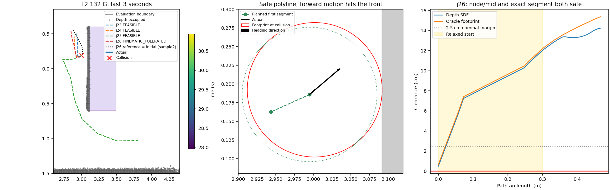
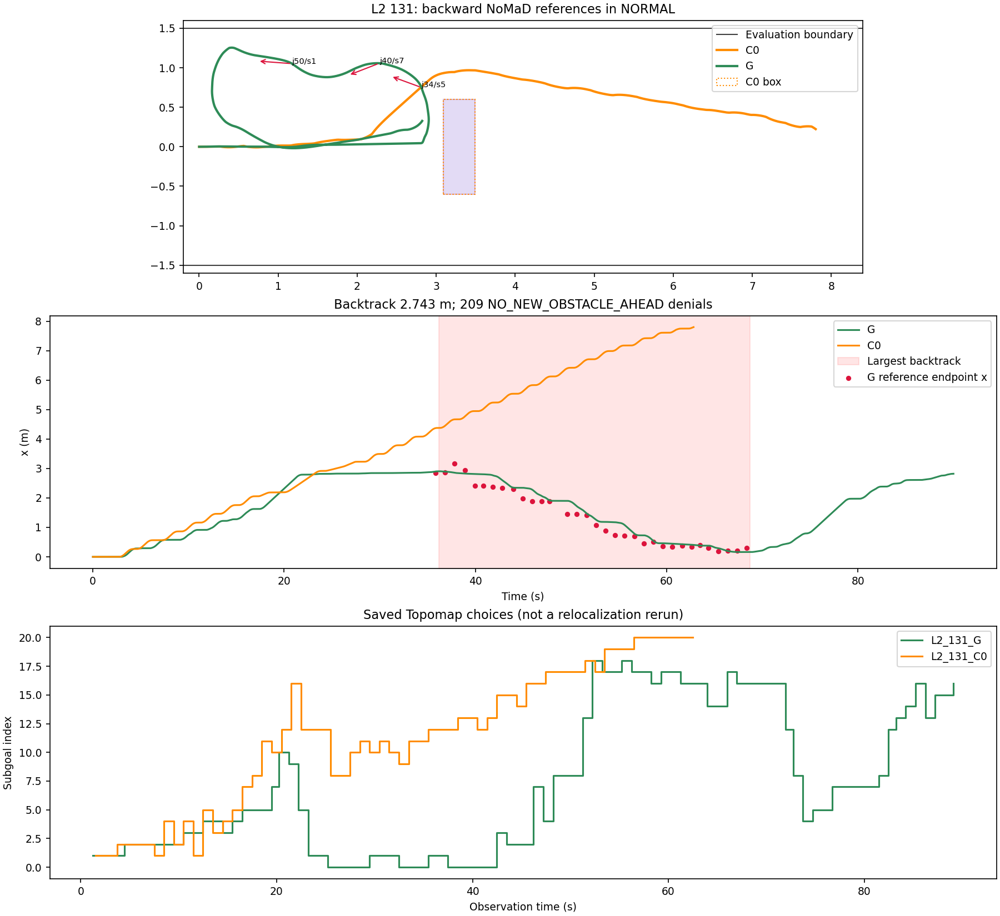
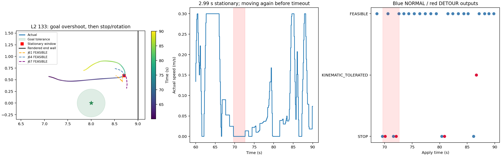
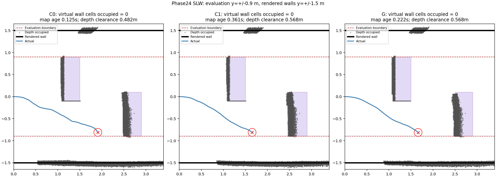

# Phase24 온라인 파일럿 진단

저장된 pose·명령·G job 입력/출력·SDF·USD만 분석했다. 새 주행, 렌더, NoMaD 추론, Graph 풀이, rollout, 튜닝은 **0회**다. 방법·판정 함수·기존 결과는 수정하지 않았다. 아래 원인 판정은 사후 진단이며, 정책을 바꿨을 때의 인과효과를 재실험한 결과가 아니다.

| 대상 | 진단 |
|---|---|
| L2_132_G | **OTHER**: 시작 구간 여유 완화 + 뒤쪽 첫 chord를 양의 속도 PP로 실행하면서 충돌 |
| L2_131_G | NORMAL에서 NoMaD/Topomap의 뒤쪽 참조를 따라 역주행; B 트리거는 새 장애물 부재로 차단 |
| L2_133_G | 목표를 지난 위치에서 NORMAL 운동학 실패와 DETOUR 실패·제자리 회전이 반복. 영구 정지는 아니며 이후 다시 이동했지만 goal tolerance 밖에서 timeout |
| Phase24 SLW | **SCENE_BOUNDARY_NOT_PERCEIVABLE**: 평가 경계±0.9m는 가상 경계, 렌더 벽은±1.5m |

## 1. L2_132_G 충돌

충돌은 30.944444s, pose [3.001901, 0.192206, 0.7725]에서 발생했다. 아래 표는 직전3초와 그 구간 시작에 이미 실행 중이던 job23을 포함한다. 참조·초기값은 저장된8samples, job의 예측 B, OLD, SDF에 **동결된 준비 함수만** 적용하여 복원했다. 최적화는 하지 않았고, 실제 APPLY 경로는 저장 solver message와 정확히 대조했다.

| job | t | mode | output | selected_sample | all_unsafe | reference_endpoint | initialization | starts | depth_node_mid_min_m | oracle_node_mid_min_m | oracle_segment_min_m | depth_start_margin_m | map_frame | map_age_at_dispatch_s | prediction_error_m | prediction_yaw_error_deg |
| --- | --- | --- | --- | --- | --- | --- | --- | --- | --- | --- | --- | --- | --- | --- | --- | --- |
| 23 | 27.611 | NORMAL | FEASIBLE | 1 | True | [2.9931, 0.4988] | REFERENCE | ['REFERENCE', 'OLD_REMAINDER'] | 0.045384 | 0.051161 | 0.051161 | 0.025 | 105 | 0.375 | 0 | 0 |
| 24 | 28.611 | NORMAL | FEASIBLE | 4 | False | [2.935, 0.4654] | REFERENCE | ['REFERENCE', 'OLD_REMAINDER'] | 0.034041 | 0.035801 | 0.035801 | 0.025 | 109 | 0.36111 | 0 | 0 |
| 25 | 29.611 | DETOUR | FEASIBLE | — | — | — | FAN_-90 | ['FAN_0', 'FAN_30', 'FAN_-30', 'FAN_60', 'FAN_-60', 'FAN_90', 'FAN_-90'] | 0.006412 | 0.008171 | 0.008171 | 0.001412 | 113 | 0.375 | 0 | 0 |
| 26 | 30.722 | NORMAL | KINEMATIC_TOLERATED | 2 | True | [2.8741, 0.559] | REFERENCE | ['REFERENCE'] | 0.004983 | 0.006742 | 0.006742 | 0 | 118 | 0.23611 | 0 | 0 |

j25는29.611s에 적용되었고29.667s에 NO_NEW_OBSTACLE_AHEAD로 우회가 끝났다. 선택 component의 t_new는19.486s라10초 새 장애물 창이29.486s에 끝났다(즉 적용 전에 만료). 이후 실행기는 STOP 상태로 넘어갔으며,30.722s에 j26이 NORMAL/KINEMATIC_TOLERATED로 적용됐다. j26은 REFERENCE 초기값(sample2)에서 나온 해다. 이 FRESH의8개 native suffix는 모두 unsafe였으며, 등록된 규칙에 따라 전체 후보 중 FRESHEST인 sample2를 참조로 사용했다.

G가 읽은 것은 **base V1 SDF**다. unknown은 점유가 아니며,20F의0.5mshadow reset은 지도에 포함되지만 R3용 unknown/recency 차단 EDT는 G에 전달하지 않는다. g_jobs snapshot은 values/occupied/observed만 저장하며 최근 free 시각 배열도 없다. 따라서 G의 NORMAL/DETOUR 양쪽 계획 지도는 C0/C1의 R3 지도와 다르다.

j26의 node/midpoint depth 최소는 4.983mm, 기존 depth exact_clearance(점유 셀 중심 기준)는 5.070mm다. Oracle node/midpoint 및 **연속 선분** 최소는 모두 6.742mm로 양수다. 시작 B의 depth clearance가5mm보다 작아 첫0.30m의 hard margin은 **0mm**로 완화됐다. unknown 경로 점 비율은0%다.

반면 실제 궤적 최소 oracle clearance는 -0.142mm, 경로 대비 최대 cross-track은 9.316mm다. 첫 선분 길이는 0.056599m, dt는 0.999993s이며, chord가 현재 heading과 163.987° 어긋난다(전방 투영 -0.054403m). 저장된 실행 명령은 양의 v=0.056599m/s, omega=0.400rad/s였다.

G는 선분 길이/dt를 양의 속도로 정의하고 비홀로노믹·뒤쪽 이동 정합은 soft residual로만 둔다. 이 해의 첫 선분 속도는0.056599m/s라 회전 구간 기준(v<0.01)에 해당하지 않는다. 따라서 실행기는 뒤쪽 chord를 즉시 따라가는 대신 현재 heading으로 전진하면서 회전했다. 이것이 안전한 polyline과 실제 footprint 충돌의 차이를 설명한다. 마지막 출력의 tolerated 표식 자체는 사실이지만, 작은 속도 초과(약0.2%)가 충돌을 일으켰다는 반사실 근거는 없다.

| candidate | assessment | evidence |
| --- | --- | --- |
| MAP_OPTIMISTIC | NOT_SUPPORTED | j26 depth min4.983mm < oracle6.742mm; unknown fraction0 |
| SEGMENT_CHECK | NOT_SUPPORTED | node/midpoint and continuous oracle minima both+6.742mm |
| TOLERATED_OUTPUT | PRESENT; causal attribution NOT_ESTABLISHED | vmax0.300598 vs0.3; actual v0.056599,omega0.4. Obstacle hard condition still satisfied. |
| PREDICTION_ERROR | NOT_SUPPORTED | All last3s outputs: position/yaw prediction errors0 |
| OTHER | SUPPORTED | Relaxed start margin0 + backward first chord164deg + forward-only PP execution:9.316mm cross-track exceeds6.742mm path margin |

## 2. L2_131_G 역주행

가장 큰 역주행 구간은 36.208–68.722s: x=2.905→0.162m, 감소량 2.743m다. 구간 시작의 활성 경로를 포함한 NORMAL33개 중27개의 참조 끝점이 B보다 −x쪽이다. 실행 제어 로그는 NORMAL281회, DETOUR12회이며, NO_NEW_OBSTACLE_AHEAD로 B 조건이209회 차단됐다.

39.944s의 sample5,40.833s의 sample1,41.833s·42.833s의 sample2는 native 끝점부터 뒤쪽을 가리키며, 이때 closest/subgoal은 모두0이다. 즉 이 구간에서 G가 따르는 원래 NoMaD/Topomap 참조 자체가 출발 쪽이다. 짧은 OLD 보충만으로 생긴 방향이라는 해석은 이 사례들에 맞지 않는다.

앞서 B 트리거가 사용한 component의 t_new는19.486s이고 새 장애물 창은29.486s까지다. 역주행 시작36.208s에는 이 창을 이미 지났다. NO_NEW_OBSTACLE_AHEAD는 실제 상자가 사라졌다는 뜻이 아니라,10초 창과 앞쪽 직사각형을 만족하는 새 component가 없다는 뜻이다.

NORMAL_NO_OUTPUT으로 들어간 우회는47.722,52.611,67.389s의3회이고, 각 해는 적용 직후 PATH_BECAME_UNSAFE로 종료됐다. 저장된 native 참조와 모드별 결과 전체는 아래 표/CSV에 있다.

| job | t | mode | output | selected_sample | closest | subgoal | reference_dx | path_dx | initialization |
| --- | --- | --- | --- | --- | --- | --- | --- | --- | --- |
| 30 | 35.833 | NORMAL | KINEMATIC_TOLERATED | 3 | 0 | 0 | -0.050967 | -0.036465 | OLD_REMAINDER |
| 31 | 36.833 | NORMAL | FEASIBLE | 6 | 1 | 1 | -0.022858 | 0.081987 | SAFE_0 |
| 32 | 37.833 | NORMAL | FEASIBLE | 0 | 1 | 1 | 0.3033 | 0.08658 | REFERENCE |
| 33 | 38.944 | NORMAL | FEASIBLE | 2 | 0 | 0 | 0.11607 | 0.082103 | REFERENCE |
| 34 | 39.944 | NORMAL | FEASIBLE | 5 | 0 | 0 | -0.38985 | -0.38841 | SAFE_6 |
| 35 | 40.833 | NORMAL | FEASIBLE | 1 | 0 | 0 | -0.38148 | -0.37988 | SAFE_5 |
| 36 | 41.833 | NORMAL | FEASIBLE | 2 | 0 | 0 | -0.39409 | -0.39271 | REFERENCE |
| 37 | 42.833 | NORMAL | FEASIBLE | 2 | 0 | 0 | -0.25101 | -0.24939 | REFERENCE |
| 38 | 43.944 | NORMAL | FEASIBLE | 3 | 3 | 3 | -0.051514 | -0.047671 | OLD_REMAINDER |
| 39 | 44.944 | NORMAL | FEASIBLE | 1 | 2 | 2 | -0.36336 | -0.36732 | REFERENCE |
| 40 | 45.944 | NORMAL | FEASIBLE | 7 | 2 | 2 | -0.39615 | -0.39695 | SAFE_5 |
| 41 | 46.944 | NORMAL | FEASIBLE | 6 | 2 | 2 | -0.17198 | -0.17465 | REFERENCE |
| 42 | 47.722 | NORMAL | STOP | 4 | 7 | 7 | -0.036299 | — | — |
| 43 | 48.222 | DETOUR | KINEMATIC_TOLERATED | — | 7 | 7 | — | 1.3193 | FAN_-90 |
| 44 | 49.611 | NORMAL | FEASIBLE | 5 | 8 | 8 | -0.45034 | -0.45118 | REFERENCE |
| 45 | 50.611 | NORMAL | FEASIBLE | 1 | 8 | 8 | -0.27344 | -0.27433 | SAFE_6 |
| 46 | 51.611 | NORMAL | KINEMATIC_TOLERATED | 0 | 8 | 8 | -0.068833 | -0.071168 | SAFE_1 |
| 47 | 52.611 | NORMAL | STOP | 5 | 13 | 13 | -0.1891 | — | — |
| 48 | 53.111 | DETOUR | FEASIBLE | — | 13 | 13 | — | 1.3378 | FAN_-30 |
| 49 | 53.611 | NORMAL | FEASIBLE | 6 | 18 | 18 | -0.30726 | -0.30582 | SAFE_0 |
| 50 | 54.611 | NORMAL | FEASIBLE | 1 | 17 | 17 | -0.43701 | -0.43574 | REFERENCE |
| 51 | 55.611 | NORMAL | FEASIBLE | 0 | 17 | 17 | -0.35463 | -0.35291 | REFERENCE |
| 52 | 56.611 | NORMAL | KINEMATIC_TOLERATED | 0 | 18 | 18 | -0.088173 | -0.075346 | SAFE_2 |
| 53 | 57.611 | NORMAL | FEASIBLE | 4 | 17 | 17 | -0.27761 | -0.27724 | REFERENCE |
| 54 | 58.611 | NORMAL | FEASIBLE | 5 | 17 | 17 | -0.033198 | -0.087119 | OLD_REMAINDER |
| 55 | 59.611 | NORMAL | FEASIBLE | 7 | 16 | 16 | -0.10761 | -0.11355 | SAFE_1 |
| 56 | 60.611 | NORMAL | FEASIBLE | 5 | 17 | 17 | -0.10426 | -0.10424 | SAFE_4 |
| 57 | 61.611 | NORMAL | FEASIBLE | 0 | 17 | 17 | -0.054613 | -0.06495 | REFERENCE |
| 58 | 62.611 | NORMAL | FEASIBLE | 7 | 16 | 16 | -0.063994 | -0.070475 | SAFE_6 |
| 59 | 63.5 | NORMAL | FEASIBLE | 7 | 16 | 16 | 0.008592 | -0.085093 | OLD_REMAINDER |
| 60 | 64.389 | NORMAL | FEASIBLE | 3 | 16 | 16 | -0.083034 | -0.12715 | OLD_REMAINDER |
| 61 | 65.389 | NORMAL | FEASIBLE | 4 | 14 | 14 | -0.10624 | -0.10917 | REFERENCE |
| 62 | 66.389 | NORMAL | FEASIBLE | 6 | 14 | 14 | 0.009595 | 0.009351 | REFERENCE |
| 63 | 67.389 | NORMAL | STOP | 5 | 17 | 17 | 0.043486 | — | — |
| 64 | 67.889 | DETOUR | FEASIBLE | — | 17 | 17 | — | 1.8871 | FAN_-60 |
| 65 | 68.389 | NORMAL | FEASIBLE | 2 | 16 | 16 | 0.14389 | 0.13761 | SAFE_1 |

같은 seed의 C0는19.444s에 B 트리거,20.000s에 우회 적용,23.333s에 NO_NEW_OBSTACLE_AHEAD로 정상 주행에 복귀했다. 상자 통과는 생성 후 14.472s, 목표 도착은 62.819s다. G는 상자를 통과하지 못했다. 같은 seed라도 폐루프 궤적·RGB 입력은 달라지므로 이 비교를 동일 관측에 대한 planner 단독 인과효과로 해석하지 않는다.

## 3. L2_133_G 목표 근처 정지

연속 |v|<0.01m/s 정지는 69.681–72.667s(2.986s), pose≈[8.7048, 0.5884, 0.5454]에서 확인된다. 해당 제어 구간의 원인은 {'STOP': 17, 'GRAPH_ROTATION': 9, 'PP_GRAPH_SPEED': 1}다.

| job | t | mode | output | selected_sample | closest | subgoal | reference_endpoint | active_obstacle | active_speed | active_omega | active_dt |
| --- | --- | --- | --- | --- | --- | --- | --- | --- | --- | --- | --- |
| 61 | 68.611 | NORMAL | FEASIBLE | 5 | 20 | 20 | [8.5045, 0.5699] | 0 | 1 | 10 | 4 |
| 62 | 69.611 | NORMAL | STOP | 6 | 20 | 20 | [8.6604, 0.4643] | — | — | — | — |
| 63 | 70.111 | DETOUR | STOP | — | 20 | 20 | — | — | — | — | — |
| 64 | 70.611 | NORMAL | FEASIBLE | 1 | 20 | 20 | [8.4935, 0.7256] | 0 | 1 | 10 | 5 |
| 65 | 71.611 | NORMAL | STOP | 0 | 20 | 20 | [8.6958, 0.6174] | — | — | — | — |
| 66 | 72.111 | DETOUR | STOP | — | 20 | 20 | — | — | — | — | — |
| 67 | 72.611 | NORMAL | FEASIBLE | 0 | 16 | 16 | [8.7926, 0.3359] | 0 | 0 | 7 | 7 |
| 68 | 73.5 | NORMAL | FEASIBLE | 6 | 13 | 13 | [8.4461, 0.7495] | 0 | 5 | 10 | 4 |

STOP에는 수락된 해가 없으므로 아래는 **초기값별 마지막으로 저장된 iterate**의 제약 상태다. active=여유절댓값≤1e−5, violated=여유<−1e−7이며 active와 violated는 다르다. kinematic은v/omega hard 제약의 합계이며 STOP 로그에서는 둘을 개별 분리할 수 없다. soft 가속도 항은 이 hard 제약 개수에 포함되지 않는다. 기록되지 않은 상태를0으로 대체하지 않았다.

| job | mode | initialization | active_obstacle | violated_obstacle | active_kinematic | violated_kinematic | active_dt_bound | message |
| --- | --- | --- | --- | --- | --- | --- | --- | --- |
| 62 | NORMAL | REFERENCE | 0 | 0 | 0 | 3 | 2 | Iteration limit reached |
| 62 | NORMAL | OLD_REMAINDER | 0 | 0 | 0 | 2 | 0 | Iteration limit reached |
| 62 | NORMAL | SAFE_0 | 0 | 0 | 0 | 6 | 0 | Iteration limit reached |
| 62 | NORMAL | SAFE_7 | 0 | 0 | 0 | 3 | 0 | Iteration limit reached |
| 63 | DETOUR | FAN_0 | 0 | 6 | 0 | 10 | 0 | Positive directional derivative for linesearch |
| 63 | DETOUR | FAN_30 | 0 | 18 | 0 | 9 | 0 | Positive directional derivative for linesearch |
| 63 | DETOUR | FAN_-30 | 0 | 14 | 0 | 11 | 0 | Positive directional derivative for linesearch |
| 63 | DETOUR | FAN_60 | 0 | 13 | 0 | 10 | 0 | Inequality constraints incompatible |
| 63 | DETOUR | FAN_-60 | 0 | 9 | 0 | 11 | 0 | Positive directional derivative for linesearch |
| 63 | DETOUR | FAN_90 | 0 | 2 | 0 | 18 | 0 | Positive directional derivative for linesearch |
| 63 | DETOUR | FAN_-90 | 0 | 1 | 11 | 3 | 3 | Iteration limit reached |
| 65 | NORMAL | REFERENCE | 0 | 0 | 0 | 4 | 0 | Iteration limit reached |
| 65 | NORMAL | OLD_REMAINDER | 0 | 0 | 0 | 1 | 0 | Iteration limit reached |
| 65 | NORMAL | SAFE_1 | 0 | 0 | 0 | 4 | 1 | Iteration limit reached |
| 65 | NORMAL | SAFE_2 | 0 | 0 | 0 | 6 | 0 | Iteration limit reached |
| 66 | DETOUR | FAN_0 | 0 | 4 | 0 | 8 | 0 | Positive directional derivative for linesearch |
| 66 | DETOUR | FAN_30 | 0 | 16 | 0 | 9 | 0 | Inequality constraints incompatible |
| 66 | DETOUR | FAN_-30 | 0 | 19 | 0 | 11 | 0 | Inequality constraints incompatible |
| 66 | DETOUR | FAN_60 | 0 | 4 | 0 | 13 | 0 | Positive directional derivative for linesearch |
| 66 | DETOUR | FAN_-60 | 0 | 14 | 0 | 12 | 0 | Positive directional derivative for linesearch |
| 66 | DETOUR | FAN_90 | 0 | 3 | 0 | 11 | 0 | More than 3*n iterations in LSQ subproblem |
| 66 | DETOUR | FAN_-90 | 1 | 1 | 7 | 2 | 0 | Iteration limit reached |

NORMAL j62/j65는 모든 초기값에서 장애물 active/violation이0이지만 운동학 위반이 남고100회 반복 한도에 도달했다. 따라서 이 두 STOP의 직접적인 출력 실패는 운동학 쪽이다. 뒤이은 DETOUR j63/j66은 장애물과 운동학 위반이 함께 남는다. component가 없는 우회는 승인된 start→current 방향을 사용하며, 이 위치는 이미 goal x=8m를 지나 렌더 end wall x=9m 앞이다.

중간 FEASIBLE j64는 omega10개·dt5개가 활성이고 회전 실행이 정지 시간에 포함된다. 이후 다시 이동했으므로90초 내내 붙박이로 정지한 것은 아니다. 최종 명령은 [0.07362, 0.117566] (PP_GRAPH_SPEED), 최종 goal 거리는 0.717m로 tolerance0.3m 밖이다. 마지막 j87은 NORMAL/FEASIBLE이며 장애물 활성0, 속도7·omega9개 활성이다. 초기 정지와 최종 timeout을 구분해야 한다.

## 4. SLW 경계 검증

Phase24의12개 저장 scene.usda 모두 LeftWall center y=1.55, thickness0.1, RightWall center y=−1.55다. 실제 안쪽 면은±1.5m다. 반면 scenario.json의 half_width는0.9이며, footprint 정지는 |y|+0.09≥0.9에서 발생한다. ±0.9에 연속 렌더 벽은 없다. 따라서 Phase24 SLW를 **SCENE_BOUNDARY_NOT_PERCEIVABLE**로 표시한다. 기존 CORRIDOR 결과12건과 원 report의 라벨은 기록에 유지한다. 이 장면 결과로 알고리즘 간 안전 우열을 판단할 수 없다.

실패 x위치의 가상 벽 주변(x±0.10m,y±0.03m)에서 보존 지도 모두 점유0칸·observed100%였다. 실제 정지 pose의 depth clearance는0.482–0.579m인데 oracle 가상 벽 clearance는음수다.8/12는 정지 순간 최신 발행 snapshot을 직접 확인했다.4/12는 저장 축소 때문에 해당 최신 프레임이 없어서 마지막 보존 pre-failure map을 사용했으며, 아래 exact=False와 나이를 명시했다. 그4건의 정지 tick 최신 지도 점유를 직접 확인했다고 주장하지 않는다. 렌더 geometry 결함은12개 USD에서 별도로 확정된다.

| run | time_s | x | y | virtual_wall_y | rendered_wall_y | boundary_occupied_cells | boundary_observed_fraction | depth_clearance_at_stop_m | oracle_wall_clearance_m | exact_latest_published_at_failure | age_s |
| --- | --- | --- | --- | --- | --- | --- | --- | --- | --- | --- | --- |
| SLW_131_C0 | 22.611 | 1.9085 | -0.81165 | -0.9 | -1.5 | 0 | 1 | 0.48151 | -0.001649 | True | 0.125 |
| SLW_131_C1 | 17.347 | 1.6521 | -0.81152 | -0.9 | -1.5 | 0 | 1 | 0.56848 | -0.001521 | True | 0.36111 |
| SLW_131_G | 16.708 | 1.6613 | -0.81252 | -0.9 | -1.5 | 0 | 1 | 0.56754 | -0.002521 | True | 0.22222 |
| SLW_132_C0 | 16.736 | 1.7042 | -0.81012 | -0.9 | -1.5 | 0 | 1 | 0.5704 | -0.000121 | True | 0.25 |
| SLW_132_C1 | 15.986 | 1.5982 | -0.81103 | -0.9 | -1.5 | 0 | 1 | 0.56898 | -0.001032 | True | 0.25 |
| SLW_132_G | 13.111 | 1.6964 | -0.81153 | -0.9 | -1.5 | 0 | 1 | 0.56671 | -0.001534 | False | 0.875 |
| SLW_133_C0 | 24.056 | 1.8792 | -0.81037 | -0.9 | -1.5 | 0 | 1 | 0.51079 | -0.000373 | False | 0.56944 |
| SLW_133_C1 | 36.681 | 2.2989 | 0.81053 | 0.9 | 1.5 | 0 | 1 | 0.57947 | -0.000526 | True | 0.19444 |
| SLW_133_G | 19.375 | 1.8694 | -0.81051 | -0.9 | -1.5 | 0 | 1 | 0.52064 | -0.000514 | True | 0.13889 |
| SLW_134_C0 | 20.056 | 1.7605 | -0.8108 | -0.9 | -1.5 | 0 | 1 | 0.56927 | -0.000801 | False | 0.55556 |
| SLW_134_C1 | 18.264 | 1.6555 | -0.81084 | -0.9 | -1.5 | 0 | 1 | 0.5692 | -0.000838 | False | 0.77778 |
| SLW_134_G | 14.847 | 1.6763 | -0.81166 | -0.9 | -1.5 | 0 | 1 | 0.56879 | -0.001655 | True | 0.36111 |

Phase24 wrapper는 Phase21 renderer의 base.build_scene을 직접 사용한다. 이 함수는 벽 y를±1.55로 고정하며 config.corridor.half_width를 반영하지 않는다. Phase16·17은 그 뒤 set_box로 벽을 실제 장면 경계에 맞추고, Phase18은 Phase17 renderer를 재사용한다. 저장 USD 확인 결과는 다음과 같다. Phase16에는 SLW가 없으므로 그 전신인 SL gate2건을 확인했다.

| phase | runs | rendered_matches |
| --- | --- | --- |
| Phase16_SL_gate | 2 | 2 |
| phase17_SLW | 35 | 35 |
| phase18_SLW | 48 | 48 |

Phase16 SL2/2, Phase17 SLW35/35, Phase18 SLW48/48에서 실제 벽 면이 평가 경계±0.9m와 일치한다. 따라서 동일 문제가 Phase16–18에도 있었다는 근거는 없으며, 확인한 저장 run에서는 이 불일치가 없다. 개별 USD hash는 prior_boundaries.csv에 남겼다.

## 5. 우회 지도·안전 검사 비교

| 항목 | G | C0 (Phase21 M3) | C1 (Phase21 B4 A*) |
|---|---|---|---|
| 공통 depth 원본 | V1 log-odds, noise .01d², .5mshadow reset, exact odometry | 동일 | 동일 |
| 평소 native 선택 | base V1, unknown free. 안전 후보 없으면 전체 FRESHEST를 G참조로 허용 | base V1 SAFE; 모두 위험하면 R2→R3 | base V1 SAFE; 모두 위험하면 A*repair→A*detour |
| R2 자리 | 없음 | base V1, unknown free, 시작.3m완화 및 정확 certificate | base V1, unknown free인 repair 자리; 정확 certificate |
| 우회 계획 지도 | **base V1만**, unknown free; recency 차단 없음 | 첫.3m base; 이후 occupied/unknown/last-free>2s를 막힌 셀로 합친 EDT | C0의 R3와 같은 base/strict 분할 |
| 계획 안전 샘플 | 11nodes+10midpoints. 연속 certificate 없음, h/√2 보정 없음 | 구간당9점; h/√2+L/16여유; 연속 정확 거리 certificate | 8연결 grid·코너절단 금지, LOS/후처리 뒤 sample slack 및 연속 정확 certificate |
| 시작 완화 | raw d(B)로 min(.025,max(0,d(B)−.005)) | d(B)−h/√2 기준; 음수 B는 거부 | C0와 같은 보수적 B 기준 |
| 출력 수락 | FEASIBLE 또는 F2완전만족+운동학10%허용; NORMAL에는 별도 exact검증 없음 | R3 solver/제약/certificate 통과 | 탐색/후처리 certificate 통과 |
| 적용 후 최신 depth 재검사 | **DETOUR에만** frozen20F certificate(시작완화+far unknown/recency blocked),9Hz. NORMAL에는 이 검사가 없음 | 우회 수락·실행 중 같은 최신 certificate | C0와 동일 |
| 실행 | PP방향+graph속도, graph회전 구간. 비홀로노믹 정합은 soft | PP+SP+출발 정렬 | PP+SP+출발 정렬 |
| 평가용 가상 경계 입력 | 없음 | 없음 | 없음 |

G의 우회 **계획 지도와 실행 중 certificate 지도가 서로 다르다**. 이 때문에 base-map feasible 경로가 적용 직후 PATH_BECAME_UNSAFE로 종료될 수 있으며 L2_131_G에서 실제로3회 관찰됐다. 다만 L2_132_G의 최종 충돌은 NORMAL 경로이고 unknown0%, 계획 polyline은 oracle상 안전했으므로 그 충돌을 unknown 처리 차이로 단정하지 않는다.

## 근거와 한계

- 원본 결과: `artifacts/isaac6/phase24_pilot_01/main`, 각 run의 g_events.jsonl/g_commands.jsonl/g_jobs, agent_trajectory.csv, depth, scene.usda, summary.json. 본 진단은 별도 phase24_diagnosis 폴더에만 산출한다.
- [G factor/참조 준비](../research/nomad_phase24/graph.py), [node/midpoint 제약](../research/nomad_phase23/graph.py#L88), [G 실행/모드 전환](../research/nomad_phase24/live.py), [G 입력 지도 저장](../research/nomad_phase24/online_worker.py).
- [strict recency map과 certificate](../research/nomad_phase20d/recent.py), [R3 base/strict 분할](../research/nomad_phase20c/detour_known.py), [A* 입력 지도 선택](../research/nomad_phase21/pool.py).
- [고정 폭 base renderer](../research/nomad_isaac/simulator.py#L109), [Phase17 벽 재배치](../research/nomad_phase17/simulator.py#L36), [Phase18 renderer 재사용](../research/nomad_phase18/simulator.py), [Phase24 renderer wrapper](../research/nomad_phase24/online_simulator.py).
- planned path의 oracle 최소는 기존 exact segment/AABB 함수(회전 box는 기존 rigid transform)를 재사용했다. 실제 충돌 수치는 기존 swept evaluator 저장값이다. 초기값·참조 복원은 deterministic preparation이며 새 solve가 아니다.
- 수락된 해의 활성 제약은 저장 pose/dt와 SDF로 계산했고, STOP의 활성/위반은 마지막 저장 worker message를 사용했다. snapshot timestamp와 그림용 경로 사이 미래 정보는 planner에 재입력하지 않았다.
- 수정안 구현, 재실행, 새 튜닝 또는 새 rollout은 수행하지 않았다.
