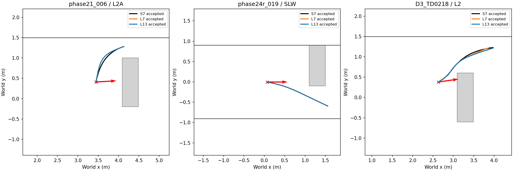
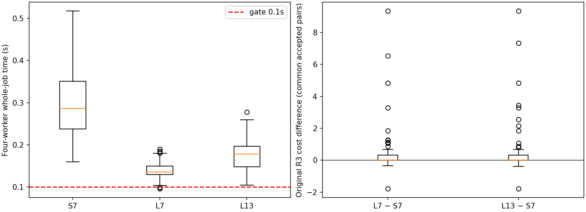

# Phase25 — R3 solver comparison (offline)

| Item | S7 SLSQP | L7 / L13 Levenberg–Marquardt |
|---|---|---|
| Variables | Fixed B +10 future xy points:20 variables | Identical |
| Original cost | One half sum of squared progress, smoothness, clearance and weak start-heading residuals | Identical residuals, including the frozen weak heading term |
| Constraint handling | Hard inequalities, redundant disk-implied coordinate bounds | Positive-part penalty residuals; s=0.01→0.001→0.0001, warm-start each stage |
| Obstacle solve samples | Frozen9points/segment with h/√2+L/16 | Requested11nodes+10midpoints, footprint distance minus threshold; final acceptance uses the full S7 rule |
| Solve | Analytic SLSQP, maxiter100, ftol1e−8 | Analytic scipy least_squares(method='lm'); max_nfev50 per stage, ftol/xtol/gtol1e−8 |
| Initializations | 0,±30,±60,±90degrees | L7 identical; L13 adds ±15,±45,±75degrees |
| Acceptance | Solver success, original hard violation≤1e−7, exact certificate, progress≥0.5m, whole job≤1s | Same final criteria, including the Phase24-R continuous certificate |
| Selection | Largest u_ref progress, then shorter length, then initializer index | Identical |

R3 has only20 variables: a dense Jacobian is sufficient, so sparsity offers little gain here. Any speed difference is principally from the nonlinear least-squares solver/linear algebra and its continuation, not from introducing a sparse graph implementation.

Original residuals: progress max(0,1.2−(p10−B)·u)/0.10; second differences/0.03; clearance max(0,0.15−d)/0.05 at90points; weak start heading 2sin((heading(p1−B)−yaw_B)/2)/(π/6). LM adds obstacle max(0,threshold−d)/s, curvature max(0,|κ|−4)/s, lower/upper segment-length violations of[0.10,0.20]/s and radius excess beyond1.6/s. The first0.3m uses the frozen threshold min(0.025,max(0,d(B)−h/√2−0.005)); base/strict map membership and threshold derivatives use the same piecewise convention as S7. Strict cells include occupied, unknown and free evidence older than2s. No map, decision, execution, R2 repair or prior phase source was modified. A* is not used.

The API's max_nfev50 is a conservative function-evaluation cap for each LM stage, not an invented SLSQP iteration count. Actual nfev/njev/status are saved per stage. All penalties are fixed, with no data-driven adjustment. Out-of-grid or numerical errors are recorded as failed starts, without adding a new objective extension.

## Data and measurement rules

129 unique inputs: {'phase21': 8, 'phase24r': 89, 'phase24r2': 16, 'phase23o3_pre16': 16}. All saved C0 R3 transports and the fixed pre-passage16 are included. Snapshot hashes and three representative IDs were frozen before solving; originals are read-only. Protocol SHA256 `6d861dcad17416b64be1929384543be14495b601dcb3eb42aa62c79cd6baa9a7`. Offline settings commit `8aca3ac6f79d8be50520fdc56233c6be510baa44` plus the subsequent freeze commit.

Time is saved-input loading + strict EDT/cache creation + four-worker dispatch/loading + all7or13solves + final certificates/selection. Pool startup is excluded; per-start wall times and preprocessing are also saved. Every variant reloads its fields, and variant order rotates evenly over the129inputs. Whole-job wall time is reported uncapped; results finishing after1s are not selected. The0.1s gate applies to the whole-job p95, not a favorable single start. No online contention or inference was simulated.

Depth clearance is each selected path’s minimum exact base/strict footprint clearance; its median is over accepted paths, with the count shown. Cost differences exclude penalty costs and use only common accepted snapshot pairs. Same-side rate uses common accepted paths with both sides defined, with its denominator shown. Pre-passage counts exclude already-passed/pre-spawn inputs and require oracle box/wall-safe passage. Oracle is evaluation-only. The dedicated16-input subgroup is separately reported. These are path-level offline comparisons, not new navigation outcomes.

Five unit tests passed, including the complete170×20 analytic Jacobian versus Richardson-extrapolated central differences (absolute tolerance1e−5), original-cost/constraint equality, fixed continuation, rejection of a colliding output and the registered gate/selection boundary.

## Registered gates

| variant | label | adoption | timing | passage | clearance |
| --- | --- | --- | --- | --- | --- |
| L7 | NO_GO | False | False | False | True |
| L13 | NO_GO | True | False | False | True |

**NO_GO**; selected variant: `None`. Acceptance≥S7−5percentage points; whole-job p95≤0.1s; pre-passage passage plans≥S7; depth clearance median≥S7−0.01m. Among passing variants the higher passage count wins; ties chooseL7.

## Results

| variant | n | accepted | adoption_rate | compute_p50_s | compute_p95_s | compute_max_s | timeout_1s | pre_passage_n | passage_plans | clearance_min_m | clearance_median_m | curvature_rms_median | curvature_max | progress_median_m |
| --- | --- | --- | --- | --- | --- | --- | --- | --- | --- | --- | --- | --- | --- | --- |
| S7 | 129 | 70 | 0.54264 | 0.28649 | 0.46754 | 0.51743 | 0 | 41 | 13 | 0.038063 | 0.10779 | 0.64687 | 4 | 1.1478 |
| L7 | 129 | 62 | 0.48062 | 0.13503 | 0.17738 | 0.19005 | 0 | 41 | 11 | 0.038155 | 0.10845 | 0.55153 | 4 | 1.1577 |
| L13 | 129 | 64 | 0.49612 | 0.17767 | 0.23702 | 0.27755 | 0 | 41 | 12 | 0.046346 | 0.10794 | 0.61818 | 4 | 1.1667 |

### Common pairs

| variant | common_accepted | defined_sides | same_side | same_side_fraction | cost_delta_median |
| --- | --- | --- | --- | --- | --- |
| L7 | 61 | 45 | 45 | 1 | -1.7328e-11 |
| L13 | 62 | 46 | 46 | 1 | 3.578e-05 |

### Source cohorts

| source | variant | n | accepted | adoption_rate | compute_p50_s | compute_p95_s | compute_max_s | timeout_1s | pre_passage_n | passage_plans | clearance_min_m | clearance_median_m | curvature_rms_median | curvature_max | progress_median_m |
| --- | --- | --- | --- | --- | --- | --- | --- | --- | --- | --- | --- | --- | --- | --- | --- |
| phase21 | S7 | 8 | 7 | 0.875 | 0.24986 | 0.29162 | 0.29862 | 0 | 7 | 3 | 0.09 | 0.12454 | 0.53813 | 2.3413 | 1.1509 |
| phase21 | L7 | 8 | 7 | 0.875 | 0.13789 | 0.16142 | 0.16493 | 0 | 7 | 3 | 0.060004 | 0.12551 | 0.53607 | 2.7333 | 1.1509 |
| phase21 | L13 | 8 | 7 | 0.875 | 0.19445 | 0.22069 | 0.22918 | 0 | 7 | 3 | 0.060004 | 0.12551 | 0.53607 | 2.7333 | 1.1509 |
| phase24r | S7 | 89 | 38 | 0.42697 | 0.30975 | 0.46754 | 0.51743 | 0 | 7 | 3 | 0.044897 | 0.10266 | 0.65354 | 4 | 0.94383 |
| phase24r | L7 | 89 | 31 | 0.34831 | 0.13503 | 0.17985 | 0.19005 | 0 | 7 | 2 | 0.047607 | 0.10798 | 0.54985 | 4 | 1.0733 |
| phase24r | L13 | 89 | 31 | 0.34831 | 0.18019 | 0.24119 | 0.27755 | 0 | 7 | 3 | 0.046346 | 0.10798 | 0.65203 | 4 | 1.1291 |
| phase24r2 | S7 | 16 | 14 | 0.875 | 0.24821 | 0.3332 | 0.35038 | 0 | 11 | 4 | 0.042254 | 0.11718 | 0.45767 | 3.2488 | 1.1924 |
| phase24r2 | L7 | 16 | 13 | 0.8125 | 0.12665 | 0.14549 | 0.14893 | 0 | 11 | 3 | 0.060821 | 0.12215 | 0.32202 | 1.1719 | 1.1906 |
| phase24r2 | L13 | 16 | 13 | 0.8125 | 0.14583 | 0.18177 | 0.19326 | 0 | 11 | 3 | 0.052474 | 0.12215 | 0.32202 | 1.2792 | 1.1943 |
| phase23o3_pre16 | S7 | 16 | 11 | 0.6875 | 0.29897 | 0.49067 | 0.50147 | 0 | 16 | 3 | 0.038063 | 0.10179 | 0.79373 | 2.8259 | 1.1613 |
| phase23o3_pre16 | L7 | 16 | 11 | 0.6875 | 0.13877 | 0.16152 | 0.17321 | 0 | 16 | 3 | 0.038155 | 0.10531 | 0.91503 | 3.0317 | 1.1516 |
| phase23o3_pre16 | L13 | 16 | 13 | 0.8125 | 0.17741 | 0.20793 | 0.20877 | 0 | 16 | 3 | 0.04899 | 0.1 | 0.92318 | 2.981 | 1.1568 |

### Failure flags (multiple per start allowed)

| variant | reason | count | total_initializations |
| --- | --- | --- | --- |
| S7 | CERTIFICATE_NINE_POINT_MARGIN | 510 | 903 |
| S7 | CURVATURE | 392 | 903 |
| S7 | INSUFFICIENT_PROGRESS | 189 | 903 |
| S7 | NONCONVERGED | 618 | 903 |
| S7 | OBSTACLE | 510 | 903 |
| S7 | RADIUS | 53 | 903 |
| S7 | SPACING | 395 | 903 |
| L7 | CERTIFICATE_NINE_POINT_MARGIN | 370 | 903 |
| L7 | CURVATURE | 173 | 903 |
| L7 | INSUFFICIENT_PROGRESS | 80 | 903 |
| L7 | NONCONVERGED | 180 | 903 |
| L7 | OBSTACLE | 370 | 903 |
| L7 | RADIUS | 35 | 903 |
| L7 | SDF_OR_NUMERICAL_ERROR | 263 | 903 |
| L7 | SPACING | 294 | 903 |
| L13 | CERTIFICATE_NINE_POINT_MARGIN | 695 | 1677 |
| L13 | CURVATURE | 340 | 1677 |
| L13 | INSUFFICIENT_PROGRESS | 126 | 1677 |
| L13 | NONCONVERGED | 360 | 1677 |
| L13 | OBSTACLE | 695 | 1677 |
| L13 | RADIUS | 65 | 1677 |
| L13 | SDF_OR_NUMERICAL_ERROR | 452 | 1677 |
| L13 | SPACING | 587 | 1677 |

Both LM variants failed the registered gate. Online preparation, smoke and main navigation were not run. No constants were changed after seeing these results.
