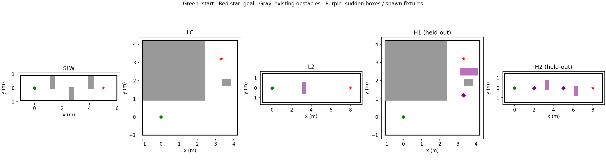
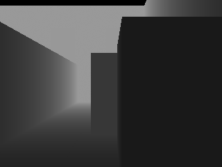
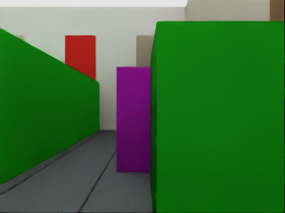
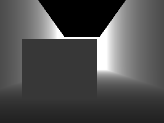
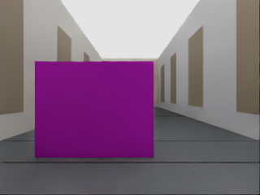
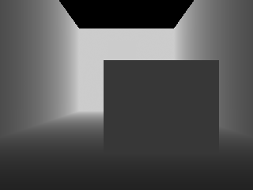
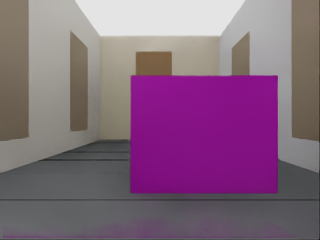

# Phase26 — preregistered pilot preflight

**Preparation only. Main seed201–202 runs have not started.** Source baseline: Phase24-R2 C0, frozen hashes in protocol.json. Protocol SHA256 `36b4d61b0ff3162a2369559e11bc3141f8061f10b20c8da8b47eead515266157`. All previous code/results/raw are preserved.

## Methods

| Method | Normal handoff | Blocked response |
|---|---|---|
| B0 NOMAD_RAW | sample0, common PP/SP/start alignment; no depth/filter | No fallback or RECOVER_ROTATE; reference only |
| B1 SAFE_TE | Phase18 handoff rules via Phase21; depth SAFE, K3 TE/expiry/KEEP, SP/alignment from latest selected chunk | Frozen fallback/RECOVER_ROTATE; no detour |
| B2 SAFE_RTC | Phase18 RTC-hard/DDPM and SAFE through Phase21; common PP/SP/start alignment | Frozen fallback/RECOVER_ROTATE; no detour |
| B3 SAFE_ROTATE | FRESHEST-SAFE/common executor | Frozen fallback/RECOVER_ROTATE; no R2/R3 |
| B4 ASTAR | Same as C0 | C0 R2 SLSQP unchanged; only R3 replaced by Phase21 A*, lambda4.0, smoothing0 |
| C0 | Phase24-R2 C0 unchanged | R2 SLSQP→R3 SLSQP seven starts; conservative map, continuous certificate, frozen24-R trigger/direction/handover/recovery |

All use RGB+the reused scene Topomap, D750, PP lookahead0.25, Phase18D SP, start alignment,9Hz control/72Hz integration/nominal4Hz observations,90s simulation cap. NoMaD metric scaling remains unchanged. B1/B2 are **Phase18 handoff rules + common PP/SP executor**. Depth V1/shadow/recency/persistent-component behavior is identical for B1–B4/C0; B0 has no depth annotator or map. Simulator odometry is exact. Oracle enters placement/render/evaluation only; planner inputs remain depth snapshots/pose/samples. R3's frozen implementation actually has20XY variables; the historical SE(2) wording does not authorize a model change. SaferPath is excluded.

## Scenes and held-out definitions

SLW and LC reuse Phase18 JSON/reference/Topomap hashes; L2 reuses the Phase24-R2 definition. All four USD wall inner faces must equal each scene's evaluation rectangle before navigation, including LC's asymmetric y bounds.

H1: LC corner exit is y=0.9, spawn at y∈[1.2,1.3]. The fixed route axis is+y. The box has world x/y/z size1.0/0.4/0.8m, cross-axis center x3.6, with a1.0m gap between the robot's forward footprint support and the near box face (the existing L2 placement convention). Initial depth fixture center is(3.6,2.49). Existing LC obstacles stay present. The wide gap is0.7m. **H1 is explicitly a u_ref limitation test**, not a tuned scene.

H2: x∈[2.0,2.1] spawns a0.4×1.0×0.8m box at y+0.3; after footprint passage of it, x∈[5.0,5.1] spawns the second at y−0.3. The same1m front clearance convention is used. Both boxes stay rendered and monitored; the second never replaces the first in collision evaluation. Scene passage requires both, with per-box times also retained. Geometry-only testing used neither policy nor inference. No position adjustment was needed.

## Registered pilot decisions and missing data

Six methods×five scenes×paired seeds201–202=60runs. Fixed seed-first scene/method order is stored in protocol.json (permutation seed20261105). One identical-seed retry is allowed only after technical failure; remaining runs continue. If a primary method fails again, that complete scene×seed primary group is excluded. B0 failures do not affect primary groups. Attempt data are preserved; no outcome-based retry or tuning.

Sudden pooled L2/H1/H2: C0_BETTER_vs_B1/B2/B3 iff goal successes≥comparator+2 and collisions≤comparator. Against ASTAR, the literal registered goal≥B4+2 clause gives BETTER first; otherwise goal≥B4−1 AND collision≤B4 gives NONINFERIOR; otherwise WORSE. Collisions are also reported separately; no extra collision condition is added to the written BETTER clause. Static SLW/LC: STATIC_OK iff C0goal≥B3−1 and C0collisions≤B3. PILOT_SUPPORTS requires all three better flags, ASTAR not WORSE and STATIC_OK; PILOT_AGAINST when B3better fails and ASTAR is WORSE; otherwise PILOT_MIXED, listing satisfied/missed criteria. The thresholds do not change after technical exclusions. Effective paired n and scene results are explicit. Exact sign p is descriptive only. B0 has no decision role.

Primary endpoint is goal entry. Secondary endpoints: box/wall geometric collisions separately, goal time, per-box and scene passage/time, minimum footprint clearance, omega saturation, actual stopped fraction, recovery count, detour triggers/application delay and solve p95. Margin-only corridor stops remain separately visible. Missing passage time is not imputed. After SUPPORTS/MIXED, the report adds only a draft seeds203–208 confirmation plan; no expansion runs are launched.

## Verification

8unit tests pass: H1/H2 placement/sequence, persistent two-box evaluation, wall refusal, exact C0-L2 configuration regression, B4's R2 passthrough, label/exclusion functions and a fake60-row report. The15requested seed95smokes are excluded and interpreted only technically. The table deliberately omits navigation outcomes.

| scene | method | technical_validation | command_pose_error_m | wall_geometry_error_m | launcher_wall_s | attempt_count | output |
| --- | --- | --- | --- | --- | --- | --- | --- |
| H1 | B0_NOMAD_RAW | PASS | 0 | 7.4506e-10 | 146.12 | 1 | /home/gpuadmin/Workspace/NoMaD/artifacts/isaac6/phase26_smoke_01/main/H1_095_B0_NOMAD_RAW/attempt1 |
| H1 | B1_SAFE_TE | PASS | 0 | 7.4506e-10 | 169.73 | 2 | /home/gpuadmin/Workspace/NoMaD/artifacts/isaac6/phase26_smoke_01/main/H1_095_B1_SAFE_TE/attempt2 |
| H1 | B2_SAFE_RTC | PASS | 0 | 7.4506e-10 | 176.46 | 1 | /home/gpuadmin/Workspace/NoMaD/artifacts/isaac6/phase26_smoke_01/main/H1_095_B2_SAFE_RTC/attempt1 |
| H1 | B3_SAFE_ROTATE | PASS | 0 | 7.4506e-10 | 168.95 | 1 | /home/gpuadmin/Workspace/NoMaD/artifacts/isaac6/phase26_smoke_01/main/H1_095_B3_SAFE_ROTATE/attempt1 |
| H1 | B4_ASTAR | PASS | 0 | 7.4506e-10 | 167.12 | 1 | /home/gpuadmin/Workspace/NoMaD/artifacts/isaac6/phase26_smoke_01/main/H1_095_B4_ASTAR/attempt1 |
| H1 | C0 | PASS | 0 | 7.4506e-10 | 181.11 | 1 | /home/gpuadmin/Workspace/NoMaD/artifacts/isaac6/phase26_smoke_01/main/H1_095_C0/attempt1 |
| H2 | B0_NOMAD_RAW | PASS | 0 | 7.4506e-10 | 144.22 | 1 | /home/gpuadmin/Workspace/NoMaD/artifacts/isaac6/phase26_smoke_01/main/H2_095_B0_NOMAD_RAW/attempt1 |
| H2 | B1_SAFE_TE | PASS | 0 | 7.4506e-10 | 197.29 | 1 | /home/gpuadmin/Workspace/NoMaD/artifacts/isaac6/phase26_smoke_01/main/H2_095_B1_SAFE_TE/attempt1 |
| H2 | B2_SAFE_RTC | PASS | 0 | 7.4506e-10 | 208.47 | 1 | /home/gpuadmin/Workspace/NoMaD/artifacts/isaac6/phase26_smoke_01/main/H2_095_B2_SAFE_RTC/attempt1 |
| H2 | B3_SAFE_ROTATE | PASS | 0 | 7.4506e-10 | 193.01 | 1 | /home/gpuadmin/Workspace/NoMaD/artifacts/isaac6/phase26_smoke_01/main/H2_095_B3_SAFE_ROTATE/attempt1 |
| H2 | B4_ASTAR | PASS | 0 | 7.4506e-10 | 204.56 | 1 | /home/gpuadmin/Workspace/NoMaD/artifacts/isaac6/phase26_smoke_01/main/H2_095_B4_ASTAR/attempt1 |
| H2 | C0 | PASS | 0 | 7.4506e-10 | 210.85 | 1 | /home/gpuadmin/Workspace/NoMaD/artifacts/isaac6/phase26_smoke_01/main/H2_095_C0/attempt1 |
| L2 | C0 | PASS | 0 | 7.4506e-10 | 207.49 | 1 | /home/gpuadmin/Workspace/NoMaD/artifacts/isaac6/phase26_smoke_01/main/L2_095_C0/attempt1 |
| LC | C0 | PASS | 0 | 7.4506e-10 | 213.8 | 1 | /home/gpuadmin/Workspace/NoMaD/artifacts/isaac6/phase26_smoke_01/main/LC_095_C0/attempt1 |
| SLW | C0 | PASS | 0 | 7.4506e-10 | 217.22 | 1 | /home/gpuadmin/Workspace/NoMaD/artifacts/isaac6/phase26_smoke_01/main/SLW_095_C0/attempt1 |

Both held-out geometry checks passed with no adjustment. See the RGB/depth images below. Wall checks and command→72Hz pose checks passed in every smoke. The second H2 box is explicitly verified in the depth-only fixture and unit test; no performance assumption is made about whether a policy reaches its trigger in a smoke.

## Time, storage and operational safety

Estimated60-run time including15%allowance and5min report: **3.70hours**. A conservative all-runs-need-retry bound is **7.39hours**. This is measured launcher wall time, using same scene/method smoke when available and the slower same-method held-out smoke otherwise.

Estimated normal remaining data: **144.45GB**; with20GBheadroom: **164.45GB**; available at freeze: **222.61GB**. Full RGB/depth is retained only for seed201 in each scene; seed202 retains trajectories/metrics/FRESH+visualization maps/planner inputs, using the7d823b7 archival policy. Capture, inference and live map behavior are unchanged. Disk is checked before every attempt, including retries; insufficient space stops before launch. Atomic state/backup and resume retain completed attempts. Short socket paths are prechecked for all120possible attempts; maximum 98bytes.

Main execution is user initiated, locked and resumable. Report generation uses /usr/bin/python3 with PYTHONPATH=research, then commits/pushes new results. No venv packages were installed. No method is run on a new seed in preflight.

## Preserved preparation failures

| scene | method | attempt | cause | preserved_output |
| --- | --- | --- | --- | --- |
| H1 | B1_SAFE_TE | 1 | KeyError('avoidance_success') | /home/gpuadmin/Workspace/NoMaD/artifacts/isaac6/phase26_smoke_01/main/H1_095_B1_SAFE_TE/attempt1 |

The new multi-box evaluation adapter initially omitted the protected driver’s `avoidance_success` summary field. Only that return schema was corrected, its regression assertion was added, and the same dev seed was retried once. No planner/controller/factor/threshold or scene position was changed in response to a navigation outcome. All failed attempt directories remain intact.

