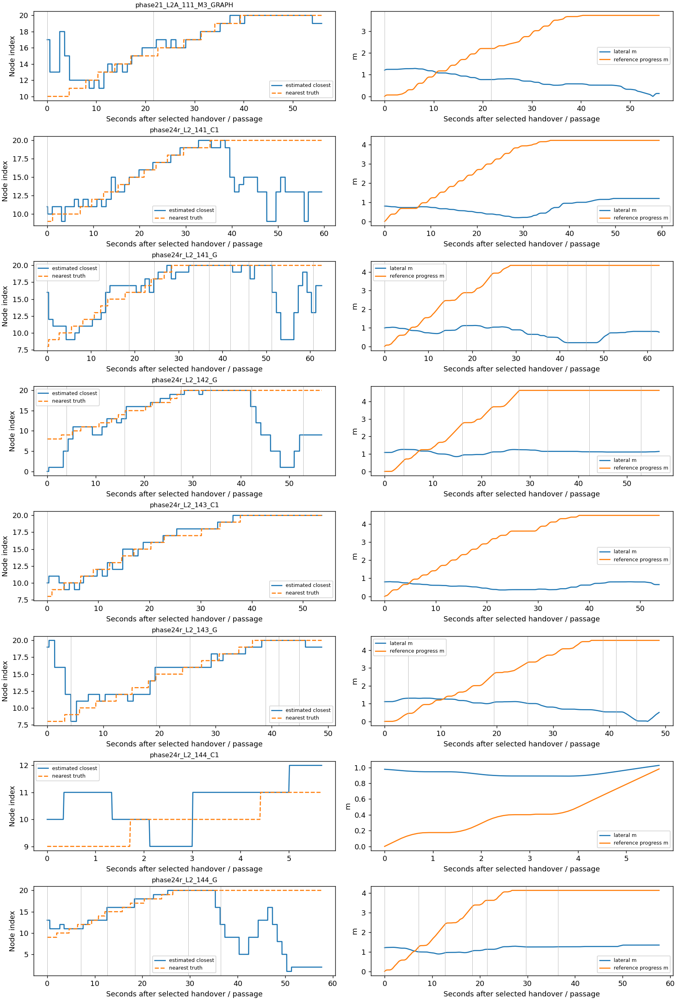
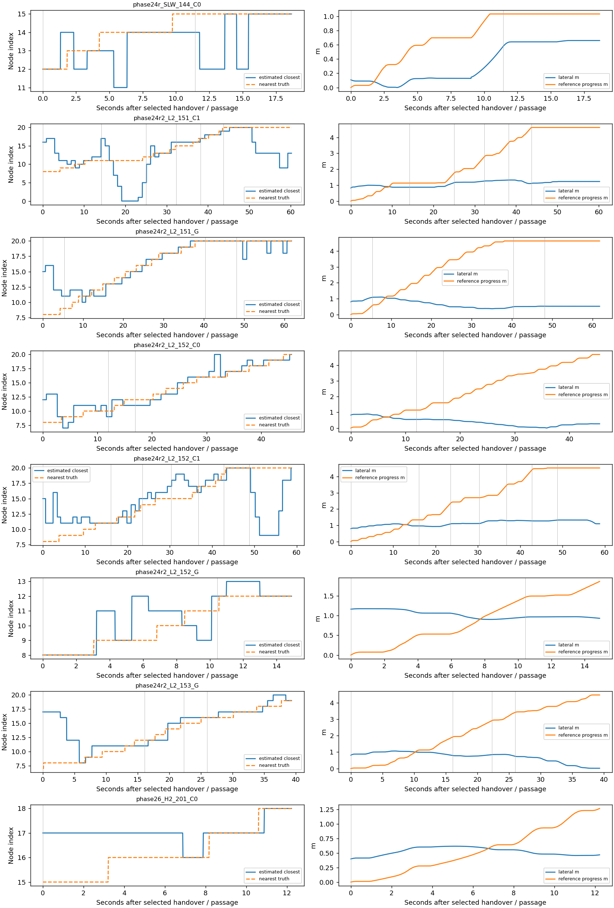
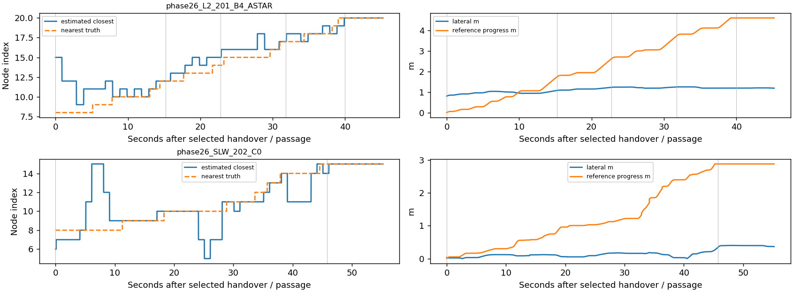
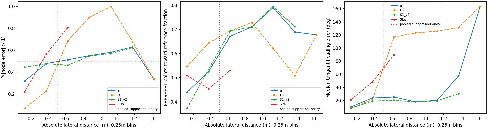
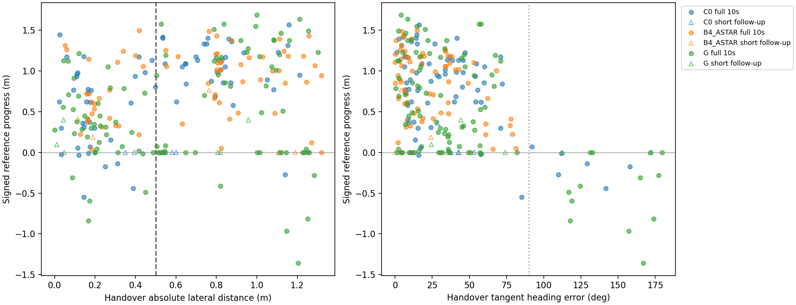

# Phase27-D — 복귀 실패 진단 (저장 로그 전용)

> **범위에 따라 결론이 달라진다.** 전체(정적 checkpoint proxy 포함)는 NOT_RETURN_BOTTLENECK이지만, 돌발 장면만 보면 RETURN_BOTTLENECK이다. 전체 라벨을 복귀 문제가 없다는 결론으로 확대하지 않는다.

**NOT_RETURN_BOTTLENECK**. 우회 적용 후 실패 35run 중 PASSED_THEN_FAIL 18run (51.4%). 지지 범위 안/밖 handover의 최종 goal 비율은 각각 0.19444444444444445, 0.29285714285714287이다. 두 조건은 True, False.

## 범위·측정 정의

새 주행·Isaac·NoMaD 추론·Graph solve·튜닝 없이 기존 raw만 사용했다. 저장소 코드와 기존 결과는 수정하지 않았다. 임시 `/tmp/phase27d_report.py`를 `/usr/bin/python3`, `PYTHONPATH=research`로 실행했다. 스크립트 hash와 모든 읽은 파일 hash는 provenance.json/measurement_rules.json에 있다. 완료된 main의 최종 선택 attempt만 사용하며 smoke/실패 retry는 중복하지 않는다.

전체 144run: {'phase21': 48, 'phase24r': 24, 'phase24r2': 12, 'phase26': 60}. 72Hz 모든 적분 스텝(정지 포함)을 사용했다. 세 Topomap 모두 world_pose가 있어 B1 궤적 fallback은 필요하지 않았다.

방법 이름은 Phase21 M3_GRAPH→C0, Phase24-R/R2 C1→B4_ASTAR로 대응시켰다. Phase21/24의 A*는 R2 자리도 A*이지만 Phase26 B4는 R3만 A*이며, G는 R와 R2에서 endpoint-return 항이 다르다. 버전은 원본 그대로 두고 phase별 표를 주 표로 제공한다. 합산은 설명용이지 동일 방법의 독립 재현 실험이 아니다.

기준 경로는 촬영 world_pose XY를 잇는 polyline이다. 횡거리는 최근접 선분의 normal 성분으로 계산하여 **경로 끝을 지나친 종방향 거리**를 횡거리로 오인하지 않는다. heading은 선분 tangent와의 절대각 차이며, 가장 가까운 이미지의 촬영 yaw 오차도 steps에 보존했다. 정답 node는 원래 모든 촬영 위치 중 Euclidean 최근접 node(동률은 낮은 index)이다.

주 node 오류는 **±1 허용 범위 밖, |추정−정답|>1**이다. 문구를 최소1개 어긋남으로 읽는 |오차|≥1 결과도 병기하고 재판정했다. 추정 closest는 FRESH application 시각부터 다음 결과까지 보유한다. 따라서 주 곡선은 인지 오류뿐 아니라 수신 지연·상태 보유를 포함하는 운영적 지지 범위다. 관측 pose A에 맞춘 별도 결과는 support_observation_aligned.csv에 있다. 첫 결과 전 node는 미상이다.

각 스텝의 FRESHEST는 그때까지 받은 최신8개 native sample에서 현재 pose 투영 이후 잔여 길이가 최대인 것(동률 낮은 index)으로 재계산했다. 안전 필터는 넣지 않았다. 끝점−로봇 벡터가 기준선 쪽 normal과 양의 내적이면 복귀 방향이다. 정확히 기준선 위이거나 끝점 방향이0이면 방향 비율의 분모에서 제외한다. 1초를 넘은 입력도 보유 지표에 포함하되 age와 유효1초 조건부 비율을 별도 저장했다. 새 후보를 생성한 것은 아니다.

## 실패 분해

SUCCESS는 최종 goal 성공이다. applied detour가 있고 통과했지만 미도착이면 PASSED_THEN_FAIL, 통과하지 못했으면 DETOUR_FAIL. 실제 적용은 C0/A* APPLIED 또는 G의 accepted DETOUR APPLY로 판정했다. rejected solve만으로는 적용으로 세지 않았다. NO_DETOUR_FAIL은 적용 없는 실패의 **참고행**이며, 우회 시도/solver 실패가 원인에서 무관하다고 증명하는 명칭은 아니다. 우회 적용 표의 분모에는 들어가지 않는다.

돌발 통과는 저장된 footprint passage이고 H2는 기존 Phase26 지표처럼 두 상자 모두 필요하다. 통과와 종료가 같은 tick이면 복귀 기회가 없으므로 PASSED_THEN_FAIL에 넣지 않는다. 정적 SLW/LC는 사용자가 기존에 정의한 마지막 장애물 checkpoint를 통과 proxy로 썼고 해당 행을 명시했다. 이 proxy가 없는 돌발 분석만의 민감도도 별도로 제시한다.

| phase | scene | method | n | applied_runs | SUCCESS | PASSED_THEN_FAIL | DETOUR_FAIL | NO_DETOUR_FAIL | success_with_detour |
|---|---|---|---|---|---|---|---|---|---|
| phase21 | L2 | C0 | 4 | 3 | 4 | 0 | 0 | 0 | 3 |
| phase21 | L2 | B4_ASTAR | 4 | 3 | 3 | 0 | 0 | 1 | 3 |
| phase21 | L2A | C0 | 4 | 1 | 2 | 1 | 0 | 1 | 0 |
| phase21 | L2A | B4_ASTAR | 4 | 3 | 4 | 0 | 0 | 0 | 3 |
| phase24r | L2 | C0 | 4 | 4 | 4 | 0 | 0 | 0 | 4 |
| phase24r | L2 | B4_ASTAR | 4 | 4 | 1 | 3 | 0 | 0 | 1 |
| phase24r | L2 | G | 4 | 4 | 0 | 4 | 0 | 0 | 0 |
| phase24r | SLW | C0 | 4 | 4 | 0 | 1 | 3 | 0 | 0 |
| phase24r | SLW | B4_ASTAR | 4 | 4 | 1 | 0 | 3 | 0 | 1 |
| phase24r | SLW | G | 4 | 4 | 0 | 0 | 4 | 0 | 0 |
| phase24r2 | L2 | C0 | 4 | 4 | 3 | 1 | 0 | 0 | 3 |
| phase24r2 | L2 | B4_ASTAR | 4 | 4 | 1 | 2 | 1 | 0 | 1 |
| phase24r2 | L2 | G | 4 | 4 | 0 | 3 | 1 | 0 | 0 |
| phase26 | H1 | C0 | 2 | 2 | 2 | 0 | 0 | 0 | 2 |
| phase26 | H1 | B4_ASTAR | 2 | 2 | 2 | 0 | 0 | 0 | 2 |
| phase26 | H2 | C0 | 2 | 2 | 1 | 1 | 0 | 0 | 1 |
| phase26 | H2 | B4_ASTAR | 2 | 2 | 0 | 0 | 2 | 0 | 0 |
| phase26 | L2 | C0 | 2 | 2 | 2 | 0 | 0 | 0 | 2 |
| phase26 | L2 | B4_ASTAR | 2 | 2 | 1 | 1 | 0 | 0 | 1 |
| phase26 | LC | C0 | 2 | 2 | 1 | 0 | 1 | 0 | 1 |
| phase26 | LC | B4_ASTAR | 2 | 1 | 2 | 0 | 0 | 0 | 1 |
| phase26 | SLW | C0 | 2 | 2 | 0 | 1 | 1 | 0 | 0 |
| phase26 | SLW | B4_ASTAR | 2 | 1 | 0 | 0 | 1 | 1 | 0 |

### 방법×장면 합산(버전 혼합, 설명용)

| scene | method | n | applied_runs | SUCCESS | PASSED_THEN_FAIL | DETOUR_FAIL | NO_DETOUR_FAIL |
|---|---|---|---|---|---|---|---|
| H1 | C0 | 2 | 2 | 2 | 0 | 0 | 0 |
| H1 | B4_ASTAR | 2 | 2 | 2 | 0 | 0 | 0 |
| H2 | C0 | 2 | 2 | 1 | 1 | 0 | 0 |
| H2 | B4_ASTAR | 2 | 2 | 0 | 0 | 2 | 0 |
| L2 | C0 | 14 | 13 | 13 | 1 | 0 | 0 |
| L2 | B4_ASTAR | 14 | 13 | 6 | 6 | 1 | 1 |
| L2 | G | 8 | 8 | 0 | 7 | 1 | 0 |
| L2A | C0 | 4 | 1 | 2 | 1 | 0 | 1 |
| L2A | B4_ASTAR | 4 | 3 | 4 | 0 | 0 | 0 |
| LC | C0 | 2 | 2 | 1 | 0 | 1 | 0 |
| LC | B4_ASTAR | 2 | 1 | 2 | 0 | 0 | 0 |
| SLW | C0 | 6 | 6 | 0 | 2 | 4 | 0 |
| SLW | B4_ASTAR | 6 | 5 | 1 | 0 | 4 | 1 |
| SLW | G | 4 | 4 | 0 | 0 | 4 | 0 |

## PASSED_THEN_FAIL 이후 경과

run 요약 anchor는 통과 시각 이전의 마지막 실제 handover, 없으면 통과 이후 첫 handover다. 실제 handover가 없으면 값을 비워 둔다. 모든 handover별 값은 handovers.csv에 별도로 있다. 정지 비율은 |v|<0.01인 실제 시간 비율이다. node 정체는 동일 추정 index가5초 이상 유지됐는지이며, 실제 이동 없이 정지한 경우와 localization loss를 혼동하지 않도록 실제 진전≥0.25m를 동반한 정체 flag도 저장했다. 역행은 추정 index 감소 횟수다.

| run_id | passage_type | passage_t_s | handover_anchor_s | remaining_time_s | remaining_distance_m | post_stop_fraction | node_first | node_last | node_net | node_max_hold_s | node_backward_steps | retriggers_after |
|---|---|---|---|---|---|---|---|---|---|---|---|---|
| phase21_L2A_111_M3_GRAPH | DYNAMIC_ALL_BOXES | 41.83 | 34.11 | 55.89 | 4.938 | 0.34 | 17 | 19 | 2 | 13.78 | 11 | 1 |
| phase24r_L2_141_C1 | DYNAMIC_ALL_BOXES | 30.99 | 30.56 | 59.44 | 5.16 | 0.4505 | 11 | 13 | 2 | 4.111 | 14 | 0 |
| phase24r_L2_141_G | DYNAMIC_ALL_BOXES | 29.22 | 27.33 | 62.67 | 6.462 | 0.3989 | 16 | 17 | 1 | 10 | 13 | 10 |
| phase24r_L2_142_G | DYNAMIC_ALL_BOXES | 36.9 | 33.33 | 56.67 | 5.89 | 0.4451 | 0 | 9 | 9 | 9.889 | 8 | 11 |
| phase24r_L2_143_C1 | DYNAMIC_ALL_BOXES | 38 | 36.33 | 53.67 | 5.34 | 0.381 | 10 | 20 | 10 | 17.33 | 6 | 2 |
| phase24r_L2_143_G | DYNAMIC_ALL_BOXES | 45.22 | 41.11 | 48.89 | 6.57 | 0.2932 | 19 | 19 | 0 | 10 | 7 | 7 |
| phase24r_L2_144_C1 | DYNAMIC_ALL_BOXES | 84.32 | — | — | — | — | — | — | — | — | — | — |
| phase24r_L2_144_G | DYNAMIC_ALL_BOXES | 32.44 | 32.33 | 57.67 | 4.961 | 0.5183 | 13 | 2 | -11 | 10 | 10 | 17 |
| phase24r_SLW_144_C0 | STATIC_LAST_OBSTACLE_CHECKPOINT_PROXY | 77.67 | 71.33 | 18.67 | 1.63 | 0.5357 | 12 | 15 | 3 | 5.444 | 4 | 3 |
| phase24r2_L2_151_C1 | DYNAMIC_ALL_BOXES | 35.56 | 29.78 | 60.22 | 5.252 | 0.5129 | 16 | 13 | -3 | 7 | 13 | 9 |
| phase24r2_L2_151_G | DYNAMIC_ALL_BOXES | 33.32 | 28.22 | 61.78 | 5.89 | 0.4676 | 15 | 20 | 5 | 13 | 7 | 7 |
| phase24r2_L2_152_C0 | DYNAMIC_ALL_BOXES | 49.56 | 44.44 | 45.56 | 4.977 | 0.3659 | 12 | 20 | 8 | 5 | 7 | 2 |
| phase24r2_L2_152_C1 | DYNAMIC_ALL_BOXES | 37.31 | 31.22 | 58.78 | 5.754 | 0.4669 | 15 | 20 | 5 | 6.778 | 15 | 8 |
| phase24r2_L2_152_G | DYNAMIC_ALL_BOXES | 78.88 | 75.11 | 14.89 | 1.922 | 0.2985 | 8 | 12 | 4 | 3.222 | 5 | 2 |
| phase24r2_L2_153_G | DYNAMIC_ALL_BOXES | 58.12 | 50.67 | 39.33 | 4.897 | 0.2938 | 17 | 19 | 2 | 8.889 | 4 | 3 |
| phase26_H2_201_C0 | DYNAMIC_ALL_BOXES | 85.82 | 77.78 | 12.22 | 1.36 | 0.2273 | 17 | 18 | 1 | 6.889 | 1 | 0 |
| phase26_L2_201_B4_ASTAR | DYNAMIC_ALL_BOXES | 50.65 | 44.78 | 45.22 | 5.159 | 0.3882 | 15 | 20 | 5 | 5.333 | 9 | 5 |
| phase26_SLW_202_C0 | STATIC_LAST_OBSTACLE_CHECKPOINT_PROXY | 75.99 | 34.78 | 55.22 | 3.493 | 0.4427 | 6 | 15 | 9 | 9.111 | 7 | 8 |

## 정책 지지 범위

0.25m bin에서 node 오류 비율이 처음50%를 **초과**하는 bin의 하단을 지지 한계로 보고했다. 정확한 경계는 그 bin 폭 안에서 미정이다. 최소 표본 수나 단조성 조건을 사후 추가하지 않았으며, 모든 bin의 스텝 수·run 수를 공개한다. 정지/긴 run이 더 많은 가중치를 갖고 같은 run의 tick은 독립 표본이 아니다. 이 한계는 학습 정책의 보편적 안전 한계가 아니다.

| lower_m | upper_m | n_steps | runs | node_known_steps | node_error_gt1_fraction | node_error_ge1_fraction | freshest_direction_steps | freshest_inward_fraction | heading_median_deg | heading_p95_deg |
|---|---|---|---|---|---|---|---|---|---|---|
| 0 | 0.25 | 423732 | 144 | 394196 | 0.3166 | 0.6068 | 392945 | 0.4392 | 10.22 | 96.41 |
| 0.25 | 0.5 | 170226 | 131 | 170226 | 0.4771 | 0.669 | 170226 | 0.5251 | 23.94 | 156.3 |
| 0.5 | 0.75 | 102491 | 101 | 102491 | 0.5112 | 0.7369 | 102491 | 0.6711 | 25.38 | 167.2 |
| 0.75 | 1 | 66539 | 66 | 66539 | 0.5493 | 0.8274 | 66539 | 0.7104 | 18.03 | 163.1 |
| 1 | 1.25 | 36499 | 37 | 36499 | 0.5808 | 0.796 | 36499 | 0.7905 | 20.4 | 172.1 |
| 1.25 | 1.5 | 8830 | 12 | 8830 | 0.6298 | 0.8564 | 8830 | 0.6892 | 57.56 | 177.3 |
| 1.5 | 1.75 | 1766 | 2 | 1766 | 0.3341 | 0.9796 | 1766 | 0.6772 | 163.3 | 178.7 |

Support limits: `{"primary": {"threshold_m": 0.5, "crossing_bin_upper_m": 0.75, "fraction": 0.5112253758866632, "steps": 102491, "runs": 101}, "ge1": {"threshold_m": 0.0, "crossing_bin_upper_m": 0.25, "fraction": 0.6068377152482521, "steps": 394196, "runs": 144}, "by_map": {"LC": {"threshold_m": 0.5, "crossing_bin_upper_m": 0.75, "fraction": 0.6852010265183918, "steps": 1169, "runs": 3}, "S1_v2": {"threshold_m": 0.75, "crossing_bin_upper_m": 1.0, "fraction": 0.5463075244042928, "steps": 65972, "runs": 64}, "SLW": {"threshold_m": 0.25, "crossing_bin_upper_m": 0.5, "fraction": 0.564270528069873, "steps": 34806, "runs": 21}}}`

## 넘김 상태와 이후10초 진전

실제 적용된 우회가 끝나는 END/MODE_EXIT만 handover다. 적용 전에 거절된 job의 END와 run 종료 시 남은 우회에는 handover를 만들지 않았다. 10초를 채우지 못한 terminal follow-up은 빈 삼각형으로 그리고 관측 길이를 기록했으며 외삽하지 않았다. 진전은 기준 polyline arclength의 signed 변화다. 이후 재발한 trigger도 포함되므로 단독 NoMaD 복귀 효과라고 해석할 수 없다.

| cohort | region | limit_m | handovers | unique_runs | weighted_denominator | weighted_successes | goal_rate |
|---|---|---|---|---|---|---|---|
| ALL | INSIDE | 0.5 | 108 | 44 | 108 | 21 | 0.1944 |
| ALL | OUTSIDE | 0.5 | 140 | 41 | 140 | 41 | 0.2929 |
| RUN_BALANCED | INSIDE | 0.5 | 108 | 44 | 30.28 | 11.67 | 0.3853 |
| RUN_BALANCED | OUTSIDE | 0.5 | 140 | 41 | 31.72 | 16.33 | 0.5149 |
| FIRST | INSIDE | 0.5 | 42 | 42 | 42 | 14 | 0.3333 |
| FIRST | OUTSIDE | 0.5 | 20 | 20 | 20 | 14 | 0.7 |
| LAST | INSIDE | 0.5 | 25 | 25 | 25 | 10 | 0.4 |
| LAST | OUTSIDE | 0.5 | 37 | 37 | 37 | 18 | 0.4865 |

ALL은 handover-event 기준이라 동일 run의 최종 outcome이 반복된다. unique_runs와 run균등 가중, 첫/마지막 handover 기준을 함께 보고했으며 독립 시행으로 취급하지 않았다.

## 판정과 민감도

| label | applied_detour_failures | passed_then_fail | passed_failure_fraction | condition1 | inside_goal_rate | outside_goal_rate | condition2 |
|---|---|---|---|---|---|---|---|
| NOT_RETURN_BOTTLENECK | 35 | 18 | 0.5143 | True | 0.1944 | 0.2929 | False |

| variant | label | passed_failure_fraction | inside_goal_rate | outside_goal_rate | condition1 | condition2 |
|---|---|---|---|---|---|---|
| node_error_ge1_decision | NOT_RETURN_BOTTLENECK | 0.5143 | — | 0.25 | True | False |
| sudden_only | RETURN_BOTTLENECK | 0.8 | 0.3778 | 0.306 | True | True |
| first_handover | NOT_RETURN_BOTTLENECK | 0.5143 | 0.3333 | 0.7 | True | False |
| last_handover | NOT_RETURN_BOTTLENECK | 0.5143 | 0.4 | 0.4865 | True | False |
| run_balanced | NOT_RETURN_BOTTLENECK | 0.5143 | 0.3853 | 0.5149 | True | False |

| category | termination | runs |
|---|---|---|
| PASSED_THEN_FAIL | simulation_timeout | 18 |
| DETOUR_FAIL | simulation_timeout | 17 |

실제 최다 관측 실패 범주는 **PASSED_THEN_FAIL**이며, 그 범주의 가장 많은 종료 원인은 **simulation_timeout** (18run)이다. 이는 기록된 실패 단계/종료 원인에 대한 진단이며, 특정 factor나 localization을 인과적으로 입증하지는 않는다.

비교/판정에 쓰지 않은 추가 정의를 결과에 맞춰 선택하지 않았다. 코드 수정·재실행·새 튜닝은 하지 않았다. 입력 hash를 생성 전후 재검사했다.

## 1순위 관측 실패와 방법/장면 혼합 점검

우회 적용 실패의 최다 범주는 **통과 후 목표 미수렴→90초 timeout,18/35**이다. 통과 전 timeout17건과 거의 같은 규모라 전체 실패를 한 원인으로 단정할 수 없다. PASSED_THEN_FAIL중 실제 handover가 기록된17건에서는 그 뒤 중앙값 55.22초 동안 5.16m를 더 이동했지만 미도착이었다(정지 비율 중앙값 39.9%). node 역행은 17/17, 동일 추정 node5초 이상 정체는 15/17에서 관측됐다. 이후 node 오류>1비율의 run별 중앙값은 23.2%, FRESHEST 복귀 방향 비율 중앙값은 77.0%이다. **운동 자체의 부재보다 목표/경로 진행 유지 실패가 우선 진단 대상**이라는 로그 근거이며, 어느 graph 항이나 지각 모듈이 원인인지는 이 관측만으로 확정하지 않는다.

실제 handover 없이 우회 실행 중 끝난 PASSED_THEN_FAIL: phase24r_L2_144_C1. 이 run에는 post-handover 시간을 만들어 넣지 않았다.

| run_id | phase | scene | method | remaining_time_s | remaining_distance_m | stop_fraction | node_error_gt1_fraction | freshest_inward_fraction | reference_net_progress_m | minimum_goal_distance_m | final_goal_distance_m | node_backward_steps | node_max_hold_s | retriggers |
|---|---|---|---|---|---|---|---|---|---|---|---|---|---|---|
| phase21_L2A_111_M3_GRAPH | phase21 | L2A | C0 | 55.89 | 4.938 | 0.34 | 0.1051 | 0.8236 | 3.737 | 0.3076 | 0.3296 | 11 | 13.78 | 1 |
| phase24r_L2_141_C1 | phase24r | L2 | B4_ASTAR | 59.44 | 5.16 | 0.4505 | 0.377 | 0.6576 | 4.221 | 0.5604 | 1.197 | 14 | 4.111 | 0 |
| phase24r_L2_141_G | phase24r | L2 | G | 62.67 | 6.462 | 0.3989 | 0.3264 | 0.77 | 4.36 | 0.4164 | 0.9335 | 13 | 10 | 10 |
| phase24r_L2_142_G | phase24r | L2 | G | 56.67 | 5.89 | 0.4451 | 0.3913 | 0.7194 | 4.638 | 1.154 | 1.367 | 8 | 9.889 | 11 |
| phase24r_L2_143_C1 | phase24r | L2 | B4_ASTAR | 53.67 | 5.34 | 0.381 | 0.04735 | 0.7071 | 4.469 | 0.6387 | 0.7247 | 6 | 17.33 | 2 |
| phase24r_L2_143_G | phase24r | L2 | G | 48.89 | 6.57 | 0.2932 | 0.1386 | 0.7611 | 4.555 | 0.5945 | 0.7356 | 7 | 10 | 7 |
| phase24r_L2_144_G | phase24r | L2 | G | 57.67 | 4.961 | 0.5183 | 0.445 | 0.72 | 4.143 | 1.265 | 1.351 | 10 | 10 | 17 |
| phase24r_SLW_144_C0 | phase24r | SLW | C0 | 18.67 | 1.63 | 0.5357 | 0.229 | 0.8602 | 1.033 | 0.4938 | 0.6986 | 4 | 5.444 | 3 |
| phase24r2_L2_151_C1 | phase24r2 | L2 | B4_ASTAR | 60.22 | 5.252 | 0.5129 | 0.4854 | 0.7736 | 4.626 | 1.144 | 1.232 | 13 | 7 | 9 |
| phase24r2_L2_151_G | phase24r2 | L2 | G | 61.78 | 5.89 | 0.4676 | 0.2045 | 0.6637 | 4.632 | 0.4256 | 0.9367 | 7 | 13 | 7 |
| phase24r2_L2_152_C0 | phase24r2 | L2 | C0 | 45.56 | 4.977 | 0.3659 | 0.16 | 0.8522 | 4.684 | 0.3723 | 0.3723 | 7 | 5 | 2 |
| phase24r2_L2_152_C1 | phase24r2 | L2 | B4_ASTAR | 58.78 | 5.754 | 0.4669 | 0.4985 | 0.8148 | 4.533 | 1.234 | 1.234 | 15 | 6.778 | 8 |
| phase24r2_L2_152_G | phase24r2 | L2 | G | 14.89 | 1.922 | 0.2985 | 0.2349 | 0.9664 | 1.86 | 3.156 | 3.156 | 5 | 3.222 | 2 |
| phase24r2_L2_153_G | phase24r2 | L2 | G | 39.33 | 4.897 | 0.2938 | 0.2323 | 0.7815 | 4.469 | 0.5434 | 0.5434 | 4 | 8.889 | 3 |
| phase26_H2_201_C0 | phase26 | H2 | C0 | 12.22 | 1.36 | 0.2273 | 0.2633 | 0.5085 | 1.265 | 0.9308 | 0.9308 | 1 | 6.889 | 0 |
| phase26_L2_201_B4_ASTAR | phase26 | L2 | B4_ASTAR | 45.22 | 5.159 | 0.3882 | 0.2223 | 0.8824 | 4.599 | 1.19 | 1.193 | 9 | 5.333 | 5 |
| phase26_SLW_202_C0 | phase26 | SLW | C0 | 55.22 | 3.493 | 0.4427 | 0.2193 | 0.6598 | 2.882 | 0.4092 | 0.4178 | 7 | 9.111 | 8 |

| stratum | cohort | region | limit_m | handovers | unique_runs | weighted_denominator | weighted_successes | goal_rate |
|---|---|---|---|---|---|---|---|---|
| ALL | ALL | INSIDE | 0.5 | 108 | 44 | 108 | 21 | 0.1944 |
| ALL | ALL | OUTSIDE | 0.5 | 140 | 41 | 140 | 41 | 0.2929 |
| METHOD_C0 | ALL | INSIDE | 0.5 | 38 | 17 | 38 | 10 | 0.2632 |
| METHOD_C0 | ALL | OUTSIDE | 0.5 | 37 | 17 | 37 | 29 | 0.7838 |
| METHOD_B4_ASTAR | ALL | INSIDE | 0.5 | 27 | 15 | 27 | 11 | 0.4074 |
| METHOD_B4_ASTAR | ALL | OUTSIDE | 0.5 | 44 | 13 | 44 | 12 | 0.2727 |
| METHOD_G | ALL | INSIDE | 0.5 | 43 | 12 | 43 | 0 | 0 |
| METHOD_G | ALL | OUTSIDE | 0.5 | 59 | 11 | 59 | 0 | 0 |
| SCENE_H1 | ALL | INSIDE | 0.5 | 6 | 4 | 6 | 6 | 1 |
| SCENE_H1 | ALL | OUTSIDE | 0.5 | 0 | 0 | 0 | 0 | — |
| SCENE_H2 | ALL | INSIDE | 0.5 | 7 | 3 | 7 | 0 | 0 |
| SCENE_H2 | ALL | OUTSIDE | 0.5 | 14 | 3 | 14 | 4 | 0.2857 |
| SCENE_L2 | ALL | INSIDE | 0.5 | 29 | 17 | 29 | 8 | 0.2759 |
| SCENE_L2 | ALL | OUTSIDE | 0.5 | 118 | 32 | 118 | 37 | 0.3136 |
| SCENE_L2A | ALL | INSIDE | 0.5 | 3 | 3 | 3 | 3 | 1 |
| SCENE_L2A | ALL | OUTSIDE | 0.5 | 2 | 1 | 2 | 0 | 0 |
| SCENE_LC | ALL | INSIDE | 0.5 | 2 | 2 | 2 | 1 | 0.5 |
| SCENE_LC | ALL | OUTSIDE | 0.5 | 1 | 1 | 1 | 0 | 0 |
| SCENE_SLW | ALL | INSIDE | 0.5 | 61 | 15 | 61 | 3 | 0.04918 |
| SCENE_SLW | ALL | OUTSIDE | 0.5 | 5 | 4 | 5 | 0 | 0 |

전체248handover 중 실행시간0인 handover는 1개이고, 종료까지10초를 채우지 못한 것은 18개다. 첫/마지막 handover와 run균등 분석에서도 전체 판정은 NOT_RETURN_BOTTLENECK이다. 반면 돌발만의 적용 실패는16/20(80%)가 통과 후 미도착이고, inside17/45(37.8%) vs outside41/134(30.6%)라 두 조건을 모두 만족한다. 정적 실패/방법 구성과 반복 handover의 차이가 합산 도착률에 섞여 있으므로 층별 표를 함께 해석해야 한다.

## Heading과10초 진전의 관측 관계

| heading_band_deg | full10s_handovers | unique_runs | median_progress_m | nonpositive_progress_count | nonpositive_progress_fraction |
|---|---|---|---|---|---|
| 0–30 | 123 | 49 | 0.8924 | 10 | 0.0813 |
| 30–60 | 68 | 43 | 0.8535 | 8 | 0.1176 |
| 60–90 | 20 | 17 | 0.4836 | 2 | 0.1 |
| 90–180 | 19 | 6 | -0.2828 | 18 | 0.9474 |

완전한10초 추적만 사용하면 heading오차90°이상인19handover 중18개(94.7%)는 진전이0이하였고, 진전 중앙값은−0.283m였다. 0–30° 구간123개에서는 중앙값+0.892m, 비양의 진전은10개(8.1%)였다. 이는 횡거리 한계만으로 설명되지 않는 방향 정합 문제의 관측 근거다. 같은 run의 반복 event이고 방향이 반대면 signed진전이 작아지는 기하학적 관계도 있으므로, 독립 인과 검정이나 새 방법의 성능 증거로 취급하지 않는다.
