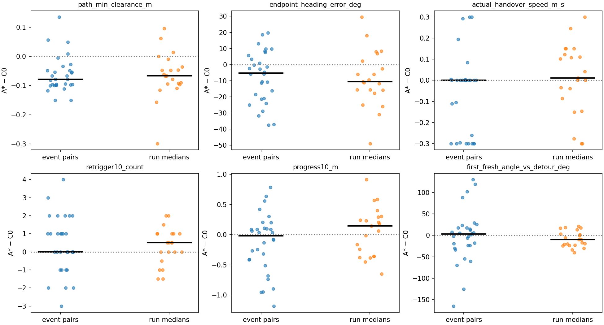
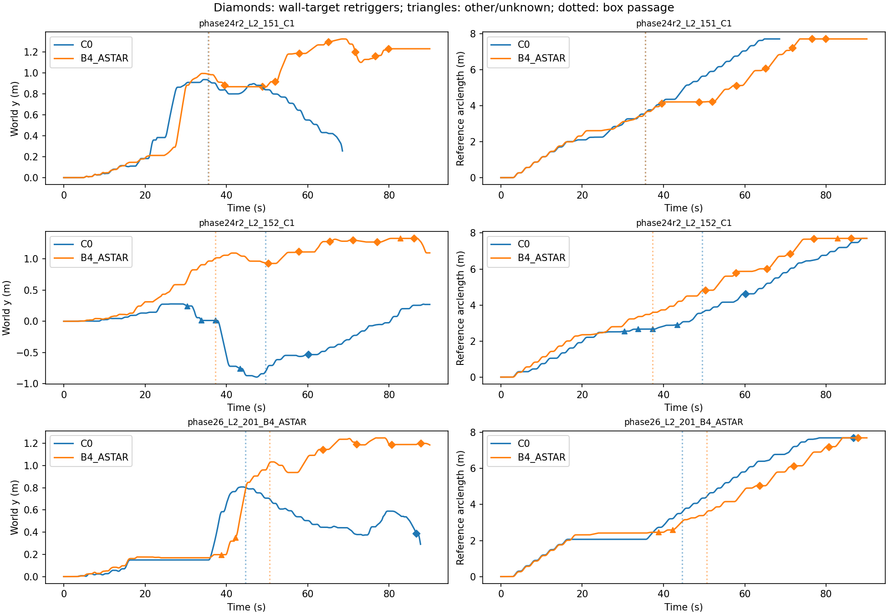
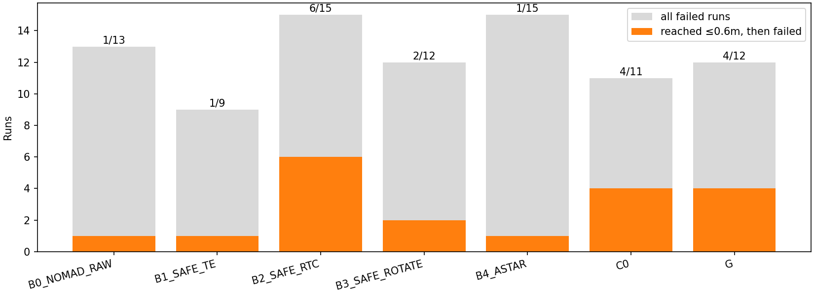
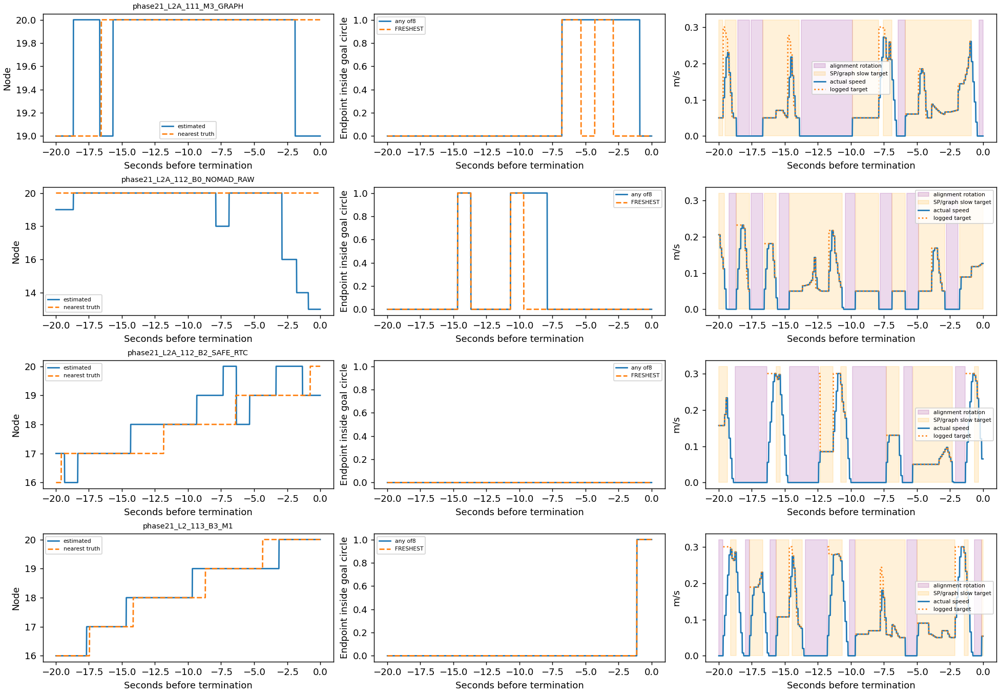
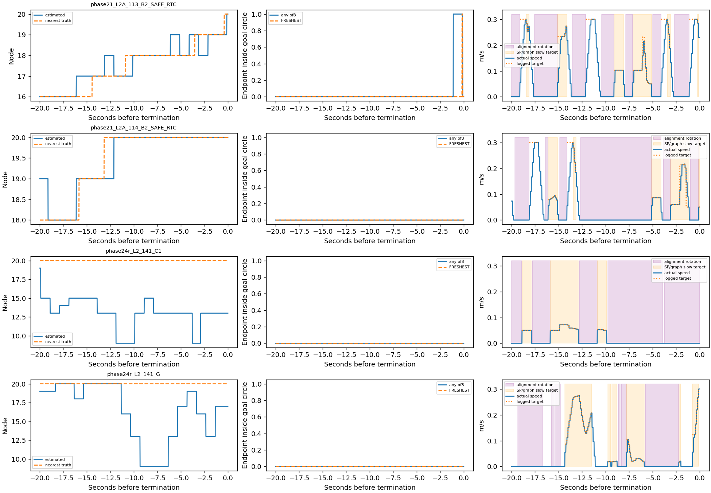
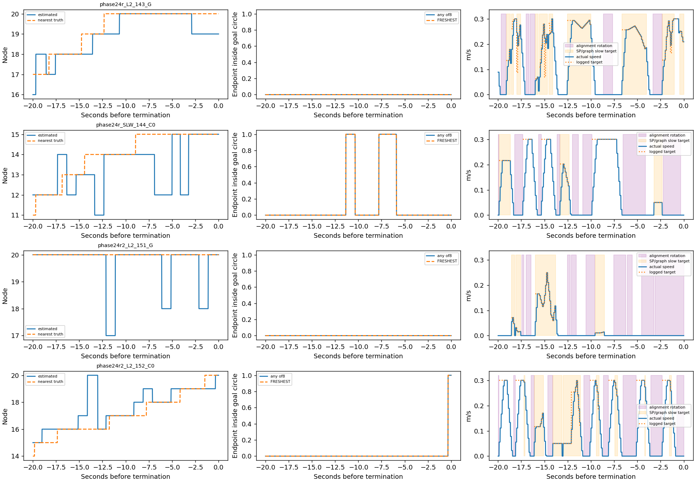
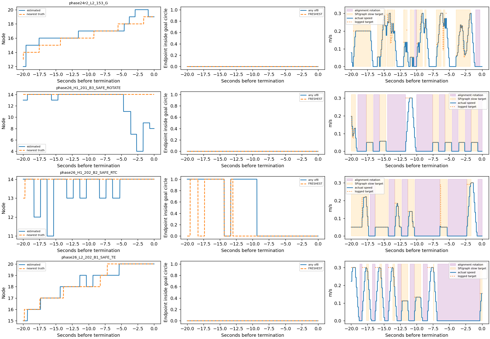
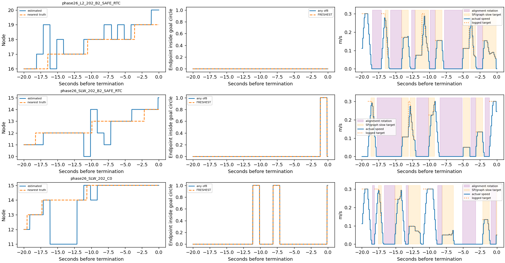

# Phase27-E — A* 넘김·재트리거와 공통 종단 실패 진단

**판정: ASTAR_RETRIGGER_LOOP / COMMON_TERMINAL_ISSUE.** 이는 저장 로그에서 두 가설 중 더 강한 관측 설명을 고른 진단이며, 동일 상태의 planner 교체 실험으로 인과를 증명한 결과가 아니다.

## 먼저 확인한 범위와 전제

전체30run씩에서 PASSED_THEN_FAIL은 A*6, C0는5로 차이는1run이다. 통과run을 분모로 하면6/21(28.6%) vs5/24(20.8%), 우회가 적용되고 통과한run만 분모로 하면6/19(31.6%) vs5/21(23.8%)다. phase별 방향도 일정하지 않다. 따라서 “A*가 일반적으로 더 많이 실패한다”는 통계적 주장으로 확대하지 않는다. 같은 phase·scene·seed의 run30쌍을 대응시켰고, handover가 양쪽 모두 있는21쌍은 run내 중앙값을 짝 비교했다. C0의75handover와 A*의71handover는 전부 보존했다.

| phase | method | runs | success | PASSED_THEN_FAIL | passed_runs | applied_passed_runs | PTF_per_passed | PTF_per_applied_passed | handover_runs |
|---|---|---|---|---|---|---|---|---|---|
| ALL | C0 | 30 | 19 | 5 | 24 | 21 | 0.2083 | 0.2381 | 26 |
| ALL | B4_ASTAR | 30 | 15 | 6 | 21 | 19 | 0.2857 | 0.3158 | 24 |
| phase21 | C0 | 8 | 6 | 1 | 7 | 4 | 0.1429 | 0.25 | 4 |
| phase21 | B4_ASTAR | 8 | 7 | 0 | 7 | 6 | 0 | 0 | 6 |
| phase24r | C0 | 8 | 4 | 1 | 5 | 5 | 0.2 | 0.2 | 8 |
| phase24r | B4_ASTAR | 8 | 2 | 3 | 5 | 5 | 0.6 | 0.6 | 7 |
| phase24r2 | C0 | 4 | 3 | 1 | 4 | 4 | 0.25 | 0.25 | 4 |
| phase24r2 | B4_ASTAR | 4 | 1 | 2 | 3 | 3 | 0.6667 | 0.6667 | 4 |
| phase26 | C0 | 10 | 6 | 2 | 8 | 8 | 0.25 | 0.25 | 10 |
| phase26 | B4_ASTAR | 10 | 5 | 1 | 6 | 5 | 0.1667 | 0.2 | 7 |

엄격한 event 대응은 동일 phase·scene·seed·trigger A/B·평가용 대상 surface에 대해 발생 순서로 짝지었다: **30쌍(60handover)**, 나머지**86handover는 미대응**으로 남겼다. 모든 event는 handover_metrics.csv에 있다. 억지로 서로 다른 장애물·횟수를 같은 입력으로 만들지 않았다. 짝의 trigger pose 차이 중앙값은 **0.372m**, 따라서 동일 trigger 코드라는 뜻과 동일 입력이라는 뜻은 다르다.

Phase21/24-R/R2의 B4는 R2 자리에도 A*를 썼지만 Phase26은 R3만 A*이다. Phase21의 trigger와24-R 이후 trigger도 다르다. 이런 버전 차이 때문에 phase를 넘어서 event를 짝짓지 않았다. G는1부 비교에서 제외하고2부 전체 방법의 종단 진단에는 포함했다.

## 측정 규칙

장애물 거리/여유는 평가용 box·wall과 원형 footprint의 정확한 point/segment 거리다(반경0.09m 차감). handover의 box 거리와 box+wall 최소를 분리했다. 우회 경로는 실제 APPLIED 경로 전체를 적용 당시 활성 장애물로 평가했고 handover 당시 평가도 별도 저장했다. endpoint heading은 마지막 chord와 그 endpoint의 기준 polyline tangent 차이, 실제 handover yaw 차이는 별도 열이다. 끝점 속도는 저장된 SP profile 마지막 값과 handover 순간 실제 v를 모두 보고했다. 새 SP 계획이나 rollout은 만들지 않았다.

10초 창은 실제 run 종료에서 자르며 full10을 표시했다. 같은 trigger가 겹치는 창에 반복 포함될 수 있으므로 **unique retrigger**에서는 바로 앞 handover 하나에만 귀속시켰다. 같은 component는 동일 run의 component_id가 같은 경우만이다. ID가 바뀌어도 같은 벽인지는 저장 occupancy/component 셀을 oracle surface에 대응시켜 평가했다(최다표의 비율을 confidence로 저장; 이번 최소는0.614). 원래 상자와 벽을 혼동하지 않았다.

첫 native 후보는 handover 이후 첫 FRESH의8개에서 현재 B 이후 잔여가 최대인 FRESHEST이다. endpoint−B 방향이 handover 위치의 우회 chord와90° 초과 차이면 REVERSES, 아니면 CONTINUES, 길이0이면 미정이다. 후보가 실제 선택되어 실행됐는지와 deferred 여부는 별도로 저장했다. 여기서 방향 반전은 강제로 적용한 새 경로가 아니라 저장된 후보의 방향이다.

## 1. 방법별·결과 층별 중앙값

거리 m, 각도 deg, 속도 m/s. n과 unique_runs를 함께 표시하며 반복 event는 독립 표본이 아니다.

| outcome | method | handovers | unique_runs | handover_box_clearance_m | handover_min_clearance_m | path_min_clearance_m | endpoint_heading_error_deg | handover_heading_error_deg | actual_handover_speed_m_s | planned_endpoint_speed_m_s |
|---|---|---|---|---|---|---|---|---|---|---|
| ALL | C0 | 75 | 26 | 0.2683 | 0.2517 | 0.15 | 25.97 | 28.63 | 0.3 | 0.3 |
| ALL | B4_ASTAR | 71 | 24 | 0.5021 | 0.2226 | 0.07209 | 16.26 | 15.06 | 0.3 | 0.3 |
| PASSED_THEN_FAIL | C0 | 18 | 5 | 0.2275 | 0.2275 | 0.1313 | 31.01 | 28.81 | 0.2774 | 0.3 |
| PASSED_THEN_FAIL | B4_ASTAR | 23 | 5 | 1.365 | 0.1635 | 0.1074 | 5.491 | 11.22 | 0.3 | 0.3 |
| SUCCESS | C0 | 39 | 16 | 0.3403 | 0.2914 | 0.1547 | 16.13 | 33.54 | 0.3 | 0.3 |
| SUCCESS | B4_ASTAR | 23 | 12 | 0.2217 | 0.188 | 0.05685 | 16.8 | 16.42 | 0.3 | 0.3 |

| outcome | method | handovers | full10 | retrigger10_fraction | retrigger10_full_fraction | retrigger10_count | progress10_m | reverse_first_fraction | first_fresh_angle_vs_detour_deg |
|---|---|---|---|---|---|---|---|---|---|
| ALL | C0 | 75 | 69 | 0.5733 | 0.5507 | 1 | 0.8551 | 0.1467 | 38.37 |
| ALL | B4_ASTAR | 71 | 67 | 0.6761 | 0.6716 | 1 | 0.8687 | 0.1268 | 29.32 |
| PASSED_THEN_FAIL | C0 | 18 | 16 | 0.5556 | 0.5 | 1 | 0.8088 | 0.2778 | 39.73 |
| PASSED_THEN_FAIL | B4_ASTAR | 23 | 22 | 0.8261 | 0.8182 | 1 | 1.007 | 0.1739 | 38.12 |
| SUCCESS | C0 | 39 | 35 | 0.4872 | 0.4571 | 0 | 1.05 | 0.02564 | 36.54 |
| SUCCESS | B4_ASTAR | 23 | 23 | 0.3478 | 0.3478 | 0 | 1.099 | 0.08696 | 29.06 |

### 짝 차이(A*−C0)

| scope | metric | n | median_A_minus_C0 | A_higher | A_lower | equal |
|---|---|---|---|---|---|---|
| EVENT | actual_handover_speed_m_s | 30 | 0 | 7 | 11 | 12 |
| EVENT | endpoint_heading_error_deg | 30 | -5.255 | 10 | 20 | 0 |
| EVENT | first_fresh_angle_vs_detour_deg | 30 | 2.916 | 16 | 14 | 0 |
| EVENT | first_fresh_remaining_m | 30 | -0.01968 | 13 | 17 | 0 |
| EVENT | handover_box_clearance_m | 30 | 0.007134 | 16 | 14 | 0 |
| EVENT | handover_heading_error_deg | 30 | -1.509 | 15 | 15 | 0 |
| EVENT | handover_min_clearance_m | 30 | 0.0164 | 18 | 12 | 0 |
| EVENT | lateral_m | 30 | -0.0007171 | 14 | 16 | 0 |
| EVENT | path_box_clearance_m | 30 | -0.08554 | 4 | 26 | 0 |
| EVENT | path_min_clearance_m | 30 | -0.07855 | 4 | 26 | 0 |
| EVENT | planned_endpoint_speed_m_s | 30 | 0 | 0 | 8 | 22 |
| EVENT | progress10_m | 30 | -0.01917 | 15 | 15 | 0 |
| EVENT | retrigger10_count | 30 | 0 | 14 | 8 | 8 |
| EVENT | same_component_retriggers | 30 | 0 | 13 | 3 | 14 |
| EVENT | same_target_retriggers | 30 | 0 | 14 | 8 | 8 |
| RUN_MEDIAN | actual_handover_speed_m_s | 21 | 0.01111 | 11 | 8 | 2 |
| RUN_MEDIAN | endpoint_heading_error_deg | 21 | -10.71 | 6 | 15 | 0 |
| RUN_MEDIAN | first_fresh_angle_vs_detour_deg | 21 | -9.773 | 7 | 14 | 0 |
| RUN_MEDIAN | first_fresh_remaining_m | 21 | -0.001718 | 10 | 11 | 0 |
| RUN_MEDIAN | handover_box_clearance_m | 21 | -0.0236 | 10 | 11 | 0 |
| RUN_MEDIAN | handover_heading_error_deg | 21 | -9.043 | 8 | 13 | 0 |
| RUN_MEDIAN | handover_min_clearance_m | 21 | -0.06844 | 8 | 13 | 0 |
| RUN_MEDIAN | lateral_m | 21 | 0.07668 | 16 | 5 | 0 |
| RUN_MEDIAN | path_box_clearance_m | 21 | -0.07348 | 6 | 15 | 0 |
| RUN_MEDIAN | path_min_clearance_m | 21 | -0.06628 | 3 | 18 | 0 |
| RUN_MEDIAN | planned_endpoint_speed_m_s | 21 | 0 | 0 | 3 | 18 |
| RUN_MEDIAN | progress10_m | 21 | 0.1468 | 12 | 9 | 0 |
| RUN_MEDIAN | retrigger10_count | 21 | 0.5 | 12 | 5 | 4 |
| RUN_MEDIAN | same_component_retriggers | 21 | 0 | 7 | 3 | 11 |
| RUN_MEDIAN | same_target_retriggers | 21 | 0.5 | 11 | 5 | 5 |

A*의 경로 최소 여유는 event짝에서 중앙값−0.0786m, run중앙값 짝에서−0.0663m로 더 작았다. 그러나 endpoint heading 오차는 각각−5.25°/−10.71°로 더 작고, 속도는 비슷하며, run짝의10초 진전은 오히려+0.147m였다. PASSED_THEN_FAIL 층에서도 첫 후보 반전은 A*17.4%, C0 27.8%다. **단순히 A*가 더 나쁜 끝점 heading/속도/방향 반전을 넘겼다는 설명은 일관되게 지지되지 않는다.** 여유 감소는 재검증/루프의 상류 요인일 수 있으므로 무관하다고 단정하지 않는다.

### 재트리거 대상과 원인

| method | outcome | handovers | unique_runs | retriggering_handovers | retrigger_fraction | unique_retriggers | same_component | same_physical_target | unknown_component | post_pass_retriggers | post_pass_runs | post_pass_wall | post_pass_approach_only |
|---|---|---|---|---|---|---|---|---|---|---|---|---|---|
| C0 | ALL | 75 | 26 | 43 | 0.5733 | 55 | 17 | 39 | 1 | 15 | 8 | 15 | 1 |
| B4_ASTAR | ALL | 71 | 24 | 48 | 0.6761 | 67 | 28 | 53 | 5 | 23 | 5 | 22 | 6 |
| C0 | PASSED_THEN_FAIL | 18 | 5 | 10 | 0.5556 | 14 | 6 | 12 | 0 | 6 | 3 | 6 | 0 |
| B4_ASTAR | PASSED_THEN_FAIL | 23 | 5 | 19 | 0.8261 | 24 | 9 | 22 | 1 | 19 | 3 | 18 | 5 |
| C0 | SUCCESS | 39 | 16 | 19 | 0.4872 | 20 | 10 | 17 | 0 | 9 | 5 | 9 | 1 |
| B4_ASTAR | SUCCESS | 23 | 12 | 8 | 0.3478 | 10 | 5 | 8 | 0 | 4 | 2 | 4 | 1 |

A*의 PASSED_THEN_FAIL handover23개 중19개(82.6%)에서10초 안에 재트리거가 있었다. SUCCESS층에서는8/23(34.8%)이고, C0의 PASSED_THEN_FAIL에서는10/18(55.6%)였다. run짝의 재트리거 횟수 차이 중앙값은+0.5(12양수,5음수,4동률)다. event짝 중앙값은0이므로 이 반대 증거도 남긴다.

중복을 제거한 A* PASSED_THEN_FAIL의 통과 후 재트리거는19개이며, **18개가 상자가 아니라 WALL:YMAX**에 대응한다. 이는3개run에 집중된다. 그중5개는 forward_stalled=False인데 approach_stalled=True로 발동했다. 같은 벽에 대해 component ID가 바뀌는 재발도 많으므로 “모두 원래 상자의 동일 ID 재진입”이라고 부르지 않는다. C0는 통과 후6개 재트리거(3run), 모두 벽이었고 approach-only는0이었다.

A* PASSED_THEN_FAIL의 종료 이유는 PATH_BECAME_UNSAFE18/23, NO_NEW_OBSTACLE_AHEAD5/23이다. 따라서 기록상 반복 과정은 **넘김/안전 재검증 종료 → 벽 component에 대한 NO_PROGRESS → 다시 우회**다. 안전 재검증의 어느 점이 위반됐는지까지 이 분석에서 새로 판정하지 않았으므로 “모두 certificate 버그”라고 주장하지 않는다. C0 성공에서도 PATH_BECAME_UNSAFE 종료가 많다는 점을 함께 주의해야 한다.

실제 handover가 없는 A* PASSED_THEN_FAIL은 phase24r_L2_144_C1. 이1run에는 끝점/넘김 원인을 만들어 넣지 않았다. 관측 가능한5개 실패run 중3개가 통과 후 벽 루프를 보이며, 나머지 실패를 전부 이 루프로 설명하지 않는다.

## 2. 목표0.6m 이내 접근 후 실패

| phase | method | runs | failures | near_goal_failures | near_fraction_of_failures | min_goal_distance_failed_median_m | goal_predicate_mismatches |
|---|---|---|---|---|---|---|---|
| ALL | B0_NOMAD_RAW | 18 | 13 | 1 | 0.07692 | 4.548 | 0 |
| ALL | B1_SAFE_TE | 18 | 9 | 1 | 0.1111 | 1.466 | 0 |
| ALL | B2_SAFE_RTC | 18 | 15 | 6 | 0.4 | 2.19 | 0 |
| ALL | B3_SAFE_ROTATE | 18 | 12 | 2 | 0.1667 | 4.299 | 0 |
| ALL | B4_ASTAR | 30 | 15 | 1 | 0.06667 | 1.252 | 0 |
| ALL | C0 | 30 | 11 | 4 | 0.3636 | 1.298 | 0 |
| ALL | G | 12 | 12 | 4 | 0.3333 | 1.209 | 0 |

전체87실패run 중19개가0.6m 이내에 접근했고 **7방법군 모두에서 발생**했다. 따라서 COMMON_TERMINAL_ISSUE로 판정한다. 이는 현상이 방법 공통이라는 뜻이며 모든 run에 같은 원인이 있다는 뜻은 아니다. 최소 거리는0.3076–0.5945m이고 기존 goal tolerance0.3m 안에 든 로그점은 없었다. goal 판정 누락 증거는0건이다.

마지막20초(더 짧으면 관측 구간)에서8개 후보 endpoint 중 하나라도 goal 원 안인 비율과 raw FRESHEST endpoint 비율의 run중앙값은 모두0이었다. **10/19run에서는20초 내내 어느 endpoint도 goal 원 안에 없었다.** 평균 속도의 run중앙값0.0679m/s, 정지 비율50.0%, 정렬 회전39.4%다. 기록된 filter 결정327개 중 ALL_UNSAFE는0개여서 이 구간의 주된 멈춤을 필터 거절로 설명할 근거가 없다. 일부 run에는 후보가 goal 원 안인 시각도 있어 실행/정렬 문제를 배제하지 않는다.

단, “한번0.6m 이내 접근”과 “마지막20초 내내 목표 근처”는 다르다. 마지막20초에0.6m 안 관측이 있는 것은17/19run이고, 해당 영역 체류 비율의 중앙값은19.3%다. 실제0.6m 안인 tick만 조건부로 보면 any-endpoint-in-goal 비율의 run중앙값은9.0%다(terminal_near_conditioned.csv). 따라서 전체20초의0비율을 곧바로 목표 근처 정책 생성 실패율로 바꾸어 해석하지 않는다.

SP감속은 GO상태의 저장 target<0.3인 시간으로 정의했다(가속 제한에 의한 낮은 실제속도와 구분). G는 SP를 쓰지 않으므로 SP 열은 미정이며 graph-speed 저속 및 graph rotation을 별도 표시했다. B0는 필터가 없어 필터 비율을0으로 채우지 않았다. state는 기록된 제어 상태를 다음 tick까지 유지한 값이며 실제 정지는72Hz 속도로 계산했다. 후보도 새 추론 없이 최신 저장 결과를 유지했고 유효1초 flag를 함께 저장했다.

| method | n | minimum_goal_distance_m | mean_speed_m_s | stopped_fraction | alignment_rotation_fraction | alignment_brake_fraction | sp_slow_fraction | graph_speed_low_fraction | any_endpoint_goal_fraction | freshest_endpoint_goal_fraction | last20_near_fraction | any_endpoint_goal_when_near | estimated_final_node_fraction | node_error_gt1_fraction | filter_all_unsafe_fraction | filter_rejections | filter_decisions |
|---|---|---|---|---|---|---|---|---|---|---|---|---|---|---|---|---|---|
| B0_NOMAD_RAW | 1 | 0.4432 | 0.05772 | 0.3444 | 0.2833 | 0.06111 | 0.6444 | — | 0.1889 | 0.1 | 0.734 | 0.2573 | 0.7389 | 0.1951 | — | 0 | 0 |
| B1_SAFE_TE | 1 | 0.4908 | 0.07905 | 0.5278 | 0.4778 | 0.1722 | 0.1722 | — | 0 | 0 | 0.375 | 0 | 0.2674 | 0 | 0 | 0 | 20 |
| B2_SAFE_RTC | 6 | 0.4566 | 0.06401 | 0.5167 | 0.4806 | 0.1056 | 0.3 | — | 0.025 | 0.001736 | 0.217 | 0.1446 | 0.1031 | 0.04861 | 0 | 0 | 119 |
| B3_SAFE_ROTATE | 2 | 0.3552 | 0.06165 | 0.4306 | 0.3806 | 0.1028 | 0.4444 | — | 0.02813 | 0.02813 | 0.3146 | 0.1546 | 0.4198 | 0.117 | 0 | 0 | 41 |
| B4_ASTAR | 1 | 0.5604 | 0.01401 | 0.75 | 0.7278 | 0.01667 | 0.25 | — | 0 | 0 | 0 | — | 0 | 0.9951 | 0 | 0 | 20 |
| C0 | 4 | 0.3908 | 0.08599 | 0.4028 | 0.3111 | 0.1139 | 0.275 | — | 0.1253 | 0.1243 | 0.4059 | 0.1966 | 0.3562 | 0.1365 | 0 | 0 | 74 |
| G | 4 | 0.4845 | 0.07934 | 0.5 | 0.2833 | 0.01111 | — | 0.4083 | 0 | 0 | 0.05451 | 0 | 0.3444 | 0.1184 | 0 | 0 | 53 |

### Near-goal 실패run별 마지막20초

| run_id | minimum_goal_distance_m | minimum_goal_time_s | last20_near_fraction | node_first | node_last | node_backward_steps | estimated_final_node_fraction | any_endpoint_goal_fraction | freshest_endpoint_goal_fraction | mean_speed_m_s | stopped_fraction | alignment_rotation_fraction | sp_slow_fraction | filter_all_unsafe | filter_decisions |
|---|---|---|---|---|---|---|---|---|---|---|---|---|---|---|---|
| phase21_L2A_111_M3_GRAPH | 0.3076 | 88.69 | 0.7333 | 19 | 19 | 2 | 0.7889 | 0.2944 | 0.1424 | 0.06193 | 0.3556 | 0.3278 | 0.5833 | 0 | 20 |
| phase21_L2A_112_B0_NOMAD_RAW | 0.4432 | 78.94 | 0.734 | 19 | 13 | 4 | 0.7389 | 0.1889 | 0.1 | 0.05772 | 0.3444 | 0.2833 | 0.6444 | 0 | 0 |
| phase21_L2A_112_B2_SAFE_RTC | 0.4416 | 89.65 | 0.2611 | 17 | 19 | 3 | 0.15 | 0 | 0 | 0.06794 | 0.4667 | 0.4333 | 0.3389 | 0 | 20 |
| phase21_L2_113_B3_M1 | 0.3262 | 90 | 0.1819 | 16 | 20 | 0 | 0.1562 | 0.05625 | 0.05625 | 0.08867 | 0.2722 | 0.2278 | 0.5667 | 0 | 21 |
| phase21_L2A_113_B2_SAFE_RTC | 0.3559 | 90 | 0.1729 | 16 | 20 | 3 | 0.00625 | 0.05 | 0.003472 | 0.08078 | 0.5 | 0.4667 | 0.2389 | 0 | 20 |
| phase21_L2A_114_B2_SAFE_RTC | 0.4983 | 88.26 | 0.6694 | 19 | 20 | 1 | 0.6062 | 0 | 0 | 0.04648 | 0.6278 | 0.5944 | 0.2222 | 0 | 20 |
| phase24r_L2_141_C1 | 0.5604 | 63.86 | 0 | 19 | 13 | 6 | 0 | 0 | 0 | 0.01401 | 0.75 | 0.7278 | 0.25 | 0 | 20 |
| phase24r_L2_141_G | 0.4164 | 67.75 | 0.3229 | 19 | 17 | 6 | 0.3 | 0 | 0 | 0.04101 | 0.65 | 0.3944 | — | 0 | 8 |
| phase24r_L2_143_G | 0.5945 | 79.5 | 0.02917 | 16 | 19 | 2 | 0.3889 | 0 | 0 | 0.1341 | 0.35 | 0.1722 | — | 0 | 12 |
| phase24r_SLW_144_C0 | 0.4938 | 81.67 | 0.09722 | 12 | 15 | 4 | 0.2062 | 0.1444 | 0.1444 | 0.09293 | 0.5056 | 0.3833 | 0.1556 | 0 | 16 |
| phase24r2_L2_151_G | 0.4256 | 67.15 | 0 | 20 | 20 | 3 | 0.85 | 0 | 0 | 0.0176 | 0.7889 | 0.45 | — | 0 | 17 |
| phase24r2_L2_152_C0 | 0.3723 | 89.11 | 0.1931 | 15 | 20 | 2 | 0.07292 | 0.01736 | 0.01736 | 0.1033 | 0.35 | 0.2944 | 0.25 | 0 | 21 |
| phase24r2_L2_153_G | 0.5434 | 88.89 | 0.07986 | 12 | 19 | 1 | 0.1 | 0 | 0 | 0.1177 | 0.2944 | 0.05 | — | 0 | 16 |
| phase26_H1_201_B3_SAFE_ROTATE | 0.3842 | 56.79 | 0.4472 | 13 | 8 | 5 | 0.6833 | 0 | 0 | 0.03464 | 0.5889 | 0.5333 | 0.3222 | 0 | 20 |
| phase26_H1_202_B2_SAFE_RTC | 0.3085 | 78.94 | 1 | 14 | 14 | 6 | 0.6944 | 0.4826 | 0.2264 | 0.04547 | 0.5333 | 0.4944 | 0.4222 | 0 | 20 |
| phase26_L2_202_B1_SAFE_TE | 0.4908 | 90 | 0.375 | 15 | 20 | 1 | 0.2674 | 0 | 0 | 0.07905 | 0.5278 | 0.4778 | 0.1722 | 0 | 20 |
| phase26_L2_202_B2_SAFE_RTC | 0.4715 | 90 | 0.09514 | 16 | 20 | 4 | 0.05625 | 0 | 0 | 0.07649 | 0.4444 | 0.3889 | 0.4111 | 0 | 19 |
| phase26_SLW_202_B2_SAFE_RTC | 0.5342 | 90 | 0.0125 | 11 | 15 | 3 | 0.00625 | 0.05 | 0.05 | 0.06007 | 0.5889 | 0.5111 | 0.2611 | 0 | 20 |
| phase26_SLW_202_C0 | 0.4092 | 80.32 | 0.6188 | 12 | 15 | 2 | 0.5062 | 0.1062 | 0.1062 | 0.07904 | 0.45 | 0.2833 | 0.3 | 0 | 17 |

## 판정과 수정 후보(구현하지 않음)

**ASTAR_RETRIGGER_LOOP**가 두 가설 중 더 직접적인 로그 설명이다. 재트리거/벽 반복의 부담과 실패층 집중은 확인되지만, 상태 차이와 재트리거는 상호작용하며 새 동일상태 실험 없이 인과적 주원인을 분리할 수는 없다. 특히6대5라는 작은 전체 차이, phase별 방향 변화, 단30event짝을 고려해 일반 성능 주장으로 확대하지 않는다. 종단은 **COMMON_TERMINAL_ISSUE**다.

1. 공통 결정 계층 후보: depth로 추정한 벽면을 따라 이미 전진하는 경우의 approach-only 재트리거와 동일 벽면/component 조각의 연속 재진입을 분리하고, 진행 증거를 요구하는 hysteresis를 검토. Oracle 물체 ID는 쓰지 않고 깊이 기반 안전 정지는 유지한다.
2. 공통 종단 모드 후보: 종단 Topomap/목표영상과 짧은 후보의 방향 안정성을 이용해 참조·정렬을 유지하고, 매 FRESH의 정렬 재시작을 억제하는 방식을 검토. 평가용 goal 좌표는 제어 입력으로 쓰지 않는다.

위 두 가지는 후속 검증 후보일 뿐이며 상수 선택·새 실행·방법 수정은 하지 않았다. 기존144run과 Phase27-D 산출물의 hash를 확인했고 저장소 코드 변경은0이다. 분석·report는 `/usr/bin/python3`와 `PYTHONPATH=research`로 실행했으며 venv에 패키지를 설치하지 않았다. 임시 스크립트 위치/hash는 provenance.json에 기록했다.
