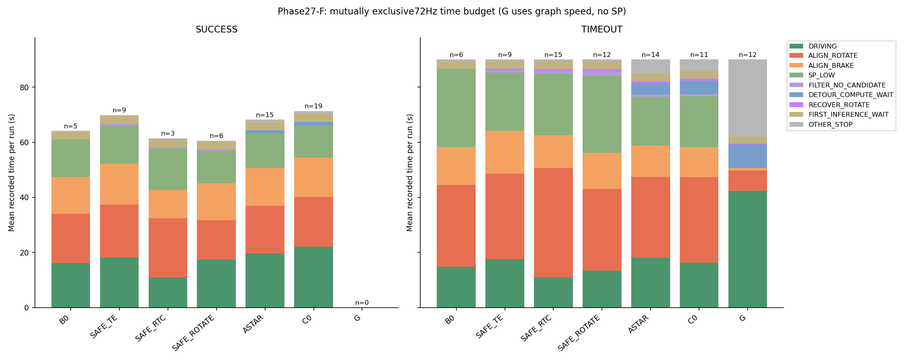
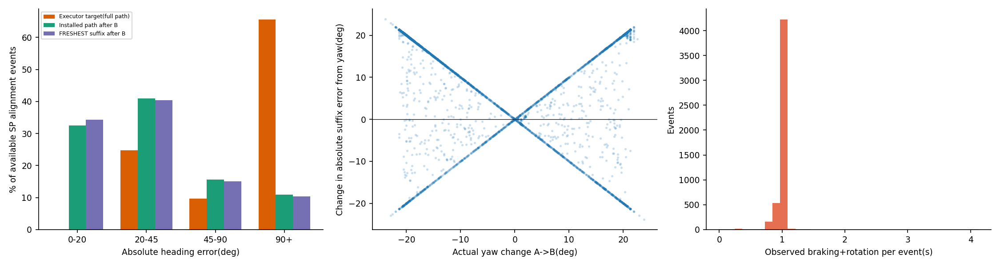
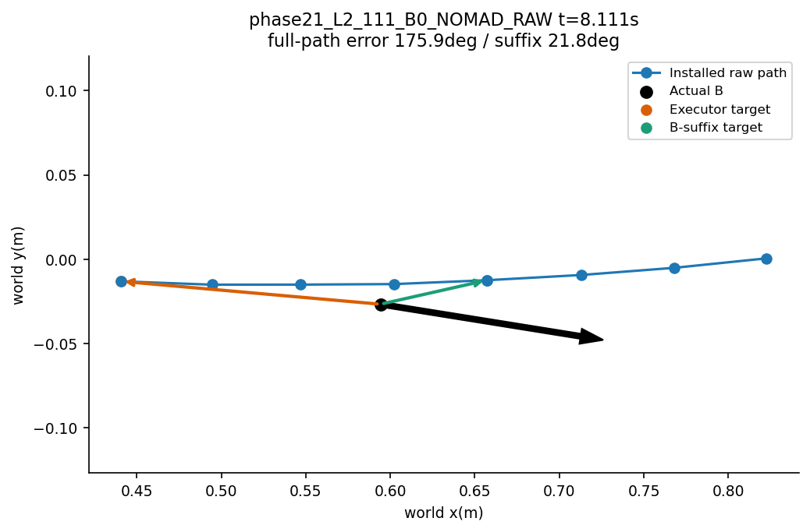
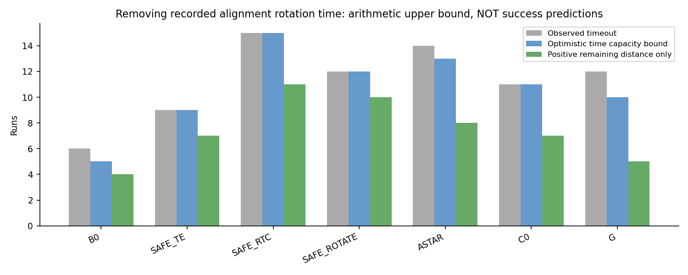

# Phase27-F — 시간 예산·출발 정렬 진단

**판정: ALIGNMENT_DOMINANT.** 저장된144run, 총 11251.153s(시뮬레이션 시계)를 분석했다. 물리적 정지(|v|<0.02m/s) 5026.333s 중 정렬 상태가 차지한 정지 시간은 **74.90%**다. 요청식의 정렬 회전+감속 전체 시간 5020.319s을 정지 시간으로 나누면 **99.88%**다. 감속 중 이동까지 분자에 포함하기 때문에 이 값은 일부 방법에서100%를 넘는다. 정지 tick만 쓴 보수적 집계도50%를 넘으므로 판정은 동일하다.

새 주행·rollout·추론·Graph solve·튜닝을 하지 않았다. 기존 코드·protocol·raw·Phase27D/E 결과는 읽기만 했다. `/usr/bin/python3`, `PYTHONPATH=research`로 로그 집계와 그림만 생성했다. 분석 기준 소스 HEAD는 `5fe8ff8`이며, 소스 및 입력 SHA256은 산출물에 보존했다.

## 1. 범위와 측정 규칙

- Phase21 48, Phase24-R 24, Phase24-R2 12, Phase26 60 =144 main run. Phase27D의 동일 run 목록과72Hz pose 캐시를 재사용하고 실제 명령·사건 로그를 대조했다. 재시도 이전 attempt/smoke는 포함하지 않는다.
- SUCCESS57, TIMEOUT79, 충돌6, corridor2. 시간 초과79건은 모두 저장된 `simulation_timeout`이다. 부팅/렌더 초기화 등 실행 전 wall-clock은 포함하지 않는다.
- dt는 연속72Hz pose 시각 차이다. 해당 구간 중앙 시각에 유효한9Hz 명령을 대응시킨다. 회복 로그72Hz 및 G 정렬 START/END는 우선 사용한다. 실제 v와ω는 저장 궤적에서 읽는다. 경계의9Hz 상태 전환과72Hz 대응은 최대한 로그 시계에 맞춘 시간 회계이며 새 실행을 재현한 것이 아니다.
- 겹치는 상태를 **첫 추론 대기 → 회복 → 정렬 회전/감속 → 수리·우회 계산 대기 → 후보 없음 → SP 저속 → 나머지 주행 → 기타 정지** 순으로 한 번만 센다. 정렬 감속·계산 대기에도 실제 이동이 남을 수 있으므로 물리적 정지는 별도로 센다.
- 주행은 |v|≥0.02이고 위 특수 상태에 속하지 않은 tick. SP 저속은 SP GO에서 목표속도가0.3미만이고 실제 |v|≥0.02인 tick. G는 graph 속도를 쓰므로 SP 저속에 넣지 않는다. G 저속 이동은 주행이다.
- 후보 없음은 기록된 ALL_UNSAFE와 STOP_WAIT가 함께 있는 구간이다. 안전 경로의 endpoint/만료, 회복 후 WAIT_FRESH, G STOP 등은 기타 정지에 들어간다. G의 본래 graph 회전 구간은 정렬 휴리스틱과 구분해 기타 정지의 하위 집계로 보존한다.
- 방법·scene·phase가 서로 다른 사후 pooled 자료다. 방법별 관측 수가 다르므로 이 시간 표를 방법 성능의 인과 비교로 해석하지 않는다.

| 상태 | 총초 | 전체시간_pct |
|---|---|---|
| 주행 | 2671 | 23.74 |
| 출발/구간 정렬 회전 | 3336 | 29.65 |
| 정렬 감속 | 1684 | 14.97 |
| SP 저속 | 2262 | 20.1 |
| 필터 후보 없음 | 60.67 | 0.5392 |
| 우회/수리 계산 대기 | 258.2 | 2.295 |
| RECOVER_ROTATE | 56.72 | 0.5041 |
| 첫 추론 대기 | 412.2 | 3.664 |
| 기타 정지 | 510.7 | 4.539 |

| 방법 | n | 물리정지_s | 정렬회전_s | 정렬감속_s | 정지중정렬_pct | 요청식_pct | 고유graph회전_s |
|---|---|---|---|---|---|---|---|
| B0_NOMAD_RAW | 18 | 441.7 | 333.6 | 195.1 | 87.27 | 119.7 | 0 |
| B1_SAFE_TE | 18 | 595 | 451.8 | 274 | 87.25 | 122 | 0 |
| B2_SAFE_RTC | 18 | 805.4 | 658.4 | 207.8 | 89.14 | 107.5 | 0 |
| B3_SAFE_ROTATE | 18 | 596.4 | 443.4 | 236.6 | 84.74 | 114 | 0 |
| B4_ASTAR | 30 | 1015 | 676.1 | 369.7 | 75.59 | 103.1 | 0 |
| C0 | 30 | 1008 | 684.1 | 390 | 77.05 | 106.6 | 0 |
| G | 12 | 565.2 | 88.99 | 10.78 | 16.51 | 17.65 | 27.67 |

### 방법×장면 전체 표

셀은 **run당 평균 초**. 합계는 각 그룹 평균 실제 주행시간이다. 모든 실패를 포함한다.

| 방법 | 장면 | n | 주행 | 정렬 회전 | 정렬 감속 | SP 저속 | 후보 없음 | 계산 대기 | 회복 회전 | 첫 추론 대기 | 기타 정지 |
|---|---|---|---|---|---|---|---|---|---|---|---|
| B0_NOMAD_RAW | H1 | 2 | 12.5 | 13.61 | 9.722 | 11.94 | 0 | 0 | 0 | 2.889 | 0.05556 |
| B0_NOMAD_RAW | H2 | 2 | 8.056 | 6.111 | 6.306 | 8.965 | 0 | 0 | 0 | 2.889 | 0.05556 |
| B0_NOMAD_RAW | L2 | 6 | 13.63 | 20 | 11 | 15.9 | 0 | 0 | 0 | 2.815 | 0.2037 |
| B0_NOMAD_RAW | L2A | 4 | 17.86 | 24.33 | 15.69 | 24.55 | 0 | 0 | 0 | 2.778 | 0.4167 |
| B0_NOMAD_RAW | LC | 2 | 11.06 | 15.39 | 11 | 14.39 | 0 | 0 | 0 | 2.778 | 0.4444 |
| B0_NOMAD_RAW | SLW | 2 | 5.611 | 23 | 6.139 | 15.11 | 0 | 0 | 0 | 2.889 | 0.6667 |
| B1_SAFE_TE | H1 | 2 | 14.83 | 18.78 | 13.33 | 21.09 | 0 | 0 | 0 | 2.889 | 0.1111 |
| B1_SAFE_TE | H2 | 2 | 16.72 | 33.33 | 14.11 | 14.18 | 0 | 0 | 0 | 2.833 | 0.5556 |
| B1_SAFE_TE | L2 | 6 | 22.57 | 24.7 | 17.7 | 15.44 | 0.8333 | 0 | 0.5833 | 2.889 | 0.4167 |
| B1_SAFE_TE | L2A | 4 | 19.61 | 26.69 | 17.08 | 18.92 | 0 | 0 | 0 | 2.889 | 0.3889 |
| B1_SAFE_TE | LC | 2 | 13.44 | 13.17 | 11.61 | 9.958 | 0 | 0 | 0 | 2.889 | 0.2778 |
| B1_SAFE_TE | SLW | 2 | 8.889 | 33.11 | 10.67 | 28.22 | 2.5 | 0 | 1.75 | 2.889 | 0.5833 |
| B2_SAFE_RTC | H1 | 2 | 11 | 32.5 | 10.78 | 20.42 | 1.5 | 0 | 0 | 2.889 | 0.3333 |
| B2_SAFE_RTC | H2 | 2 | 16 | 33.11 | 13.72 | 20.94 | 1 | 0 | 1.75 | 2.889 | 0.5833 |
| B2_SAFE_RTC | L2 | 6 | 8.5 | 43.43 | 10.02 | 23.67 | 0.5 | 0 | 0.5833 | 2.889 | 0.4167 |
| B2_SAFE_RTC | L2A | 4 | 15.22 | 36.22 | 14.89 | 18.81 | 0.75 | 0 | 0.875 | 2.861 | 0.375 |
| B2_SAFE_RTC | LC | 2 | 10.28 | 19.11 | 10.56 | 14.38 | 0 | 0 | 0 | 2.944 | 0.3333 |
| B2_SAFE_RTC | SLW | 2 | 6.278 | 41.78 | 9 | 26 | 1.5 | 0 | 1.75 | 2.944 | 0.75 |
| B3_SAFE_ROTATE | H1 | 2 | 12.33 | 25 | 11.78 | 18.75 | 0.5 | 0 | 0.875 | 2.889 | 0.1806 |
| B3_SAFE_ROTATE | H2 | 2 | 16 | 19.5 | 13.83 | 30.18 | 1 | 0 | 0 | 2.889 | 0.3333 |
| B3_SAFE_ROTATE | L2 | 6 | 14.19 | 29.15 | 13.24 | 24.91 | 0.8333 | 0 | 0.875 | 2.833 | 0.6435 |
| B3_SAFE_ROTATE | L2A | 4 | 20.14 | 25.17 | 15.89 | 19.33 | 0 | 0 | 0 | 2.833 | 0.3056 |
| B3_SAFE_ROTATE | LC | 2 | 11.83 | 10.33 | 10.56 | 12.43 | 0 | 0 | 0 | 2.889 | 0 |
| B3_SAFE_ROTATE | SLW | 2 | 9.056 | 29.11 | 10.61 | 28.56 | 4.278 | 0 | 4.375 | 2.944 | 1.069 |
| B4_ASTAR | H1 | 2 | 13.25 | 10.5 | 10.78 | 10.47 | 0 | 1 | 0 | 2.944 | 0.6111 |
| B4_ASTAR | H2 | 2 | 22.17 | 31.44 | 12.83 | 8.833 | 0.7222 | 5.167 | 0 | 2.889 | 5.944 |
| B4_ASTAR | L2 | 14 | 21.36 | 25 | 13.6 | 16.33 | 0.246 | 2.214 | 0 | 2.913 | 2.238 |
| B4_ASTAR | L2A | 4 | 22.29 | 17.42 | 16.03 | 12.65 | 0 | 0.3889 | 0 | 2.917 | 0.1944 |
| B4_ASTAR | LC | 2 | 12.69 | 11.44 | 10.39 | 11.35 | 0 | 1.389 | 0 | 2.889 | 1.056 |
| B4_ASTAR | SLW | 6 | 11.04 | 24.94 | 7.852 | 16.63 | 1.167 | 4.787 | 1.458 | 2.889 | 6.134 |
| C0 | H1 | 2 | 14.36 | 14.94 | 10.39 | 8.625 | 0 | 1.722 | 0 | 2.889 | 1.111 |
| C0 | H2 | 2 | 22.02 | 29.67 | 13.11 | 13.61 | 0.1111 | 1.944 | 0 | 2.889 | 1.056 |
| C0 | L2 | 14 | 23.61 | 19.77 | 14.96 | 12.72 | 0.07937 | 1.516 | 0 | 2.897 | 1.365 |
| C0 | L2A | 4 | 20.89 | 26.44 | 15.42 | 12.92 | 0 | 0.2222 | 0 | 2.833 | 0.25 |
| C0 | LC | 2 | 15.22 | 14.44 | 11.89 | 16.61 | 0 | 3.056 | 0 | 2.944 | 2.833 |
| C0 | SLW | 6 | 13.65 | 30.57 | 8.019 | 19.52 | 1.148 | 7.37 | 1.185 | 2.889 | 5.648 |
| G | L2 | 8 | 47.94 | 8.403 | 1.125 | 0 | 0 | 6.59 | 0.2917 | 2.667 | 22.98 |
| G | SLW | 4 | 31.19 | 5.441 | 0.4444 | 0 | 0 | 12.32 | 0.4444 | 2.639 | 37.52 |

### SUCCESS만

| 방법 | 장면 | n | 주행 | 정렬 회전 | 정렬 감속 | SP 저속 | 후보 없음 | 계산 대기 | 회복 회전 | 첫 추론 대기 | 기타 정지 |
|---|---|---|---|---|---|---|---|---|---|---|---|
| B0_NOMAD_RAW | H1 | 1 | 13 | 14.33 | 10.67 | 12.21 | 0 | 0 | 0 | 2.889 | 0 |
| B0_NOMAD_RAW | L2 | 1 | 23.33 | 27.67 | 17.44 | 12.93 | 0 | 0 | 0 | 2.889 | 0.4444 |
| B0_NOMAD_RAW | L2A | 1 | 22 | 17 | 17 | 13.32 | 0 | 0 | 0 | 2.889 | 0.3333 |
| B0_NOMAD_RAW | LC | 2 | 11.06 | 15.39 | 11 | 14.39 | 0 | 0 | 0 | 2.778 | 0.4444 |
| B1_SAFE_TE | H1 | 1 | 12.44 | 12.67 | 11 | 12.96 | 0 | 0 | 0 | 2.889 | 0.1111 |
| B1_SAFE_TE | H2 | 1 | 22.56 | 16.11 | 18 | 13.36 | 0 | 0 | 0 | 2.778 | 0.6667 |
| B1_SAFE_TE | L2 | 2 | 23.11 | 18.61 | 17 | 13.15 | 0.5 | 0 | 0 | 2.889 | 0.1667 |
| B1_SAFE_TE | L2A | 2 | 22.22 | 24.39 | 17.33 | 13.85 | 0 | 0 | 0 | 2.889 | 0.5 |
| B1_SAFE_TE | LC | 2 | 13.44 | 13.17 | 11.61 | 9.958 | 0 | 0 | 0 | 2.889 | 0.2778 |
| B1_SAFE_TE | SLW | 1 | 11.33 | 31.56 | 12.11 | 25.99 | 1 | 0 | 1.75 | 2.889 | 0.5833 |
| B2_SAFE_RTC | H1 | 1 | 12 | 26.67 | 9.333 | 16.85 | 1 | 0 | 0 | 2.889 | 0.1111 |
| B2_SAFE_RTC | LC | 2 | 10.28 | 19.11 | 10.56 | 14.38 | 0 | 0 | 0 | 2.944 | 0.3333 |
| B3_SAFE_ROTATE | H1 | 1 | 12.22 | 16.78 | 9.667 | 10.06 | 1 | 0 | 1.75 | 2.889 | 0.25 |
| B3_SAFE_ROTATE | H2 | 1 | 20.22 | 16.78 | 15.44 | 20.81 | 1 | 0 | 0 | 2.889 | 0.3333 |
| B3_SAFE_ROTATE | L2 | 1 | 24.11 | 15.22 | 17 | 10.68 | 0 | 0 | 0 | 2.667 | 0.3333 |
| B3_SAFE_ROTATE | L2A | 1 | 24.11 | 16.44 | 17.11 | 4 | 0 | 0 | 0 | 3 | 0 |
| B3_SAFE_ROTATE | LC | 2 | 11.83 | 10.33 | 10.56 | 12.43 | 0 | 0 | 0 | 2.889 | 0 |
| B4_ASTAR | H1 | 2 | 13.25 | 10.5 | 10.78 | 10.47 | 0 | 1 | 0 | 2.944 | 0.6111 |
| B4_ASTAR | L2 | 6 | 23.21 | 20.74 | 15.02 | 11.98 | 0.03704 | 1.185 | 0 | 2.889 | 0.7222 |
| B4_ASTAR | L2A | 4 | 22.29 | 17.42 | 16.03 | 12.65 | 0 | 0.3889 | 0 | 2.917 | 0.1944 |
| B4_ASTAR | LC | 2 | 12.69 | 11.44 | 10.39 | 11.35 | 0 | 1.389 | 0 | 2.889 | 1.056 |
| B4_ASTAR | SLW | 1 | 13.89 | 21.22 | 9.333 | 21.67 | 0 | 3.389 | 0 | 2.889 | 6.333 |
| C0 | H1 | 2 | 14.36 | 14.94 | 10.39 | 8.625 | 0 | 1.722 | 0 | 2.889 | 1.111 |
| C0 | H2 | 1 | 25.6 | 21.78 | 13.11 | 12.56 | 0 | 1.889 | 0 | 2.889 | 1 |
| C0 | L2 | 13 | 23.64 | 19.22 | 14.89 | 12.55 | 0.08547 | 1.402 | 0 | 2.897 | 1.214 |
| C0 | L2A | 2 | 23 | 15.72 | 16.61 | 9.625 | 0 | 0 | 0 | 2.833 | 0.1667 |
| C0 | LC | 1 | 12.44 | 10.11 | 9.778 | 8.333 | 0 | 0.4444 | 0 | 2.889 | 0 |

### TIMEOUT만

| 방법 | 장면 | n | 주행 | 정렬 회전 | 정렬 감속 | SP 저속 | 후보 없음 | 계산 대기 | 회복 회전 | 첫 추론 대기 | 기타 정지 |
|---|---|---|---|---|---|---|---|---|---|---|---|
| B0_NOMAD_RAW | L2 | 2 | 16.33 | 27.44 | 14.06 | 29 | 0 | 0 | 0 | 2.889 | 0.2778 |
| B0_NOMAD_RAW | L2A | 3 | 16.48 | 26.78 | 15.26 | 28.3 | 0 | 0 | 0 | 2.741 | 0.4444 |
| B0_NOMAD_RAW | SLW | 1 | 6.556 | 43 | 8.111 | 28.11 | 0 | 0 | 0 | 2.889 | 1.333 |
| B1_SAFE_TE | H1 | 1 | 17.22 | 24.89 | 15.67 | 29.22 | 0 | 0 | 0 | 2.889 | 0.1111 |
| B1_SAFE_TE | H2 | 1 | 10.89 | 50.56 | 10.22 | 15 | 0 | 0 | 0 | 2.889 | 0.4444 |
| B1_SAFE_TE | L2 | 4 | 22.31 | 27.75 | 18.06 | 16.58 | 1 | 0 | 0.875 | 2.889 | 0.5417 |
| B1_SAFE_TE | L2A | 2 | 17 | 29 | 16.83 | 24 | 0 | 0 | 0 | 2.889 | 0.2778 |
| B1_SAFE_TE | SLW | 1 | 6.444 | 34.67 | 9.222 | 30.44 | 4 | 0 | 1.75 | 2.889 | 0.5833 |
| B2_SAFE_RTC | H1 | 1 | 10 | 38.33 | 12.22 | 24 | 2 | 0 | 0 | 2.889 | 0.5556 |
| B2_SAFE_RTC | H2 | 2 | 16 | 33.11 | 13.72 | 20.94 | 1 | 0 | 1.75 | 2.889 | 0.5833 |
| B2_SAFE_RTC | L2 | 6 | 8.5 | 43.43 | 10.02 | 23.67 | 0.5 | 0 | 0.5833 | 2.889 | 0.4167 |
| B2_SAFE_RTC | L2A | 4 | 15.22 | 36.22 | 14.89 | 18.81 | 0.75 | 0 | 0.875 | 2.861 | 0.375 |
| B2_SAFE_RTC | SLW | 2 | 6.278 | 41.78 | 9 | 26 | 1.5 | 0 | 1.75 | 2.944 | 0.75 |
| B3_SAFE_ROTATE | H1 | 1 | 12.44 | 33.22 | 13.89 | 27.44 | 0 | 0 | 0 | 2.889 | 0.1111 |
| B3_SAFE_ROTATE | H2 | 1 | 11.78 | 22.22 | 12.22 | 39.56 | 1 | 0 | 0 | 2.889 | 0.3333 |
| B3_SAFE_ROTATE | L2 | 5 | 12.2 | 31.93 | 12.49 | 27.76 | 1 | 0 | 1.05 | 2.867 | 0.7056 |
| B3_SAFE_ROTATE | L2A | 3 | 18.81 | 28.07 | 15.48 | 24.44 | 0 | 0 | 0 | 2.778 | 0.4074 |
| B3_SAFE_ROTATE | SLW | 2 | 9.056 | 29.11 | 10.61 | 28.56 | 4.278 | 0 | 4.375 | 2.944 | 1.069 |
| B4_ASTAR | H2 | 2 | 22.17 | 31.44 | 12.83 | 8.833 | 0.7222 | 5.167 | 0 | 2.889 | 5.944 |
| B4_ASTAR | L2 | 8 | 19.97 | 28.19 | 12.54 | 19.6 | 0.4028 | 2.986 | 0 | 2.931 | 3.375 |
| B4_ASTAR | SLW | 4 | 11.97 | 30.94 | 8.389 | 18.08 | 1.722 | 6.222 | 2.188 | 2.889 | 7.59 |
| C0 | H2 | 1 | 18.44 | 37.56 | 13.11 | 14.67 | 0.2222 | 2 | 0 | 2.889 | 1.111 |
| C0 | L2 | 1 | 23.11 | 26.89 | 15.89 | 14.89 | 0 | 3 | 0 | 2.889 | 3.333 |
| C0 | L2A | 2 | 18.78 | 37.17 | 14.22 | 16.22 | 0 | 0.4444 | 0 | 2.833 | 0.3333 |
| C0 | LC | 1 | 18 | 18.78 | 14 | 24.89 | 0 | 5.667 | 0 | 3 | 5.667 |
| C0 | SLW | 6 | 13.65 | 30.57 | 8.019 | 19.52 | 1.148 | 7.37 | 1.185 | 2.889 | 5.648 |
| G | L2 | 8 | 47.94 | 8.403 | 1.125 | 0 | 0 | 6.59 | 0.2917 | 2.667 | 22.98 |
| G | SLW | 4 | 31.19 | 5.441 | 0.4444 | 0 | 0 | 12.32 | 0.4444 | 2.639 | 37.52 |

충돌/corridor 그룹과 phase별 분리는 [전체 CSV](../research/results/phase27f/time_budget_method_scene.csv), [phase별 CSV](../research/results/phase27f/time_budget_phase_method_scene.csv)에 있다. [기타 정지 세부](../research/results/phase27f/other_stop_breakdown.csv)는 source/mode별 실제 시간을 보존한다.

## 2. 정렬 사건과 A→B 회전 기여

SP 출발 정렬 5012건, G chord 정렬 START/구간 186건, 회전 START 전에 중단된 G 감속 11건을 기록했다. G의 이후 구간 정렬은 출발 사건과 따로 표시한다. 사건별 회전+감속 합은 전체 시간 예산의 정렬 합과 일치한다. 회전이 시작되지 않은 감속 사건도 누락하지 않았다.

FRESHEST는 실제B에서8개 원래 후보의 잔여 길이를 비교해 다시 찾는다. 방향은 **B에 투영한 뒤 남은 경로에서 B로부터5cm 이상 떨어진 첫 점**으로 정의했다. 실제 실행 경로가 수리·우회·HERMITE·G일 때 이 원래 FRESHEST 방향은 참고값이며, 실제 정렬 목표와 혼동하지 않는다. 전체 사건 중 FRESHEST 방향 산출 가능 5198/5209, A와B 모두의 분해 가능 5190/5209. 후보가 짧아 방향이 없는 사건은 NA로 남겼다.

같은 후보를 A와B에서 각각 투영해 ψ_A,ψ_B를 구하고 실제 yaw θ_A,θ_B를 읽었다. `e_B=wrap(e_A+wrap(ψ_B−ψ_A)−wrap(θ_B−θ_A))`를 검산했다. `−Δθ`가 회전의 부호 있는 성분이다. 절대오차 기여는 먼저 투영점 변화, 그다음 실제 yaw 변화를 적용한 순서부 분해이며, 원형 각도의 백분율 인과 기여로 해석하지 않는다.

| 방법 | 범위 | 사건 | 회전실행 | 회전중앙_s | 회전감속중앙_s | 회전감속_p95_s | 동일설치재시작 | 같은native추가사건 | A_B회전절대중앙_deg | 회전기여중앙_deg |
|---|---|---|---|---|---|---|---|---|---|---|
| B0_NOMAD_RAW | SP_START | 546 | 543 | 0.5556 | 1 | 1 | 0 | 0 | 16.49 | 10.02 |
| B1_SAFE_TE | SP_START | 742 | 742 | 0.5556 | 1 | 1 | 0 | 0 | 15.99 | 11.63 |
| B2_SAFE_RTC | SP_START | 878 | 873 | 0.8889 | 1 | 1 | 0 | 0 | 17.84 | 11.49 |
| B3_SAFE_ROTATE | SP_START | 696 | 694 | 0.6667 | 1 | 1 | 0 | 0 | 16.44 | 11.31 |
| B4_ASTAR | SP_START | 1059 | 1059 | 0.5556 | 1 | 1 | 0 | 1 | 15 | 9.155 |
| C0 | SP_START | 1091 | 1091 | 0.5556 | 1 | 1 | 0 | 3 | 15 | 9.359 |
| G | G_BRAKE_ONLY | 11 | 0 | 0 | 0.3333 | 0.4444 | 0 | 0 | 14.04 | 0.06145 |
| G | G_SEGMENT | 7 | 7 | 0.3333 | 0.5556 | 2.833 | 0 | 1 | 15.11 | -12.88 |
| G | G_START | 179 | 179 | 0.3333 | 0.3333 | 1 | 0 | 39 | 14.04 | 0 |

**같은 설치 경로에서 실제 회전 재시작은0건**이다. native ID가 재사용되어 서로 다른 경로 설치에서 다시 정렬된 경우는 별도 열에 센다(같은 ID가 같은 경로를 의미하지 않는다). 교체로 잘린 회전 시간도 실제 소비한 시간까지만 센다. SP 사건의 회전 시간 중앙값 0.667s, 감속 포함 중앙값 1.000s, p95 1.000s이다. 이는 고정된 방향까지 완전히 회전했을 이론 시간이 아니다.

SP 사건 5012건 중 같은 설치 경로에서 정렬 이후 GO/PP 명령까지 관측된 것은 96건이다. 4967건은 소비 시간≤1s였다. 90°를0.4rad/s로 돌기만 해도3.93s가 필요하다. 따라서 짧게 잘린 정렬 시간은 정렬이 신속히 끝났다는 뜻이 아니며, 새 경로 교체·만료와 반복 정렬이 함께 존재하는 로그다. 후속 경로에서 도착한 run도 있으므로 이 사건 지표를 실패 run 수로 바꾸지 않는다.

### 0–20 /20–45 /45–90 /90° 이상

범위는 하한 포함·상한 제외(마지막은180포함). 각 정의별 NA는 분모에서 제외한다. FRESHEST는 모든 방법의 원래 sample 기준이며 아래 SP 표는 G 회전을 섞지 않는다.

| 방향정의 | 구간_deg | 사건 | 비율_pct | 회전_s | 감속_s | 손실중앙_s | 손실_p95_s |
|---|---|---|---|---|---|---|---|
| executor_target_error_deg | 0-20 | 0 | 0 | 0 | 0 | — | — |
| executor_target_error_deg | 20-45 | 1241 | 24.76 | 1203 | 0.3333 | 1 | 1 |
| executor_target_error_deg | 45-90 | 484 | 9.657 | 446.4 | 24.67 | 1 | 1 |
| executor_target_error_deg | 90-180 | 3287 | 65.58 | 1598 | 1648 | 1 | 1 |
| applied_suffix_error_deg | 0-20 | 1626 | 32.57 | 708.7 | 894 | 1 | 1 |
| applied_suffix_error_deg | 20-45 | 2044 | 40.94 | 1579 | 428.1 | 1 | 1 |
| applied_suffix_error_deg | 45-90 | 777 | 15.56 | 603.7 | 154.9 | 1 | 1 |
| applied_suffix_error_deg | 90-180 | 546 | 10.94 | 344.8 | 188.9 | 1 | 1 |
| freshest_suffix_angle_deg | 0-20 | 1716 | 34.29 | 811.4 | 884.7 | 1 | 1 |
| freshest_suffix_angle_deg | 20-45 | 2021 | 40.39 | 1526 | 442.3 | 1 | 1 |
| freshest_suffix_angle_deg | 45-90 | 751 | 15.01 | 587.2 | 154.2 | 1 | 1 |
| freshest_suffix_angle_deg | 90-180 | 516 | 10.31 | 317.8 | 188.7 | 1 | 1 |

### 저장된 prefix를 향하는 정렬 목표

[SPAlignment.replace_path](../research/nomad_phase20/execution.py#L13)는 전체 `path.points`를 앞에서 훑어 B와5cm 이상 떨어진 첫 점을 고른다. B 이후 투영 suffix를 먼저 자르지 않는다. 반면 뒤의 PP/SP 추종은 경로 투영을 사용한다. 저장 로그의 `heading_error_deg`와 이 전체-prefix 규칙을 재계산한 값은 모든 SP 사건에서1e−6도 이내로 일치했다.

- SP 정렬 5012건 중 목표점이 B의 경로 투영점보다 뒤에 있는 사건 **3148건(62.8%)**.
- 그중 실행기 방향 오차≥90°인데 B 이후 적용 경로 방향 오차<45°인 사건 **2430건**, 실제 회전 1085.56s +감속 1321.78s.
- 원래 FRESHEST와 실제 설치 경로가 수치상 동일한 4255건에서도 prefix 목표 2750건이다. 이 부분은 Graph 보정 때문에 생긴 후보 차이로 설명할 수 없다.
- SP 전체 실행기 목표 오차 중앙값 174.40°, B 이후 실제 경로 방향 중앙값 24.94°. 원래 FRESHEST가 그대로 설치된 사건의 A→B 실제 회전 절대값 중앙값 16.04°, suffix 절대오차에 대한 회전 성분 중앙값 10.19°(p90 20.69°).

따라서 큰 정렬 각도를 전부 A→B 지연 중 로봇 회전 탓으로 돌릴 수 없다. B가 이미 지나온 prefix를 정렬 목표로 삼은 관측이 상당수 있다. 이 코드는 이번 진단에서 수정하지 않았고, 이를 고치면 성공이 늘어난다는 폐루프 결과도 측정하지 않았다.

## 3. 정렬 회전 시간을 없앤 단순 시간 상한

각 TIMEOUT 종료 위치를 해당 Topomap 촬영 pose polyline에 투영해 남은 호길이 `L_rem`을 계산했다. 저장된 실제 경로·pose는 바꾸지 않았다.

`T_bound = T_observed − T_alignment_rotate + L_rem /0.30`

`T_bound≤90s`이면 시간 용량상 가능한 run으로 센다. 정렬 감속은 제거하지 않는다. 즉시 최대속도·추가 대기/장애물/회전/NoMaD 오류 없음이라는 낙관적 가정이며 **성공으로 전환될 run의 상한 추정**이다. 정렬을 없애면 다음 RGB·위치·경로가 달라지므로 실제 성공 수 예측이 아니다.

기준 경로 끝을 이미 넘어간 경우 L_rem=0이 되어 손쉽게 통과하므로 별도로 표시했다. 감도 표는 종료 위치→기준 polyline 연결 거리와 기준 끝→실제 goal 허용 원까지 거리도 더한 값, 실제 이동 중 평균속도를 쓴 값이다. 이들 역시 실행 가능성을 보장하지 않는다.

| 방법 | 시간초과 | 시간용량상한 | 잔여양수가능 | 이미기준끝 | goal연결상한 | 관측속도상한 | 제거회전중앙_s | 잔여길이중앙_m |
|---|---|---|---|---|---|---|---|---|
| B0_NOMAD_RAW | 6 | 5 | 4 | 1 | 5 | 3 | 29.11 | 5.119 |
| B1_SAFE_TE | 9 | 9 | 7 | 2 | 9 | 6 | 29.44 | 1.254 |
| B2_SAFE_RTC | 15 | 15 | 11 | 4 | 15 | 11 | 35.78 | 2.422 |
| B3_SAFE_ROTATE | 12 | 12 | 10 | 2 | 11 | 6 | 25.78 | 5.026 |
| B4_ASTAR | 14 | 13 | 8 | 5 | 13 | 10 | 29.22 | 1.038 |
| C0 | 11 | 11 | 7 | 4 | 11 | 10 | 26.89 | 1.126 |
| G | 12 | 10 | 5 | 5 | 10 | 6 | 8.278 | 0.4712 |

합계79건 중 시간 용량 상한 **75건**, 이 중 실제 잔여 호길이가 양수인 것은 **52건**이다. 이미 기준 끝에 투영된 23건을 실제 goal 회복으로 세지 말아야 한다. goal 연결거리까지 고려한 상한 74건, 관측 이동속도 감도 52건. run별 입력과 계산값은 [counterfactual_runs.csv](../research/results/phase27f/counterfactual_runs.csv)에 있다.

## 4. Phase12–18 SE(2) Graph 이어받기 구현 조사

### 위치·변수·출력

| 단계 | 구현 | 내용 |
|---|---|---|
| 12 /12-H /13 | [GraphGF](../research/nomad_phase12/graph_gf.py#L27); [GFExecution](../research/nomad_phase12/gf_execution.py#L10) | 24변수 v4 계열. GF는 oracle SDF·corridor·side 제거. SELECT+GRAPH oracle 분기는 v4 유지. 12-H는 HERMITE 실행 수정이며 Graph 변경 없음. |
| 14-D /15-A·A2 | 오프라인 진단·지도 | 새 online SE(2) 이어받기 없음. v4 재풀이/깊이 지도 검증. |
| 15-B /16 | [DepthGraph](../research/nomad_phase15b/graph.py#L7); [SafeExecution](../research/nomad_phase16/execution.py#L43) | GF에 depth SDF hard 제약·정확 certificate. Phase16은 fallback/SAFE-TE 규칙 추가; graph 변수·기본 factor 유지. |
| 17 /18 | [ClearanceGraph](../research/nomad_phase17/graph.py#L9); [Phase18 import](../research/nomad_phase18/execution.py#L2) | depth CLR soft residual만 추가. Phase18 재사용. RECOVER_ROTATE는 graph 외부 fallback 회복. |
| 공통 solver/실행 | [FlagGraphV4.solve](../research/nomad_phase5/graph.py#L38); [수락 후 XY 추출](../research/nomad_phase4c/execution.py#L58) | 해석 Jacobian SLSQP; 결과 poses8×3 → XY만 PurePursuit; v,ω는 후단 실행기 생성. |

변수는8개 editable pose `(x_i,y_i,θ_i)` =24개다. Δt·속도 변수는 없다. 첫 점 p0를 B에 고정하는 방식도 아니다. 원래 sample의 B 투영 선분과 비율을 고정한 가중합 E가 경계 pose다. θ는 native NoMaD 출력이 아니라 chord로 초기화한 보조 변수다. 결과는 **8개 pose의 기하 경로**이며 시간 궤적이나 `(v,ω)` 명령이 아니다. 온라인에서 θ 열은 버리고 XY를 PP에 넘긴다.

### Factor·제약·solver

| 항 | 정의 |
|---|---|
| FRESH XY/yaw prior | (p−p_native)/0.10m; 2sin(Δθ/2)/30° |
| SE(2) 상대변환 | R(−θ_i)(p_i+1−p_i)와 원래 상대변환 차이/0.01m; 상대 heading/10° |
| B 경계 위치/heading | (E−B)/0.01m; E heading−실제 B heading/10° |
| heading-tangent | 각 θ의 단위벡터와≥2cm chord 방향 차이/10° |
| 직전 수락 보정 prior | B 이후 직전 보정 경로를 대응 호길이로 재표집, XY 차이/0.20m |
| 끝점 진행 | max(0,0.25−forward_B·(p7−B))/0.25 |
| side(oracle v4만) | 원래 확정 측면 유지/0.02m; GF/depth에는 없음 |
| depth CLR(17/18) | 63검사점에서 max(0,0.15−depth clearance)/0.05 |

목적함수는0.5Σr². hard 제약은 구간≥max(5mm,초기0.8배), 전체≥초기0.9배, heading chord≥초기0.5배, Menger |κ|≤8, E의 B 전방 투영≥2cm, tangent-circle 경계곡률=직전 실제ω/v, XY trust±0.75m·yaw±π다. v4에 명시적인 곡률 변화 soft factor는 없다.

oracle v4는 SDF와corridor half-plane을 추가한다. GF는 이들을 제거한다. DepthGraph는 각7구간의9점에서 `d−h/√2−L/16≥0.025m` 및 정확 점유-site certificate를 추가하고 oracle 벽 half-plane은 사용하지 않는다. 이 검증은 수정된 polyline 기준이며, B→entry 연결과 실제 PP 추종까지 자동 보장하는 조건은 아니다.

SLSQP는 단일 초기값, 해석적 목적/제약 Jacobian, maxiter100, ftol1e−8, 재시도 없음. 수렴·제약·certificate 후에도 online 최신 FRESH ID가 다르면 SUPERSEDED, 계산0.5s 초과면 STALE 등으로 거절한다. 실제 source/상수 SHA는 [code_audit.csv](../research/results/phase27f/code_audit.csv)에 기록했다.

### 실제 B heading·속도와 출발 정렬

[온라인 dispatch](../research/nomad_phase4c/execution.py#L32)는 FRESH switch 시점 실제 pose를 B로, 직전 실제 `[v,plant.actual_w]`를 경계 입력으로 저장한다. 실제 heading은 경계 heading residual과 forward/normal 방향에 쓰인다. 속도는 **κ_before=ω/v**를 정하는 데 쓰이며 v≤0이면 초기화 거절이다. v 자체를 시작속도 변수로 고정하거나 시간 궤적 연속성을 푸는 구조는 아니다. CPU 풀이 완료 후 실제 적용 pose가 아닌 dispatch B를 기준으로 하며 그동안 원래 경로를 실행한다.

Phase12–16에는 현재 SP 출발 정렬 규칙이 없다. Phase17–18의 RECOVER_ROTATE는 STOP_WAIT≥2·실제v<0.01일 때30°/.3rad/s 회복이며 별개다. 현재144run에서 보는 Phase20의 SPAlignment(정지20°/이동45°) 및 Phase24-R G chord 정렬(30°→10°)을 과거 v4 이어받기와 동일시할 수 없다. 별도 SE(2) heading 변수가 있어도 그 heading을 실행기에 직접 전달하지 않았다는 점이 핵심이다.

### CURV 속도 효과가 생기는 위치

[control_command](../research/nomad_phase4c/plant.py#L17) → [Phase4 live CURV](../research/nomad_phase4/execution.py#L19)에서 `κ_PP=2y_L/(x_L²+y_L²)`, `v_target=clip(0.4/|κ_PP|,0.05,0.3)`, |Δv/Δt|≤0.5, `ω=clip(vκ_PP,±0.4)`를 적용한다. 원래 v4 offline protocol에 적힌vmax0.2와 달리 Phase12–18 online 경로의 실제 상한은0.3이다.

같은 선택/같은 목표라도 경로 보정으로 |κ_PP|가4→2→1.33 이하로 낮아지면 목표속도가0.10→0.20→0.30m/s로 높아진다. 따라서 평균속도 증가에는 **기하 보정과 CURV 속도 규칙의 결합 효과**가 들어간다. FRESHEST 선택·일반 smoothing·Graph 모두 이 효과를 만들 수 있어, 속도 증가만으로 Graph의 고유 이어받기/의도 복원 효과를 입증할 수 없다. 이는 실제 측정속도가 가짜라는 뜻이 아니다. Graph의 Menger 곡률과 PP의 요구곡률도 같지 않고, v4 objective에는 PP rollout이 없다. 코너를 펴면 감속이 줄어 각속도 제한 아래에서 덜 꺾일 가능성도 있지만, 이번 작업에서 그 인과를 새 주행으로 검증하지 않았다.

## 5. 무결성·산출물

-144run의 상태별 시간 합=각 원래 run 지속시간(오차1e−8s 이하), 실제 주행/정지 합도 일치. 모든 정렬 회전 tick을 설치 경로/사건에 연결했으며 미귀속 회전0s, 정렬 미발동 설치에 귀속된 회전0s.
- 각 SP 사건의 실행기 목표각 재계산은 로그와1e−6도 이내. A→B 각도 항등식 검사 통과. 전체 사건의 회전+감속 합과 시간 예산 합 일치.
- `time_steps/*.npz`는 원본을 수정하지 않은72Hz 파생 상태 배열. run·사건·분포·상한 CSV/JSON, source hashes, input hashes, verification.json을 함께 저장한다.
- 측정은 기존 행동의 시간 회계다. 정렬 제거가 경로·충돌·goal 성공을 어떻게 바꿀지는 이 데이터만으로 확정할 수 없다. 방법 수정이나 재실행은 하지 않았다.

**ALIGNMENT_DOMINANT**
