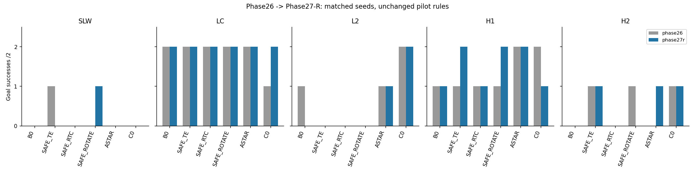
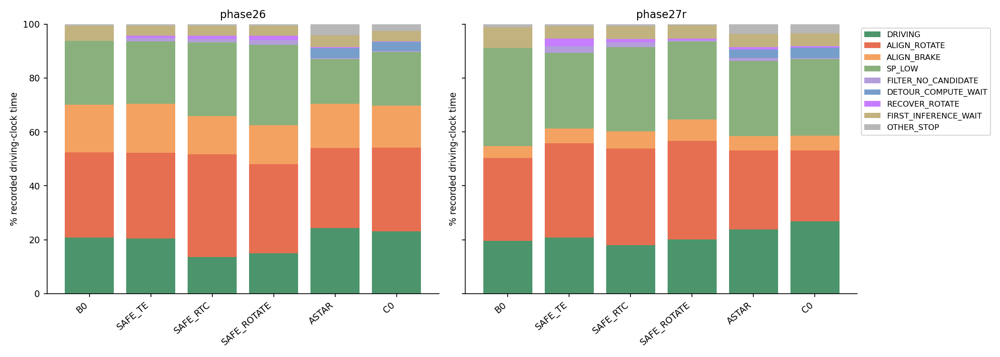

# Phase27-R 결과 — Phase26 대비 정렬 prefix 수정

**기존 Phase26 판정 함수를 그대로 재적용한 결과: `PILOT_AGAINST`.** 수정 전은 `PILOT_SUPPORTS`였다. 두 실험 모두60/60 final run이 기술 검증 PASS이며 scene×seed 제외는 없다. 새 주행·추론·계획 재풀이 없이 기존 report를 재생성하고 저장 로그의 비교·시간 회계만 추가했다. 원래 Phase26 결과와 Phase27-R 준비 자료는 보존했다.

## 수정 전후 핵심 비교

같은6방법·5장면·seed201/202, 같은 등록 판정이다. 변경된 주행 동작은 SP 출발 정렬 목표의 prefix→B 투영 이후 suffix 수정 하나다. 서로 다른 실행 시점의 두 폐루프 실험이므로 수정 전후 NoMaD 입력·경로·우회 발동 시점은 같지 않다. 이 표는 같은 seed 짝의 관측 비교이며 저장 경로 하나의 반사실이 아니다.

총 도착은 **27/60→28/60**, 충돌은 **6→12**다. 주행시간 중 정렬 회전은 **32.76%→32.47%**, 정렬 감속은 **15.97%→5.91%**. 정렬 감소가 C0의 등록 우위를 유지한다는 결과는 나오지 않았다.

## 1. 방법×장면 나란히 비교

모든 셀은 **Phase26 → Phase27-R**. 도착·충돌·통과는 run 수다. 정적 SLW/LC의 상자 통과는 해당 없음(—). ALL행의 n=10은 전체 run 수이며 상자 통과 대상은 그중 돌발6run이다(CSV의 passage_eligible_n에 별도 기록). 충돌은 원래 평가기의 실제 box/wall overlap이며, margin-only corridor 종료는 별도로 원래 결과 표/CSV에 남긴다. H2 통과는 두 상자 모두 통과해야1건이고, 통과시간은 첫 상자 생성부터 두 번째 상자 통과까지다. 미통과 시간은 대체하지 않으므로 통과시간 중앙값은 통과 run에 조건부이며 분모 변화에 주의한다.

평균속도는 run별 `distance_m/duration_s`(정지 포함)를 방법×장면 안에서 산술평균한다. 정지비율은 원래 Phase26 정의 `|v|<0.01`의 run별 비율 중앙값이다. 아래 시간 예산은 Phase27F의0.02기준·시간가중치이므로 두 비율을 섞지 않는다. 도착시간·box/wall 충돌 분리와 다른 원래 지표도 아래 frozen report 및 [before_after_summary.csv](../research/results/phase27r/before_after_summary.csv)에 있다.

| 장면 | 방법 | n | 도착 | 충돌 | 통과 | 통과시간_s | 평균속도_m_s | 정지_pct |
|---|---|---|---|---|---|---|---|---|
| SLW | B0_NOMAD_RAW | 2 → 2 | 0 → 0 | 1 → 1 | — → — | — → — | 0.084 → 0.077 | 47.31 → 56.98 |
| SLW | B1_SAFE_TE | 2 → 2 | 1 → 0 | 0 → 0 | — → — | — → — | 0.065 → 0.057 | 49.43 → 62.04 |
| SLW | B2_SAFE_RTC | 2 → 2 | 0 → 0 | 0 → 1 | — → — | — → — | 0.055 → 0.127 | 57.04 → 41.20 |
| SLW | B3_SAFE_ROTATE | 2 → 2 | 0 → 1 | 0 → 1 | — → — | — → — | 0.066 → 0.145 | 49.63 → 33.32 |
| SLW | B4_ASTAR | 2 → 2 | 0 → 0 | 1 → 1 | — → — | — → — | 0.078 → 0.080 | 48.88 → 53.99 |
| SLW | C0 | 2 → 2 | 0 → 0 | 0 → 0 | — → — | — → — | 0.069 → 0.059 | 53.02 → 67.16 |
| LC | B0_NOMAD_RAW | 2 → 2 | 2 → 2 | 0 → 0 | — → — | — → — | 0.098 → 0.142 | 38.09 → 19.20 |
| LC | B1_SAFE_TE | 2 → 2 | 2 → 2 | 0 → 0 | — → — | — → — | 0.106 → 0.169 | 36.38 → 25.39 |
| LC | B2_SAFE_RTC | 2 → 2 | 2 → 2 | 0 → 0 | — → — | — → — | 0.092 → 0.137 | 43.13 → 28.93 |
| LC | B3_SAFE_ROTATE | 2 → 2 | 2 → 2 | 0 → 0 | — → — | — → — | 0.109 → 0.144 | 33.09 → 27.78 |
| LC | B4_ASTAR | 2 → 2 | 2 → 2 | 0 → 0 | — → — | — → — | 0.105 → 0.141 | 36.49 → 22.60 |
| LC | C0 | 2 → 2 | 1 → 2 | 0 → 0 | — → — | — → — | 0.104 → 0.141 | 37.06 → 28.51 |
| L2 | B0_NOMAD_RAW | 2 → 2 | 1 → 0 | 1 → 2 | 1 → 0 | 30.32 → — | 0.085 → 0.118 | 46.55 → 40.54 |
| L2 | B1_SAFE_TE | 2 → 2 | 0 → 0 | 0 → 0 | 2 → 1 | 39.81 → 14.69 | 0.105 → 0.079 | 38.46 → 60.93 |
| L2 | B2_SAFE_RTC | 2 → 2 | 0 → 0 | 0 → 1 | 1 → 1 | 27.54 → 66.24 | 0.079 → 0.120 | 43.52 → 40.86 |
| L2 | B3_SAFE_ROTATE | 2 → 2 | 0 → 0 | 0 → 0 | 0 → 0 | — → — | 0.056 → 0.066 | 55.62 → 59.75 |
| L2 | B4_ASTAR | 2 → 2 | 1 → 1 | 0 → 0 | 2 → 2 | 25.29 → 43.06 | 0.107 → 0.109 | 40.63 → 52.85 |
| L2 | C0 | 2 → 2 | 2 → 2 | 0 → 0 | 2 → 2 | 22.58 → 15.14 | 0.104 → 0.161 | 39.89 → 22.71 |
| H1 | B0_NOMAD_RAW | 2 → 2 | 1 → 1 | 1 → 1 | 1 → 1 | 12.50 → 9.00 | 0.101 → 0.128 | 36.90 → 26.62 |
| H1 | B1_SAFE_TE | 2 → 2 | 1 → 2 | 0 → 0 | 1 → 2 | 12.61 → 6.83 | 0.098 → 0.180 | 35.05 → 19.18 |
| H1 | B2_SAFE_RTC | 2 → 2 | 1 → 1 | 0 → 1 | 2 → 1 | 20.09 → 10.85 | 0.075 → 0.125 | 49.87 → 31.22 |
| H1 | B3_SAFE_ROTATE | 2 → 2 | 1 → 2 | 0 → 0 | 2 → 2 | 14.80 → 9.03 | 0.086 → 0.141 | 44.52 → 31.89 |
| H1 | B4_ASTAR | 2 → 2 | 2 → 2 | 0 → 0 | 2 → 2 | 13.42 → 10.34 | 0.109 → 0.157 | 34.13 → 23.72 |
| H1 | C0 | 2 → 2 | 2 → 1 | 0 → 1 | 2 → 1 | 16.06 → 6.15 | 0.101 → 0.148 | 40.95 → 29.74 |
| H2 | B0_NOMAD_RAW | 2 → 2 | 0 → 0 | 2 → 2 | 0 → 0 | — → — | 0.103 → 0.141 | 31.90 → 35.01 |
| H2 | B1_SAFE_TE | 2 → 2 | 1 → 1 | 0 → 0 | 1 → 1 | 42.43 → 31.06 | 0.088 → 0.123 | 47.19 → 31.39 |
| H2 | B2_SAFE_RTC | 2 → 2 | 0 → 0 | 0 → 0 | 1 → 1 | 61.47 → 54.85 | 0.077 → 0.073 | 47.47 → 61.42 |
| H2 | B3_SAFE_ROTATE | 2 → 2 | 1 → 0 | 0 → 0 | 1 → 0 | 46.40 → — | 0.093 → 0.101 | 32.03 → 45.06 |
| H2 | B4_ASTAR | 2 → 2 | 0 → 1 | 0 → 0 | 0 → 2 | — → 46.00 | 0.083 → 0.120 | 51.54 → 35.93 |
| H2 | C0 | 2 → 2 | 1 → 1 | 0 → 0 | 2 → 1 | 54.92 → 32.61 | 0.100 → 0.149 | 44.66 → 26.41 |

### 돌발·정적·전체 합산

| 장면 | 방법 | n | 도착 | 충돌 | 통과 | 통과시간_s | 평균속도_m_s | 정지_pct |
|---|---|---|---|---|---|---|---|---|
| SUDDEN | B0_NOMAD_RAW | 6 → 6 | 2 → 1 | 4 → 5 | 2 → 1 | 21.41 → 9.00 | 0.096 → 0.129 | 36.90 → 32.26 |
| SUDDEN | B1_SAFE_TE | 6 → 6 | 2 → 3 | 0 → 0 | 4 → 4 | 34.90 → 11.38 | 0.097 → 0.127 | 35.05 → 29.66 |
| SUDDEN | B2_SAFE_RTC | 6 → 6 | 1 → 1 | 0 → 2 | 4 → 3 | 24.28 → 54.85 | 0.077 → 0.106 | 46.79 → 41.40 |
| SUDDEN | B3_SAFE_ROTATE | 6 → 6 | 2 → 2 | 0 → 0 | 3 → 2 | 15.60 → 9.03 | 0.078 → 0.103 | 42.24 → 36.50 |
| SUDDEN | B4_ASTAR | 6 → 6 | 3 → 4 | 0 → 0 | 4 → 6 | 15.23 → 26.45 | 0.100 → 0.128 | 40.79 → 30.14 |
| SUDDEN | C0 | 6 → 6 | 5 → 4 | 0 → 1 | 6 → 4 | 23.97 → 15.14 | 0.102 → 0.153 | 40.95 → 24.56 |
| STATIC | B0_NOMAD_RAW | 4 → 4 | 2 → 2 | 1 → 1 | — → — | — → — | 0.091 → 0.109 | 40.76 → 31.79 |
| STATIC | B1_SAFE_TE | 4 → 4 | 3 → 2 | 0 → 0 | — → — | — → — | 0.085 → 0.113 | 43.94 → 38.46 |
| STATIC | B2_SAFE_RTC | 4 → 4 | 2 → 2 | 0 → 1 | — → — | — → — | 0.073 → 0.132 | 46.89 → 32.63 |
| STATIC | B3_SAFE_ROTATE | 4 → 4 | 2 → 3 | 0 → 1 | — → — | — → — | 0.087 → 0.144 | 41.19 → 30.60 |
| STATIC | B4_ASTAR | 4 → 4 | 2 → 2 | 1 → 1 | — → — | — → — | 0.092 → 0.111 | 38.57 → 36.58 |
| STATIC | C0 | 4 → 4 | 1 → 2 | 0 → 0 | — → — | — → — | 0.087 → 0.100 | 41.23 → 48.16 |
| ALL | B0_NOMAD_RAW | 10 → 10 | 4 → 3 | 5 → 6 | 2 → 1 | 21.41 → 9.00 | 0.094 → 0.121 | 38.10 → 32.26 |
| ALL | B1_SAFE_TE | 10 → 10 | 5 → 5 | 0 → 0 | 4 → 4 | 34.90 → 11.38 | 0.092 → 0.122 | 38.09 → 30.31 |
| ALL | B2_SAFE_RTC | 10 → 10 | 3 → 3 | 0 → 3 | 4 → 3 | 24.28 → 54.85 | 0.076 → 0.116 | 46.79 → 38.44 |
| ALL | B3_SAFE_ROTATE | 10 → 10 | 4 → 5 | 0 → 1 | 3 → 2 | 15.60 → 9.03 | 0.082 → 0.119 | 42.24 → 32.28 |
| ALL | B4_ASTAR | 10 → 10 | 5 → 6 | 1 → 1 | 4 → 6 | 15.23 → 26.45 | 0.097 → 0.121 | 38.57 → 30.14 |
| ALL | C0 | 10 → 10 | 6 → 6 | 0 → 1 | 6 → 4 | 23.97 → 15.14 | 0.096 → 0.132 | 40.95 → 27.91 |

## 2. Phase27F 방식72Hz 시간 예산 재계산

원본 궤적의72Hz dt와9Hz 명령/회복 로그를 대응시켰다. 우선순위는 첫 추론 대기→RECOVER_ROTATE→정렬 회전/감속→수리/우회 계산 대기→ALL_UNSAFE STOP_WAIT→SP 저속→잔여 주행→기타 정지다. 각 tick은 한 상태에만 포함된다. SP 저속은 GO 목표속도<0.3이며 실제속도≥0.02인 구간이다. B0도 공통 SP 정렬을 사용한다.

기존 Phase26의60run을 동일 코드로 다시 계산했을 때 **Phase27F의 저장72Hz 상태 배열과 전부 일치**, 모든 시간 합의 최대 차이는 0s였다. 새 run도 각 상태 시간 합=실제 지속시간이다. method×scene×성공/timeout/기타실패별 표는 [time_budget_summary.csv](../research/results/phase27r/time_budget_summary.csv)에 보존했다.

| 상태 | 전_초 | 후_초 | 전_주행시간_pct | 후_주행시간_pct |
|---|---|---|---|---|
| 주행 | 821.847 | 725.972 | 19.258 | 21.602 |
| 정렬 회전 | 1397.889 | 1091.111 | 32.756 | 32.468 |
| 정렬 감속 | 681.333 | 198.611 | 15.966 | 5.910 |
| SP 저속 | 1010.681 | 998.944 | 23.683 | 29.725 |
| 필터 후보 없음 | 36.333 | 37.764 | 0.851 | 1.124 |
| 우회/수리 대기 | 49.556 | 41.444 | 1.161 | 1.233 |
| RECOVER_ROTATE | 33.250 | 36.750 | 0.779 | 1.094 |
| 첫 추론 대기 | 173.778 | 173.778 | 4.072 | 5.171 |
| 기타 정지 | 62.861 | 56.250 | 1.473 | 1.674 |

### 남은 정렬 회전·감속(방법별)

%는 해당 방법의 총 기록시간을 분모로 한다. 실제 정지 시간(|v|<0.02) 중 정렬 상태가 차지한 비율도 병기한다. 감속 중 실제 이동은 마지막 열의 분자에서 제외한다.

| 방법 | 회전_s | 회전_pct | 감속_s | 감속_pct | 물리정지_pct | 정지중정렬_pct |
|---|---|---|---|---|---|---|
| B0_NOMAD_RAW | 161.78 → 115.44 | 31.59 → 30.83 | 90.67 → 16.67 | 17.70 → 4.45 | 42.43 → 41.19 | 85.38 → 78.53 |
| B1_SAFE_TE | 243.56 → 221.33 | 31.82 → 35.03 | 139.11 → 34.46 | 18.17 → 5.45 | 42.81 → 47.04 | 85.15 → 77.57 |
| B2_SAFE_RTC | 311.78 → 217.00 | 38.30 → 35.86 | 114.22 → 39.00 | 14.03 → 6.44 | 49.04 → 45.85 | 86.45 → 81.82 |
| B3_SAFE_ROTATE | 253.33 → 210.89 | 32.98 → 36.56 | 111.89 → 46.33 | 14.57 → 8.03 | 44.58 → 44.77 | 83.35 → 86.02 |
| B4_ASTAR | 193.00 → 169.33 | 29.55 → 29.35 | 107.67 → 30.44 | 16.48 → 5.28 | 45.03 → 43.06 | 74.35 → 71.11 |
| C0 | 234.44 → 157.11 | 31.07 → 26.39 | 117.78 → 31.71 | 15.61 → 5.33 | 44.40 → 39.58 | 78.57 → 69.83 |
| ALL | 1397.89 → 1091.11 | 32.76 → 32.47 | 681.33 → 198.61 | 15.97 → 5.91 | 44.89 → 43.78 | 82.32 → 77.62 |

Phase27F의 문자 그대로의 `(정렬회전 전체+정렬감속 전체)/물리적 정지시간`은 108.53%→87.66%이며, 감속 중 이동까지 포함하여100%를 넘을 수 있다. 실제 정지 tick에 한정하면 **82.32%→77.62%**다. 이 시간 진단은 Phase26 성능 판정과 별개다.

## 3. 동결 판정과 C0 대 B4 순위 변화

| 항목 | Phase26 | Phase27R |
|---|---|---|
| label | PILOT_SUPPORTS | PILOT_AGAINST |
| C0_BETTER_vs | {'B1_SAFE_TE': True, 'B2_SAFE_RTC': True, 'B3_SAFE_ROTATE': True} | {'B1_SAFE_TE': False, 'B2_SAFE_RTC': True, 'B3_SAFE_ROTATE': False} |
| C0_vs_ASTAR | BETTER | WORSE |
| STATIC_OK | True | True |
| satisfied | ['B1_SAFE_TE', 'B2_SAFE_RTC', 'B3_SAFE_ROTATE', 'ASTAR', 'STATIC_OK'] | ['B2_SAFE_RTC', 'STATIC_OK'] |
| unsatisfied | [] | ['B1_SAFE_TE', 'B3_SAFE_ROTATE', 'ASTAR'] |

순위는 우선 도착 수만으로 비교하고 충돌을 별도 표시한다. SUDDEN행에만 원래 C0_vs_ASTAR 등록 라벨을 적용하며, scene/전체 행은 서술용이다. 임의의 종합 점수나 새 tie-break를 만들지 않았다.

| 장면 | C0도착 | B4도착 | 도착순위 | C0충돌 | B4충돌 |
|---|---|---|---|---|---|
| SLW | 0 → 0 | 0 → 0 | TIED_GOALS → TIED_GOALS | 0 → 0 | 1 → 1 |
| LC | 1 → 2 | 2 → 2 | C0 < ASTAR → TIED_GOALS | 0 → 0 | 0 → 0 |
| L2 | 2 → 2 | 1 → 1 | C0 > ASTAR → C0 > ASTAR | 0 → 0 | 0 → 0 |
| H1 | 2 → 1 | 2 → 2 | TIED_GOALS → C0 < ASTAR | 0 → 1 | 0 → 0 |
| H2 | 1 → 1 | 0 → 1 | C0 > ASTAR → TIED_GOALS | 0 → 0 | 0 → 0 |
| SUDDEN | 5 → 4 | 3 → 4 | C0 > ASTAR → TIED_GOALS | 0 → 1 | 0 → 0 |
| STATIC | 1 → 2 | 2 → 2 | C0 < ASTAR → TIED_GOALS | 0 → 0 | 1 → 1 |
| ALL | 6 → 6 | 5 → 6 | C0 > ASTAR → TIED_GOALS | 0 → 1 | 1 → 1 |

돌발 합산에서 C0/B4 도착은 **5/6 vs3/6 → 4/6 vs4/6**으로 C0 우위에서 동률로 바뀌었다. 동시에 충돌이 **0 vs0 → 1 vs0**이 되어 C0의 안전 비열등 조건이 깨졌다. 따라서 등록 C0_vs_ASTAR는 **BETTER→WORSE**이며, 도착 수가 A*보다 작아졌기 때문이라는 해석은 틀리다. H1의 C0 도착2→1·충돌0→1, H2의 B4 도착0→1이 이 차이에 기여했다. 전체10run 도착은 C0/B4 **6 vs5 → 6 vs6**이다. 돌발 상자 통과는 C0/B4 **6 vs4 → 4 vs6**으로 바뀌었다.

각 scene×seed에서 C0가 이긴/진/동률인 수와 통과시간은 [c0_astar_ranking.csv](../research/results/phase27r/c0_astar_ranking.csv), 방법별 수정 전후 같은 seed 결과는 [before_after_seed_pairs.csv](../research/results/phase27r/before_after_seed_pairs.csv)에 있다. 표본이 작고 수정으로 폐루프 궤적·관측이 바뀌었으므로 시간 감소만으로 충돌 원인이나 우회 성능 기여를 확정하지 않는다.

## 4. 재현·검증

실행 SHA별 run 수: `{'267f82687931aaf192c4f42a1f193aa10cb8c6f7': 60}`. 수정 SP 파일 SHA256은60run 모두 `ebcd985e5f7f94878d35cf7361e561a2ce20fa9a482a5a43df05478428e20359`로 일치한다. 기존 campaign report의 판정과 이번 재생성 판정이 일치하고, Phase26의 판정 함수와 원래 결정 파일도 일치한다. source/입력 hash와 보존 결과 hash는 `comparison_provenance.json`, 검사 결과는 `comparison_validation.json`에 기록했다.

재생성 명령(저장 로그만): `PYTHONPATH=research /usr/bin/python3 -m nomad_phase27r.results_compare --run-root ../artifacts/isaac6/phase27r_pilot_01`. 이는 기존 `nomad_phase27r.report.generate`를 먼저 호출한 뒤 비교표·시간 예산을 추가한다. 기존 frozen report·판정·주행 코드는 수정하지 않았다. venv 설치 없음.

---

## 기존 report 전체(동결 판정·지표)

### Registered report

Unchanged Phase26 protocol SHA256 `36b4d61b0ff3162a2369559e11bc3141f8061f10b20c8da8b47eead515266157`. Small descriptive pilot; no p-value determines a label. H1 is explicitly a u_ref limitation test. Exact simulator odometry. B0 is reference-only.

## Decisions

| label | C0_BETTER_vs | C0_vs_ASTAR | STATIC_OK | satisfied | unsatisfied | excluded_scene_seed |
| --- | --- | --- | --- | --- | --- | --- |
| PILOT_AGAINST | {'B1_SAFE_TE': False, 'B2_SAFE_RTC': True, 'B3_SAFE_ROTATE': False} | WORSE | True | ['B2_SAFE_RTC', 'STATIC_OK'] | ['B1_SAFE_TE', 'B3_SAFE_ROTATE', 'ASTAR'] | [] |

## Scene and pooled results

| group | method | n | goal | collision | box_collision | wall_collision | corridor_stop | passage | passage_time_median_s | goal_time_median_s | min_clearance_median_m | omega_saturation_median | stop_fraction_median | recovery_count | detour_triggers | detour_latency_median_s | compute_p95_median_s |
| --- | --- | --- | --- | --- | --- | --- | --- | --- | --- | --- | --- | --- | --- | --- | --- | --- | --- |
| SLW | B0_NOMAD_RAW | 2 | 0 | 1 | 0 | 1 | 1 | 0 | — | — | 0.060487 | 0.73547 | 0.56979 | 0 | 0 | — | — |
| SLW | B1_SAFE_TE | 2 | 0 | 0 | 0 | 0 | 0 | 0 | — | — | 0.032931 | 0.62222 | 0.62037 | 4 | 0 | — | — |
| SLW | B2_SAFE_RTC | 2 | 0 | 1 | 0 | 1 | 1 | 0 | — | — | 0.001503 | 0.4268 | 0.41196 | 1 | 0 | — | — |
| SLW | B3_SAFE_ROTATE | 2 | 1 | 1 | 0 | 1 | 1 | 0 | — | 54.653 | 0.052563 | 0.3222 | 0.3332 | 1 | 0 | — | — |
| SLW | B4_ASTAR | 2 | 0 | 1 | 0 | 1 | 1 | 0 | — | — | 0.0084516 | 0.47471 | 0.53985 | 3 | 25 | 0.33333 | 0.27857 |
| SLW | C0 | 2 | 0 | 0 | 0 | 0 | 0 | 0 | — | — | 0.08967 | 0.58827 | 0.6716 | 2 | 25 | 0.38889 | 0.48789 |
| LC | B0_NOMAD_RAW | 2 | 2 | 0 | 0 | 0 | 0 | 0 | — | 38.042 | 0.18574 | 0.49055 | 0.19196 | 0 | 0 | — | — |
| LC | B1_SAFE_TE | 2 | 2 | 0 | 0 | 0 | 0 | 0 | — | 32.34 | 0.23021 | 0.457 | 0.25392 | 0 | 0 | — | — |
| LC | B2_SAFE_RTC | 2 | 2 | 0 | 0 | 0 | 0 | 0 | — | 40.076 | 0.14157 | 0.49429 | 0.28931 | 0 | 0 | — | — |
| LC | B3_SAFE_ROTATE | 2 | 2 | 0 | 0 | 0 | 0 | 0 | — | 37.632 | 0.17978 | 0.5482 | 0.27779 | 0 | 0 | — | — |
| LC | B4_ASTAR | 2 | 2 | 0 | 0 | 0 | 0 | 0 | — | 37.361 | 0.14619 | 0.35365 | 0.22605 | 0 | 4 | 0.55556 | 0.43875 |
| LC | C0 | 2 | 2 | 0 | 0 | 0 | 0 | 0 | — | 37.799 | 0.15341 | 0.36241 | 0.28507 | 0 | 2 | 0.44444 | 0.34928 |
| L2 | B0_NOMAD_RAW | 2 | 0 | 2 | 2 | 0 | 0 | 0 | — | — | -0.00033777 | 0.60275 | 0.40543 | 0 | 0 | — | — |
| L2 | B1_SAFE_TE | 2 | 0 | 0 | 0 | 0 | 0 | 1 | 14.694 | — | 0.40682 | 0.73951 | 0.60926 | 0 | 0 | — | — |
| L2 | B2_SAFE_RTC | 2 | 0 | 1 | 1 | 0 | 0 | 1 | 66.236 | — | 0.032192 | 0.67149 | 0.4086 | 0 | 0 | — | — |
| L2 | B3_SAFE_ROTATE | 2 | 0 | 0 | 0 | 0 | 0 | 0 | — | — | 0.11044 | 0.67716 | 0.59753 | 1 | 0 | — | — |
| L2 | B4_ASTAR | 2 | 1 | 0 | 0 | 0 | 0 | 2 | 43.056 | 49.264 | 0.056822 | 0.64301 | 0.52851 | 0 | 3 | 0.30556 | 0.2529 |
| L2 | C0 | 2 | 2 | 0 | 0 | 0 | 0 | 2 | 15.139 | 54.09 | 0.13676 | 0.47303 | 0.22706 | 0 | 5 | 0.33333 | 0.28582 |
| H1 | B0_NOMAD_RAW | 2 | 1 | 1 | 1 | 0 | 0 | 1 | 9 | 35.569 | 0.051583 | 0.51264 | 0.26622 | 0 | 0 | — | — |
| H1 | B1_SAFE_TE | 2 | 2 | 0 | 0 | 0 | 0 | 2 | 6.8333 | 30.438 | 0.11159 | 0.41705 | 0.19176 | 0 | 0 | — | — |
| H1 | B2_SAFE_RTC | 2 | 1 | 1 | 1 | 0 | 0 | 1 | 10.847 | 53.875 | 0.033784 | 0.57052 | 0.31224 | 0 | 0 | — | — |
| H1 | B3_SAFE_ROTATE | 2 | 2 | 0 | 0 | 0 | 0 | 2 | 9.0278 | 38.118 | 0.11592 | 0.47903 | 0.31893 | 0 | 0 | — | — |
| H1 | B4_ASTAR | 2 | 2 | 0 | 0 | 0 | 0 | 2 | 10.34 | 33.694 | 0.053946 | 0.31886 | 0.23716 | 0 | 5 | — | 0.30392 |
| H1 | C0 | 2 | 1 | 1 | 1 | 0 | 0 | 1 | 6.1528 | 29.986 | 0.071469 | 0.35093 | 0.29737 | 0 | 9 | 0.33333 | 0.32668 |
| H2 | B0_NOMAD_RAW | 2 | 0 | 2 | 2 | 0 | 0 | 0 | — | — | -0.00075773 | 0.616 | 0.35011 | 0 | 0 | — | — |
| H2 | B1_SAFE_TE | 2 | 1 | 0 | 0 | 0 | 0 | 1 | 31.056 | 56.278 | 0.029507 | 0.44223 | 0.31388 | 6 | 0 | — | — |
| H2 | B2_SAFE_RTC | 2 | 0 | 0 | 0 | 0 | 0 | 1 | 54.847 | — | 0.094695 | 0.66358 | 0.6142 | 3 | 0 | — | — |
| H2 | B3_SAFE_ROTATE | 2 | 0 | 0 | 0 | 0 | 0 | 0 | — | — | 0.087666 | 0.63704 | 0.45062 | 0 | 0 | — | — |
| H2 | B4_ASTAR | 2 | 1 | 0 | 0 | 0 | 0 | 2 | 46 | 73.875 | 0.046685 | 0.46959 | 0.3593 | 0 | 16 | 0.36111 | 0.43519 |
| H2 | C0 | 2 | 1 | 0 | 0 | 0 | 0 | 1 | 32.611 | 54.931 | 0.039616 | 0.4147 | 0.26406 | 0 | 10 | 0.41667 | 0.39659 |
| SUDDEN | B0_NOMAD_RAW | 6 | 1 | 5 | 5 | 0 | 0 | 1 | 9 | 35.569 | -0.00036861 | 0.58297 | 0.32261 | 0 | 0 | — | — |
| SUDDEN | B1_SAFE_TE | 6 | 3 | 0 | 0 | 0 | 0 | 4 | 11.375 | 33.694 | 0.045626 | 0.4464 | 0.2966 | 6 | 0 | — | — |
| SUDDEN | B2_SAFE_RTC | 6 | 1 | 2 | 2 | 0 | 0 | 3 | 54.847 | 53.875 | 0.045183 | 0.64328 | 0.41403 | 3 | 0 | — | — |
| SUDDEN | B3_SAFE_ROTATE | 6 | 2 | 0 | 0 | 0 | 0 | 2 | 9.0278 | 38.118 | 0.099391 | 0.54506 | 0.36496 | 1 | 0 | — | — |
| SUDDEN | B4_ASTAR | 6 | 4 | 0 | 0 | 0 | 0 | 6 | 26.451 | 41.903 | 0.051895 | 0.44363 | 0.30135 | 0 | 24 | 0.33333 | 0.30392 |
| SUDDEN | C0 | 6 | 4 | 1 | 1 | 0 | 0 | 4 | 15.139 | 50.438 | 0.087331 | 0.42798 | 0.24563 | 0 | 24 | 0.33333 | 0.32849 |
| STATIC | B0_NOMAD_RAW | 4 | 2 | 1 | 0 | 1 | 1 | 0 | — | 38.042 | 0.11585 | 0.59283 | 0.31787 | 0 | 0 | — | — |
| STATIC | B1_SAFE_TE | 4 | 2 | 0 | 0 | 0 | 0 | 0 | — | 32.34 | 0.092175 | 0.49025 | 0.38457 | 4 | 0 | — | — |
| STATIC | B2_SAFE_RTC | 4 | 2 | 1 | 0 | 1 | 1 | 0 | — | 40.076 | 0.059455 | 0.49429 | 0.32626 | 1 | 0 | — | — |
| STATIC | B3_SAFE_ROTATE | 4 | 3 | 1 | 0 | 1 | 1 | 0 | — | 37.931 | 0.13799 | 0.50959 | 0.306 | 1 | 0 | — | — |
| STATIC | B4_ASTAR | 4 | 2 | 1 | 0 | 1 | 1 | 0 | — | 37.361 | 0.077771 | 0.4358 | 0.36582 | 3 | 29 | 0.44444 | 0.33158 |
| STATIC | C0 | 4 | 2 | 0 | 0 | 0 | 0 | 0 | — | 37.799 | 0.15341 | 0.42287 | 0.48156 | 2 | 27 | 0.38889 | 0.46311 |

## Paired seed outcomes

| scene | index | method | classification | success | collision | box_passage | box_passage_from_spawn_s | goal_time_s | technical_validation | attempt_count |
| --- | --- | --- | --- | --- | --- | --- | --- | --- | --- | --- |
| H1 | 201 | B0_NOMAD_RAW | COLLISION | False | True | False | — | — | PASS | 1 |
| H1 | 201 | B1_SAFE_TE | SUCCESS | True | False | True | 5.6111 | 27.181 | PASS | 1 |
| H1 | 201 | B2_SAFE_RTC | SUCCESS | True | False | True | 10.847 | 53.875 | PASS | 1 |
| H1 | 201 | B3_SAFE_ROTATE | SUCCESS | True | False | True | 8.4167 | 37.556 | PASS | 1 |
| H1 | 201 | B4_ASTAR | SUCCESS | True | False | True | 9.6111 | 34.542 | PASS | 1 |
| H1 | 201 | C0 | SUCCESS | True | False | True | 6.1528 | 29.986 | PASS | 1 |
| H1 | 202 | B0_NOMAD_RAW | SUCCESS | True | False | True | 9 | 35.569 | PASS | 1 |
| H1 | 202 | B1_SAFE_TE | SUCCESS | True | False | True | 8.0556 | 33.694 | PASS | 1 |
| H1 | 202 | B2_SAFE_RTC | COLLISION | False | True | False | — | — | PASS | 1 |
| H1 | 202 | B3_SAFE_ROTATE | SUCCESS | True | False | True | 9.6389 | 38.681 | PASS | 1 |
| H1 | 202 | B4_ASTAR | SUCCESS | True | False | True | 11.069 | 32.847 | PASS | 1 |
| H1 | 202 | C0 | COLLISION | False | True | False | — | — | PASS | 1 |
| H2 | 201 | B0_NOMAD_RAW | COLLISION | False | True | False | — | — | PASS | 1 |
| H2 | 201 | B1_SAFE_TE | SUCCESS | True | False | True | 31.056 | 56.278 | PASS | 1 |
| H2 | 201 | B2_SAFE_RTC | STUCK | False | False | True | 54.847 | — | PASS | 1 |
| H2 | 201 | B3_SAFE_ROTATE | STUCK | False | False | False | — | — | PASS | 1 |
| H2 | 201 | B4_ASTAR | STUCK | False | False | True | 40.861 | — | PASS | 1 |
| H2 | 201 | C0 | STUCK | False | False | False | — | — | PASS | 1 |
| H2 | 202 | B0_NOMAD_RAW | COLLISION | False | True | False | — | — | PASS | 1 |
| H2 | 202 | B1_SAFE_TE | STUCK | False | False | False | — | — | PASS | 1 |
| H2 | 202 | B2_SAFE_RTC | STUCK | False | False | False | — | — | PASS | 1 |
| H2 | 202 | B3_SAFE_ROTATE | STUCK | False | False | False | — | — | PASS | 1 |
| H2 | 202 | B4_ASTAR | SUCCESS | True | False | True | 51.139 | 73.875 | PASS | 1 |
| H2 | 202 | C0 | SUCCESS | True | False | True | 32.611 | 54.931 | PASS | 1 |
| L2 | 201 | B0_NOMAD_RAW | COLLISION | False | True | False | — | — | PASS | 1 |
| L2 | 201 | B1_SAFE_TE | STUCK | False | False | False | — | — | PASS | 1 |
| L2 | 201 | B2_SAFE_RTC | COLLISION | False | True | False | — | — | PASS | 1 |
| L2 | 201 | B3_SAFE_ROTATE | STUCK | False | False | False | — | — | PASS | 1 |
| L2 | 201 | B4_ASTAR | SUCCESS | True | False | True | 12.042 | 49.264 | PASS | 1 |
| L2 | 201 | C0 | SUCCESS | True | False | True | 18.597 | 62.236 | PASS | 1 |
| L2 | 202 | B0_NOMAD_RAW | COLLISION | False | True | False | — | — | PASS | 1 |
| L2 | 202 | B1_SAFE_TE | STUCK | False | False | True | 14.694 | — | PASS | 1 |
| L2 | 202 | B2_SAFE_RTC | STUCK | False | False | True | 66.236 | — | PASS | 1 |
| L2 | 202 | B3_SAFE_ROTATE | STUCK | False | False | False | — | — | PASS | 1 |
| L2 | 202 | B4_ASTAR | STUCK | False | False | True | 74.069 | — | PASS | 1 |
| L2 | 202 | C0 | SUCCESS | True | False | True | 11.681 | 45.944 | PASS | 1 |
| LC | 201 | B0_NOMAD_RAW | SUCCESS | True | False | False | — | 40.722 | PASS | 1 |
| LC | 201 | B1_SAFE_TE | SUCCESS | True | False | False | — | 29.944 | PASS | 1 |
| LC | 201 | B2_SAFE_RTC | SUCCESS | True | False | False | — | 45.444 | PASS | 1 |
| LC | 201 | B3_SAFE_ROTATE | SUCCESS | True | False | False | — | 37.333 | PASS | 1 |
| LC | 201 | B4_ASTAR | SUCCESS | True | False | False | — | 36.958 | PASS | 1 |
| LC | 201 | C0 | SUCCESS | True | False | False | — | 36.861 | PASS | 1 |
| LC | 202 | B0_NOMAD_RAW | SUCCESS | True | False | False | — | 35.361 | PASS | 1 |
| LC | 202 | B1_SAFE_TE | SUCCESS | True | False | False | — | 34.736 | PASS | 1 |
| LC | 202 | B2_SAFE_RTC | SUCCESS | True | False | False | — | 34.708 | PASS | 1 |
| LC | 202 | B3_SAFE_ROTATE | SUCCESS | True | False | False | — | 37.931 | PASS | 1 |
| LC | 202 | B4_ASTAR | SUCCESS | True | False | False | — | 37.764 | PASS | 1 |
| LC | 202 | C0 | SUCCESS | True | False | False | — | 38.736 | PASS | 1 |
| SLW | 201 | B0_NOMAD_RAW | STUCK | False | False | False | — | — | PASS | 1 |
| SLW | 201 | B1_SAFE_TE | STUCK | False | False | False | — | — | PASS | 1 |
| SLW | 201 | B2_SAFE_RTC | STUCK | False | False | False | — | — | PASS | 1 |
| SLW | 201 | B3_SAFE_ROTATE | CORRIDOR | False | True | False | — | — | PASS | 1 |
| SLW | 201 | B4_ASTAR | CORRIDOR | False | True | False | — | — | PASS | 1 |
| SLW | 201 | C0 | STUCK | False | False | False | — | — | PASS | 1 |
| SLW | 202 | B0_NOMAD_RAW | CORRIDOR | False | True | False | — | — | PASS | 1 |
| SLW | 202 | B1_SAFE_TE | STUCK | False | False | False | — | — | PASS | 1 |
| SLW | 202 | B2_SAFE_RTC | CORRIDOR | False | True | False | — | — | PASS | 1 |
| SLW | 202 | B3_SAFE_ROTATE | SUCCESS | True | False | False | — | 54.653 | PASS | 1 |
| SLW | 202 | B4_ASTAR | STUCK | False | False | False | — | — | PASS | 1 |
| SLW | 202 | C0 | STUCK | False | False | False | — | — | PASS | 1 |

## Descriptive sign counts

| group | comparison | wins | losses | ties | exact_sign_p |
| --- | --- | --- | --- | --- | --- |
| SUDDEN | C0 vs B1_SAFE_TE | 3 | 2 | 1 | 1 |
| SUDDEN | C0 vs B2_SAFE_RTC | 3 | 0 | 3 | 0.25 |
| SUDDEN | C0 vs B3_SAFE_ROTATE | 3 | 1 | 2 | 0.625 |
| SUDDEN | C0 vs B4_ASTAR | 1 | 1 | 4 | 1 |
| STATIC | C0 vs B1_SAFE_TE | 0 | 0 | 4 | 1 |
| STATIC | C0 vs B2_SAFE_RTC | 0 | 0 | 4 | 1 |
| STATIC | C0 vs B3_SAFE_ROTATE | 0 | 1 | 3 | 1 |
| STATIC | C0 vs B4_ASTAR | 0 | 0 | 4 | 1 |
| SLW | C0 vs B1_SAFE_TE | 0 | 0 | 2 | 1 |
| SLW | C0 vs B2_SAFE_RTC | 0 | 0 | 2 | 1 |
| SLW | C0 vs B3_SAFE_ROTATE | 0 | 1 | 1 | 1 |
| SLW | C0 vs B4_ASTAR | 0 | 0 | 2 | 1 |
| LC | C0 vs B1_SAFE_TE | 0 | 0 | 2 | 1 |
| LC | C0 vs B2_SAFE_RTC | 0 | 0 | 2 | 1 |
| LC | C0 vs B3_SAFE_ROTATE | 0 | 0 | 2 | 1 |
| LC | C0 vs B4_ASTAR | 0 | 0 | 2 | 1 |
| L2 | C0 vs B1_SAFE_TE | 2 | 0 | 0 | 0.5 |
| L2 | C0 vs B2_SAFE_RTC | 2 | 0 | 0 | 0.5 |
| L2 | C0 vs B3_SAFE_ROTATE | 2 | 0 | 0 | 0.5 |
| L2 | C0 vs B4_ASTAR | 1 | 0 | 1 | 1 |
| H1 | C0 vs B1_SAFE_TE | 0 | 1 | 1 | 1 |
| H1 | C0 vs B2_SAFE_RTC | 0 | 0 | 2 | 1 |
| H1 | C0 vs B3_SAFE_ROTATE | 0 | 1 | 1 | 1 |
| H1 | C0 vs B4_ASTAR | 0 | 1 | 1 | 1 |
| H2 | C0 vs B1_SAFE_TE | 1 | 1 | 0 | 1 |
| H2 | C0 vs B2_SAFE_RTC | 1 | 0 | 1 | 1 |
| H2 | C0 vs B3_SAFE_ROTATE | 1 | 0 | 1 | 1 |
| H2 | C0 vs B4_ASTAR | 0 | 0 | 2 | 1 |

H2 scene passage requires both boxes; per-box spawn-to-passage times and collision/clearance are in runs.json. Missing passage time is not imputed. Raw attempts and original phase results are preserved. Primary technical failures after one identical-seed retry exclude the complete scene×seed primary group; B0 failure is independent.

Technical exclusions: []

Phase27-R registration SHA256 `6d615e7a4c440d9c957025f672514def627ec99d63cdbcaa9dc37832535647f8`. The sole controller change is SPAlignment.replace_path: project B, then use the first stored suffix waypoint at arclength >=s_B+0.05m; no alignment if unavailable. All Phase26 decisions, seeds, scenes, method ordering and technical-retry rules are reused. Original Phase26 results are preserved.
