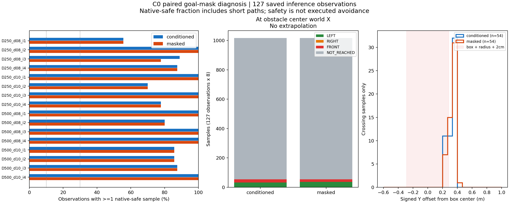
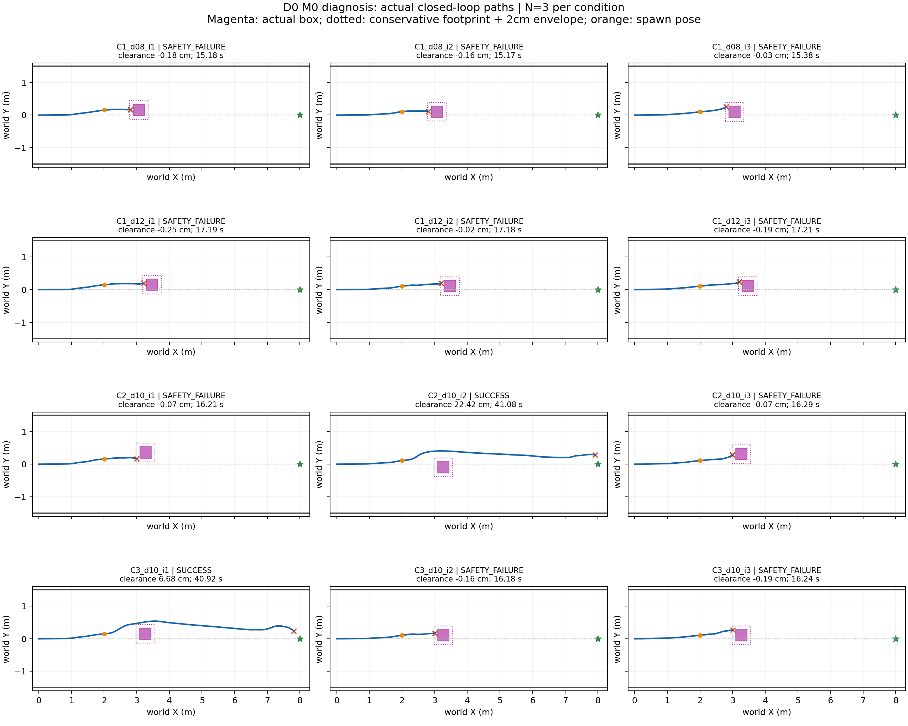

# Phase 2 policy diagnosis — results and frozen protocol

Base `e2eac6b`, same Phase 0 branch. C0 runs before twelve new D0 navigations. Protocol: `research/nomad_diagnostic/protocol.json`. Existing source artifacts are read-only.

C0 uses all 127 actual inference inputs from the 16 Phase 2 main M0 runs after oracle availability and before entire-footprint passage. The 167 busy captures in that window are counted separately; they have no invented seed or subgoal. Re-encode the original candidate batch and saved selected subgoal, reuse saved initial noise and DDPM seed, and compare conditioned normalized output, metric output and selected condition at predeclared tolerances. Decode official exploration mask=1 with identical initial/DDPM noise. The fake goal has an independent fixed RNG; official `explore.py` uses no-grad goal-masked encoding. No navigation is performed in C0.

User-fixed pooled observation bands (also report all run fractions): `<10% RARE`, `10% <= p <30% INDETERMINATE`, `>=30% SUFFICIENT`. Indicator is at least one native-safe sample among eight. Apply the same bands to both modes. A short safe prediction that does not reach the box center X is **not demonstrated avoidance**: no lateral extrapolation; report NOT_REACHED and safe-and-crossing separately. Native safety is full eight-point polyline clearance >=2cm plus corridor containment, using existing geometry functions; it does not establish actual PP execution safety.

C1: d=.8 and 1.2m, indices1–3 each. C2: d=1m, lateral placement offsets +.2/-.2/+.2m. C3: d=1m, centered, official goal mask=1 from oracle-public next FRESH until actual X>box rear+.30, then latch back to conditioned. Topomap localization/distance evaluation continues unchanged to preserve node logs; only the masked condition is decoded during exploration. Oracle data only controls this diagnostic inference-mode switch, never PP, selection or stopping. Decision pose is logged separately; native world paths retain observation anchors.

All runs: original sample0 PP, 4/9/72Hz, 1s waypoint timeout, 90s bounded navigation, no additional result delay, seed101+10000*index+2*request_id, DDPM+1. Twelve attempts, no retry or parameter changes. Runtime hooks are explicitly gated by diagnostic mode; legacy option restrictions remain. Existing model, checkpoint, Topomap, PP, PD, Graph and collision code remain unchanged.

Minimal preflight: four diagnostic unit tests and 13 existing Phase2/delivery tests pass. Topomap21-node RGB/hash check and fixed checkpoint/source hashes pass. Graph is not called and sample selection is disabled. Actual command/pose replay, swept clearance, RGB history hashes, gate/mask schedule and seed audits run after each navigation. Technical failure stops further launch attempts.

C1 success suggests delay may contribute; C1 failure with C2/C3 success indicates conditional avoidance. All three failing together with masked pooled ratio<10% supports the specified current-setting failure diagnosis. D0 retains real asynchronous inference age, so failure alone cannot establish that delay/handoff has zero influence. Results are exploratory N=3 per condition and not a model-wide capability proof.

Preregistration was committed as `baded63` before any C0 inference or new navigation. All C0 and C1–C3 executions used this clean commit. The text above is the frozen protocol, not a retrospective parameter choice.

## 실제 결과 — 2026-10-23

**판정: 조건부 회피 능력 확인.** 정면 goal-conditioned C1은 d=0.8/1.2m 각각 0/3 성공, C2 측면 배치는 1/3, C3 진단용 oracle exploration 전환은 1/3 성공했다. 모든 실패는 실제 geometric overlap이며 corridor 침범·timeout·placement invalid·technical failure는 없었다. 정확히 12회, 재시도 0회다. N=3 탐색 관측이며 모델 전체의 회피 능력이나 인과 효과를 입증하지 않는다.

### C0: 같은 observation·noise·seed에서의 비교

127개 conditioned 재현에서 selected condition, normalized diffusion output, metric output의 최대 절대 오차는 모두 **0**이다. 초기 noise도 저장값과 정확히 일치했다. 기존 raw/history hash는 분석 전후 일치한다. Busy-skip capture 167개는 별도 집계했다.

| 지표 | Goal-conditioned (a) | Goal-masked (b) |
|---|---:|---:|
| 안전 sample ≥1인 observation | 112/127 (88.19%) | 111/127 (87.40%) |
| 사전 고정 전체 비율 구간 | SUFFICIENT (≥30%) | SUFFICIENT (≥30%) |
| Sample 0 안전 observation | 105/127 (82.68%) | 105/127 (82.68%) |
| 전체 sample의 native 안전 비율 | 856/1016 (84.25%) | 852/1016 (83.86%) |
| 중심 X에서 좌 / 우 / 정면 sample | 32 / 0 / 22 | 37 / 0 / 17 |
| 중심 X 교차 없음 (외삽하지 않음) | 962/1016 (94.69%) | 962/1016 (94.69%) |
| 안전하면서 중심 X를 옆으로 지나는 후보 ≥1 | 4/127 (3.15%) | 4/127 (3.15%) |
| Native full polyline 길이 중앙값 | 0.288m | 0.294m |

두 mode 모두 사용자 사전 기준상 **충분**이다. 따라서 “masked에서도 안전 sample이 드묾(<10%)”이라는 부정 판정 조건은 성립하지 않는다. 다만 이 지표는 상자까지 닿지 않는 짧은 경로도 안전으로 센다. 중심 X를 안전하게 지나는 4개 observation은 두 mode 모두 기존 성공 run `s2a_D250_d10_i1_M0`에만 있다. 짧은 native 경로의 안전성을 완전한 회피나 실제 PP 실행 안전성으로 바꾸어 해석하면 안 된다.

Masked는 같은 저장 입력에서 안전 후보 observation을 늘리지 않았다: 둘 다 안전 111개, 둘 다 ALL_UNSAFE 15개, conditioned만 안전 1개, masked만 안전 0개다. Mask가 실제로 출력에 영향을 주었는지는 metric 차이로 확인했다(관측별 최대 절대 차이 중앙값 0.0513m). C0 conditioned ALL_UNSAFE 15개 중 실제 적용 8개는 기존 Phase2 기록과 일치하며, 7개는 종료 직전 미적용 prediction이다.

| 원본 M0 run (s2a_…_M0) | 관측 수 | (a) 안전 후보 비율 | (b) 안전 후보 비율 | busy-skip |
|---|---:|---:|---:|---:|
| D250_d08_i1 | 9 | 55.56% | 55.56% | 7 |
| D250_d08_i2 | 7 | 100.00% | 100.00% | 8 |
| D250_d08_i3 | 9 | 88.89% | 77.78% | 6 |
| D250_d08_i4 | 8 | 87.50% | 87.50% | 7 |
| D250_d10_i1 | 16 | 100.00% | 100.00% | 15 |
| D250_d10_i2 | 10 | 70.00% | 70.00% | 9 |
| D250_d10_i3 | 9 | 100.00% | 100.00% | 10 |
| D250_d10_i4 | 9 | 77.78% | 77.78% | 10 |
| D500_d08_i1 | 6 | 100.00% | 100.00% | 11 |
| D500_d08_i2 | 5 | 80.00% | 80.00% | 10 |
| D500_d08_i3 | 6 | 100.00% | 100.00% | 10 |
| D500_d08_i4 | 5 | 100.00% | 100.00% | 10 |
| D500_d10_i1 | 7 | 85.71% | 85.71% | 13 |
| D500_d10_i2 | 7 | 85.71% | 85.71% | 15 |
| D500_d10_i3 | 8 | 87.50% | 87.50% | 12 |
| D500_d10_i4 | 6 | 100.00% | 100.00% | 14 |

위 모든 run도 비율 자체는 ≥30% 구간이다. 좌/우는 world ±Y이며, 상자 반폭+radius+2cm(0.285m) 바깥의 첫 forward center-X 교차로 구분했다. 원시 signed lateral offset과 모든 8개 sample 판정은 CSV에 남겼다.

### C1/C2/C3: 실제 closed-loop 결과

Offset는 index 1/2/3에 10000/20000/30000, 실제 seed=101+offset+2×request_id, DDPM seed=+1이다. C2의 lateral offset은 index별 +0.20/−0.20/+0.20m이며 clipping은 발생하지 않았다. 모든 run은 D=0, sample 0, 기존 PP v=0.2로 실행했다. C3에서도 sample 교체나 속도 정책 변경은 없다.

| Run | 결과 | 종료 s | 최소 clearance cm | 최대 \|y\| m | 이동 m | 통과 |
|---|---|---:|---:|---:|---:|---|
| C1_d08_i1 | SAFETY_FAILURE | 15.181 | -0.183 | 0.174 | 2.814 | 없음 |
| C1_d08_i2 | SAFETY_FAILURE | 15.167 | -0.157 | 0.126 | 2.811 | 없음 |
| C1_d08_i3 | SAFETY_FAILURE | 15.375 | -0.029 | 0.260 | 2.831 | 없음 |
| C1_d12_i1 | SAFETY_FAILURE | 17.194 | -0.248 | 0.191 | 3.217 | 없음 |
| C1_d12_i2 | SAFETY_FAILURE | 17.181 | -0.018 | 0.196 | 3.214 | 없음 |
| C1_d12_i3 | SAFETY_FAILURE | 17.208 | -0.190 | 0.238 | 3.219 | 없음 |
| C2_d10_i1 | SAFETY_FAILURE | 16.208 | -0.072 | 0.200 | 3.019 | 없음 |
| C2_d10_i2 | SUCCESS | 41.083 | 22.422 | 0.406 | 7.994 | +Y |
| C2_d10_i3 | SAFETY_FAILURE | 16.292 | -0.066 | 0.290 | 3.036 | 없음 |
| C3_d10_i1 | SUCCESS | 40.917 | 6.675 | 0.540 | 7.961 | +Y |
| C3_d10_i2 | SAFETY_FAILURE | 16.181 | -0.158 | 0.171 | 3.014 | 없음 |
| C3_d10_i3 | SAFETY_FAILURE | 16.236 | -0.187 | 0.273 | 3.025 | 없음 |

성공한 C2 index2와 C3 index1은 각각 minimum clearance 22.42cm / 6.68cm이며 2cm margin 위반이 없다. 실패 10개는 모두 실제 overlap이고, margin 미충족 누적 시간은 0.111–0.139s이다. Goal success와 safety margin을 별도로 보존했다. 기존 monitor의 swept lower bound이므로 음수는 penetration depth의 정확한 측정값이 아니다.

C3는 세 run 모두 첫 visible observation 45 다음 capture 46 공개 후 FRESH42부터 mask=1이 적용됐다. 성공한 index1은 ID42–76을 모두 적용했고, 실제 X가 상자 rear+0.30m를 지난 뒤 ID77부터 conditioned로 돌아왔다. 실패 index2/3은 ID42–60(각19개)을 적용한 뒤 충돌했다. 공개 전 mask=1이나 실제 B 재앵커링은 없었다. Mode 결정 pose와 observation pose는 구분해 기록했다.

그림의 파란 선은 실제 72Hz 실행, 주황 점은 spawn pose, 자홍색은 실제 box, 점선 상자는 원형 footprint+2cm의 보수적 AABB envelope, 빨간 ×는 종료 위치, 초록 별은 목표다. 그래프의 예측 경로나 가상 rollout이 아니다.

### 검증 및 해석 범위

- 12/12 기술 검증 PASS. 995장 RGB magenta count/hash와 visible flag를 원본 RGB에서 재계산했다. Oracle 공개는 첫 visible의 다음 실제 capture 완료 이후다. C3 mode request 및 실제 switch 기록도 대조했다.
- 72Hz pose 적분, 9Hz 실제 PP 명령 및 command-to-trace 최대 오차 모두 0. Mode decision pose도 실제 trace와 오차 0. 기존 swept collision/corridor 계산과 일치한다.
- Graph 호출 0, sample 교체 0, 추가 지연 0. Waypoint timeout 0. 초기 대기 포함 stop 시간은 1.111s(한 run 1.222s); recovery/safety stop은 없다.
- Soft real-time pacing 절대 오차 중앙값 0.106ms, p95 0.160ms, 최대 3.062ms. Warm GPU inference run별 중앙값 36.89–38.40ms. D0는 인위적 전달 지연이 없다는 뜻이며 실제 inference, rendering 및 controller tick 대기는 존재한다.
- Checkpoint, Topomap, NoMaD 모델, 원본 PP/PD/Graph 및 기존 입력 hash 유지. 새 raw는 `/home/gpuadmin/Workspace/NoMaD/artifacts/isaac6/p2_diagnostic_01/`에 독립 보존했다.

사전 판정의 “C1 실패, C2 또는 C3 성공” 분기에 해당한다. Topomap에 없는 장애물도 **옆으로 비킨 배치 또는 진단용 oracle exploration 전환에서 성공한 사례가 있다**. 정면 conditioned D0 실패는 Phase2 실패가 추가 전달 지연만으로 설명되지 않음을 보여주지만, 실제 inference age·handoff·PP 실행의 기여를 배제하지 않는다. C0의 단발 재추론과 C3의 새 closed-loop RGB는 서로 다른 증거다.

C2의 side와 seed는 함께 바뀌며, C3 d=1.0m와 정확히 짝인 C1 d=1.0m 조건은 없다. 동일 offset도 실제 RGB/history/request timing은 동일하지 않다. 따라서 goal mask의 순수 인과 효과, 일반적 회피 성공률, Graph 필요성은 입증하지 않는다. C3는 실제 geometry와 visibility에 의존하는 **진단용 oracle 전환**이며 일반적인 online perception 정책으로 주장하지 않는다. PhysX 동역학/실제 로봇 검증도 아니다.

### 파일 및 재현

실행 commit: `baded63` (clean). 분석 코드 `research/nomad_diagnostic/report.py`는 실행 종료 후 read-only report용으로 추가했다. 신규 구현은 `nomad_diagnostic/{config,inference,c0,data,batch,test_diagnostic}.py`와 `protocol.json`; 최소 hooks는 `nomad_isaac/{launch,simulator,worker,async_runtime}.py`, `nomad_phase2/{config,execution,audit}.py`다. 기존 Topomap inference source와 native/model/controller 파일은 수정하지 않았다.

작은 결과: [summary.json](../research/results/phase2_policy_diagnosis_20261023/summary.json), [runs.csv](../research/results/phase2_policy_diagnosis_20261023/runs.csv), [C0 run별 비율](../research/results/phase2_policy_diagnosis_20261023/c0_runs.csv), [C0 observation](../research/results/phase2_policy_diagnosis_20261023/c0_observations.csv), [C0 모든 sample](../research/results/phase2_policy_diagnosis_20261023/c0_samples.csv), [새 주행 FRESH](../research/results/phase2_policy_diagnosis_20261023/fresh.csv), [모드 전환](../research/results/phase2_policy_diagnosis_20261023/modes.csv). Raw, RGB, NPZ 및 checkpoint는 Git에 포함하지 않는다.

검증 명령: `PYTHONPATH=research /usr/bin/python3 -m unittest nomad_diagnostic.test_diagnostic`; 기존 regression 13개는 `pytest research/tests/test_phase2.py research/tests/test_delivery_delay.py`. C0 및 batch는 기존 출력 경로 재사용을 거부한다. 이 보고서 재생성은 새 출력 경로를 지정한 `nomad_diagnostic.report`만 실행하며 inference/navigation을 호출하지 않는다.
