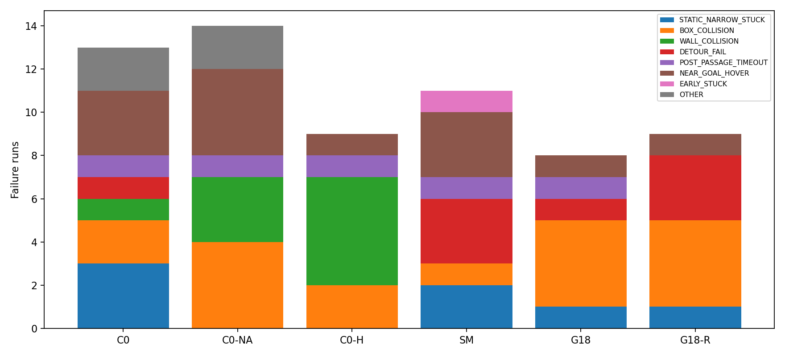
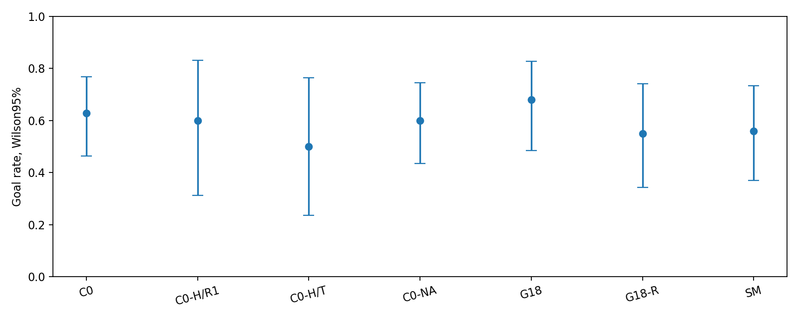
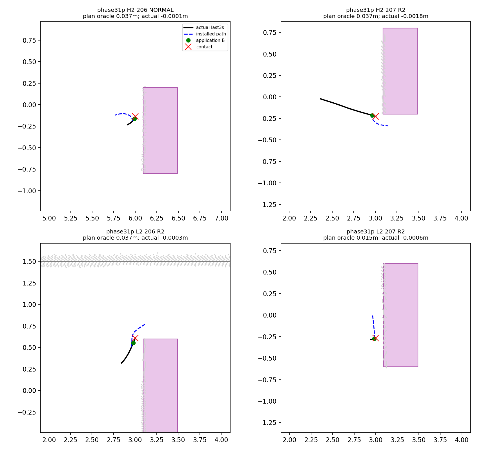
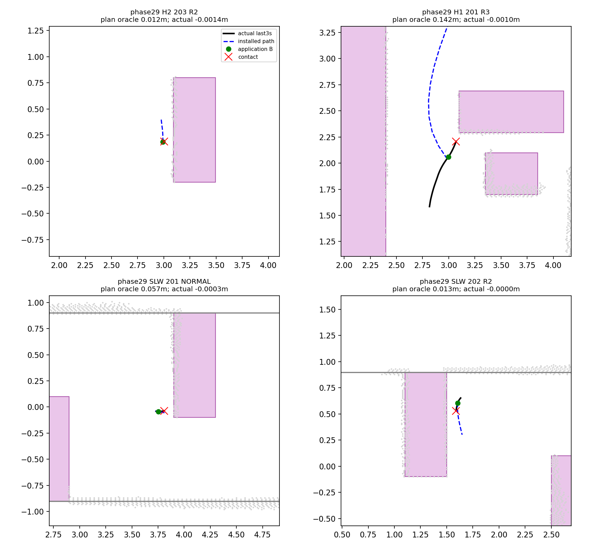

# Phase31-D 통합 분석

기존 로그 **160회**(도착 96, 실패 64, 기술 무효0)를 분석했다. 보고서 참조 중복 40행을 output 실제 경로로 제거했고, Phase29 smoke는 명시적 대상(dev·confirm)이 아니므로 제외했다. 새 시뮬레이션·NoMaD 추론·Graph 재풀이 및 기존 코드/결과 수정은 없다. 분석용 임시 스크립트는 `/tmp`에만 두었으며 산출물/방법 규칙/입력 hash만 저장했다.

핵심 관측: G18-R 충돌4건은 R2 3건과 NORMAL 원 SAFE 경로 1건이다. 이4건에서 충돌 순간 실행 중이던 경로는 NORMAL CLR 보정이나 R3가 아니다. 이전에 수정된 경로가 로봇 상태에 미친 간접 영향까지 배제한다는 뜻은 아니다. 동일 코드/정책의 같은 scene×seed를 다른 날 독립 재실행한 쌍은 0개라, 그 조건의 흔들림 일치율은 계산할 수 없다.

### 포함 자료(독립 물리 run)

| phase | stage | n |
|---|---|---|
| phase27r | main | 10 |
| phase28 | main | 20 |
| phase28t/main | main | 10 |
| phase29 | confirm | 60 |
| phase29 | dev | 20 |
| phase30r | main | 10 |
| phase31p | main | 30 |

방법별 seed 범위가 다르므로 전체 도착률 순위는 짝 비교의 대체물이 아니다. 예를 들어 C0와 G18의 공통25짝은 각각17회 도착이고, C0와 G18-R의 공통20짝은 각각11회 도착이다.

## 1. 실패 분해 규칙

원 evaluator의 success/collision/termination은 그대로 보존하고 실패에만 아래 우선순위의 **첫 일치** 원인 하나를 붙였다. 이는 로그 기반 주 실패 양상의 분해이며 좁은 폭/모델/실행기의 인과를 확정한 것이 아니다.

1. 기술 무효는 OTHER(통계 제외); 성공 run은 분류 대상에서 제외.
2. geometric box contact → BOX_COLLISION. InnerCorner 등 구조 벽 상자는 WALL_COLLISION.
3. 외곽 wall overlap 또는 corridor stop → WALL_COLLISION. **실제 겹침과 margin/경계 정지를 구분해 failures.csv에 남겼다. WALL_COLLISION 개수 전체가 실제 충돌 수는 아니다.**
4. 목표 최소 거리 ≤0.6m 뒤 미도착 → NEAR_GOAL_HOVER. 실제 회전/진동을 입증하는 명칭이 아니라 근접 후 미도착 기준이다.
5. 돌발 장면에서 필요한 모든 상자 통과 후 미도착 → POST_PASSAGE_TIMEOUT. H2는2개 모두 통과해야 한다.
6. 정적 SLW/LC에서 마지막10초의 목표 거리 순감소 <0.20m → STATIC_NARROW_STUCK. 이동하며 되돌거나 맴돈 경우도 포함한다.
7. 상자 출현 후 모든 상자를 통과하지 못함 → DETOUR_FAIL. R3가 실제 적용되지 않았어도 이 실패 단계에 해당하며 적용 수를 별도 보존했다.
8. 돌발 상자가 아직 출현하지 않았거나, 남은 경우 중 시작점 최대 변위 <0.5m → EARLY_STUCK; 나머지 OTHER.

각 run의 최소 목표거리·시점, 마지막10초 진전/주행거리, 상자 수/통과 수 및 분류 근거: [failures.csv](../research/results/phase31d/failures.csv). 숫자는 새 성능 판정 기준이 아니라 이번 사후 분해의 고정 측정 규칙이다.

| cause | n | fraction_of_failures | fraction_of_all_runs | common_observed | common_all_six |
|---|---|---|---|---|---|
| STATIC_NARROW_STUCK | 7 | 0.10938 | 0.04375 | 2 | 0 |
| BOX_COLLISION | 17 | 0.26562 | 0.10625 | 4 | 0 |
| WALL_COLLISION | 9 | 0.14062 | 0.05625 | 1 | 0 |
| DETOUR_FAIL | 8 | 0.125 | 0.05 | 1 | 0 |
| POST_PASSAGE_TIMEOUT | 5 | 0.078125 | 0.03125 | 0 | 0 |
| NEAR_GOAL_HOVER | 13 | 0.20312 | 0.08125 | 1 | 0 |
| EARLY_STUCK | 1 | 0.015625 | 0.00625 | 0 | 0 |
| OTHER | 4 | 0.0625 | 0.025 | 1 | 0 |

### 방법×장면

| method | scene | n | goal | failures | STATIC_NARROW_STUCK | BOX_COLLISION | WALL_COLLISION | DETOUR_FAIL | POST_PASSAGE_TIMEOUT | NEAR_GOAL_HOVER | EARLY_STUCK | OTHER | common_observed | common_all_six |
|---|---|---|---|---|---|---|---|---|---|---|---|---|---|---|
| C0 | SLW | 7 | 2 | 5 | 3 | 0 | 0 | 0 | 0 | 1 | 0 | 1 | 1 | 0 |
| C0 | LC | 7 | 6 | 1 | 0 | 0 | 0 | 0 | 0 | 0 | 0 | 1 | 0 | 0 |
| C0 | L2 | 7 | 4 | 3 | 0 | 0 | 0 | 0 | 1 | 2 | 0 | 0 | 0 | 0 |
| C0 | H1 | 7 | 6 | 1 | 0 | 1 | 0 | 0 | 0 | 0 | 0 | 0 | 0 | 0 |
| C0 | H2 | 7 | 4 | 3 | 0 | 1 | 1 | 1 | 0 | 0 | 0 | 0 | 2 | 0 |
| C0-NA | SLW | 7 | 2 | 5 | 0 | 0 | 3 | 0 | 0 | 0 | 0 | 2 | 1 | 0 |
| C0-NA | LC | 7 | 5 | 2 | 0 | 1 | 0 | 0 | 0 | 1 | 0 | 0 | 0 | 0 |
| C0-NA | L2 | 7 | 5 | 2 | 0 | 0 | 0 | 0 | 1 | 1 | 0 | 0 | 0 | 0 |
| C0-NA | H1 | 7 | 7 | 0 | 0 | 0 | 0 | 0 | 0 | 0 | 0 | 0 | 0 | 0 |
| C0-NA | H2 | 7 | 2 | 5 | 0 | 3 | 0 | 0 | 0 | 2 | 0 | 0 | 2 | 0 |
| C0-H | SLW | 4 | 0 | 4 | 0 | 1 | 3 | 0 | 0 | 0 | 0 | 0 | 0 | 0 |
| C0-H | LC | 4 | 3 | 1 | 0 | 0 | 1 | 0 | 0 | 0 | 0 | 0 | 0 | 0 |
| C0-H | L2 | 4 | 3 | 1 | 0 | 0 | 0 | 0 | 0 | 1 | 0 | 0 | 0 | 0 |
| C0-H | H1 | 4 | 3 | 1 | 0 | 1 | 0 | 0 | 0 | 0 | 0 | 0 | 0 | 0 |
| C0-H | H2 | 4 | 2 | 2 | 0 | 0 | 1 | 0 | 1 | 0 | 0 | 0 | 0 | 0 |
| SM | SLW | 5 | 3 | 2 | 1 | 0 | 0 | 0 | 0 | 1 | 0 | 0 | 0 | 0 |
| SM | LC | 5 | 4 | 1 | 1 | 0 | 0 | 0 | 0 | 0 | 0 | 0 | 0 | 0 |
| SM | L2 | 5 | 3 | 2 | 0 | 0 | 0 | 0 | 1 | 1 | 0 | 0 | 0 | 0 |
| SM | H1 | 5 | 3 | 2 | 0 | 1 | 0 | 0 | 0 | 0 | 1 | 0 | 0 | 0 |
| SM | H2 | 5 | 1 | 4 | 0 | 0 | 0 | 3 | 0 | 1 | 0 | 0 | 1 | 0 |
| G18 | SLW | 5 | 2 | 3 | 1 | 2 | 0 | 0 | 0 | 0 | 0 | 0 | 0 | 0 |
| G18 | LC | 5 | 5 | 0 | 0 | 0 | 0 | 0 | 0 | 0 | 0 | 0 | 0 | 0 |
| G18 | L2 | 5 | 3 | 2 | 0 | 0 | 0 | 0 | 1 | 1 | 0 | 0 | 0 | 0 |
| G18 | H1 | 5 | 4 | 1 | 0 | 1 | 0 | 0 | 0 | 0 | 0 | 0 | 0 | 0 |
| G18 | H2 | 5 | 3 | 2 | 0 | 1 | 0 | 1 | 0 | 0 | 0 | 0 | 1 | 0 |
| G18-R | SLW | 4 | 3 | 1 | 1 | 0 | 0 | 0 | 0 | 0 | 0 | 0 | 1 | 0 |
| G18-R | LC | 4 | 4 | 0 | 0 | 0 | 0 | 0 | 0 | 0 | 0 | 0 | 0 | 0 |
| G18-R | L2 | 4 | 1 | 3 | 0 | 2 | 0 | 0 | 0 | 1 | 0 | 0 | 0 | 0 |
| G18-R | H1 | 4 | 2 | 2 | 0 | 0 | 0 | 2 | 0 | 0 | 0 | 0 | 0 | 0 |
| G18-R | H2 | 4 | 1 | 3 | 0 | 2 | 0 | 1 | 0 | 0 | 0 | 0 | 1 | 0 |

### 공통 실패

같은 scene×seed에서 **관측된 모든 방법/독립 run**이 실패한 블록은 3개, 여섯 방법이 모두 존재하며 전부 실패한 블록은 0개다. 전체35블록 중6방법 완비는10개(201/202), 나머지는4방법 또는3방법 관측이다. 미관측 방법을 실패로 채우지 않았다. C0-H 두 버전 중 하나라도 성공하면 그 블록은 모든 기록 실패로 보지 않는다. 원인별 공통 여부는 위 표와 failures.csv에 표시했고, 같은 주 원인까지 일치하는지도 common_failure_blocks.csv에 별도 기록했다.

| scene | index | methods | n_methods | n_runs | all_observed_fail | all_six_fail | same_primary_cause | causes |
|---|---|---|---|---|---|---|---|---|
| H2 | 203 | ['C0', 'C0-NA', 'G18', 'SM'] | 4 | 4 | True | — | False | {'BOX_COLLISION': 2, 'WALL_COLLISION': 1, 'DETOUR_FAIL': 1} |
| H2 | 206 | ['C0', 'C0-NA', 'G18-R'] | 3 | 3 | True | — | False | {'NEAR_GOAL_HOVER': 1, 'BOX_COLLISION': 2} |
| SLW | 206 | ['C0', 'C0-NA', 'G18-R'] | 3 | 3 | True | — | False | {'OTHER': 1, 'STATIC_NARROW_STUCK': 2} |

## 2. 반복 일치율과 도착률 불확실성

C0/C0-NA의 과거 행이 여러 runs.json에 실려 있어도 output 경로가 같으면 같은 물리 run이다. 중복 참조를 서로 다른 날 재주행으로 세지 않았다. 날짜는 `launch_complete.json`(없으면 summary.json)의 보존 mtime을 KST로 읽은 보조 값으로, 별도 wall-clock 측정이 없는 자료에서 정확한 실행일을 새로 주장하지 않는다.

| method | independent_same_seed_repeat_pairs | unchanged_cross_day_pairs | unchanged_success_agreement | changed_version_pairs | changed_version_success_agreement | changed_version_outcome_agreement |
|---|---|---|---|---|---|---|
| C0 | 0 | 0 | — | 0 | — | — |
| C0-NA | 0 | 0 | — | 0 | — | — |
| C0-H | 10 | 0 | — | 10 | 0.5 | 0.4 |
| SM | 0 | 0 | — | 0 | — | — |
| G18 | 0 | 0 | — | 0 | — | — |
| G18-R | 0 | 0 | — | 0 | — | — |

C0-H는 같은 seed10쌍이 있지만 Phase28 R1과 Phase28-T main은 예산/적용시점/CPU 격리 정책이 달라 **버전 변경 비교**다. 따라서 그 일치율을 같은 알고리즘의 자연 변동성으로 해석하지 않는다. repeat_pairs.csv에는 도착/종료 종류/원인 일치와 날짜를 따로 남겼다.

방법별95% Wilson 구간은 관측 비율의 서술용 구간이다. 고정된5장면, 같은 seed 재사용 및 혼합 C0-H 버전의 의존/이질성을 보정한 일반화 성능 구간은 아니다. Wilson score 방식은 [statsmodels 공식 문서](https://www.statsmodels.org/stable/generated/statsmodels.stats.proportion.proportion_confint.html)의 정의를 따랐다.

| level | method_or_variant | scene | n | goal | rate | wilson_low | wilson_high |
|---|---|---|---|---|---|---|---|
| method | C0 | ALL | 35 | 22 | 0.62857 | 0.46337 | 0.76834 |
| method | C0-NA | ALL | 35 | 21 | 0.6 | 0.43573 | 0.74449 |
| method | C0-H | ALL | 20 | 11 | 0.55 | 0.34209 | 0.7418 |
| method | SM | ALL | 25 | 14 | 0.56 | 0.37067 | 0.73334 |
| method | G18 | ALL | 25 | 17 | 0.68 | 0.4841 | 0.82795 |
| method | G18-R | ALL | 20 | 11 | 0.55 | 0.34209 | 0.7418 |

C0-H 버전별 분리:

| level | method_or_variant | scene | n | goal | rate | wilson_low | wilson_high |
|---|---|---|---|---|---|---|---|
| variant | C0-H/R1 | ALL | 10 | 6 | 0.6 | 0.31267 | 0.83182 |
| variant | C0-H/T | ALL | 10 | 5 | 0.5 | 0.23659 | 0.76341 |

### McNemar80% power 짝 수

양측 α=0.05, power=0.80, 다중비교 보정 없음. **같은 scene×seed 공통 자료만** 짝지었다. C0-H는 R1/T를 각각 별도 variant로 계산해 동일 comparator를 한 비교 안에서 중복 복제하지 않았다. 각 비교의 관측 도착률 차이는 전체 방법별 분모 차이가 아니라 그 공통 짝의 (b−c)/N이다. b=A만 도착, c=B만 도착이며 discordance=(b+c)/N도 함께 추정했다. cross_phase_pairs는 서로 다른 연구 시점의 짝 수다.

Exact McNemar는 discordant 수에 조건부인 이항검정이다([statsmodels](https://www.statsmodels.org/stable/generated/statsmodels.stats.contingency_tables.mcnemar.html)). 필요한 짝 수는 미래 D~Binomial(n,(b+c)/N), B|D~Binomial(D,b/(b+c))에서 양측 exact p≤0.05가 될 확률을 합산해 최초로0.80에 도달하는 n을 구했다. 이는 discordant 비율까지 반영하는 무조건부 검정력 계산이며 [NCSS 공식 문서](https://www.ncss.com/wp-content/themes/ncss/pdf/Procedures/PASS/Tests_for_Two_Correlated_Proportions-McNemar_Test.pdf)가 설명하는 방식과 대응한다. 작은 n에서 직접 모든 경우를 열거한 값과1e−12 이내 일치를 검사했다. 큰 n의 D 꼬리 생략 오차는 최대2e−12다. 주어진 가설 아래의 결정적 확률 계산이며 새로운 주행/Monte Carlo 실험은 하지 않았다.

Δ=0이면 현 관측 효과를80%로 검출할 유한 n은 제시할 수 없어 NA로 표기했다. 반대 discordant가0인 작은 pilot의 과신을 드러내기 위해 네 셀에0.5씩 더한 Jeffreys 감도 계산도 병기했다. 이것은 추정치 보정 참고행이며 데이터를 바꾸거나 미래 효과를 확정한 것이 아니다. **미래 paired 확률/장면 비중이 같고 짝들이 독립이라는 가정**이 필요하다. 같은 seed의5장면은 상관될 수 있으므로 n/5를 독립 seed 수로 해석하면 안 된다. 현재 적은 seed만으로 그 상관을 안정적으로 추정할 수 없다.

현재 Phase31-P만의 비교:

| scope | a | b | n | goal_a | goal_b | a_only | b_only | paired_difference | discordance | mcnemar_exact_p | pairs_for_80pct | power_at_n | jeffreys_sensitivity_pairs | status | cross_phase_pairs |
|---|---|---|---|---|---|---|---|---|---|---|---|---|---|---|---|
| Phase31-P only | G18-R | C0 | 10 | 4 | 5 | 1 | 2 | -0.1 | 0.3 | 1 | 249 | 0.80145 | 394 | ESTIMATED | 0 |
| Phase31-P only | G18-R | C0-NA | 10 | 4 | 6 | 1 | 3 | -0.2 | 0.4 | 0.625 | 84 | 0.80299 | 124 | ESTIMATED | 0 |
| Phase31-P only | C0 | C0-NA | 10 | 5 | 6 | 1 | 2 | -0.1 | 0.3 | 1 | 249 | 0.80145 | 394 | ESTIMATED | 0 |

모든 공통 키 비교(버전 변경 행은 별도 해석):

| scope | a | b | n | goal_a | goal_b | a_only | b_only | paired_difference | discordance | mcnemar_exact_p | pairs_for_80pct | power_at_n | jeffreys_sensitivity_pairs | status | cross_phase_pairs |
|---|---|---|---|---|---|---|---|---|---|---|---|---|---|---|---|
| paired_common_keys | C0 | C0-H/R1 | 10 | 6 | 6 | 1 | 1 | 0 | 0.2 | 1 | — | — | — | ZERO_OBSERVED_DIFFERENCE_NO_FINITE_N | 10 |
| paired_common_keys | C0 | C0-H/T | 10 | 6 | 5 | 3 | 2 | 0.1 | 0.5 | 1 | 408 | 0.80021 | 585 | ESTIMATED | 10 |
| paired_common_keys | C0 | C0-NA | 35 | 22 | 21 | 6 | 5 | 0.028571 | 0.31429 | 1 | 3085 | 0.80013 | 3553 | ESTIMATED | 10 |
| paired_common_keys | C0 | G18 | 25 | 17 | 17 | 4 | 4 | 0 | 0.32 | 1 | — | — | — | ZERO_OBSERVED_DIFFERENCE_NO_FINITE_N | 10 |
| paired_common_keys | C0 | G18-R | 20 | 11 | 11 | 4 | 4 | 0 | 0.4 | 1 | — | — | — | ZERO_OBSERVED_DIFFERENCE_NO_FINITE_N | 10 |
| paired_common_keys | C0 | SM | 25 | 17 | 14 | 7 | 4 | 0.12 | 0.44 | 0.54883 | 252 | 0.80072 | 296 | ESTIMATED | 10 |
| paired_common_keys | C0-H/R1 | C0-H/T | 10 | 6 | 5 | 3 | 2 | 0.1 | 0.5 | 1 | 408 | 0.80021 | 585 | ESTIMATED | 10 |
| paired_common_keys | C0-H/R1 | C0-NA | 10 | 6 | 5 | 2 | 1 | 0.1 | 0.3 | 1 | 249 | 0.80145 | 394 | ESTIMATED | 0 |
| paired_common_keys | C0-H/R1 | G18 | 10 | 6 | 5 | 2 | 1 | 0.1 | 0.3 | 1 | 249 | 0.80145 | 394 | ESTIMATED | 10 |
| paired_common_keys | C0-H/R1 | G18-R | 10 | 6 | 7 | 3 | 4 | -0.1 | 0.7 | 1 | 566 | 0.80042 | 775 | ESTIMATED | 10 |
| paired_common_keys | C0-H/R1 | SM | 10 | 6 | 6 | 1 | 1 | 0 | 0.2 | 1 | — | — | — | ZERO_OBSERVED_DIFFERENCE_NO_FINITE_N | 10 |
| paired_common_keys | C0-H/T | C0-NA | 10 | 5 | 5 | 2 | 2 | 0 | 0.4 | 1 | — | — | — | ZERO_OBSERVED_DIFFERENCE_NO_FINITE_N | 10 |
| paired_common_keys | C0-H/T | G18 | 10 | 5 | 5 | 2 | 2 | 0 | 0.4 | 1 | — | — | — | ZERO_OBSERVED_DIFFERENCE_NO_FINITE_N | 10 |
| paired_common_keys | C0-H/T | G18-R | 10 | 5 | 7 | 1 | 3 | -0.2 | 0.4 | 0.625 | 84 | 0.80299 | 124 | ESTIMATED | 10 |
| paired_common_keys | C0-H/T | SM | 10 | 5 | 6 | 3 | 4 | -0.1 | 0.7 | 1 | 566 | 0.80042 | 775 | ESTIMATED | 10 |
| paired_common_keys | C0-NA | G18 | 25 | 15 | 17 | 5 | 7 | -0.08 | 0.48 | 0.77441 | 609 | 0.80015 | 711 | ESTIMATED | 10 |
| paired_common_keys | C0-NA | G18-R | 20 | 11 | 11 | 5 | 5 | 0 | 0.5 | 1 | — | — | — | ZERO_OBSERVED_DIFFERENCE_NO_FINITE_N | 10 |
| paired_common_keys | C0-NA | SM | 25 | 15 | 14 | 6 | 5 | 0.04 | 0.44 | 1 | 2203 | 0.80006 | 2592 | ESTIMATED | 10 |
| paired_common_keys | G18 | G18-R | 10 | 5 | 7 | 2 | 4 | -0.2 | 0.6 | 0.6875 | 124 | 0.80103 | 173 | ESTIMATED | 10 |
| paired_common_keys | G18 | SM | 25 | 17 | 14 | 6 | 3 | 0.12 | 0.36 | 0.50781 | 207 | 0.80073 | 248 | ESTIMATED | 0 |
| paired_common_keys | G18-R | SM | 10 | 7 | 6 | 4 | 3 | 0.1 | 0.7 | 1 | 566 | 0.80042 | 775 | ESTIMATED | 10 |
| Phase31-P only | G18-R | C0 | 10 | 4 | 5 | 1 | 2 | -0.1 | 0.3 | 1 | 249 | 0.80145 | 394 | ESTIMATED | 0 |
| Phase31-P only | G18-R | C0-NA | 10 | 4 | 6 | 1 | 3 | -0.2 | 0.4 | 0.625 | 84 | 0.80299 | 124 | ESTIMATED | 0 |
| Phase31-P only | C0 | C0-NA | 10 | 5 | 6 | 1 | 2 | -0.1 | 0.3 | 1 | 249 | 0.80145 | 394 | ESTIMATED | 0 |

## 3. 충돌8건: 적용 경로와 실제 궤적

R3 APPLIED→END 사이를 R3, REPAIR 경로를 R2, 그 외 SAFE/GRAPH18을 NORMAL로 구분했다. 실제 실행된 R3의 END 후3초 안의 NORMAL이면 POST_HANDOVER_3S로 우선 표시한다. 거절만 된 R3 END는 넘김으로 세지 않는다. source/mode/path kind를 같이 저장해 정렬/대기와 구분했다. 이번 분석에서는 Graph를 다시 풀지 않았으며 **저장된 적용 경로만** 평가했다.

| method | phase | scene | index | state | path_kind | path_solver_disposition | x_m | y_m | contact_s | logged_plan_depth_clearance_m | near_threshold_m | oracle_plan_full_m | oracle_plan_apply_suffix_m | actual_oracle_swept_min_during_path_m | cross_track_at_contact_m |
|---|---|---|---|---|---|---|---|---|---|---|---|---|---|---|---|
| G18 | phase29 | H2 | 203 | R2 | REPAIR | ACCEPTED | 3.0049 | 0.18928 | 17.958 | 0.0084684 | 0 | 0.011927 | 0.011927 | -0.0013658 | 0.013344 |
| G18 | phase29 | H1 | 201 | R3 | DETOUR | ACCEPTED | 3.0702 | 2.2074 | 22.931 | 0.13265 | 0.025 | 0.1423 | 0.1423 | -0.0010045 | 0.16339 |
| G18 | phase29 | SLW | 201 | NORMAL | SAFE | INITIALIZATION_REJECTED | 3.8103 | -0.036854 | 49.653 | 0.047493 | 0.025 | 0.002331 | 0.056977 | -0.00026686 | 0.017099 |
| G18 | phase29 | SLW | 202 | R2 | REPAIR | ACCEPTED | 1.59 | 0.52989 | 49.097 | 0.013454 | 0.0036761 | 0.013446 | 0.013446 | -3.9138e-05 | 0.014778 |
| G18-R | phase31p | H2 | 206 | NORMAL | SAFE | NONCONVERGED | 6.0015 | -0.13625 | 73.264 | 0.025637 | 0.025 | 0.034967 | 0.036686 | -5.7007e-05 | 0.045508 |
| G18-R | phase31p | H2 | 207 | R2 | REPAIR | ACCEPTED | 3.0059 | -0.22663 | 16.194 | 0.034103 | 0.025 | 0.037236 | 0.037236 | -0.0018084 | 0.045755 |
| G18-R | phase31p | L2 | 206 | R2 | REPAIR | ACCEPTED | 3.0033 | 0.6095 | 19.444 | 0.034705 | 0.025 | 0.036691 | 0.036691 | -0.00033911 | 0.037829 |
| G18-R | phase31p | L2 | 207 | R2 | REPAIR | ACCEPTED | 3.0011 | -0.26642 | 29.347 | 0.01493 | 0.005561 | 0.01545 | 0.01545 | -0.00060035 | 0.018045 |

계획 깊이 여유는 원 로그의 검증/선택 값이다. RAW SAFE는 B 투영 이후 선택 clearance이고, R2/R3는 실제 통과한 certificate의 최소값이다. R2/R3의 시작0.3m 완화 기준은 near_threshold_m에 별도로 표시했으므로 양수이지만0.025 미만이라는 사실만으로 certificate 실패로 보지 않는다. planning_base_depth_exact_suffix_m는 같은 저장 planning snapshot의 base 점유 site까지 정확 거리이며, R3의 far strict certificate 값과 혼동하지 않는다.

oracle 계획 여유는 적용 시점 B를 경로에 투영한 이후의 연속 polyline에 대해 계산했다. 현재 사건까지 생긴 static/dynamic 상자와 실제 사각형 경계를 사용하고 footprint 반경을 포함한다. 전체 경로와 충돌 시점 잔여 경로 값도 collisions.csv에 분리했다. 기존 `nomad_phase16.geometry.path_safety`와 기존 swept geometry 함수를 그대로 재사용하여 LC/H1의 비대칭 ymin/ymax도 보존했다. 실제 여유는 해당 경로 적용 구간의 저장72Hz pose·v·ω로 기존 swept 판정을 재계산했으며8건 모두 원 contact lower bound와1e−6m 이내 일치했다. 입력/certificate/pose를 새로 생성하거나 planner에 oracle을 입력하지 않았다.

특히 G18 SLW201은 전체 원 경로 여유가0.00233m이고 적용 B 이후 suffix만 보면0.05698m다. 충돌 시점에 다시 투영한 잔여 경로 여유는0.00233m였다. 따라서 이 사례를 전체 실행 경로가 항상5.7cm 안전했다고 해석하면 안 된다. 전체/적용 suffix/충돌 시 suffix를 구분해 저장했다.

G18 H1의 R3는 계획 oracle 여유0.1423m였지만 실제 최소−0.00100m, 충돌 시 cross-track0.1634m였다. G18-R의4건은 적용 suffix 계획 oracle 여유0.01545~0.03724m였지만 실제 최소−0.00181~−0.000057m였다. 저장된 기하만으로도 계획과 실행의 차이가 보이지만, 각 factor의 단독 인과까지 확정하지는 않는다.

G18-R4건 중3건은 수정하지 않은 R2가 만든 경로를 실행 중이었고,1건은 NORMAL G18-R 풀이 NONCONVERGED 후 원 SAFE 경로를 실행 중이었다. Phase29 G18의4건은 R2 2건, R3 1건, INITIALIZATION_REJECTED 후 원 SAFE 1건이다. 즉 충돌 run의 방법 이름만 보고 그 순간 CLR 보정 경로가 실행됐다고 해석하면 안 된다. plan-oracle/actual 간 차이와 cross-track은 추가 실행·지도 진단 근거이며, 단일 수치만으로 특정 factor의 인과를 확정하지 않는다.

## 재현성과 범위

- [measurement_rules.json](../research/results/phase31d/measurement_rules.json): 분류·짝·통계 규칙.
- [input_manifest.json](../research/results/phase31d/input_manifest.json): 읽은 파일 382개 SHA256; 분석 전후 동일 확인.
- [verification.json](../research/results/phase31d/verification.json): 임시 스크립트 hash, 기하/통계 검산, 시뮬레이션·추론·Graph solve0.
- 원 run 결과와 코드 파일은 수정하지 않았다. 새 산출물만 commit/push한다.
