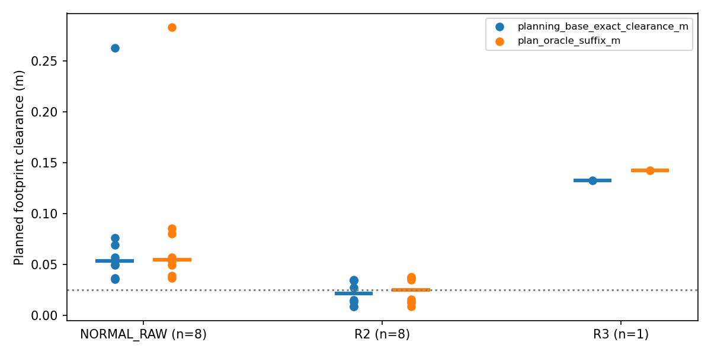
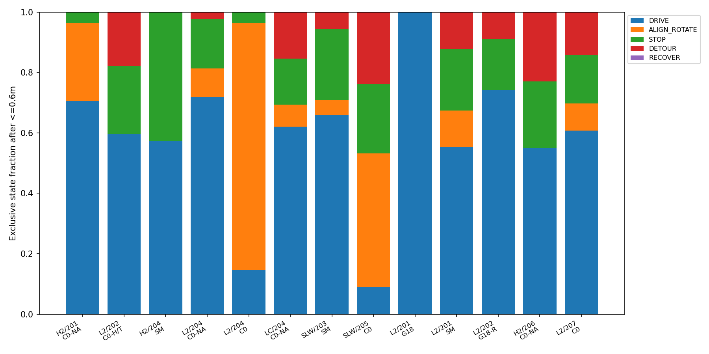
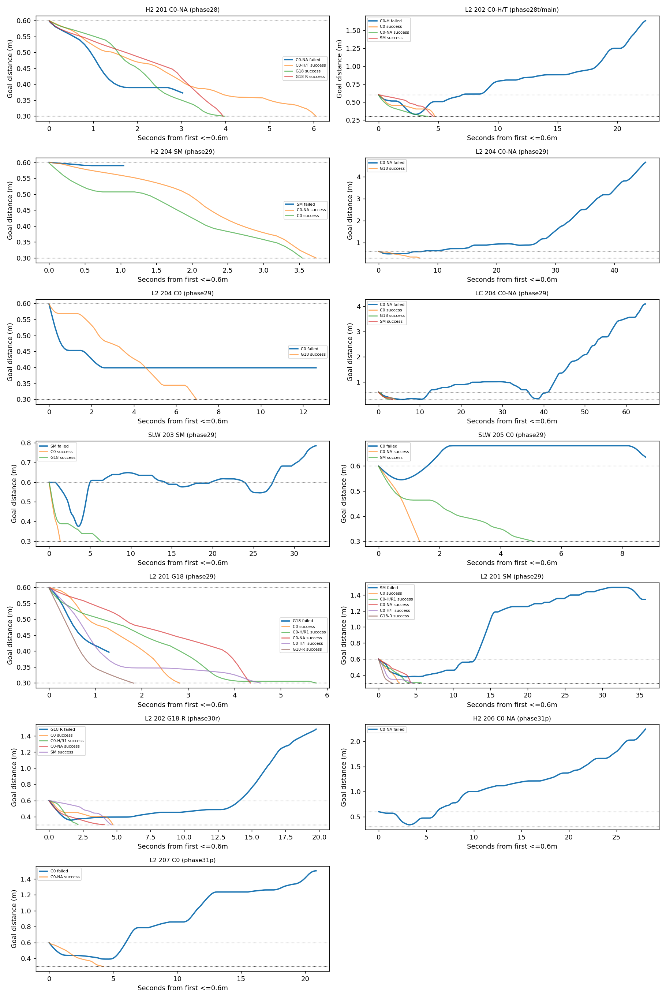

# Phase31-E: 상자 충돌과 목표 근처 미도착 원인 확인

Phase31-D의 **BOX_COLLISION17건 / NEAR_GOAL_HOVER13건**을 그대로 사용했다. 새 주행·렌더·추론·Graph 재풀이 및 기존 코드/결과 변경은 없다. 임시 분석 파일만 `/tmp`에 작성하고 `/usr/bin/python3`와 `PYTHONPATH=research`로 실행했다.

- 충돌 시 실행 경로: **NORMAL 원 SAFE8 / R2 8 / R3 1**, NORMAL Graph·넘김 직후3s·RECOVER는0. 두 C0-H 충돌에서도 H 보정 경로는 실행되지 않았다.
- 17건 모두 해당 상자 영역의 점유 이력이 **설치 전**에 있었고, 계획에 쓴 snapshot에도 상자 점유 칀이 남아 있었다. 따라서 상자를 설치 후 처음 알게 된 사례는 없다. 부분 미관측·지도 오차·갱신 지연까지 배제하는 뜻은 아니다.
- 충돌 R2 계획 여유는 공통 base exact 기준 중앙값 **2.11cm**, NORMAL **5.34cm**, R3 **13.27cm**. R2 4/8은 출발 완화 때문에2.5cm 미만에서도 수락됐다.
- 근접 후 후보 끝점이 목표0.3m 원 안에 드는 비율(run별 median): 실패 **1.39%**, 성공 대조군 **27.5%**. 종료 시 마지막 Topomap node는 **2/13 vs18/23**.
- 13건 전부 반복 맴돌기는 아니다. **3건은 근접 후 남은 시간1.04~3.03s**, 9건에서10cm 이상 후퇴가 있었고 완결된 후퇴→재접근은 총3회다.

## 1. 충돌 순간 실행 상태와 계획·실제 여유

### 측정 규칙

`repair.jsonl`의 마지막 `PATH_APPLIED`를 실제 설치 경로로 삼고, 마지막 제어 명령의 source와 controller 상태를 대조했다. 상태 우선순위는 RECOVER → 활성 R2/R3 → 실제 R3 종료 후3s 이내 NORMAL → NORMAL Graph/원 경로다. 거절된 R3의 END는 넘김이 아니다. `underlying_path_state`는 최근 넘김 여부와 별도로 저장했다. SM은 평소 smoothing을 구분할 수 있으나 이번 SM 충돌은 R2였다.

계획 여유는 서로 다른 세 값을 구분한다.

1. **로그 선택/certificate 여유**: 원 SAFE의 보수적 선택 하한 또는 실제 수락된 R2/R3 certificate의 depth exact 최소값. 원 SAFE에는 별도의 Graph certificate가 없으므로 `SELECTION_ONLY`로 기록한다.
2. **공통 base exact 여유**: 설치 B 투영 이후 경로와 동일 planning snapshot의 점유 cell center 사이 정확 거리−로봇 반경0.09m. 선택 하한과 다른 수치이며 R3 far strict certificate의 대체값도 아니다.
3. **oracle 계획/실제 여유**: 설치 B 이후 연속 polyline의 여유와 저장72Hz pose/명령 구간의 swept footprint 여유. 기존 기하 함수를 재사용했으며17건 모두 원 충돌 lower bound와1e−6m 이내 일치했다. oracle은 사후 평가에만 사용했다.

R2/R3 시작 완화와 far2.5cm 기준은 원 로그 그대로다. 표의 near 기준보다 크고2.5cm보다 작은 값은 곧 certificate 오류라는 뜻이 아니다. 전체 경로/설치 suffix 여유도 CSV에 분리했다.

| method | n | NORMAL_RAW | NORMAL_GRAPH | R2 | R3 | POST_HANDOVER_3S | RECOVER |
|---|---|---|---|---|---|---|---|
| C0 | 2 | 2 | 0 | 0 | 0 | 0 | 0 |
| C0-NA | 4 | 3 | 0 | 1 | 0 | 0 | 0 |
| C0-H | 2 | 1 | 0 | 1 | 0 | 0 | 0 |
| SM | 1 | 0 | 0 | 1 | 0 | 0 | 0 |
| G18 | 4 | 1 | 0 | 2 | 1 | 0 | 0 |
| G18-R | 4 | 1 | 0 | 3 | 0 | 0 | 0 |

| 사례 | 상태 | 상자 | 충돌 (x,y)m | 설치→충돌 s | 경과 s | 로그 계획 여유 cm | certificate/선택 | near 기준 cm | 실제 여유 cm |
|---|---|---|---|---|---|---|---|---|---|
| P27R H1/202 C0 | NORMAL_RAW | DynamicObstacle | (3.151,2.202) | 56.111→56.750 | 0.639 | 5.95 | SELECTION_ONLY | 2.50 | -0.059 |
| P28 H1/201 C0-H | NORMAL_RAW | DynamicObstacle | (3.977,2.201) | 58.889→59.278 | 0.389 | 4.04 | SELECTION_ONLY | 2.50 | -0.036 |
| P28 H2/202 C0-NA | NORMAL_RAW | DynamicObstacle | (3.002,0.179) | 17.889→18.569 | 0.681 | 2.72 | SELECTION_ONLY | 2.50 | -0.027 |
| P28 LC/202 C0-NA | NORMAL_RAW | AfterCorner | (3.361,1.614) | 26.333→26.847 | 0.514 | 6.67 | SELECTION_ONLY | 2.50 | -0.364 |
| P28 SLW/201 C0-H | R2 | Slalom2 | (2.411,-0.596) | 32.000→32.194 | 0.194 | 0.85 | R2_BASE_NEAR_RELAXED | 0.00 | -0.061 |
| P29c H1/204 SM | R2 | DynamicObstacle | (3.017,2.259) | 34.000→34.417 | 0.417 | 3.43 | R2_BASE_NEAR_RELAXED | 2.50 | -0.034 |
| P29c H2/203 C0-NA | R2 | DynamicObstacle | (3.002,0.233) | 17.000→17.361 | 0.361 | 2.73 | R2_BASE_NEAR_RELAXED | 1.73 | -0.165 |
| P29c H2/203 G18 | R2 | DynamicObstacle | (3.005,0.189) | 17.778→17.958 | 0.181 | 0.85 | R2_BASE_NEAR_RELAXED | 0.00 | -0.137 |
| P29d H1/201 G18 | R3 | DynamicObstacle | (3.070,2.207) | 22.222→22.931 | 0.708 | 13.27 | R3_BASE_NEAR_STRICT_FAR | 2.50 | -0.100 |
| P29d SLW/201 G18 | NORMAL_RAW | Slalom3 | (3.810,-0.037) | 49.111→49.653 | 0.542 | 4.75 | SELECTION_ONLY | 2.50 | -0.027 |
| P29d SLW/202 G18 | R2 | Slalom1 | (1.590,0.530) | 48.556→49.097 | 0.542 | 1.35 | R2_BASE_NEAR_RELAXED | 0.37 | -0.004 |
| P31P H2/206 C0 | NORMAL_RAW | DynamicObstacle | (3.001,-0.191) | 14.667→15.667 | 1.000 | 25.59 | SELECTION_ONLY | 2.50 | -0.060 |
| P31P H2/206 G18-R | NORMAL_RAW | DynamicObstacle2 | (6.002,-0.136) | 72.667→73.264 | 0.597 | 2.56 | SELECTION_ONLY | 2.50 | -0.006 |
| P31P H2/207 C0-NA | NORMAL_RAW | DynamicObstacle | (3.003,0.168) | 16.667→17.292 | 0.625 | 4.02 | SELECTION_ONLY | 2.50 | -0.024 |
| P31P H2/207 G18-R | R2 | DynamicObstacle | (3.006,-0.227) | 16.000→16.194 | 0.194 | 3.41 | R2_BASE_NEAR_RELAXED | 2.50 | -0.181 |
| P31P L2/206 G18-R | R2 | DynamicObstacle | (3.003,0.610) | 19.111→19.444 | 0.333 | 3.47 | R2_BASE_NEAR_RELAXED | 2.50 | -0.034 |
| P31P L2/207 G18-R | R2 | DynamicObstacle | (3.001,-0.266) | 29.111→29.347 | 0.236 | 1.49 | R2_BASE_NEAR_RELAXED | 0.56 | -0.060 |

각 경로 설치 입력과 certificate 원 필드는 [box_collision_details.json](../research/results/phase31e/box_collision_details.json)에 보존했다. 실제 상태, command source, 경로 kind, Graph 거절 사유, 설치 후 시간 및 속도·각속도는 [box_collisions.csv](../research/results/phase31e/box_collisions.csv)에 있다. **R2/R3/NORMAL에서 충돌했다는 것과 그 solver/factor가 단독 원인이라는 것은 구분한다.**

### depth 최초 관측 시각

상자 칸은 oracle 상자 사각형 안(격자 반칸 대각선 오차 포함)의 depth 점유 셀로 **사후 공간 매칭**했다. 저장된 `first_occupied_tick`을 사용했고, 돌발 상자는 생성 이전의 점유 이력을 상자 관측으로 세지 않았다. 광선/RGB 가시성을 depth 점유와 혼동하지 않는다. capture 시각과 실제 snapshot 발행 시각을 분리했으며, 발행 monotonic 시각은 저장72Hz monotonic↔sim 시각으로 보간했다.

충돌 전에 발행된 보존 snapshot만 사용했다. 보존 간격 때문에 충돌 직전 0.167~0.875s의 최신 셀 변화가 파일에 없을 수 있다. 누적 최초 관측은 그 이전 정보로 확정할 수 있지만 누락 구간의 새 관측은 만들어 내지 않았다. 아래 ‘설치 후 새 표면칸’은 이미 알려진 상자의 다른 칸이 새로 관측된 시각이며 **상자 전체의 최초 관측**이 아니다. 값이 없으면 보존 이력 안에서 해당 신규 칸을 확인하지 못했다는 뜻이다.

| 사례 | 계획 지도 시각 s | 계획 지도 상자 점유칸 | 상자 최초 점유 capture s | 최초 발행 s | 발행−설치 s | 설치 후 새 표면칸 capture s | 충돌 직전 보존 map 간격 s |
|---|---|---|---|---|---|---|---|
| P27R H1/202 C0 | 55.736 | 126 | 50.736 | 50.864 | -5.247 | — | 0.514 |
| P28 H1/201 C0-H | 58.486 | 156 | 48.736 | 49.064 | -9.825 | — | 0.306 |
| P28 H2/202 C0-NA | 17.736 | 354 | 10.750 | 10.857 | -7.032 | — | 0.333 |
| P28 LC/202 C0-NA | 25.986 | 585 | 9.486 | 9.614 | -16.720 | — | 0.611 |
| P28 SLW/201 C0-H | 31.736 | 1091 | 0.236 | 0.359 | -31.641 | — | 0.208 |
| P29c H1/204 SM | 33.736 | 368 | 26.236 | 26.369 | -7.631 | — | 0.181 |
| P29c H2/203 C0-NA | 16.486 | 374 | 11.236 | 11.358 | -5.642 | — | 0.875 |
| P29c H2/203 G18 | 17.486 | 374 | 10.486 | 10.609 | -7.169 | — | 0.472 |
| P29d H1/201 G18 | 21.736 | 316 | 18.486 | 18.626 | -3.596 | — | 0.194 |
| P29d SLW/201 G18 | 48.736 | 629 | 21.472 | 21.616 | -27.495 | — | 0.167 |
| P29d SLW/202 G18 | 48.236 | 813 | 0.236 | 0.390 | -48.165 | — | 0.861 |
| P31P H2/206 C0 | 14.486 | 396 | 10.486 | 10.614 | -4.053 | — | 0.431 |
| P31P H2/206 G18-R | 72.486 | 338 | 65.236 | 65.377 | -7.290 | — | 0.778 |
| P31P H2/207 C0-NA | 16.486 | 352 | 10.736 | 10.930 | -5.737 | — | 0.806 |
| P31P H2/207 G18-R | 15.736 | 304 | 11.236 | 11.364 | -4.636 | — | 0.458 |
| P31P L2/206 G18-R | 18.736 | 464 | 10.736 | 10.863 | -8.248 | — | 0.208 |
| P31P L2/207 G18-R | 28.736 | 408 | 11.000 | 11.115 | -17.996 | — | 0.611 |

17건의 `box_first_observation_after_install_s`는 모두 NA(이미 설치 전에 알려짐)다. 알려진 상자였다는 사실은 depth의 정확성이나 명령의 안전성을 보증하지 않는다.

### 충돌 경로에 한정한 R2·R3·NORMAL 분포

| 상태 | n | 공통 base exact depth cm min/median/max | oracle suffix cm min/median/max | depth <2.5cm | 설치 후 시간 median s | cross-track median cm |
|---|---|---|---|---|---|---|
| NORMAL_RAW | 8 | 3.52/5.34/26.30 | 3.67/5.47/28.34 | 0 | 0.611 | 6.73 |
| R2 | 8 | 0.85/2.11/3.47 | 0.85/2.50/3.77 | 4 | 0.285 | 2.71 |
| R3 | 1 | 13.27/13.27/13.27 | 14.23/14.23/14.23 | 0 | 0.708 | 16.34 |

R2 8건은 모두 원 certificate를 통과했지만 실제 궤적은 관통했다. 시작 완화가 적용된5건 중4건은 exact 계획 여유2.5cm 미만이었다. 공통 base exact 여유 기준 R2 중앙값2.11cm는 NORMAL5.34cm보다 작고, 설치 후 충돌까지 중앙값은0.285s로 짧다. R3 1건은 계획 oracle 여유14.23cm와 달리 실제−0.100cm, cross-track16.34cm였다. 이 자료는 **충돌 사례만 선택한 분포**이므로 R2가 R3보다 충돌률이 높다는 추론은 할 수 없다(상태별 전체 노출량을 분모로 계산하지 않았다).

NORMAL 원 경로 중 충돌 시 끝점으로 투영된 사례는 3건이다: P27R H1/202 C0, P28 LC/202 C0-NA, P31P H2/206 C0. 특히 P31P H2/206 C0의 설치 suffix 길이는0m(끝점만 남음), 실제 끝점 거리는31.25cm다. P27R H1/202 C0의 설치 suffix는0.92cm인데 충돌 시 끝점에서8.11cm 떨어졌다. 따라서 계획 여유가 양수라는 것만으로 그 이후 PP/SP 이동까지 안전했다고 볼 수 없다. G18 SLW/201도 전체 계획 여유0.23cm와 설치 suffix5.70cm가 달라 prefix/끝점 범위를 함께 봐야 한다.

## 2. 목표0.6m 접근 후 미도착

### 시간·정책 측정

분석 구간은 실패와 성공 대조군 모두 **처음 목표 거리≤0.6m가 된 저장72Hz tick부터 실제 종료까지**다. 원래 목표 판정0.3m와90s 제한은 유지했다. 제어 로그를 각72Hz 구간에 zero-order hold해 합산했다.

상태는 상호 배타적으로 회복 → R2/R3 실행(그 안의 정렬 포함) → SP 정렬 회전 → 실제 |v|≥0.02m/s 주행 → 기타 정지 순으로 배정했다. 별도의 물리 정지(|v|<0.02) 비율은 정렬/우회와 중복된다. 정렬 감속은 실제 속도에 따라 주행/정지에 속하며 보조 열로 따로 기록했다. `near_goal_runs.csv`에는 R2와 R3 실행 시간, filter STOP_WAIT, 계산 대기, endpoint 완료 flag 시간도 있다. 상태 시간 합은 모든 구간 길이와 일치한다.

| 사례 | 접근→종료 s | 분석 s | 주행 | 정렬 회전 | 정지 | R2/R3 실행 | 회복 | 물리 정지(중복) | 정렬 감속 s(중복) |
|---|---|---|---|---|---|---|---|---|---|
| P28 H2/201 C0-NA | 86.97→90.00 | 3.03 | 70.6% | 25.7% | 3.7% | 0.0% | 0.0% | 29.4% | 0.22 |
| P28T L2/202 C0-H | 67.64→90.00 | 22.36 | 59.8% | 0.0% | 22.4% | 17.9% | 0.0% | 22.4% | 0.00 |
| P29c H2/204 SM | 88.96→90.00 | 1.04 | 57.3% | 0.0% | 42.7% | 0.0% | 0.0% | 42.7% | 0.00 |
| P29c L2/204 C0-NA | 44.72→90.00 | 45.28 | 72.0% | 9.3% | 16.4% | 2.2% | 0.0% | 25.8% | 0.78 |
| P29c L2/204 C0 | 77.39→90.00 | 12.61 | 14.5% | 81.9% | 3.5% | 0.0% | 0.0% | 85.5% | 0.78 |
| P29c LC/204 C0-NA | 25.32→90.00 | 64.68 | 62.0% | 7.4% | 15.1% | 15.5% | 0.0% | 22.5% | 2.67 |
| P29c SLW/203 SM | 57.33→90.00 | 32.67 | 66.0% | 4.8% | 23.8% | 5.4% | 0.0% | 28.6% | 0.22 |
| P29c SLW/205 C0 | 81.24→90.00 | 8.76 | 8.9% | 44.4% | 22.8% | 23.9% | 0.0% | 67.2% | 0.00 |
| P29d L2/201 G18 | 88.71→90.00 | 1.29 | 100.0% | 0.0% | 0.0% | 0.0% | 0.0% | 0.0% | 0.00 |
| P29d L2/201 SM | 54.22→90.00 | 35.78 | 55.3% | 12.1% | 20.5% | 12.1% | 0.0% | 32.6% | 0.67 |
| P30R L2/202 G18-R | 70.24→90.00 | 19.76 | 74.2% | 0.0% | 16.9% | 8.9% | 0.0% | 16.9% | 0.00 |
| P31P H2/206 C0-NA | 61.94→90.00 | 28.06 | 54.9% | 0.0% | 22.2% | 23.0% | 0.0% | 22.2% | 0.00 |
| P31P L2/207 C0 | 69.14→90.00 | 20.86 | 60.7% | 9.1% | 16.0% | 14.2% | 0.0% | 25.0% | 1.00 |

NoMaD 출력은 **수신 시각**이 구간 안인 사건을 센다. 저장8개 native 후보를 관측 pose로 world 변환하고 목표 원 안의 끝점 수/전체 끝점 수를 계산했다. sample0 변환은 저장된 world chunk와1e−6m 이내 일치를 확인했다. 사건 중 하나라도 원 안에 있는 비율, B 이후 길이 최대 FRESHEST와 실제 SAFE 선택 끝점 비율을 분리했다. 끝점이 원 밖이어도 경로가 원을 통과할 수 있어, 참고로 **B 이후 suffix가 원을 지나는 비율**도 함께 제시했다. 후보 길이가0인 suffix는 그 점만 검사했다.

마지막 node는 저장 `closest_node == goal_node`로 판정했다. selected subgoal을 현재 위치로 오인하지 않았고, 수신 이후 다음 수신까지 node를 유지해 시간 비율을 계산했다. 후퇴 횟수는10cm hysteresis로 거리 증가를 확인한 사건 수이며, 이어10cm 이상 감소하면 복귀 완결로 센다. 0.70m 이탈→0.60m 재진입 횟수도 CSV에 남겼다. 이는 측정 노이즈를 제외하기 위한 사후 분석 규칙이며 기존 성능 판정 변경이 아니다.

| 사례 | 후보 사건/끝점 수 | 끝점 원 안 | 사건 중 하나 이상 | FRESHEST 끝점 | 선택 끝점 | suffix가 원 통과 | 최종 closest/마지막 | 마지막 node 시간 | 최소→최종 거리 m | 후퇴 시작/복귀 완결 |
|---|---|---|---|---|---|---|---|---|---|---|
| P28 H2/201 C0-NA | 3/24 | 25.0% | 33.3% | 33.3% | 33.3% | 25.0% | 20/20 | 47.7% | 0.373→0.373 | 0/0 |
| P28T L2/202 C0-H | 22/176 | 0.6% | 4.5% | 4.5% | 0.0% | 0.6% | 3/20 | 26.5% | 0.327→1.636 | 1/0 |
| P29c H2/204 SM | 1/8 | 0.0% | 0.0% | 0.0% | — | 0.0% | 13/20 | 0.0% | 0.590→0.590 | 0/0 |
| P29c L2/204 C0-NA | 46/368 | 1.4% | 4.3% | 4.3% | 4.7% | 1.4% | 16/20 | 33.3% | 0.489→4.662 | 1/0 |
| P29c L2/204 C0 | 13/104 | 30.8% | 76.9% | 38.5% | 38.5% | 32.7% | 19/20 | 48.1% | 0.399→0.399 | 0/0 |
| P29c LC/204 C0-NA | 65/520 | 6.9% | 12.3% | 10.8% | 9.4% | 7.1% | 11/14 | 28.9% | 0.309→4.088 | 2/1 |
| P29c SLW/203 SM | 33/264 | 6.1% | 9.1% | 9.1% | 3.7% | 6.1% | 10/15 | 45.5% | 0.376→0.785 | 2/1 |
| P29c SLW/205 C0 | 9/72 | 0.0% | 0.0% | 0.0% | 0.0% | 0.0% | 15/15 | 42.0% | 0.545→0.635 | 1/0 |
| P29d L2/201 G18 | 1/8 | 0.0% | 0.0% | 0.0% | 0.0% | 0.0% | 19/20 | 0.0% | 0.397→0.397 | 0/0 |
| P29d L2/201 SM | 36/288 | 1.4% | 8.3% | 2.8% | 3.2% | 1.4% | 6/20 | 22.3% | 0.378→1.344 | 1/1 |
| P30R L2/202 G18-R | 20/160 | 5.0% | 10.0% | 10.0% | 5.9% | 5.0% | 7/20 | 18.1% | 0.357→1.485 | 1/0 |
| P31P H2/206 C0-NA | 29/232 | 0.0% | 0.0% | 0.0% | 0.0% | 0.0% | 13/20 | 31.1% | 0.339→2.248 | 1/0 |
| P31P L2/207 C0 | 21/168 | 11.3% | 14.3% | 14.3% | 0.0% | 11.3% | 2/20 | 40.3% | 0.393→1.500 | 1/0 |

13건의 최소 거리는 모두0.3m보다 컸다(0.309~0.590m). 이번 표에는 목표 원에 들어갔는데 판정이 누락된 사례가 없다. 후보가 목표를 지시하지 않는다는 해석과 node 오인식의 인과 방향은 저장 로그만으로 분리할 수 없다.

### 같은 scene×seed 성공 방법과 비교

실패13건 중12건에서 성공한 다른 방법을 찾았고, 비교32쌍/중복 제거 성공23run이다. H2/206 C0-NA는 같은 블록의 다른 관측 방법도 실패해 성공 대조가 없다. C0-H의 R1/T는 다른 버전으로 보존했다. 연구 시점·상태 궤적이 다르므로 인과적 교차 실험으로 해석하지 않는다.

시간 비율은 각 집단 구간 시간을 합친 값, 후보·node 비율은 run별 중앙값이다. 성공 대조군은 동일 run을 여러 실패와 비교하더라도 집단 요약에서는 한 번만 센다. 성공의 근접 구간이 짧으므로 서로 다른 시간 길이·후속 관측 수가 비교에 영향을 준다.

| 집단 | n | 근접 후 시간 median s | 주행 | 정렬 회전 | 정지 | 우회 | 회복 | 물리 정지 | 후보 끝점 비율 median | 마지막 node 시간 median | 종료 시 마지막 node run | 후퇴/복귀 |
|---|---|---|---|---|---|---|---|---|---|---|---|---|
| FAILED_13 | 13 | 20.86 | 59.7% | 10.7% | 18.0% | 11.6% | 0.0% | 28.7% | 1.4% | 31.1% | 2 | 11/3 |
| SUCCESS_CONTROLS_UNIQUE | 23 | 4.01 | 83.0% | 6.8% | 7.2% | 3.1% | 0.0% | 13.9% | 27.5% | 62.0% | 18 | 0/0 |
| C0 | 3 | 12.61 | 36.2% | 38.1% | 13.7% | 12.0% | 0.0% | 51.8% | 11.3% | 42.0% | 1 | 2/0 |
| C0-NA | 4 | 36.67 | 64.0% | 6.9% | 16.7% | 12.4% | 0.0% | 23.6% | 4.1% | 32.2% | 1 | 4/1 |
| C0-H | 1 | 22.36 | 59.8% | 0.0% | 22.4% | 17.9% | 0.0% | 22.4% | 0.6% | 26.5% | 0 | 1/0 |
| SM | 3 | 32.67 | 60.3% | 8.5% | 22.4% | 8.8% | 0.0% | 30.9% | 1.4% | 22.3% | 0 | 3/2 |
| G18 | 1 | 1.29 | 100.0% | 0.0% | 0.0% | 0.0% | 0.0% | 0.0% | 0.0% | 0.0% | 0 | 0/0 |
| G18-R | 1 | 19.76 | 74.2% | 0.0% | 16.9% | 8.9% | 0.0% | 16.9% | 5.0% | 18.1% | 0 | 1/0 |

| 실패 사례 | 성공 대조군 | 성공 대조 run 수 | 분석시간 s 실패/대조 median | 후보 끝점 비율 실패/대조 median | 정렬회전 실패/대조 median | 물리정지 실패/대조 median | 마지막node 시간 실패/대조 median |
|---|---|---|---|---|---|---|---|
| P28 H2/201 C0-NA | C0-H/T, G18, G18-R | 3 | 3.03/3.99 | 25.0%/31.2% | 25.7%/0.0% | 29.4%/0.0% | 47.7%/69.3% |
| P28T L2/202 C0-H | C0, C0-NA, SM | 3 | 22.36/4.60 | 0.6%/27.5% | 0.0%/0.0% | 22.4%/2.4% | 26.5%/55.6% |
| P29c H2/204 SM | C0, C0-NA | 2 | 1.04/3.64 | 0.0%/29.7% | 0.0%/0.0% | 42.7%/6.3% | 0.0%/52.0% |
| P29c L2/204 C0-NA | G18 | 1 | 45.28/6.97 | 1.4%/41.1% | 9.3%/11.2% | 25.8%/27.1% | 33.3%/87.8% |
| P29c L2/204 C0 | G18 | 1 | 12.61/6.97 | 30.8%/41.1% | 81.9%/11.2% | 85.5%/27.1% | 48.1%/87.8% |
| P29c LC/204 C0-NA | C0, G18, SM | 3 | 64.68/3.43 | 6.9%/21.9% | 7.4%/0.0% | 22.5%/0.0% | 28.9%/32.4% |
| P29c SLW/203 SM | C0, G18 | 2 | 32.67/3.84 | 6.1%/30.2% | 4.8%/5.3% | 28.6%/17.6% | 45.5%/31.8% |
| P29c SLW/205 C0 | C0-NA, SM | 2 | 8.76/3.22 | 0.0%/13.8% | 44.4%/4.4% | 67.2%/5.4% | 42.0%/33.9% |
| P29d L2/201 G18 | C0, C0-H/R1, C0-H/T, C0-NA, G18-R | 5 | 1.29/4.35 | 0.0%/45.8% | 0.0%/0.0% | 0.0%/0.0% | 0.0%/62.0% |
| P29d L2/201 SM | C0, C0-H/R1, C0-H/T, C0-NA, G18-R | 5 | 35.78/4.35 | 1.4%/45.8% | 12.1%/0.0% | 32.6%/0.0% | 22.3%/62.0% |
| P30R L2/202 G18-R | C0, C0-H/R1, C0-NA, SM | 4 | 19.76/4.35 | 5.0%/31.2% | 0.0%/0.0% | 16.9%/1.2% | 18.1%/77.8% |
| P31P H2/206 C0-NA | 없음 | 0 | 28.06/— | 0.0%/— | 0.0%/— | 22.2%/— | 31.1%/— |
| P31P L2/207 C0 | C0-NA | 1 | 20.86/4.25 | 11.3%/27.5% | 9.1%/0.0% | 25.0%/0.0% | 40.3%/71.6% |

모든 성공 대조군의 상태·node·후보·후퇴 수는 [near_goal_success_controls.csv](../research/results/phase31e/near_goal_success_controls.csv), 각 실패와의 개별 비교는 [near_goal_pairs.csv](../research/results/phase31e/near_goal_pairs.csv)에서 확인할 수 있다.

### 사례별 해석

- **P28 H2/201 C0-NA**: 첫0.6m 접근 뒤 3.03s만 남고 후퇴 사건0: 반복 맴돌기보다 늦은 접근/90s 검열 사례.
- **P28T L2/202 C0-H**: 후퇴 1회(복귀 완결 0), 거리 0.327→1.636m; 최종 node 3/20, 후보 끝점 목표 원 0.6%.
- **P29c H2/204 SM**: 첫0.6m 접근 뒤 1.04s만 남고 후퇴 사건0: 반복 맴돌기보다 늦은 접근/90s 검열 사례.
- **P29c L2/204 C0-NA**: 후퇴 1회(복귀 완결 0), 거리 0.489→4.662m; 최종 node 16/20, 후보 끝점 목표 원 1.4%.
- **P29c L2/204 C0**: 근접 이후 정렬 회전 81.9%; 목표 최소 0.399m, 후퇴 0회.
- **P29c LC/204 C0-NA**: 후퇴 2회(복귀 완결 1), 거리 0.309→4.088m; 최종 node 11/14, 후보 끝점 목표 원 6.9%.
- **P29c SLW/203 SM**: 후퇴 2회(복귀 완결 1), 거리 0.376→0.785m; 최종 node 10/15, 후보 끝점 목표 원 6.1%.
- **P29c SLW/205 C0**: 후퇴 1회(복귀 완결 0), 거리 0.545→0.635m; 최종 node 15/15, 후보 끝점 목표 원 0.0%.
- **P29d L2/201 G18**: 첫0.6m 접근 뒤 1.29s만 남고 후퇴 사건0: 반복 맴돌기보다 늦은 접근/90s 검열 사례.
- **P29d L2/201 SM**: 후퇴 1회(복귀 완결 1), 거리 0.378→1.344m; 최종 node 6/20, 후보 끝점 목표 원 1.4%.
- **P30R L2/202 G18-R**: 후퇴 1회(복귀 완결 0), 거리 0.357→1.485m; 최종 node 7/20, 후보 끝점 목표 원 5.0%.
- **P31P H2/206 C0-NA**: 후퇴 1회(복귀 완결 0), 거리 0.339→2.248m; 최종 node 13/20, 후보 끝점 목표 원 0.0%.
- **P31P L2/207 C0**: 후퇴 1회(복귀 완결 0), 거리 0.393→1.500m; 최종 node 2/20, 후보 끝점 목표 원 11.3%.

후퇴가 관측된 run과 시간 제한 직전 처음 가까워진 run을 나누면, 공통 문제를 ‘Graph의 정지’ 하나로 설명할 수 없다. 근접 이후 전체 시간은 주행59.7%, 정렬10.7%, 정지18.0%, R2/R3 실행11.6%, 회복0%였다. 정렬 시간0인 C0-H/T·G18-R에도 후퇴와 node 역행이 관측된다. C0 L2/204의81.9% 정렬처럼 실행기 시간 손실이 두드러진 별도 사례도 있다.

## 3. 수정 후보 — 구현하지 않음

분석 대상 두 원인에 각각 최대2개만 제안한다. 현재 코드·수치·결정 계층·평가기를 변경하지 않았으며, 아래 후보의 효과는 새 사전등록 비교로만 확인할 수 있다.

| 원인 | 후보 | 공정한 적용 범위 | 근거/한계 |
|---|---|---|---|
| BOX_COLLISION | 동일 PP/SP 실행기에 최신 depth·현재 pose/명령 기준의 짧은 실행구간 안전검사와 유효 suffix/끝점 소진 처리를 연결하는 방안 검증. | 모든 방법 공통 — C0/C0-NA/C0-H/SM/G18/G18-R의 각 실행 경로; oracle 없이 depth만 사용 | NORMAL 원 경로8건, R2 8건, R3 1건 모두 계획과 실제 여유가 다름; NORMAL3건은 충돌 시 끝점으로 투영됨. |
| BOX_COLLISION | R2 출발 여유 완화 수락을 실제 heading·속도에서의 추종 가능 여유와 함께 검증하고, 불충분하면 공통 fallback으로 보내는 방안 비교. | 모든 방법 공통 — R2를 쓰는 모든 방법; G18-R만 더 보수적으로 바꾸지 않음 | 충돌 R2 8건 중4건의 exact 계획 여유<2.5cm; 시작 완화 기준 내에서 수락됐지만 실제 궤적이 관통. 여유 확대의 교착 tradeoff는 별도 검증 필요. |
| NEAR_GOAL_HOVER | 마지막 Topomap 노드 부근에서 후보 생성·노드 재선택/역행의 안정성을 RGB/Topomap 이력으로 개선하는 공통 terminal-policy 진단. | 모든 방법 공통 — 공통 NoMaD/Topomap 계층; 평가용 목표좌표를 정책 입력으로 쓰지 않음 | 실패 종료 시 마지막 node2/13 vs 성공18/23, 후보 끝점 goal 원 비율 median1.39% vs27.5%. endpoint만으로 원인을 확정하지 않음. |
| NEAR_GOAL_HOVER | 목표 노드 부근의 짧은 chunk에서 정렬 반복·실행 완료·FRESH 교체가 시간을 소비하는지 공통 terminal executor를 검증. | 모든 방법 공통 — 같은 terminal 처리 조건을 모든 방법에 적용해 비교; goal 반경0.3m/90s 제한 유지 | C0 L2/204는 근접 이후81.9% 정렬 회전; 반면3건은 근접 후 남은 시간이3.03s 이하라 terminal 시간 낭비와 늦은 접근을 분리해야 함. |

어느 후보도 **내 방법만** 고쳐 비교하는 것은 적절하지 않다. BOX 충돌은 원 SAFE/R2/R3 공통 실행에서, 목표 근처 실패는 여섯 방법 모두에서 관측됐다. R2 후보는 R2를 사용하는 모든 방법에, 공통 정책/실행 후보는 모든 비교 방법에 적용해야 선택적 이득과 수정 효과가 섞이지 않는다.

## 산출물·검산

- 분류 대상은 [Phase31-D failures.csv](../research/results/phase31d/failures.csv)의17+13행 그대로다. 앞선 분류·라벨·결과를 재작성하지 않았다.
- [measurement_rules.json](../research/results/phase31e/measurement_rules.json), [input_manifest.json](../research/results/phase31e/input_manifest.json): 측정 정의와 읽은 원 파일 hash.
- [near_goal_candidates.csv](../research/results/phase31e/near_goal_candidates.csv): 사건별8개 endpoint 거리, 선택·node 정보. [goal_distance_1hz.csv](../research/results/phase31e/goal_distance_1hz.csv)는 그림용1Hz 거리/상태이며 시간 집계는72Hz 전체로 했다.
- [verification.json](../research/results/phase31e/verification.json): 충돌17건 기하 재계산, 시간 구간 분할, sample world 변환, 입력 파일 불변 검산. 새 시뮬레이션/Graph solve/NoMaD 추론0.
- 새 문서·분석 산출물만 commit/push한다. 패키지 설치 없음.
