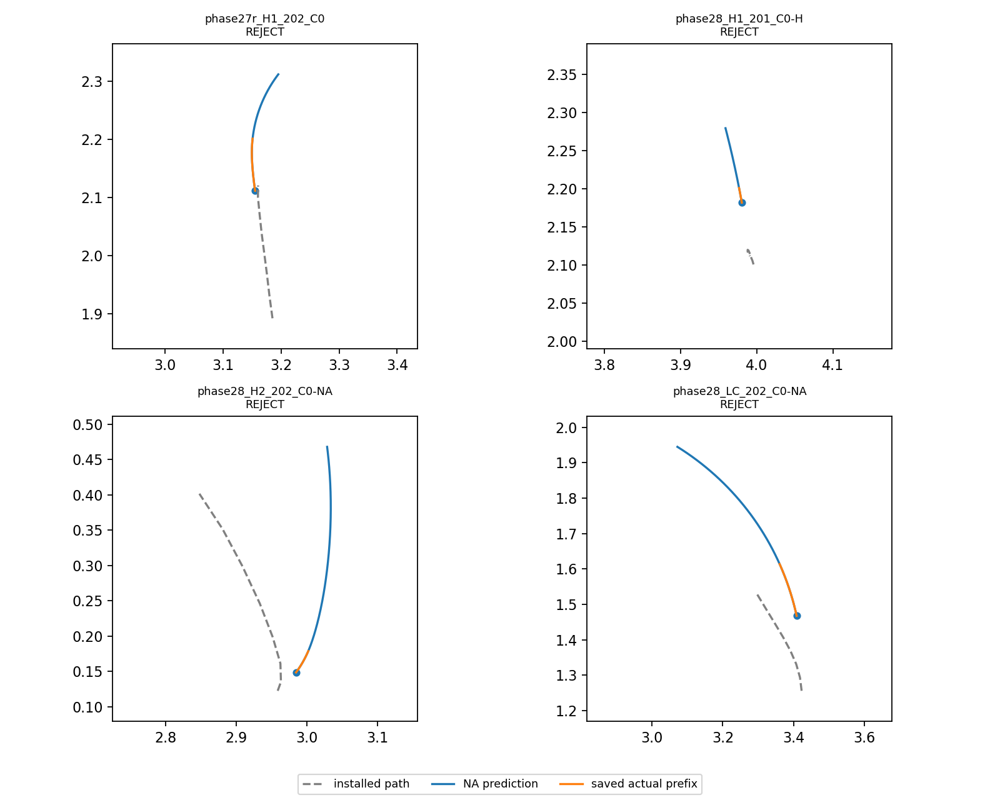
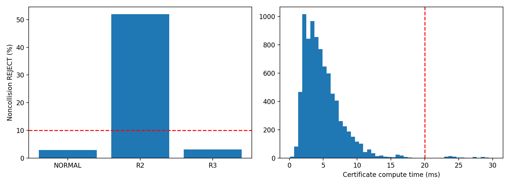
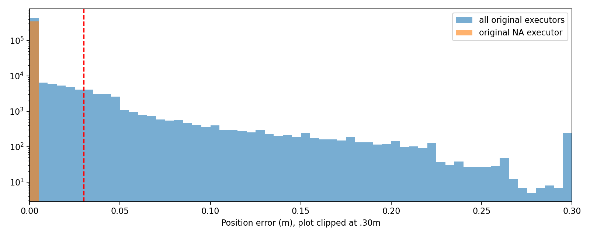

# Phase32-O EXEC-CERT 오프라인 평가

**OFFLINE_FAIL** — 충돌 검출 확정 **16/17**, 비충돌 설치사건 REJECT **304/8443 (3.60%)**, 위치 오차 p95 **0.03004m**, 계산 p95 **10.23ms**.

기존160run의 PATH_APPLIED **8,937건 전체**를 목록화하고 보존된 입력으로 평가했다. 최신 snapshot 확보 8468건, 최신 파일 결측 469건이다. 결측은 이전 보존 지도를 사용한 **proxy**와 분리했으며 원래 최신 지도 결과로 대체하지 않았다. 새 Isaac 실행·렌더·NoMaD 추론·Graph 풀이0. 기존 코드/결과 수정 없음.

## 구현·측정 규칙

- 입력: 설치 tick의 저장 실제 pose/v/ω, 설치 XY, 설치 control refresh 시각 이전에 발행된 최신 V1 snapshot. oracle/목표좌표/박스 위치는 checker API에 없다. 저장 input 복사본의 동일 frame도 허용했다.
- `nomad_phase28.alignment.NoAlignment`와 동결 PP/SP를 직접 재사용한다. lookahead0.25m, >90°일 때만 정렬, 9Hz 제어/72Hz `integrate_se2`, v≤0.3/|ω|≤0.4/|Δv|≤0.5/9이다. 모든 원 run의 plant α=∞여서 초기 실제ω는 입력 provenance에 보존하지만 첫9Hz 명령 이후 별도 각가속도 제한을 만들지 않는다.
- 종료는 동결 follower가 기존1cm endpoint 도달을 선언한 제어 tick 또는2s다. 투영점만 끝에 닿았다고 새 종료 규칙을 추가하지 않았다. 경로 끝을 지나쳤는데 endpoint 허용 원을 놓친 경우도 동결 동작 그대로2s까지 적분한다.
- 지도는 공통 **V1 base, unknown=free**. R3의 unknown/recency-blocked 계획 certificate를 새 실행 검사에 섞지 않았다. 정적 footprint 반경0.09m의 **각72Hz 원호 swept 영역과 점유 셀 중심의 정확 최소 거리**를 구해0.025m 이상이면 PASS다. 기존 V1 cell-center 거리 정의를 사용하며 셀 사각형으로 팽창하거나 새 safety margin을 더하지 않았다. SDF의 h/√2는 후보 셀 검색 범위에만 사용했다. 거의 직선인 원호의 chord 보수 오차는1e−10m 미만이다. 검색 범위 안에 점유 셀이 없는 NO_SITE_WITHIN_SEARCH_BOUND는 정확 최소값 대신 안전이 보장된 하한을 반환하며 lower_bound_only로 표시한다.
- frozen NA가 구성할 수 없는 XY 길이0의 timed H 회전 경로는 `INVALID_INPUT`으로 명시적 REJECT한다. 정지 경로를 임의로 만들어 PASS하지 않았고, 모델 위치 오차는 비교 불가로 남겼다.
- ‘비충돌’은 해당 설치 경로가 직접 실행되던 구간에 원 evaluator 충돌이 없다는 뜻이다. 같은 run이 이후 다른 설치 경로로 충돌해도 앞선 사건은 비충돌 분모에 포함한다. 원래 collision 플래그26건(BOX17+wall9)을 사용한다.
- **오거절은 운영상 명칭**이다. 원 run에서는 다음 FRESH/우회 종료/재계획으로2s 전에 경로를 바꿀 수 있다. 고정 경로2s 반사실을 REJECT했다는 사실만으로 실제 잘못된 안전 판정이라고 단정할 수 없다.
- 계산시간은 설치된 경로의 profile 생성+전방 적분+depth swept 검사 모두 포함, NPZ 디스크 읽기/분석표 작성/대안 탐색은 제외한다. import/NumPy 초기화는 합성 입력10회로 warm-up했고 기존 사건 성적을 보고 상수는 바꾸지 않았다.

## 1. 충돌17건 검출

| uid | state | install_s | collision_delay_s | exact_install_map | disposition | proxy_disposition | clearance_m | snapshot_age_s | valid_actual_ticks | position_error_p95_m |
|---|---|---|---|---|---|---|---|---|---|---|
| phase27r_H1_202_C0 | NORMAL | 56.111 | 0.63889 | True | REJECT | REJECT | -0.089726 | 0.375 | 46 | 0 |
| phase28_H1_201_C0-H | NORMAL | 58.889 | 0.38889 | True | REJECT | REJECT | -0.079441 | 0.40278 | 28 | 0 |
| phase28_H2_202_C0-NA | NORMAL | 17.889 | 0.68056 | True | REJECT | REJECT | -0.034143 | 0.15278 | 49 | 0 |
| phase28_LC_202_C0-NA | NORMAL | 26.333 | 0.51389 | True | REJECT | REJECT | -0.065003 | 0.34722 | 37 | 0 |
| phase28_SLW_201_C0-H | R2 | 32 | 0.19444 | True | REJECT | REJECT | -0.087818 | 0.26389 | 14 | 0 |
| phase29_confirm_H1_204_SM | R2 | 34 | 0.41667 | True | REJECT | REJECT | -0.032436 | 0.26389 | 30 | 0 |
| phase29_confirm_H2_203_C0-NA | R2 | 17 | 0.36111 | False | MISSING_LATEST_MAP | REJECT | -0.089172 | 0.51389 | 26 | 0 |
| phase29_confirm_H2_203_G18 | R2 | 17.778 | 0.18056 | True | REJECT | REJECT | -0.088748 | 0.29167 | 13 | 0 |
| phase29_dev_H1_201_G18 | R3 | 22.222 | 0.70833 | True | REJECT | REJECT | -0.089676 | 0.23611 | 51 | 0 |
| phase29_dev_SLW_201_G18 | NORMAL | 49.111 | 0.54167 | True | REJECT | REJECT | -0.067519 | 0.375 | 39 | 0 |
| phase29_dev_SLW_202_G18 | R2 | 48.556 | 0.54167 | True | REJECT | REJECT | -0.0044368 | 0.31944 | 39 | 0 |
| phase31p_H2_206_C0 | NORMAL | 14.667 | 1 | True | REJECT | REJECT | -0.040742 | 0.18056 | 72 | 0 |
| phase31p_H2_206_G18-R | NORMAL | 72.667 | 0.59722 | True | REJECT | REJECT | -0.0074684 | 0.18056 | 43 | 0 |
| phase31p_H2_207_C0-NA | NORMAL | 16.667 | 0.625 | True | REJECT | REJECT | -0.087196 | 0.18056 | 45 | 0 |
| phase31p_H2_207_G18-R | R2 | 16 | 0.19444 | True | REJECT | REJECT | -0.035391 | 0.26389 | 14 | 0 |
| phase31p_L2_206_G18-R | R2 | 19.111 | 0.33333 | True | REJECT | REJECT | -0.0090089 | 0.375 | 24 | 0 |
| phase31p_L2_207_G18-R | R2 | 29.111 | 0.23611 | True | REJECT | REJECT | -0.087384 | 0.375 | 17 | 0 |

확정 검출 16/17; 최신 지도 결측을 모두 미검출/검출로 놓은 검출률 범위는 **94.12%~100.00%**다. 이전 지도 proxy까지 포함한 검출 수는 17/17이며 주 수치와 분리한다. 원래 충돌 결과는 checker 입력으로 전달하지 않았고 검출률 집계에만 사용했다.

## 2. 비충돌 설치사건 REJECT

| group | installations | exact_maps | missing_latest_maps | noncollision_exact | false_reject | false_reject_rate | noncollision_exposed | compute_p50_s | compute_p95_s | event_error_p95_m | invalid_na_inputs |
|---|---|---|---|---|---|---|---|---|---|---|---|
| ALL | 8937 | 8468 | 469 | 8443 | 304 | 0.036006 | 8443 | 0.0042848 | 0.010234 | 0.047249 | 3 |
| NORMAL | 8466 | 8166 | 300 | 8156 | 233 | 0.028568 | 8156 | 0.0042981 | 0.010295 | 0.047253 | 3 |
| R2 | 157 | 141 | 16 | 127 | 66 | 0.51969 | 127 | 0.0032198 | 0.0060108 | 0 | 0 |
| R3 | 314 | 161 | 153 | 160 | 5 | 0.03125 | 160 | 0.0048872 | 0.0084231 | 0 | 0 |

| group | installations | exact_maps | missing_latest_maps | noncollision_exact | false_reject | false_reject_rate | noncollision_exposed | compute_p50_s | compute_p95_s | event_error_p95_m | invalid_na_inputs |
|---|---|---|---|---|---|---|---|---|---|---|---|
| C0 | 1823 | 1768 | 55 | 1765 | 56 | 0.031728 | 1765 | 0.0044289 | 0.010209 | 0.1916 | 0 |
| C0-H | 904 | 650 | 254 | 643 | 34 | 0.052877 | 643 | 0.0041539 | 0.0097795 | 0.080319 | 3 |
| C0-NA | 1430 | 1401 | 29 | 1395 | 77 | 0.055197 | 1395 | 0.0043067 | 0.010621 | 0 | 0 |
| G18 | 1803 | 1741 | 62 | 1737 | 35 | 0.02015 | 1737 | 0.0040866 | 0.0097688 | 0 | 0 |
| G18-R | 1502 | 1461 | 41 | 1457 | 77 | 0.052848 | 1457 | 0.0039356 | 0.0097284 | 0 | 0 |
| SM | 1475 | 1447 | 28 | 1446 | 25 | 0.017289 | 1446 | 0.0046576 | 0.010943 | 0 | 0 |

방법×상태 상세 행은 [summary.csv](../research/results/phase32o/summary.csv), 모든 설치별 판정·snapshot·오차·시간은 [events.csv](../research/results/phase32o/events.csv)에 있다. NORMAL에는 원/SM 경로와 GRAPH18/HANDOFF가 모두 들어가며 kind를 별도 보존한다.

최신 지도 결측의 비충돌 468건을 모두 PASS/REJECT로 가정하면 전체 모집단 오거절률 범위는 **3.41%~8.66%**다. 이전 지도 proxy 포함 값은 3.55%. 결측을 조용히 PASS/REJECT로 채우지 않았다.

## 3. 실행기 모델 검증

고정 경로의 예측과 실제72Hz pose를 설치 직후부터 비교하되 다음 PATH_APPLIED, 실제 run 종료, endpoint/2s, 외부 WAIT/회복/만료 명령 중 먼저 오는 시각까지만 사용했다. 최초 pose의 자명한0 오차는 분포에서 제외했다. 비교 가능한 시간이 없는 사건은0 오차로 채우지 않았다(204건).

전체 유효 496653개의72Hz 위치 샘플: **p50 0.000000m / p95 0.030037m**.
원 실행기도 동일 NA였던 구간: 349182샘플, **p50 0.000000m / p95 0.000000m**.

C0는20°/45° 정렬이고 C0-H HANDOFF는 timed follower라 이번 고정 NA 모델과 정책적으로 다르다. 이 사건을 전체 주 검증/게이트에서 숨기지 않고, 동일 실행기 부분집합만 별도로 표시했다. 전체 오차가 크면서 동일 실행기 오차가 작다면 그것을 단순 수치 적분 버그와 혼동하면 안 된다. 반대로 동일 실행기에도 제어 경계/실행 상태 차이가 남을 수 있다.

아래 event_error 열은 사건별 오차 분위의 분포이며, 위의 pooled72Hz p95와 다른 통계다.

| group | events | comparable_events | compared_seconds | event_median_error_m | event_p95_error_m | max_error_m |
|---|---|---|---|---|---|---|
| ALL | 8937 | 8733 | 6898 | 0 | 0.047249 | 0.45408 |
| SAME_NA_EXECUTOR | 6719 | 6583 | 4849.8 | 0 | 0 | 0 |
| C0 | 1823 | 1764 | 1704.2 | 0 | 0.1916 | 0.45408 |
| C0-H | 904 | 888 | 768.21 | 0 | 0.080319 | 0.18457 |
| C0-NA | 1430 | 1399 | 1296.9 | 0 | 0 | 0 |
| G18 | 1803 | 1773 | 961.12 | 0 | 0 | 0 |
| G18-R | 1502 | 1472 | 802.78 | 0 | 0 | 0 |
| SM | 1475 | 1437 | 1364.8 | 0 | 0 | 0 |

## 4. 계산시간

| p50_s | p95_s | rollout_p50_s | rollout_p95_s | sweep_p50_s | sweep_p95_s | over_20ms | all_including_proxies_p95_s | io_excluded |
|---|---|---|---|---|---|---|---|---|
| 0.0042848 | 0.010234 | 0.0015033 | 0.0017114 | 0.0028058 | 0.008636 | 65 | 0.010146 | True |

latest snapshot 결측의 proxy까지 포함한 p95는 10.15ms다. affinity와 소스 hash는 protocol에 기록했다. 여러 run을 병렬 실행하거나 simulator를 띄우지 않았으며 NumPy/BLAS thread 수는1로 실행했다.

## 5. REJECT된 비충돌 사건의 대안

| group | rejected_noncollision | other_safe_input_available | other_safe_pass | other_safe_fraction | slowdown_pass | slowdown_fraction | r3_assessed | r3_unassessed | r3_pass | r3_fraction_among_assessed | any_measured_pass | any_measured_fraction_lower_bound |
|---|---|---|---|---|---|---|---|---|---|---|---|---|
| ALL | 304 | 304 | 140 | 0.46053 | 137 | 0.45066 | 9 | 295 | 1 | 0.11111 | 177 | 0.58224 |
| NORMAL | 233 | 233 | 135 | 0.5794 | 119 | 0.51073 | 4 | 229 | 0 | 0 | 159 | 0.6824 |
| R2 | 66 | 66 | 0 | 0 | 13 | 0.19697 | 0 | 66 | 0 | — | 13 | 0.19697 |
| R3 | 5 | 5 | 5 | 1 | 5 | 1 | 5 | 0 | 1 | 0.2 | 5 | 1 |
| C0 | 56 | 56 | 26 | 0.46429 | 33 | 0.58929 | 0 | 56 | 0 | — | 36 | 0.64286 |
| C0-H | 34 | 34 | 15 | 0.44118 | 13 | 0.38235 | 0 | 34 | 0 | — | 19 | 0.55882 |
| C0-NA | 77 | 77 | 31 | 0.4026 | 24 | 0.31169 | 2 | 75 | 0 | 0 | 36 | 0.46753 |
| G18 | 35 | 35 | 18 | 0.51429 | 18 | 0.51429 | 2 | 33 | 1 | 0.5 | 23 | 0.65714 |
| G18-R | 77 | 77 | 37 | 0.48052 | 31 | 0.4026 | 4 | 73 | 0 | 0 | 44 | 0.57143 |
| SM | 25 | 25 | 13 | 0.52 | 18 | 0.72 | 1 | 24 | 0 | 0 | 19 | 0.76 |

같은 실제 pose/v/ω와 같은 snapshot으로만 검사했다. 다른 SAFE 후보는 동일 저장 NoMaD 세트에서 원 선택 index를 제외하고 원 안전 필터를 다시 통과한 후보다. 0.1m/s 감속 대안은 기존 PP 곡률/SP에 목표 상한만0.1로 둔 반사실이고, 초기 속도가 더 높으면0.5m/s² 제한으로 내려간다. 순간 감속·즉시 정지를 가정하지 않았다.

R3는 설치 시점까지 이미 계산되어 저장된 동일 경계 pose의 R3 job만 검사했다. 다른 수락 초기값이 있으면 EXEC-CERT를 다시 적용했다. **저장 job이 없으면 R3 실패가 아니라 UNASSESSED**다. 새 R3 풀이/trigger 생성은 하지 않았다. 따라서 ‘어느 대안이든 PASS’는 확인된 존재 비율의 하한이며, 미평가 R3를 포함한 완전한 존재율은 아니다. 상세는 [alternatives.csv](../research/results/phase32o/alternatives.csv).

## 게이트·한계

| condition | passed |
|---|---|
| detection | True |
| false_reject | True |
| model_error | False |
| compute | True |

주 게이트는 검출 확정 수를17로 나누고, 오거절/계산시간은 정확한 최신 지도 확보 사건으로, 위치 오차는 모든 비교 가능한 원 실행기 구간으로 계산했다. 결측으로 인한 모집단 범위와 동일 NA 부분집합 검증은 보조이며, 게이트를 통과시키기 위해 분모나 임계값을 바꾸지 않았다. 최종 **OFFLINE_FAIL**. 결측 및 R3 미평가 범위를 고려하지 않고 전체8,937건이 완전히 관측됐다고 해석하면 안 된다.

이 평가는 고정 경로·고정 snapshot에서2s 이내의 실행 반사실이다. 향후 FRESH·depth 변화·NoMaD 반응·회복 결과를 재현하지 않으며 온라인 주행 효과의 증거가 아니다. 확인된 기술 결함은 새 evaluator의0-XY H 입력 처리와 재개 기록에만 반영했고, 동결 실행기/검사 임계값은 변경하지 않았다.

재현: `PYTHONPATH=research OPENBLAS_NUM_THREADS=1 OMP_NUM_THREADS=1 /usr/bin/python3 -m nomad_phase32o.evaluate` → `PYTHONPATH=research /usr/bin/python3 -m nomad_phase32o.report`. 기존 per_run이 있으면 재적분하지 않고 이어서 집계한다. [verification.json](../research/results/phase32o/verification.json)에13개 테스트 및 기존 코드·입력 hash 검산을 기록했다. 패키지 설치 없음.
