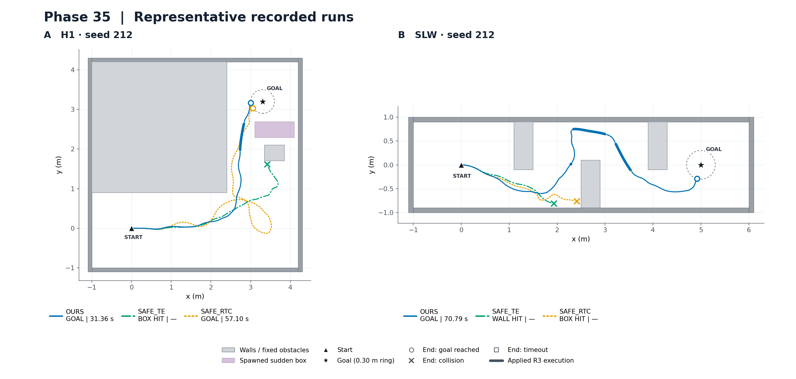

# Phase35 주행 궤적 그림

저장된 `phase35_01`의 **75개 본 run**으로 PNG **16장**을 생성했다. 모든 PNG는 **150 dpi**, 축은 **m**, x/y 축의 데이터 단위 비율은 **1:1**이다. 새 시뮬레이션·NoMaD 추론·경로 재풀이를 하지 않았고 기존 코드·결과·raw는 수정하지 않았다.

## 표시 규칙

- 궤적: `agent_trajectory.csv`의 전체 72Hz 실제 로봇 중심 좌표를 그대로 연결했다. 평활화·간격 축소·경로 이동은 하지 않았다.
- 방법 색은 Okabe–Ito 계열의 색맹 친화 배색이다: OURS 파랑 `#0072B2`, ASTAR+EC 주홍 `#D55E00`, SAFE_TE 청록 `#009E73`, SAFE_RTC 주황 `#E69F00`, NOMAD_RAW 짙은 회색 `#262626`. 선 모양도 달리했다.
- 벽은 `geometry_check.json`의 실제 USD AABB, 고정 장애물은 저장 장면 설정의 크기·위치로 회색 표시했다. 목표 점선 원은 동결된 0.30m 목표 허용 범위다.
- 돌발 상자는 해당 그림에 포함한 각 run의 실제 spawn geometry를 보라색으로 겹쳤다. `dynamic_render_<id>.json`의 실제 렌더 경계와 대조했다. 방법별 수 mm 위치 차이를 평균내지 않았으며, 실제 생성되지 않은 상자는 그리지 않았다. 겹친 여러 상자가 동시에 존재했다는 의미가 아니며, 그림에는 출현 전 궤적도 포함된다.
- 출발은 검정 삼각형, 목표는 검정 별이다. **종료 원=도착, X=실제 충돌, 사각형=시간초과**이고 각 방법의 색을 사용한다. 범례의 GOAL/BOX HIT/WALL HIT/TIMEOUT은 원 평가 결과를 그대로 표시한다. 도착시간은 성공 run에만 적고 미도착은 `—`로 표시한다.
- OURS·ASTAR+EC의 **굵은 선은 R3 우회가 실제 적용된 구간의 로봇 궤적**이다. `detour.jsonl`의 APPLIED부터 같은 job의 END까지 표시하고, 종료까지 활성인 우회는 run 종료까지 포함한다. 거절·미적용 R3와 R2 수리는 굵게 표시하지 않는다. 각 run의 구간 합은 기존 `detour_execution_s`와 일치한다.
- 벽에 닿아 corridor stop으로 끝난 4건도 기존 평가의 `collision=True`이므로 X/WALL HIT로 표시했다. 전체 종료 분류는 도착41, 상자 충돌10, 벽 충돌4, 시간초과20건이다.

## 미팅용 대표 그림

요청한 **H1 seed212와 SLW seed212**를 나란히 놓았다. **OURS·SAFE_TE·SAFE_RTC만** 표시하며 색·기호·우회 강조 규칙은 전체 그림과 동일하다. 각 패널의 축 단위 비율은1:1이며 패널 간 축 범위는 장면에 맞춘다. 대표 장면/seed는 요청에서 지정된 것으로, 생성 결과를 보고 바꾸지 않았다.

## Scene × seed 비교 그림 15장

각 그림은 동일 scene×seed의 다섯 방법을 모두 겹친다. 범례에 방법별 종료 결과와 도착시간을 표시한다.

| 장면 | Seed212 | Seed213 | Seed214 | 설명 |
| --- | --- | --- | --- | --- |
| SLW | [SLW / 212](../research/results/phase35/figures/trajectories_SLW_212.png) | [SLW / 213](../research/results/phase35/figures/trajectories_SLW_213.png) | [SLW / 214](../research/results/phase35/figures/trajectories_SLW_214.png) | 좁은 slalom, 고정 상자3개와 외곽 벽 |
| LC | [LC / 212](../research/results/phase35/figures/trajectories_LC_212.png) | [LC / 213](../research/results/phase35/figures/trajectories_LC_213.png) | [LC / 214](../research/results/phase35/figures/trajectories_LC_214.png) | L자 코너, InnerCorner·AfterCorner 고정 상자 |
| L2 | [L2 / 212](../research/results/phase35/figures/trajectories_L2_212.png) | [L2 / 213](../research/results/phase35/figures/trajectories_L2_213.png) | [L2 / 214](../research/results/phase35/figures/trajectories_L2_214.png) | 직선 통로, 중앙 돌발 상자1개 |
| H1 | [H1 / 212](../research/results/phase35/figures/trajectories_H1_212.png) | [H1 / 213](../research/results/phase35/figures/trajectories_H1_213.png) | [H1 / 214](../research/results/phase35/figures/trajectories_H1_214.png) | L자 코너 출구의 돌발 상자1개 |
| H2 | [H2 / 212](../research/results/phase35/figures/trajectories_H2_212.png) | [H2 / 213](../research/results/phase35/figures/trajectories_H2_213.png) | [H2 / 214](../research/results/phase35/figures/trajectories_H2_214.png) | 직선 통로, 순차 생성 돌발 상자 최대2개 |

## 파일·검증

- 결과 폴더: `research/results/phase35/figures/`.
- `manifest.json`: PNG별 크기·dpi·SHA256, 포함 run, 입력 파일 hash, 종료 표시, 우회 구간, 실제 상자 위치/출현시각을 기록했다.
- 75개 입력 조합·16개 PNG·150dpi를 검증했고 입력 파일의 생성 전/후 SHA256이 같음을 확인했다. 기존 `PHASE35_REPORT.md`, `decision.json` 및 동결 코드에는 변경이 없다.
- 생성은 `/usr/bin/python3`와 `PYTHONPATH=research`로 실행한 임시 시각화 스크립트(`/tmp/phase35_figures_report.py`)에서 수행했다. 패키지를 설치하지 않았다.
