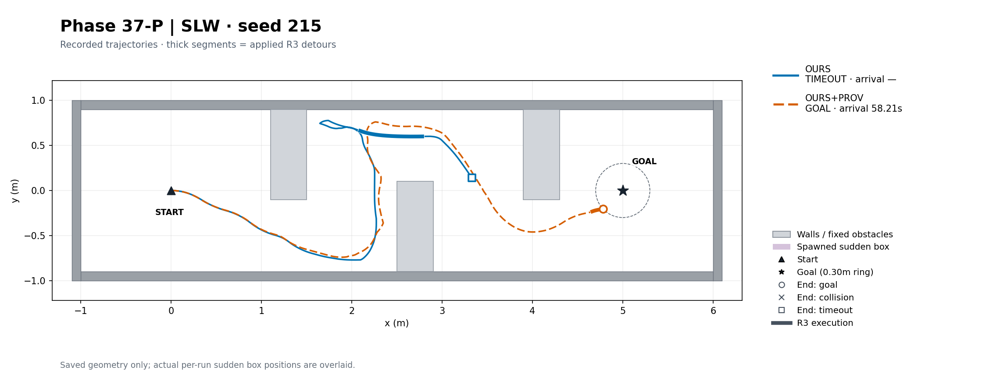
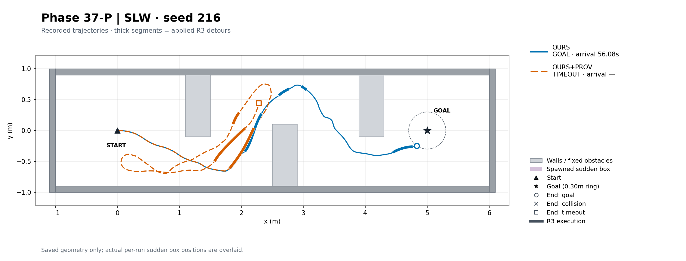
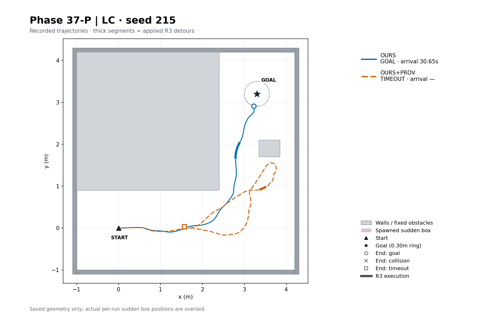
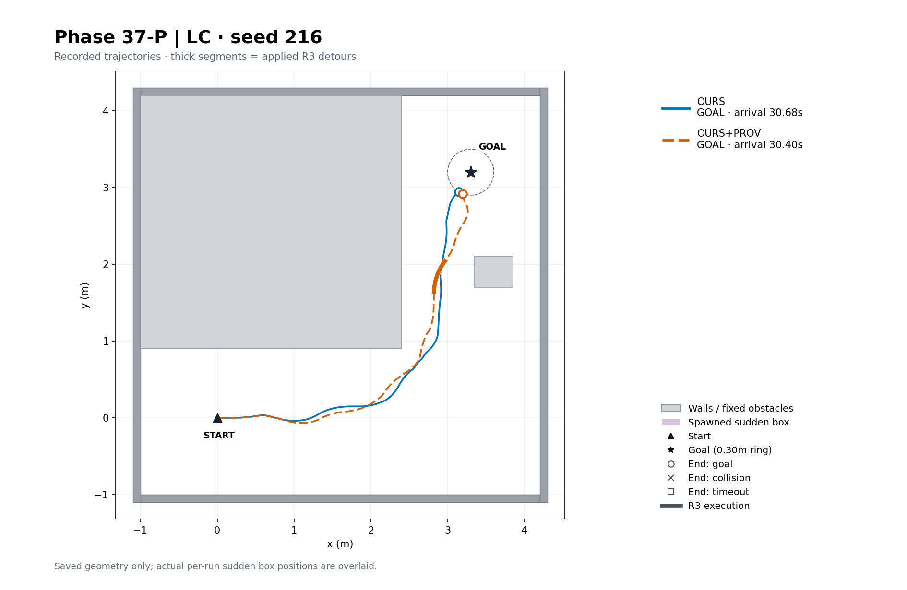
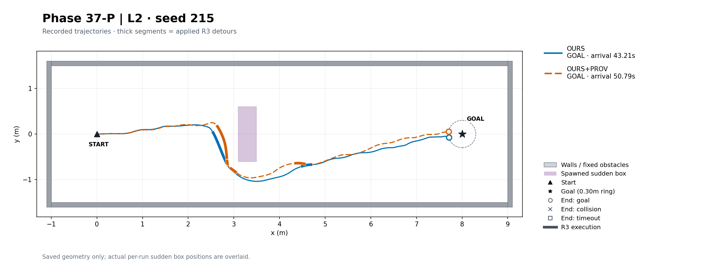
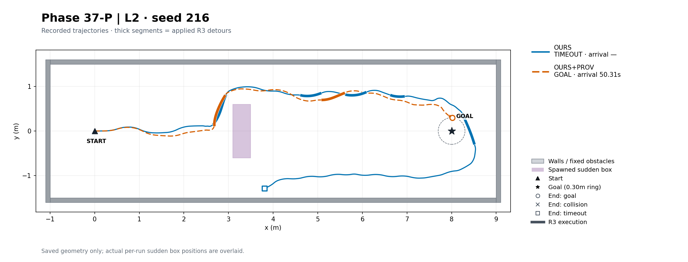
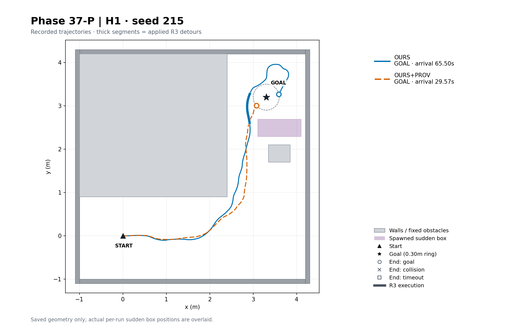
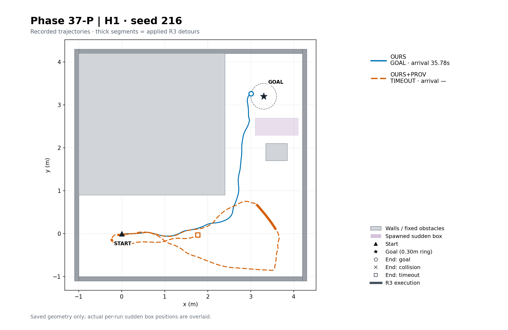
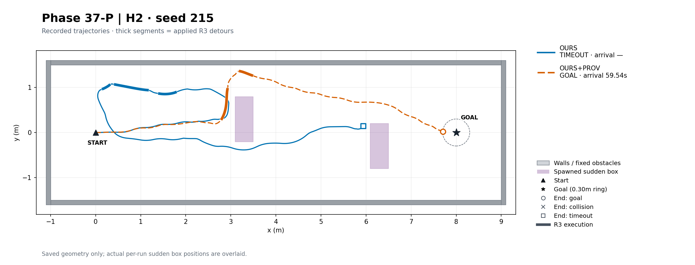
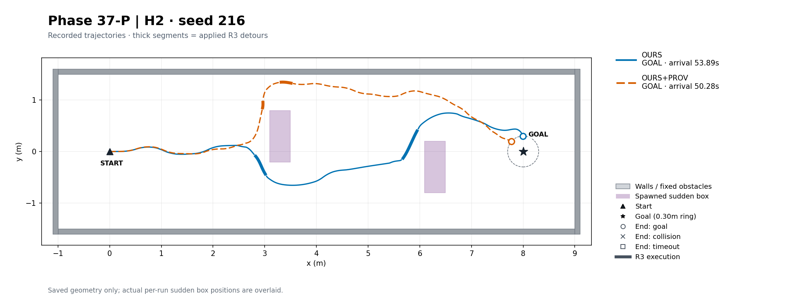

# Phase37-P — OURS / OURS+PROV 파일럿

**NOT_PROMISING**. Protocol FROZEN SHA256 `a455d695db4a0e3a0c9b0fc1038751782feefc72e21c14bd11996aeff7955811`.20 run,10개 scene×seed 짝을 대상으로 한다. 판정은 PROV 도착>OURS 도착 AND PROV 충돌≤OURS 충돌이다. 도착시간은 판정에 사용하지 않는다.

## 사용자 결정 / 사전등록 이탈

2026-11-08: Phase37-B의 `PROV_NOT_ESTABLISHED_MISSING_HISTORY`를 보존한다(확인 이력 기준 BOX42/45, 비-BOX116→59). 보존되지 않은 과거 지도 때문에 오프라인 gate를 확정할 수 없어, 사용자가 라이브 이력을 모두 추적하는 주행 파일럿을 승인했다. 오프라인 라벨을 PASS로 바꾸지 않았다.

OURS는 Phase35 동결 코드 그대로다. OURS+PROV는 매 지도 발행 직전, 최종 V1/shadow 상태에서 `last_free_tick==frame_tick AND observed AND not occupied`이고 최초 occupied 이전인 셀의 플래그를 누적한다. B의 새 덩어리 집계에만 이 플래그를 추가한다. 기존 ID·t_new·u_ref, 트리거A, 유지/넘김, R2/R3, EC, PP/SP와>90° 정렬은 그대로다.10초 방향 보정과 TOPO-H는 사용하지 않는다. Oracle은 아래 사후 분류/그림에만 사용한다.

## 판정 및 방법×장면

| label | checks | counts | evidence_valid | reason |
|---|---|---|---|---|
| NOT_PROMISING | {'goal_strictly_more': False, 'collision_not_more': True} | {'OURS': {'goal': 7, 'collision': 0}, 'OURS+PROV': {'goal': 7, 'collision': 0}} | True | registered ten-pair comparison |

| method | scene | n | valid | goal | collision | goal_time_median_s | mean_speed_m_s | stopped_fraction | trigger_A | trigger_B | detour_applied |
|---|---|---|---|---|---|---|---|---|---|---|---|
| OURS | SLW | 2 | 2 | 1 | 0 | 56.083 | 0.090284 | 0.40297 | 17 | 12 | 6 |
| OURS | LC | 2 | 2 | 2 | 0 | 30.667 | 0.17273 | 0.11776 | 0 | 2 | 1 |
| OURS | L2 | 2 | 2 | 1 | 0 | 43.208 | 0.18221 | 0.11856 | 0 | 13 | 7 |
| OURS | H1 | 2 | 2 | 2 | 0 | 50.639 | 0.13485 | 0.22535 | 2 | 11 | 1 |
| OURS | H2 | 2 | 2 | 1 | 0 | 53.889 | 0.1571 | 0.17588 | 0 | 14 | 5 |
| OURS | ALL | 10 | 10 | 7 | 0 | 43.208 | 0.16163 | 0.16375 | 19 | 52 | 20 |
| OURS+PROV | SLW | 2 | 2 | 1 | 0 | 58.208 | 0.11336 | 0.26914 | 6 | 16 | 4 |
| OURS+PROV | LC | 2 | 2 | 1 | 0 | 30.403 | 0.12955 | 0.2622 | 2 | 14 | 3 |
| OURS+PROV | L2 | 2 | 2 | 2 | 0 | 50.549 | 0.17428 | 0.14721 | 1 | 8 | 7 |
| OURS+PROV | H1 | 2 | 2 | 1 | 0 | 29.569 | 0.15246 | 0.19276 | 1 | 13 | 3 |
| OURS+PROV | H2 | 2 | 2 | 2 | 0 | 54.91 | 0.1634 | 0.20348 | 2 | 9 | 4 |
| OURS+PROV | ALL | 10 | 10 | 7 | 0 | 50.306 | 0.15988 | 0.20488 | 12 | 60 | 21 |

## 트리거 수 / Phase37 oracle4분류

| method | scene | trigger | BOX_AHEAD | STATIC_AHEAD | PASSED_BOX | NOTHING_AHEAD |
|---|---|---|---|---|---|---|
| OURS | SLW | A | 0 | 17 | 0 | 0 |
| OURS | SLW | B | 0 | 12 | 0 | 0 |
| OURS | LC | A | 0 | 0 | 0 | 0 |
| OURS | LC | B | 0 | 2 | 0 | 0 |
| OURS | L2 | A | 0 | 0 | 0 | 0 |
| OURS | L2 | B | 3 | 10 | 0 | 0 |
| OURS | H1 | A | 2 | 0 | 0 | 0 |
| OURS | H1 | B | 0 | 9 | 2 | 0 |
| OURS | H2 | A | 0 | 0 | 0 | 0 |
| OURS | H2 | B | 9 | 4 | 1 | 0 |
| OURS | ALL | A | 2 | 17 | 0 | 0 |
| OURS | ALL | B | 12 | 37 | 3 | 0 |
| OURS+PROV | SLW | A | 0 | 6 | 0 | 0 |
| OURS+PROV | SLW | B | 0 | 16 | 0 | 0 |
| OURS+PROV | LC | A | 0 | 2 | 0 | 0 |
| OURS+PROV | LC | B | 0 | 14 | 0 | 0 |
| OURS+PROV | L2 | A | 1 | 0 | 0 | 0 |
| OURS+PROV | L2 | B | 5 | 2 | 1 | 0 |
| OURS+PROV | H1 | A | 0 | 1 | 0 | 0 |
| OURS+PROV | H1 | B | 0 | 10 | 1 | 2 |
| OURS+PROV | H2 | A | 1 | 1 | 0 | 0 |
| OURS+PROV | H2 | B | 3 | 5 | 1 | 0 |
| OURS+PROV | ALL | A | 2 | 10 | 0 | 0 |
| OURS+PROV | ALL | B | 8 | 47 | 3 | 2 |

실제 TRIGGER event를 A/B로 나눠 센다. 같은 u_ref 전방1.0×0.4m 사각형과 원 Phase37 기하 분류를 사용하며, 실제 spawn/passage 시각을 사용한다. 우회 적용 수는 APPLIED event 수다.

## 짝 도착시간 (PROV−OURS)

| scene | index | OURS_goal | PROV_goal | OURS_collision | PROV_collision | goal_time_delta_s |
|---|---|---|---|---|---|---|
| SLW | 215 | False | True | False | False | — |
| SLW | 216 | True | False | False | False | — |
| LC | 215 | True | False | False | False | — |
| LC | 216 | True | True | False | False | -0.27778 |
| L2 | 215 | True | True | False | False | 7.5833 |
| L2 | 216 | False | True | False | False | — |
| H1 | 215 | True | True | False | False | -35.931 |
| H1 | 216 | True | False | False | False | — |
| H2 | 215 | False | True | False | False | — |
| H2 | 216 | True | True | False | False | -3.6111 |

둘 다 도착한 짝의 중앙값: -1.9444444444444429s.

## 실패 원인 / 기술 실패

| scene | index | method | primary_cause | classification | termination | minimum_goal_distance_m | output |
|---|---|---|---|---|---|---|---|
| H1 | 216 | OURS+PROV | EARLY_STUCK | STUCK | simulation_timeout | 2.4777 | /home/gpuadmin/Workspace/NoMaD/artifacts/isaac6/phase37p_01/main/H1_216_OURS+PROV/attempt1 |
| H2 | 215 | OURS | DETOUR_FAIL | STUCK | simulation_timeout | 2.0622 | /home/gpuadmin/Workspace/NoMaD/artifacts/isaac6/phase37p_01/main/H2_215_OURS/attempt1 |
| L2 | 216 | OURS | NEAR_GOAL_HOVER | STUCK | simulation_timeout | 0.37746 | /home/gpuadmin/Workspace/NoMaD/artifacts/isaac6/phase37p_01/main/L2_216_OURS/attempt1 |
| LC | 215 | OURS+PROV | STATIC_NARROW_STUCK | STUCK | simulation_timeout | 1.6797 | /home/gpuadmin/Workspace/NoMaD/artifacts/isaac6/phase37p_01/main/LC_215_OURS+PROV/attempt1 |
| SLW | 215 | OURS | OTHER | STUCK | simulation_timeout | 1.6775 | /home/gpuadmin/Workspace/NoMaD/artifacts/isaac6/phase37p_01/main/SLW_215_OURS/attempt1 |
| SLW | 216 | OURS+PROV | OTHER | STUCK | simulation_timeout | 2.5836 | /home/gpuadmin/Workspace/NoMaD/artifacts/isaac6/phase37p_01/main/SLW_216_OURS+PROV/attempt1 |

Phase31-D의 첫 일치 순서(상자/구조벽 충돌→경계 정지→목표0.6m 접근 후 실패→상자 통과 후 실패→정적 마지막10초 진전<0.2m→상자 미통과→출현 전/초기 정체→기타)를 Phase35의 동결 분석 코드로 재사용했다. WALL_COLLISION 분해에는 margin 정지가 포함될 수 있지만 판정의 collision은 원 evaluator 값이다.

자료 없음

## 블록별 주행 궤적

Phase35와 같은150dpi/1:1 축 비율이다. OURS 파랑, PROV 주홍, 실제 궤적과 실제 R3 실행 구간(굵은 선), 회색 벽/고정 장애물, 보라색 실제 생성 상자를 표시한다. 종료 원=도착, X=충돌, 사각형=timeout이며 그 밖의 경계 정지는 별도 표시한다. 기술 실패/필수 로그 없음은 범례에 표시하고, 둘 다 없으면 그림을 생략하고 이유를 남긴다.

저장 v2: values 생략 및 provenance flag/최초 확인 tick 보존. 같은 seed 기술 실패1회 재시도, run 종료 cache 정리, 매 attempt 전30GB 점검. 기존 Phase35/37/37-B 결과는 수정하지 않는다.
