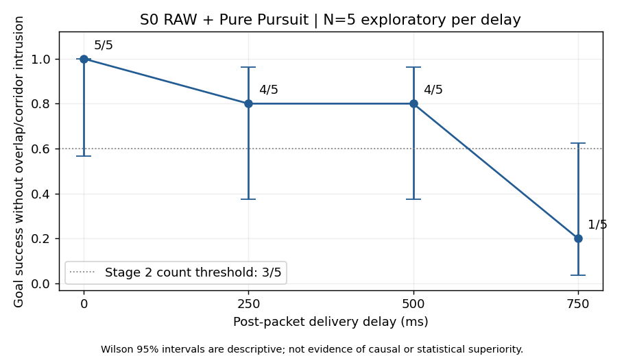
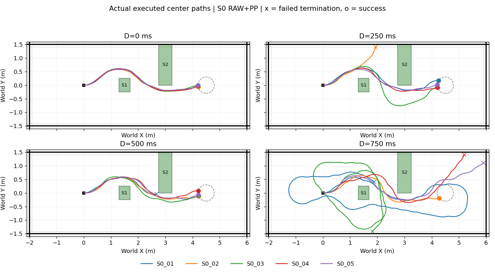

# Phase 3 Stage 1: S0 RAW + PP delivery-delay sweep

## Preregistration (before navigation)

Base `c7fc0bc`; branch `research/phase0-infrastructure`. Frozen protocol:
`research/nomad_phase3/protocol.json`. This is an **N=5 exploratory study** in
**SE(2) kinematic Isaac Sim**, with **Oracle geometry evaluation only**.
No Graph, sample selection, RIGID, rate limit, recovery or safety intervention.

The unchanged S0 scenario and 2-second/14-node Topomap are used. Sample 0,
lookahead 0.25m, speed 0.2m/s, angular bound 0.4rad/s, 4/9/72Hz, and 1-second
release-based waypoint timeout remain unchanged. The new opt-in mode changes
only the simulation termination ceiling to 90s and enables the existing uniform
post-packet result-delivery hold. Original scenario JSON remains at 60s.

Order: S0_01 to S0_05, each D=0,250,500,750ms. Offsets 10000 to 50000;
inference seed `101 + offset + 2*request_id`, DDPM seed +1. Exactly 20 attempts,
no retries. Technical failures are recorded and the next unattempted job runs.
The global S0 batch lock prevents concurrent batch GPU navigation.

Success = goal entry without confirmed geometric overlap or corridor intrusion.
2cm margin violations remain separate. A conservative contact stop without
confirmed overlap is retained as `OTHER_TERMINATION`, never called collision.
STUCK requires the 90s simulation timeout. Technical failures remain explicit.

A→B motion is summed from actual 72Hz executed poses, not a hypothetical OLD
continuation. Net wrapped yaw and total absolute yaw are separate. Staleness
uses the original PP nearest projection at actual B divided by FRESH path
length. World paths use observation pose, never switch anchoring. First switch
and invalid paths are separated; received-only outputs do not acquire a B.
Clamp fractions use remaining tracked path length <0.25m. Fixed-speed curvature
saturation means |kappa_PP|>2/m at non-stopped control ticks (the 0.4/0.2 bound).
Run-level distributions and descriptive pooled event distributions are saved;
pooled events do not increase the experimental N. Host/simulation clocks remain
separate. Pacing lateness and wall/simulation duration ratio are reported.

Stage 2 selection is fixed: among positive D with <=3 verified successes out of
5, choose the smallest two. If all positive D achieve >=4/5, stop and report no
handoff-correction necessity established in this S0 range. No Stage 2 navigation
is authorized by this task. Technical failures weaken any navigation inference.

## Preflight

19 targeted tests passed: new gate, paired seeds, legacy runner defaults,
unchanged `ChunkExecution` class, existing S0 metrics/chunk execution/delivery
hold tests. Dry-run constructs exactly 20 unique outputs in the specified order.
No extra navigation or inference was used for preflight.

Existing S0_01–05 PP records all reproduce: pose re-integration maximum error
0; PP command error <=8.89e-16; swept-clearance error <=1.67e-16. All five old
runs reached the goal. RGB history, Topomap selection, native normalization,
seeds and observation anchors were validated. Checkpoint SHA-256:
`70f79b8262527e20e56ced64a3e3d7ef91855bc9e7c3fa348d78edcb83c6a333`.
Topomap SHA-256:
`5b720e71b03b9809488ca81c340bfe691f39542371bad03eddf7a40246285f36`.

Execution command (new output must not exist):

```bash
env -u LD_LIBRARY_PATH -u LD_PRELOAD -u PYTHONHOME -u VIRTUAL_ENV OPENBLAS_NUM_THREADS=1 OMP_NUM_THREADS=1 bash research/python.sh -m nomad_phase0.s0_batch --delay-sweep --execute --run-root /home/gpuadmin/Workspace/NoMaD/artifacts/isaac6/phase3_s0_delay_01
```

The above preregistration was frozen at `8e73999` before navigation. Completed results follow.

## Completed results

Execution freeze: `8e73999d8deaf70bfebbd3ca2b356aa708514217`. 20 attempts, 0 retries. Results below are **N=5 exploratory per D**.

| D (ms) | success / 5 | Wilson 95% CI | obstacle overlap | corridor | 90s timeout | technical |
|---:|---:|---:|---:|---:|---:|---:|
| 0 | 5/5 | 0.566–1.000 | 0 | 0 | 0 | 0 |
| 250 | 4/5 | 0.376–0.964 | 0 | 1 | 0 | 0 |
| 500 | 4/5 | 0.376–0.964 | 1 | 0 | 0 | 0 |
| 750 | 1/5 | 0.036–0.624 | 0 | 3 | 1 | 0 |

Wilson intervals are descriptive; selection uses the preregistered counts, not confidence intervals.

| D (ms) | A→B travel median / p95 / max (m) | staleness median / p95 / max | switch abs(Δω) median / p95 / max (rad/s) | mean run clamp fraction | median receive interval (s) |
|---:|---|---|---|---:|---:|
| 0 | 0.031 / 0.036 / 0.053 | 0.000 / 0.000 / 0.132 | 0.121 / 0.481 / 0.800 | 0.072 | 0.250 |
| 250 | 0.081 / 0.092 / 0.103 | 0.075 / 0.244 / 0.666 | 0.177 / 0.800 / 0.800 | 0.340 | 0.500 |
| 500 | 0.131 / 0.142 / 0.153 | 0.208 / 0.447 / 0.776 | 0.304 / 0.800 / 0.800 | 0.585 | 0.749 |
| 750 | 0.181 / 0.186 / 0.203 | 0.343 / 0.632 / 1.000 | 0.400 / 0.800 / 0.800 | 0.832 | 0.998 |

Handoff percentiles pool observed events descriptively; `runs.json` preserves run-level median/p95/max. Longer runs contribute more events. Clamp fraction uses all 9Hz ticks; valid-path denominator is also saved. No native waypoint timestamps or yaw are assumed.

| D (ms) | total margin violation (s) | runs with margin violation | total timeout episodes | total busy skips | mean curvature-saturated tick fraction |
|---:|---:|---:|---:|---:|---:|
| 0 | 0.000 | 0 | 0 | 5 | 0.149 |
| 250 | 0.792 | 2 | 0 | 221 | 0.365 |
| 500 | 0.125 | 1 | 0 | 304 | 0.458 |
| 750 | 0.208 | 1 | 8 | 757 | 0.655 |

### D0 reproduction

| Run | old → new outcome | old → new goal time (s) | first pose difference (s) | first differing input request |
|---|---|---|---:|---:|
| S0_01 | SUCCESS → SUCCESS | 24.694 → 24.236 | 1.903 | 0 |
| S0_02 | SUCCESS → SUCCESS | 24.250 → 24.208 | 1.125 | 0 |
| S0_03 | SUCCESS → SUCCESS | 24.250 → 24.264 | 1.125 | 0 |
| S0_04 | SUCCESS → SUCCESS | 24.194 → 24.264 | 1.125 | 0 |
| S0_05 | SUCCESS → SUCCESS | 24.208 → 24.181 | 1.125 | 0 |

Common request seeds agree. Same offset is not identical RGB or deterministic closed-loop execution. `d0_reproduction.json` records input hashes, output differences, and equal-simulation-tick pose reproduction diagnostics. The old timeout was 60s; this sweep uses 90s.

### Failed runs and last three applied FRESH

| Run | outcome | termination | first failure t / x | cause |
|---|---|---|---|---|
| S0_01_D500 | SAFETY_FAILURE | geometric_collision | 16.806 / 2.671 | StaticObstacle2 |
| S0_01_D750 | STUCK | simulation_timeout | 90.000 / 1.878 | no confirmed geometric failure |
| S0_02_D250 | SAFETY_FAILURE | corridor_footprint_stop | 13.861 / 1.944 | left_wall_positive_y |
| S0_03_D750 | SAFETY_FAILURE | corridor_footprint_stop | 64.931 / 1.821 | right_wall_negative_y |
| S0_04_D750 | SAFETY_FAILURE | corridor_footprint_stop | 36.792 / 5.193 | left_wall_positive_y |
| S0_05_D750 | SAFETY_FAILURE | corridor_footprint_stop | 38.222 / 5.910 | end_wall_positive_x |

`failures.csv` labels Static1/Static2 and wall causes. `left_wall_after_Static1` is a descriptive match to a previously seen pattern, not proof that delay is irrelevant. A different location alone does not prove a latency cause.

| Failed run | FRESH ID | switch t (s) | A→B travel (m) | staleness | abs(Δω) (rad/s) |
|---|---:|---:|---:|---:|---:|
| S0_01_D500 | 18 | 14.667 | 0.136 | 0.200 | 0.269 |
| S0_01_D500 | 19 | 15.333 | 0.119 | 0.184 | 0.000 |
| S0_01_D500 | 20 | 16.111 | 0.125 | 0.216 | 0.088 |
| S0_01_D750 | 86 | 87.333 | 0.169 | 0.278 | 0.326 |
| S0_01_D750 | 87 | 88.333 | 0.169 | 0.240 | 0.376 |
| S0_01_D750 | 88 | 89.333 | 0.169 | 0.304 | 0.090 |
| S0_02_D250 | 22 | 12.333 | 0.069 | 0.149 | 0.000 |
| S0_02_D250 | 23 | 12.889 | 0.081 | 0.135 | 0.800 |
| S0_02_D250 | 24 | 13.333 | 0.069 | 0.057 | 0.800 |
| S0_03_D750 | 61 | 62.333 | 0.169 | 0.325 | 0.000 |
| S0_03_D750 | 62 | 63.333 | 0.169 | 0.227 | 0.722 |
| S0_03_D750 | 63 | 64.444 | 0.169 | 0.348 | 0.400 |
| S0_04_D750 | 33 | 34.333 | 0.169 | 0.558 | 0.800 |
| S0_04_D750 | 34 | 35.222 | 0.197 | 0.181 | 0.738 |
| S0_04_D750 | 35 | 36.222 | 0.197 | 0.168 | 0.062 |
| S0_05_D750 | 35 | 36.111 | 0.175 | 0.251 | 0.800 |
| S0_05_D750 | 36 | 37.111 | 0.175 | 0.120 | 0.637 |
| S0_05_D750 | 37 | 38.000 | 0.203 | 0.180 | 0.163 |

### Verification and decision

20/20 runs passed saved-log technical audit. Maximum pose re-integration error: 0; PP command error: 2.5e-15; swept-clearance replay error: 8.88e-16. All accepted outputs, release deadlines, RGB histories, normalization, seeds, Topomap choices and observation anchors were checked.

Preregistered decision: **STAGE2_DELAY_RANGE_SELECTED**. Stage 2 target delays: **[750] ms**. No Stage 2 navigation was performed.

These results do not establish the necessity or effectiveness of Graph correction. Changes in closed-loop RGB, Topomap choices and sampling input remain intertwined with execution timing. Failure-local diagnostics identify observed patterns, not a causal decomposition.

Raw data: `/home/gpuadmin/Workspace/NoMaD/artifacts/isaac6/phase3_s0_delay_01/`. Prior reference file hashes remained unchanged. Small tables and the two requested figures are in `research/results/phase3_stage1_s0_delay_20261023/`.





### Analysis-only correction and interpretation

The original post-run cause label used the sign of Y after detecting any
corridor breach. S0_05/D750 actually breached the **+X end wall** at x=5.910430m,
y=1.105699m, not the left wall. Exact SE(2) arc extrema identify the violated
axis. The original per-run metric is preserved; a separate
`analysis_amendments/S0_05_D750.json` corrects `failure.causes`. No execution,
classification, clearance, threshold, seed or navigation was changed or repeated.
Other corridor-failure axes were independently checked and stayed unchanged.

The D250 failure is the familiar left-wall drift after Static1 (x=1.944m).
D500 failed at Static2 (x=2.671m). D750 produced a 90s looping timeout, right-wall
intrusion after extended looping, left-wall intrusion after Static2, and +X
end-wall intrusion after passing the goal region. Its one successful run reached
the goal in 27.25s. These are different observed failure patterns; the data do
not isolate handoff inconsistency from upstream prediction/Topomap and follower
behavior.

There were 1,110 accepted GPU inference outputs, 1,098 actual switches, and 1,078
OLD/FRESH pairs (20 initial switches excluded); 2,463 captured RGB frames were
hash-verified. Received-only predictions have no invented switch boundary.
All actual release deadlines were met; wall/simulation duration ratios were
1.00000237–1.00000654 and maximum integration pacing lateness was 3.00ms.

All five D0 runs retained the original success outcome. Exact input/trajectory
reproduction did not occur: already at the same initial pose and subgoal,
first-history RGB mean absolute differences were 0.60–0.75 on the 0–255 scale.
This is evidence of differing rendered inputs, not a model/checkpoint change.

### Timing and changed files

| D (ms) | actual added delay, median of run medians (ms) | warm GPU inference, median of run medians (ms) | pooled A→B absolute yaw median / p95 / max (rad) |
|---:|---:|---:|---|
| 0 | 0.011 | 35.449 | 0.022 / 0.072 / 0.094 |
| 250 | 250.073 | 35.640 | 0.114 / 0.172 / 0.194 |
| 500 | 500.073 | 36.066 | 0.239 / 0.272 / 0.294 |
| 750 | 750.072 | 35.156 | 0.361 / 0.372 / 0.383 |

New files: `research/nomad_phase3/{config,batch,metrics,report,test_stage1}.py`,
package initializer and frozen `protocol.json`. Existing changes are limited to
S0 runner dispatch/metric timeout parameter, opt-in guards in `launch.py`,
`simulator.py`, `seed_offset.py`, `chunk_execution.py`, and summary labeling in
`async_runtime.py`. PP's execution class and `pure_pursuit.py`, official PD,
NoMaD, Topomap, Graph, geometry and scenario remain unchanged.

`failures.csv` also distinguishes the late left-wall failure after Static2 from
the earlier D250 drift immediately after Static1. D250's two margin-violating
runs still count as SUCCESS under the registered outcome definition; neither
had overlap or corridor intrusion. The minimum-clearance and passage-side
values for both obstacles are retained per run in `runs.csv` / `runs.json`.
