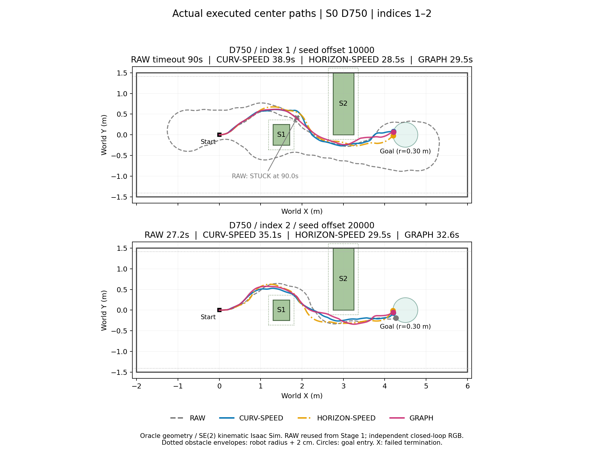

# Phase 3 Stage 2: selected S0 speed / Graph comparison

Base `d99d3e8`, branch `research/phase0-infrastructure`. This is an N=4 selection experiment with oracle static geometry and SE(2) kinematic Isaac Sim, not evidence of general Graph superiority.

## Frozen implementation

`research/nomad_phase3_stage2/protocol.json` fixes the 15-run matrix. D750 index 1 CURV-SPEED / HORIZON-SPEED / GRAPH are the three included technical pilots. Remaining jobs: D750 indices 2–4 (three methods each), then D0 GRAPH indices 1–3. RAW reuses Stage 1; no new RAW run. Seed is `101 + 10000*index + 2*request_id`, DDPM +1.

The original PP computes the target and curvature. A separate opt-in applied-command wrapper changes speed only, or replaces the world path after an accepted Graph result. Original PP, PD, NoMaD, Topomap, Graph v4 and its weights are unchanged. The timing core still applies FRESH at the first eligible 9Hz tick and expires the waypoint one second after release. Endpoint/invalid/missing/timeout stops remain unchanged; active moving commands use 0.05–0.2 m/s and acceleration 0.5 m/s².

HORIZON-SPEED uses the literal nearest projection to measure remaining arclength, and elapsed simulation time since the actual FRESH switch: `max(0.998-elapsed, 0.1)`. CURV-SPEED and GRAPH use the existing v3/v4 curvature speed rule. Both preserve angular clipping at ±0.4 rad/s.

Each GRAPH FRESH immediately applies its raw observation-anchored sample 0 and submits one job with the actual switch pose B, previous applied command, and last accepted corrected path. The unchanged v4 runs in the existing external CPU worker. One serial FIFO processes every switched FRESH; the queue's 512 slots exceed the 361-capture bound of a 90-second run. Control never waits. Queue/IPC delay, optimizer time, processing time (setup + solve + certificate), and movement until result handling are logged separately. Processing >0.5 seconds is STALE. Newer received FRESH takes precedence as SUPERSEDED; the stale flag is also retained. Terminal pending jobs are logged and cannot move the agent.

Only convergence + original constraints + original exact certificate allow replacement at the next eligible controller tick, and only while the same FRESH remains valid. Graph does not reset timeout or alter original observation anchoring. The corrected path is not re-anchored to the later application pose. A zero previous speed retains v4's initialization rejection; no fictitious curvature is substituted. No safety-stop or recovery is added.

## Execution boundary

Run `nomad_phase3_stage2.batch --pilots` only once at a new root. A later `--remaining` invocation requires all three pilot technical validations, a clean checkout, unchanged frozen source/input hashes, and no previous remaining attempt. It launches exactly 12 jobs serially. Failed jobs are preserved; no retry/resume of an interrupted remaining invocation. A documentation/result-only commit between pilots and remaining runs is permitted because execution source hashes are fixed and both Git SHAs are recorded.

The requested superiority criterion is frozen: GRAPH D750 successes exceed the best simple speed baseline by at least two; its successful-run median goal time is at most 1.2 times the fastest median among speed methods with successes; D0 GRAPH success count is at least Stage 1 RAW at the same three indices. If neither speed baseline succeeds, the time criterion is unavailable, not an automatic pass. Full comparison and the requested overlay are deferred until the user completes the remaining runs.

## Preflight

Eight targeted/legacy tests passed: speed bounds/acceleration, horizon time, opt-in gates/seeds/matrix, original D0 behavior, Graph result/supersession/staleness and unchanged timeout. A synthetic straight-path CPU worker smoke check returned a converged feasible solution; this is IPC/function validation, not navigation evidence. Dry-run contains exactly 3 pilots + 12 remaining jobs. Protected source/checkpoint and all 14 Topomap RGB nodes are hash-validated by the batch preflight.

At pre-registration no navigation or scientific outcome comparison had been performed. Included-pilot technical validation and the subsequently completed batch analysis are recorded below.

## Included pilot technical results

All three authorized D750/index1 pilots ran exactly once from clean commit `7ffa61eea2ab08d1c6752bf5bbfd50d7db1562c1`. The batch stopped automatically afterward. At that handoff the remaining navigation had not started; the user subsequently completed it from clean commit `503f556`.

| Method | Received / switched FRESH | Pose / PP command / clearance replay max error | Technical validation |
|---|---:|---:|---|
| CURV-SPEED | 39 / 38 | 0 / 0 / 0 | PASS |
| HORIZON-SPEED | 29 / 28 | 0 / 0 / 0 | PASS |
| GRAPH | 29 / 28 | 0 / 0 / 0 | PASS |

All original sample0/index2 outputs, RGB histories, Topomap choices, seeds, observation anchors, receive-based timeout and next-tick switch timestamps passed audit. Actual additional delay median was 750.072–750.073 ms. Wall/simulation ratios were 1.000002–1.000038; maximum recorded pacing lateness 2.391 ms. Existing source/checkpoint/reference hashes were verified unchanged.

GRAPH submitted 28 jobs and applied 26 accepted corrected paths. FRESH 0 and 24 retained the original v4 initialization rejection because the previous speed was zero. No nonconvergence, constraint rejection, STALE or SUPERSEDED occurred in this pilot; the latter two behaviors passed synthetic checks. Optimizer wall time median/p95/max: 56.324/62.975/70.630 ms. These are technical measurements only; no superiority inference is made from the three included pilots. The original worker's processing timestamps include setup/solve/certificate; dispatch-to-application movement also includes controller-tick waiting and is explicitly labeled separately.

Small technical results: `research/results/phase3_stage2_pilot_20261023/technical_summary.json` and `technical_checks.csv`. Full raw data and per-run metrics: `/home/gpuadmin/Workspace/NoMaD/artifacts/isaac6/phase3_stage2_s0_01/`.

## Completed user-started remaining batch (archived command)

The user completed all 12 remaining jobs on 2026-10-23. Both completion markers exist and the batch is closed; do not rerun the command below.

Expected time is roughly 30–45 minutes, including separate Isaac startup for each of 12 jobs (pilot startup + navigation + audit took 144–154 seconds per job). The command is independent of the terminal's current directory and uses nohup to survive terminal disconnect. Do not invoke it twice. It refuses any existing remaining attempt, preserves all pilot outputs, and starts no RAW baseline run.

```bash
nohup env -u LD_LIBRARY_PATH -u LD_PRELOAD -u PYTHONHOME -u VIRTUAL_ENV OPENBLAS_NUM_THREADS=1 OMP_NUM_THREADS=1 bash /home/gpuadmin/Workspace/NoMaD/visualnav-transformer/research/python.sh -m nomad_phase3_stage2.batch --remaining --run-root /home/gpuadmin/Workspace/NoMaD/artifacts/isaac6/phase3_stage2_s0_01 > /home/gpuadmin/Workspace/NoMaD/artifacts/isaac6/phase3_stage2_s0_01/remaining_terminal.log 2>&1 &
```

Completion marker: `remaining_complete.json`. Terminal log: `remaining_terminal.log`. Run journal: `remaining_execution.jsonl`. Keep the checkout unchanged during execution. On interruption or technical failure preserve the logs; do not retry. The final comparison, paired table, candidate decision and the one requested overlay are now recorded below.


## Final result — NO_GRAPH_ADVANTAGE_CANDIDATE

The included three pilots plus user-run 12 jobs give all 15 planned new runs, **15/15 technical PASS, zero retries**. RAW is reused from seven matching Stage 1 runs (D750 indices 1–4; D0 indices 1–3), never re-executed. All 199 frozen source/reference inputs and every run's stored input-log hashes match. Applied command, 72Hz pose and swept-clearance replay maximum errors are zero in all 15 new runs. Runtime commits are `7ffa61e` (pilots) and `503f556` (remaining; documentation/results-only change). New analysis code is `research/nomad_phase3_stage2/report.py`; no runtime, Graph weight, model, follower, timing or scenario change was made during analysis.

Results are N=4 exploratory at D750 and N=3 at D0, with oracle static geometry and SE(2) kinematic Isaac Sim. Equal seed offsets do not produce identical closed-loop RGB/predictions. Historical RAW and new methods therefore support this small selection result, not a paired causal proof.

### D750 outcomes

Goal-time median uses successful runs only. Average speed is the mean of each run's total travelled distance / duration, including initial and endpoint/timeout stops; failure durations are not imputed goal times. SUCCESS requires goal entry without confirmed geometric overlap or corridor intrusion. The 2cm obstacle margin is separate.

| Method | Success | Obstacle overlap | Corridor intrusion | Timeout | Goal-time median (s) | Mean speed (m/s) | Minimum obstacle clearance (m) | Margin violation total (s) |
|---|---:|---:|---:|---:|---:|---:|---:|---:|
| RAW (Stage 1) | 1/4 | 0 | 2 | 1 | 27.250 (n=1) | 0.1866 | 0.018324 | 0.208333 |
| CURV-SPEED | 4/4 | 0 | 0 | 0 | 33.736 | 0.1389 | 0.060867 | 0 |
| HORIZON-SPEED | 3/4 | 0 | 1 | 0 | 28.500 (n=3) | 0.1671 | 0.065612 | 0 |
| GRAPH | 4/4 | 0 | 0 | 0 | 31.854 | 0.1496 | 0.052910 | 0 |

HORIZON-SPEED index 4 entered the +Y corridor boundary at 15.583s, pose `(1.794636, 1.410147, 1.868914)`, after Static1. It did not geometrically overlap a static obstacle. The old RAW index 1 timed out while moving/looping (17.333m travelled), not by remaining stationary; index 3 exited the −Y corridor at 64.931s and index 4 the +Y corridor at 36.792s. The RAW 2cm margin violation is index 4's 0.208333s; all new runs have zero obstacle-margin violation intervals.

### Paired indices

Cells show goal time for SUCCESS; other values are the actual termination condition/time. Same-index offsets are `10000*index` for all methods. Full per-index metrics and conditional goal-time differences are in `paired.csv`.

| D750 index | RAW | CURV-SPEED | HORIZON-SPEED | GRAPH |
|---|---|---|---|---|
| 1 | STUCK, 90.000s | SUCCESS, 38.861s | SUCCESS, 28.500s | SUCCESS, 29.472s |
| 2 | SUCCESS, 27.250s | SUCCESS, 35.097s | SUCCESS, 29.472s | SUCCESS, 32.569s |
| 3 | −Y corridor, 64.931s | SUCCESS, 30.667s | SUCCESS, 27.653s | SUCCESS, 31.139s |
| 4 | +Y corridor, 36.792s | SUCCESS, 32.375s | +Y corridor, 15.583s | SUCCESS, 33.472s |

Relative to CURV-SPEED, GRAPH has **zero additional successful indices**; relative to HORIZON-SPEED it has one (index 4). GRAPH is faster than CURV-SPEED at indices 1–2 and slower at 3–4. Where both GRAPH and HORIZON-SPEED succeed (indices 1–3), GRAPH is slower by 0.972, 3.097 and 3.486s. These observations do not isolate Graph's causal effect: actual observations and subsequent predictions differ.

| D0 index | Stage 1 RAW goal (s) | GRAPH goal (s) | GRAPH − RAW (s) |
|---|---:|---:|---:|
| 1 | 24.236 | 25.417 | +1.181 |
| 2 | 24.208 | 25.153 | +0.944 |
| 3 | 24.264 | 25.917 | +1.653 |

D0 success is 3/3 for both, with no overlap, corridor or margin violation. Median goal time increases from 24.236 to 25.417s (+4.87%). Thus the predeclared success-count non-harm gate passes; universal absence of harm, or unchanged travel time, is not demonstrated.

### Handoff and execution diagnostics

Medians below pool actual FRESH handoffs excluding the initial no-OLD switch. Clamp/clipping/curvature fractions average the per-run fractions of all 9Hz control ticks. Run-level distributions, pooled p95/max and complete counts are retained in JSON. Staleness is measured on the **original observation-anchored path at initial FRESH switch**, before a later Graph replacement. It does not describe the corrected path at its later application pose.

| D750 method | A→B movement median (cm) | Staleness median | Endpoint clamp | FRESH switch abs(Δω) median (rad/s) | Sign reversals (sum) | Actual ω clipped | abs(κ)>8 /m |
|---|---:|---:|---:|---:|---:|---:|---:|
| RAW | 18.06 | 34.96% | 83.04% | 0.400 | 108 | 68.24% | 32.68% |
| CURV-SPEED | 15.26 | 27.05% | 67.30% | 0.464 | 79 | 12.74% | 9.17% |
| HORIZON-SPEED | 17.85 | 30.56% | 75.11% | 0.323 | 43 | 54.12% | 23.22% |
| GRAPH | 16.74 | 29.88% | 65.78% | 0.310 | 56 | 12.08% | 9.10% |

A common `|κ|>8/m` flag is recomputed for every method; Stage 1's original RAW `|κ|>2/m` fixed-speed clipping statistic is not mixed with the variable-speed threshold. Every D750 group's receive interval (mean of run medians) is 0.9987–0.9989s. All groups have FRESH-switch |Δω| p95/max 0.8 rad/s. Counts depend on run duration and are not exposure-normalized evidence of superiority.

GRAPH additionally replaces paths between FRESH switches: D750 correction-tick |Δω| median/p95/max is **0.063/0.268/0.732 rad/s**. The FRESH-only value 0.310 therefore does not capture every Graph-induced command jump. CURV-SPEED has lower staleness and larger minimum obstacle clearance in this sample; GRAPH has a modestly lower clamp fraction and lower FRESH-switch median jump. None establishes that Graph is required.

### Graph execution and timing

| D | Calls | Accepted/applied | Initialization rejected | Primary nonconverged | Primary constraint failure | SUPERSEDED | STALE | Terminal pending | Corrected valid-control ticks |
|---|---:|---:|---:|---:|---:|---:|---:|---:|---:|
| 750ms | 123 | 103 | 11 | 9 | 0 | 0 | 0 | 0 | 74.56% |
| 0ms | 295 | 241 | 3 | 14 | 0 | 34 | 0 | 3 | 45.45% |

Primary dispositions are mutually exclusive in the frozen order. Independent solver failures (including superseded outputs) are 9 / 17 and independent constraint-or-certificate failures 8 / 16 for D750 / D0; they overlap the primary counts and must not be summed. All 14 initialization rejections retain the unchanged v4 zero-previous-speed rule. The three D0 terminal jobs were never applied and have no completed solve measurement.

| D | Completed solver calls | Solve median / p95 / max (ms) | Worker processing median / p95 / max (ms) | Processing-window movement median / max (cm) | Dispatch→application movement median / max (cm) |
|---|---:|---|---|---|---|
| 750ms | 112 | 56.881 / 100.871 / 167.569 | 58.189 / 99.607 / 169.047 | 0.802 / 1.852 | 1.605 / 2.593 |
| 0ms | 289 | 56.761 / 157.469 / 226.576 | 58.313 / 158.824 / 228.112 | 1.111 / 4.444 | 2.222 / 6.667 |

Worker processing includes initialization/setup/solve/certificate and includes rejected initializations; optimizer statistics exclude them, hence different populations. Movement in that host-monotonic interval is reconstructed from actual 72Hz logged states (one-tick endpoint resolution), not an assumed frozen B. Dispatch→application includes IPC and waiting for the controller tick. There was no Graph safety stop. Accepted path RMS edits median/p95/max are 2.654/5.539/12.472cm at D750 and 1.126/2.390/3.623cm at D0. 102/103 D750 and 241/241 D0 applications changed the actual command versus the prior tick; successful certificate alone is not substituted for actual execution safety.

### Predeclared decision and remaining limitations

- **Success-count gate FAIL:** GRAPH 4 versus best simple baseline 4; required at least 6 in this realized N=4 comparison (`4 >= 4+2` is false).
- **Goal-time gate PASS:** GRAPH median 31.854s ≤ 1.2 × HORIZON-SPEED's successful-run median 28.500s = 34.200s.
- **D0 success-count gate PASS:** GRAPH 3 ≥ RAW 3.

All three were required, so the result is **`NO_GRAPH_ADVANTAGE_CANDIDATE`**. The planned expansion (RIGID/RATE/SELECT and larger N) is not triggered and no further navigation is run. Simple curvature-based slowing was sufficient to obtain 4/4 successes in this selected S0 sample. This is negative evidence for the claimed *additional Graph advantage under this criterion*, not proof that Graph can never help.

The unresolved issues are small N and historical/closed-loop input differences, additional Graph replacement discontinuities, and D0 time cost despite equal success. Native path certificates are checked at fixed solve boundary; the robot moves before correction application, and static-oracle certificate acceptance is not a general online execution guarantee.

Artifacts: [summary JSON](../research/results/phase3_stage2_s0_selected_20261023/summary.json), [condition table](../research/results/phase3_stage2_s0_selected_20261023/conditions.csv), [paired table](../research/results/phase3_stage2_s0_selected_20261023/paired.csv), [Graph jobs](../research/results/phase3_stage2_s0_selected_20261023/graph_jobs.csv), and [input hashes](../research/results/phase3_stage2_s0_selected_20261023/input_hashes.json). All original raw runs and pilot results remain unchanged.


