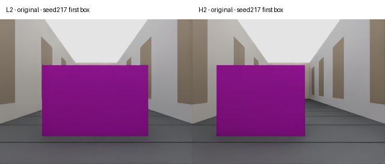
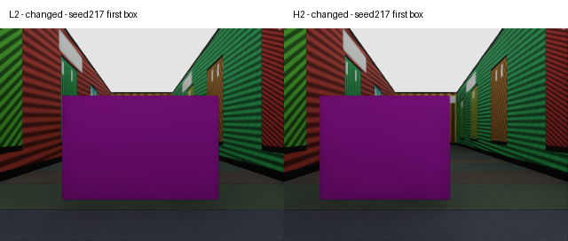

| status | completed | planned | comparison |
|---|---|---|---|
| COMPLETE | 6 | 6 | Same six scene/seed/jitter blocks; appearance and reference RGB only; no six-run decision threshold registered |

| cohort | scene | completed | valid | success | wrong_stop | collision | node_error_mae | node_error_p95 | stop_distance_median_m |
|---|---|---|---|---|---|---|---|---|---|
| Phase43-P | L2 | 3 | 3 | 0 | 2 | 0 | 3.6021 | 15.5 | 4.0735 |
| Phase44-P | L2 | 3 | 3 | 1 | 0 | 0 | 3.1389 | 6 | 0.12296 |
| Phase43-P | H2 | 3 | 3 | 1 | 1 | 0 | 1.875 | 7 | 0.6168 |
| Phase44-P | H2 | 3 | 3 | 0 | 2 | 0 | 4 | 6 | 2.0943 |
| Phase43-P | ALL | 6 | 6 | 1 | 3 | 0 | 2.6264 | 8 | 0.64527 |
| Phase44-P | ALL | 6 | 6 | 1 | 2 | 0 | 3.5441 | 6 | 2.044 |

| scene | seed | valid | phase43_success | phase44_success | success_delta | wrong_stop_delta | phase43_stop_distance_m | phase44_stop_distance_m |
|---|---|---|---|---|---|---|---|---|
| H2 | 217 | True | False | False | 0 | 0 | 0.75117 | 2.1445 |
| H2 | 219 | True | True | False | -1 | 1 | 0.48242 | 2.044 |
| H2 | 220 | True | False | False | 0 | 0 | — | — |
| L2 | 217 | True | False | False | 0 | 0 | — | — |
| L2 | 219 | True | False | True | 1 | -1 | 7.6077 | 0.12296 |
| L2 | 220 | True | False | False | 0 | -1 | 0.53936 | — |

| 기존 외관 | 변경 외관 |
|---|---|
|  |  |
