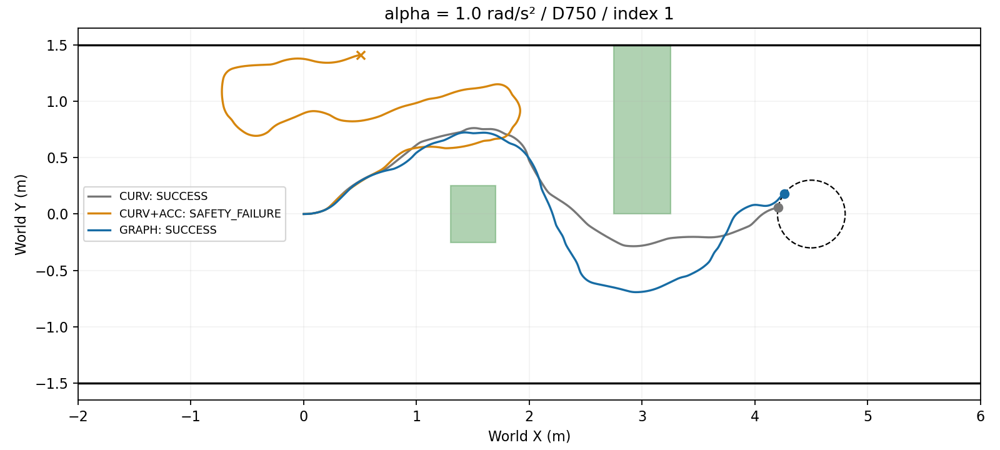

# Phase 4c Angular Acceleration Limit

Git SHA: `b8ee856d398b984faeb1590a942115ec61d53f31`; Oracle geometry; SE(2) kinematic Isaac Sim.

|α|Method|Success/N|Collision|Corridor|Timeout|Technical|Goal median s|Mean v m/s|Min clearance m|ω error RMS/max rad/s|Graph accepted/calls|
|---|---|---|---:|---:|---:|---:|---:|---:|---:|---|---|
|inf|CURV|3/3|0|0|0|0|30.1944|0.1557|0.0250|0.0000/0.0000|0/0|
|inf|GRAPH|3/3|0|0|0|0|28.5139|0.1665|0.0325|0.0000/0.0000|60/84|
|2.0|CURV|1/3|1|0|1|0|31.3056|0.1515|-0.0000|0.1721/0.7722|0/0|
|2.0|CURV+ACC|2/3|0|0|0|1|32.5972|0.1478|0.0077|0.1503/0.7722|0/0|
|2.0|GRAPH|3/3|0|0|0|0|30.3056|0.1592|0.0224|0.1577/0.7722|72/88|
|1.0|CURV|3/3|0|0|0|0|35.6528|0.1400|0.0621|0.2394/0.7861|0/0|
|1.0|CURV+ACC|0/3|1|1|1|0|N/A|0.1195|-0.0001|0.2167/0.7861|0/0|
|1.0|GRAPH|3/3|0|0|0|0|35.4167|0.1368|0.0974|0.2511/0.7861|96/112|

α=∞ CURV: reused v5 pilot indices 1–3. CURV+ACC is identical and was not rerun. Goal median uses successful runs only. RMS is weighted over positive-duration72Hz intervals. Minimum clearance is the smallest obstacle swept lower bound.

|α|Index|CURV|CURV+ACC|GRAPH|
|---|---:|---|---|---|
|inf|1|SUCCESS|IDENTICAL_TO_CURV_NOT_RERUN|SUCCESS|
|inf|2|SUCCESS|IDENTICAL_TO_CURV_NOT_RERUN|SUCCESS|
|inf|3|SUCCESS|IDENTICAL_TO_CURV_NOT_RERUN|SUCCESS|
|2.0|1|SUCCESS|SUCCESS|SUCCESS|
|2.0|2|SAFETY_FAILURE|SUCCESS|SUCCESS|
|2.0|3|STUCK|TECHNICAL_FAILURE|SUCCESS|
|1.0|1|SUCCESS|SAFETY_FAILURE|SUCCESS|
|1.0|2|SUCCESS|SAFETY_FAILURE|SUCCESS|
|1.0|3|SUCCESS|STUCK|SUCCESS|

`STOP_AND_REPORT`

Checks: `{"alpha1": false, "alpha2": true, "alpha_inf": true, "complete_valid_24": false}`

|Technical failure|Recorded error|
|---|---|
|S0_03_A2.0_CURV+ACC|AssertionError()|
