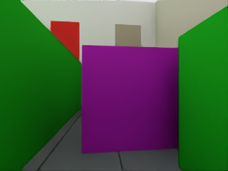

# Phase51-P WIDE: 저장 NoMaD 후보 분석

| item | value |
|---|---|
| 대상 | Phase51-P WIDE 저장 로그만. 실제 상자가 등장한 뒤, 로봇 중심이 앞면 이전이며 전진축 간격0~1.5m인 모든 추론×상자. H2 두 상자는 따로 집계 |
| 좌우 | 상자 중심 기준: +x 진행 장면은+y가 왼쪽,H1 +y 진행은-x가 왼쪽. 끝점 좌우/상자 폭 안을 모두 기록 |
| 틈 진입 | 원 sample+관측pose 연결선이 앞면을 전진 방향으로 통과;상자 footprint clearance>=0.025m이고 교차점이 벽과 로봇반경+0.025m 이상 떨어진 틈 |
| 완전 통과 | 틈 진입 조건+뒷면을 로봇반경까지 넘어감+상자 전후 slab 내 경로 전체가 동일한 free 측방 범위. 짧은 후보는 진입/완전 통과를 분리 |
| 되돌아감 | 끝점의 장면 진행축 변위<0. 원 로봇 heading 기준 뒤쪽 여부도 별도 열 |
| 그림 | 결과 선택 없이 H1,H2,L2 순서로 각 첫 보존 RGB가 있는 적격 추론(낮은seed,추론ID,상자번호). 원 PNG를 그대로 복사;새 렌더/추론 없음 |
| 한계 | oracle는 분석만. 경로 수준 기하이며 제어/NoMaD 재생성 후 주행 성공을 뜻하지 않음. SLW/LC는 돌발 상자가 없어 해당 사건 없음 |

| scene | inference_box_events | samples | front_gap_fraction | full_gap_fraction | backward_fraction | left_endpoint_fraction | right_endpoint_fraction |
|---|---|---|---|---|---|---|---|
| H1 | 46 | 368 | 0 | 0 | 0.59783 | 0.25815 | 0 |
| H2 | 81 | 648 | 0 | 0 | 0.58179 | 0.11574 | 0.16975 |
| L2 | 87 | 696 | 0 | 0 | 0.62213 | 0.024425 | 0.030172 |
| SLW | 0 | 0 | — | — | — | — | — |
| LC | 0 | 0 | — | — | — | — | — |
| ALL | 214 | 1712 | 0 | 0 | 0.60164 | 0.10923 | 0.076519 |

| scene | seed | status | boxes | eligible | rgb_available |
|---|---|---|---|---|---|
| H1 | 221 | AVAILABLE | 1 | 25 | 25 |
| H1 | 222 | AVAILABLE | 1 | 21 | 0 |
| H2 | 221 | AVAILABLE | 1 | 41 | 41 |
| H2 | 222 | AVAILABLE | 1 | 40 | 0 |
| L2 | 221 | AVAILABLE | 1 | 51 | 51 |
| L2 | 222 | AVAILABLE | 1 | 36 | 0 |
| LC | 221 | NO_SPAWNED_BOX | 0 | 0 | 0 |
| LC | 222 | NO_SPAWNED_BOX | 0 | 0 | 0 |
| SLW | 221 | NO_SPAWNED_BOX | 0 | 0 | 0 |
| SLW | 222 | NO_SPAWNED_BOX | 0 | 0 | 0 |

### H1 seed 221, inference 18, 19.986s

### H2 seed 221, inference 9, 10.986s

### L2 seed 221, inference 9, 10.986s

