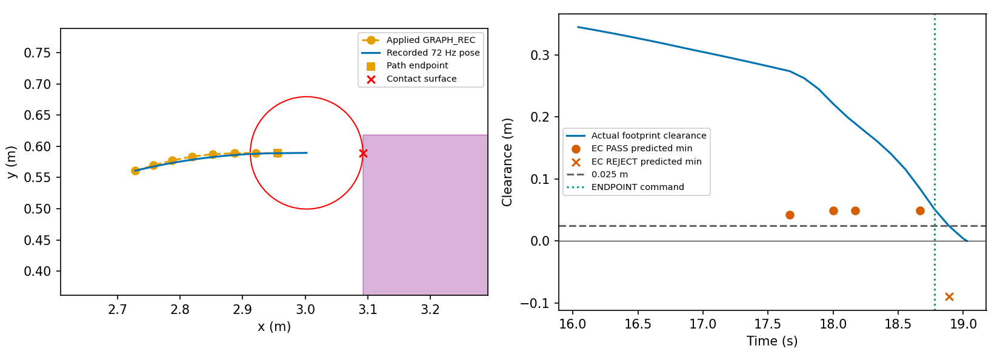

# Phase52-P L2 GRAPH-REC 접촉 및 전체 저여유 순간 진단

| contact_s | classification | graph_apply_s | B_error_m | B_heading_error_rad | graph_path_oracle_clearance_m | endpoint_command_s | endpoint_command_v_m_s | endpoint_actual_clearance_m | endpoint_to_contact_travel_m | target_low_ticks |
|---|---|---|---|---|---|---|---|---|---|---|
| 19.028 | (c) 예측-실제 차이: EC 끝점 종료와 실제 감속 이동의 불일치 | 17.667 | 0 | 0 | 0.046073 | 18.778 | 0.24226 | 0.051289 | 0.051305 | 11 |

접촉은 **19.027778s**다. 마지막 Graph 교체의 B 예측 위치·heading 오차는0이며, 적용 경로 자체 oracle 최소 여유는2.5cm보다 크다. 마지막 허용 EC는 경로 끝에 도달하면 검사를 끝내지만, 실제 실행기는 선속도를 가속 제한 안에서 줄이므로 끝점 뒤로 계속 이동했다. 접촉 표면은 관련 EC 지도에 occupied로 기록되어 있다. 따라서 이 사례는 지도 미관측이나 Graph 경로 자체 관통으로 분류하지 않는다.

구체적으로 18.666667s EC #48은 18.777778s 끝점 도달까지 0.111111s만 검사하고 최소 여유 0.049105m로 PASS했다. 실제 18.777778s ENDPOINT 명령은 즉시 정지하지 않고 v=0.242256m/s였고, 그때 실제 여유0.051289m 이후 접촉까지0.051305m 이동했다. 18.888889s에는 기존 경로 EC #67도 REJECT되고 STOP_WAIT로 전환됐지만 이미 진행 중인 감속 이동은 계속됐다. 즉 (a)의 미검사 감속 꼬리도 관찰되지만, 중복 집계를 피하려고 명확한 EC 종료 모델 차이인 (c)를 주 분류로 사용한다.

## 마지막 EC와 경로 교체

| check_id | time_s | scope | kind | chunk_id | sample | passed | predicted_min_clearance_m | horizon_end_s | endpoint_reached | snapshot_frame | snapshot_age_s | surface_cell | patch_occupied |
|---|---|---|---|---|---|---|---|---|---|---|---|---|---|
| 40 | 16.389 | PERIODIC | CUT | 13 | — | True | 0.21907 | 18.389 | False | 61 | 0.15278 | OCCUPIED | 9 |
| 41 | 16.889 | PERIODIC | CUT | 13 | — | True | 0.19056 | 18.889 | False | 63 | 0.15278 | OCCUPIED | 7 |
| 42 | 16.889 | INSTALL | CUT | 14 | — | True | 0.19398 | 18.889 | False | 63 | 0.15278 | OCCUPIED | 7 |
| 43 | 17.389 | PERIODIC | CUT | 14 | — | True | 0.16036 | 19.389 | False | 65 | 0.15278 | OCCUPIED | 7 |
| 44 | 17.667 | GRAPH_REC_REPLACE | GRAPH_REC | 14 | — | True | 0.042295 | 18.778 | True | 66 | 0.18056 | OCCUPIED | 6 |
| 45 | 17.667 | GRAPH_REC_REPLACE | GRAPH_CANDIDATE | 14 | 5 | True | 0.1619 | 19.667 | False | 66 | 0.18056 | OCCUPIED | 6 |
| 46 | 18 | KEEP_ACTIVE_NO_MIN_LENGTH | GRAPH_REC | 14 | — | True | 0.049105 | 18.778 | True | 67 | 0.26389 | OCCUPIED | 6 |
| 47 | 18.167 | PERIODIC | GRAPH_REC | 14 | — | True | 0.049105 | 18.778 | True | 68 | 0.18056 | OCCUPIED | 6 |
| 48 | 18.667 | PERIODIC | GRAPH_REC | 14 | — | True | 0.049105 | 18.778 | True | 70 | 0.18056 | OCCUPIED | 6 |
| 49 | 18.778 | GRAPH_REC_REPLACE | GRAPH_CANDIDATE | 15 | 1 | False | -0.080864 | 20.778 | False | 70 | 0.29167 | OCCUPIED | 6 |
| 50 | 18.778 | GRAPH_REC_REPLACE | GRAPH_CANDIDATE | 15 | 5 | False | -0.08921 | 20.778 | False | 70 | 0.29167 | OCCUPIED | 6 |
| 51 | 18.889 | INSTALL | CUT_CANDIDATE | 16 | 0 | False | -0.023656 | 20.889 | False | 71 | 0.15278 | OCCUPIED | 6 |
| 52 | 18.889 | INSTALL | CUT_CANDIDATE | 16 | 6 | False | -0.089602 | 20.889 | False | 71 | 0.15278 | OCCUPIED | 6 |
| 53 | 18.889 | INSTALL | CUT_CANDIDATE | 16 | 1 | False | -0.089061 | 20.889 | False | 71 | 0.15278 | OCCUPIED | 6 |
| 54 | 18.889 | INSTALL | CUT_CANDIDATE | 16 | 7 | False | -0.089283 | 20.889 | False | 71 | 0.15278 | OCCUPIED | 6 |
| 55 | 18.889 | INSTALL | CUT_CANDIDATE | 16 | 2 | False | -0.089615 | 20.889 | False | 71 | 0.15278 | OCCUPIED | 6 |
| 56 | 18.889 | INSTALL | CUT_CANDIDATE | 16 | 5 | False | -0.087797 | 20.889 | False | 71 | 0.15278 | OCCUPIED | 6 |
| 57 | 18.889 | INSTALL | CUT_CANDIDATE | 16 | 3 | False | -0.085978 | 20.889 | False | 71 | 0.15278 | OCCUPIED | 6 |
| 58 | 18.889 | INSTALL | CUT_CANDIDATE | 16 | 4 | False | -0.088353 | 20.889 | False | 71 | 0.15278 | OCCUPIED | 6 |
| 59 | 18.889 | INSTALL | CUT_CANDIDATE | 16 | 0 | False | -0.023656 | 20.889 | False | 71 | 0.15278 | OCCUPIED | 6 |
| 60 | 18.889 | INSTALL | CUT_CANDIDATE | 16 | 6 | False | -0.089602 | 20.889 | False | 71 | 0.15278 | OCCUPIED | 6 |
| 61 | 18.889 | INSTALL | CUT_CANDIDATE | 16 | 1 | False | -0.089061 | 20.889 | False | 71 | 0.15278 | OCCUPIED | 6 |
| 62 | 18.889 | INSTALL | CUT_CANDIDATE | 16 | 7 | False | -0.089283 | 20.889 | False | 71 | 0.15278 | OCCUPIED | 6 |
| 63 | 18.889 | INSTALL | CUT_CANDIDATE | 16 | 2 | False | -0.089615 | 20.889 | False | 71 | 0.15278 | OCCUPIED | 6 |
| 64 | 18.889 | INSTALL | CUT_CANDIDATE | 16 | 5 | False | -0.087797 | 20.889 | False | 71 | 0.15278 | OCCUPIED | 6 |
| 65 | 18.889 | INSTALL | CUT_CANDIDATE | 16 | 3 | False | -0.085978 | 20.889 | False | 71 | 0.15278 | OCCUPIED | 6 |
| 66 | 18.889 | INSTALL | CUT_CANDIDATE | 16 | 4 | False | -0.088353 | 20.889 | False | 71 | 0.15278 | OCCUPIED | 6 |
| 67 | 18.889 | KEEP_ACTIVE_NO_MIN_LENGTH | GRAPH_REC | 14 | — | False | -0.089867 | 20.889 | False | 71 | 0.15278 | OCCUPIED | 6 |

| job_id | chunk_id | apply_s | path | predicted_B | actual_apply_pose | B_prediction_error_m | B_prediction_heading_error_rad | path_length_m | path_oracle_clearance_m | path_endpoint_xy | actual_post_graph_distance_m | first_endpoint_command_s | first_endpoint_command_vw | endpoint_actual_clearance_m | endpoint_to_contact_travel_m | contact_to_path_endpoint_distance_m | contact_pose | contact_s | contact_surface_xy | nearest_obstacle |
|---|---|---|---|---|---|---|---|---|---|---|---|---|---|---|---|---|---|---|---|---|
| 14 | 14 | 17.667 | [[2.72847684160876, 0.560945201339995], [2.7573943368043974, 0.5693331426879352], [2.7873937476280384, 0.577385154520927], [2.8190718861189543, 0.5835729274673023], [2.8522992666863054, 0.5873557476134201], [2.886576299761276, 0.5890061890541], [2.9213245735606095, 0.5892566964985804], [2.9561152693863257, 0.588941665074949]] | [2.72847684160876, 0.560945201339995, 0.23847264910811816] | [2.72847684160876, 0.560945201339995, 0.23847264910811816] | 0 | 0 | 0.23075 | 0.046073 | [2.9561152693863257, 0.588941665074949] | 0.27596 | 18.778 | [0.24225636532417175, 0.0] | 0.051289 | 0.051305 | 0.046088 | [3.0022004109209575, 0.5894872930123198, 0.011540803551977064] | 19.028 | [3.092188150485617, 0.5894872930123198] | DynamicObstacle |

원래 EC는 [`continuation_certificate`](../research/nomad_phase32/policy.py) 및 [`rollout`](../research/nomad_phase32o/exec_cert.py)에서 `completed`이면 적분을 종료한다. 실제 [`Execution.apply`](../research/nomad_phase20/runtime.py)는 끝점에서 [`stop_command`](../research/nomad_phase16/execution.py)를 사용해 매 제어 tick 최대0.5/9 m/s씩 감속한다. 이 코드는 수정하지 않았다.

## 접촉 전3초 72Hz 전체 타임라인

| tick | time_s | last_installed_kind | last_installed_id | active_path_id | command_source | actual_v_m_s | actual_w_rad_s | actual_clearance_m | saved_swept_lower_m |
|---|---|---|---|---|---|---|---|---|---|
| 1155 | 16.042 | CUT | 13 | 13 | NORMAL | 0.057321 | -0.4 | 0.34479 | 0.34479 |
| 1156 | 16.056 | CUT | 13 | 13 | NORMAL | 0.057321 | -0.4 | 0.34429 | 0.34429 |
| 1157 | 16.069 | CUT | 13 | 13 | NORMAL | 0.057321 | -0.4 | 0.34378 | 0.34378 |
| 1158 | 16.083 | CUT | 13 | 13 | NORMAL | 0.057321 | -0.4 | 0.34327 | 0.34327 |
| 1159 | 16.097 | CUT | 13 | 13 | NORMAL | 0.057321 | -0.4 | 0.34275 | 0.34275 |
| 1160 | 16.111 | CUT | 13 | 13 | NORMAL | 0.057321 | -0.4 | 0.34224 | 0.34224 |
| 1161 | 16.125 | CUT | 13 | 13 | NORMAL | 0.056767 | -0.4 | 0.34172 | 0.34172 |
| 1162 | 16.139 | CUT | 13 | 13 | NORMAL | 0.056767 | -0.4 | 0.3412 | 0.3412 |
| 1163 | 16.153 | CUT | 13 | 13 | NORMAL | 0.056767 | -0.4 | 0.34068 | 0.34068 |
| 1164 | 16.167 | CUT | 13 | 13 | NORMAL | 0.056767 | -0.4 | 0.34015 | 0.34015 |
| 1165 | 16.181 | CUT | 13 | 13 | NORMAL | 0.056767 | -0.4 | 0.33962 | 0.33962 |
| 1166 | 16.194 | CUT | 13 | 13 | NORMAL | 0.056767 | -0.4 | 0.33909 | 0.33909 |
| 1167 | 16.208 | CUT | 13 | 13 | NORMAL | 0.056767 | -0.4 | 0.33855 | 0.33855 |
| 1168 | 16.222 | CUT | 13 | 13 | NORMAL | 0.056767 | -0.4 | 0.33801 | 0.33801 |
| 1169 | 16.236 | CUT | 13 | 13 | NORMAL | 0.056209 | -0.4 | 0.33748 | 0.33748 |
| 1170 | 16.25 | CUT | 13 | 13 | NORMAL | 0.056209 | -0.4 | 0.33694 | 0.33694 |
| 1171 | 16.264 | CUT | 13 | 13 | NORMAL | 0.056209 | -0.4 | 0.33639 | 0.33639 |
| 1172 | 16.278 | CUT | 13 | 13 | NORMAL | 0.056209 | -0.4 | 0.33585 | 0.33585 |
| 1173 | 16.292 | CUT | 13 | 13 | NORMAL | 0.056209 | -0.4 | 0.3353 | 0.3353 |
| 1174 | 16.306 | CUT | 13 | 13 | NORMAL | 0.056209 | -0.4 | 0.33474 | 0.33474 |
| 1175 | 16.319 | CUT | 13 | 13 | NORMAL | 0.056209 | -0.4 | 0.33419 | 0.33419 |
| 1176 | 16.333 | CUT | 13 | 13 | NORMAL | 0.056209 | -0.4 | 0.33363 | 0.33363 |
| 1177 | 16.347 | CUT | 13 | 13 | NORMAL | 0.055651 | -0.4 | 0.33307 | 0.33307 |
| 1178 | 16.361 | CUT | 13 | 13 | NORMAL | 0.055651 | -0.4 | 0.33251 | 0.33251 |
| 1179 | 16.375 | CUT | 13 | 13 | NORMAL | 0.055651 | -0.4 | 0.33195 | 0.33195 |
| 1180 | 16.389 | CUT | 13 | 13 | NORMAL | 0.055651 | -0.4 | 0.33139 | 0.33139 |
| 1181 | 16.403 | CUT | 13 | 13 | NORMAL | 0.055651 | -0.4 | 0.33082 | 0.33082 |
| 1182 | 16.417 | CUT | 13 | 13 | NORMAL | 0.055651 | -0.4 | 0.33025 | 0.33025 |
| 1183 | 16.431 | CUT | 13 | 13 | NORMAL | 0.055651 | -0.4 | 0.32967 | 0.32967 |
| 1184 | 16.444 | CUT | 13 | 13 | NORMAL | 0.055651 | -0.4 | 0.3291 | 0.3291 |
| 1185 | 16.458 | CUT | 13 | 13 | NORMAL | 0.055093 | -0.4 | 0.32852 | 0.32852 |
| 1186 | 16.472 | CUT | 13 | 13 | NORMAL | 0.055093 | -0.4 | 0.32795 | 0.32795 |
| 1187 | 16.486 | CUT | 13 | 13 | NORMAL | 0.055093 | -0.4 | 0.32737 | 0.32737 |
| 1188 | 16.5 | CUT | 13 | 13 | NORMAL | 0.055093 | -0.4 | 0.32679 | 0.32679 |
| 1189 | 16.514 | CUT | 13 | 13 | NORMAL | 0.055093 | -0.4 | 0.3262 | 0.3262 |
| 1190 | 16.528 | CUT | 13 | 13 | NORMAL | 0.055093 | -0.4 | 0.32561 | 0.32561 |
| 1191 | 16.542 | CUT | 13 | 13 | NORMAL | 0.055093 | -0.4 | 0.32502 | 0.32502 |
| 1192 | 16.556 | CUT | 13 | 13 | NORMAL | 0.055093 | -0.4 | 0.32443 | 0.32443 |
| 1193 | 16.569 | CUT | 13 | 13 | NORMAL | 0.054977 | -0.4 | 0.32384 | 0.32384 |
| 1194 | 16.583 | CUT | 13 | 13 | NORMAL | 0.054977 | -0.4 | 0.32324 | 0.32324 |
| 1195 | 16.597 | CUT | 13 | 13 | NORMAL | 0.054977 | -0.4 | 0.32264 | 0.32264 |
| 1196 | 16.611 | CUT | 13 | 13 | NORMAL | 0.054977 | -0.4 | 0.32204 | 0.32204 |
| 1197 | 16.625 | CUT | 13 | 13 | NORMAL | 0.054977 | -0.4 | 0.32143 | 0.32143 |
| 1198 | 16.639 | CUT | 13 | 13 | NORMAL | 0.054977 | -0.4 | 0.32083 | 0.32082 |
| 1199 | 16.653 | CUT | 13 | 13 | NORMAL | 0.054977 | -0.4 | 0.32022 | 0.32021 |
| 1200 | 16.667 | CUT | 13 | 13 | NORMAL | 0.054977 | -0.4 | 0.3196 | 0.3196 |
| 1201 | 16.681 | CUT | 13 | 13 | NORMAL | 0.054899 | -0.4 | 0.31899 | 0.31899 |
| 1202 | 16.694 | CUT | 13 | 13 | NORMAL | 0.054899 | -0.4 | 0.31837 | 0.31837 |
| 1203 | 16.708 | CUT | 13 | 13 | NORMAL | 0.054899 | -0.4 | 0.31775 | 0.31775 |
| 1204 | 16.722 | CUT | 13 | 13 | NORMAL | 0.054899 | -0.4 | 0.31713 | 0.31713 |
| 1205 | 16.736 | CUT | 13 | 13 | NORMAL | 0.054899 | -0.4 | 0.31651 | 0.31651 |
| 1206 | 16.75 | CUT | 13 | 13 | NORMAL | 0.054899 | -0.4 | 0.31588 | 0.31588 |
| 1207 | 16.764 | CUT | 13 | 13 | NORMAL | 0.054899 | -0.4 | 0.31525 | 0.31525 |
| 1208 | 16.778 | CUT | 13 | 13 | NORMAL | 0.054899 | -0.4 | 0.31462 | 0.31462 |
| 1209 | 16.792 | CUT | 13 | 13 | NORMAL | 0.05481 | -0.4 | 0.31399 | 0.31399 |
| 1210 | 16.806 | CUT | 13 | 13 | NORMAL | 0.05481 | -0.4 | 0.31335 | 0.31335 |
| 1211 | 16.819 | CUT | 13 | 13 | NORMAL | 0.05481 | -0.4 | 0.31272 | 0.31272 |
| 1212 | 16.833 | CUT | 13 | 13 | NORMAL | 0.05481 | -0.4 | 0.31208 | 0.31208 |
| 1213 | 16.847 | CUT | 13 | 13 | NORMAL | 0.05481 | -0.4 | 0.31143 | 0.31143 |
| 1214 | 16.861 | CUT | 13 | 13 | NORMAL | 0.05481 | -0.4 | 0.31079 | 0.31079 |
| 1215 | 16.875 | CUT | 13 | 13 | NORMAL | 0.05481 | -0.4 | 0.31014 | 0.31014 |
| 1216 | 16.889 | CUT | 13 | 13 | NORMAL | 0.05481 | -0.4 | 0.30949 | 0.30949 |
| 1217 | 16.903 | CUT | 14 | 14 | NORMAL | 0.05 | -0.4 | 0.3089 | 0.3089 |
| 1218 | 16.917 | CUT | 14 | 14 | NORMAL | 0.05 | -0.4 | 0.30831 | 0.30831 |
| 1219 | 16.931 | CUT | 14 | 14 | NORMAL | 0.05 | -0.4 | 0.30771 | 0.30771 |
| 1220 | 16.944 | CUT | 14 | 14 | NORMAL | 0.05 | -0.4 | 0.30711 | 0.30711 |
| 1221 | 16.958 | CUT | 14 | 14 | NORMAL | 0.05 | -0.4 | 0.30651 | 0.30651 |
| 1222 | 16.972 | CUT | 14 | 14 | NORMAL | 0.05 | -0.4 | 0.3059 | 0.3059 |
| 1223 | 16.986 | CUT | 14 | 14 | NORMAL | 0.05 | -0.4 | 0.3053 | 0.3053 |
| 1224 | 17 | CUT | 14 | 14 | NORMAL | 0.05 | -0.4 | 0.30469 | 0.30469 |
| 1225 | 17.014 | CUT | 14 | 14 | NORMAL | 0.05 | -0.4 | 0.30408 | 0.30408 |
| 1226 | 17.028 | CUT | 14 | 14 | NORMAL | 0.05 | -0.4 | 0.30347 | 0.30347 |
| 1227 | 17.042 | CUT | 14 | 14 | NORMAL | 0.05 | -0.4 | 0.30286 | 0.30286 |
| 1228 | 17.056 | CUT | 14 | 14 | NORMAL | 0.05 | -0.4 | 0.30224 | 0.30224 |
| 1229 | 17.069 | CUT | 14 | 14 | NORMAL | 0.05 | -0.4 | 0.30163 | 0.30163 |
| 1230 | 17.083 | CUT | 14 | 14 | NORMAL | 0.05 | -0.4 | 0.30101 | 0.30101 |
| 1231 | 17.097 | CUT | 14 | 14 | NORMAL | 0.05 | -0.4 | 0.30039 | 0.30039 |
| 1232 | 17.111 | CUT | 14 | 14 | NORMAL | 0.05 | -0.4 | 0.29977 | 0.29977 |
| 1233 | 17.125 | CUT | 14 | 14 | NORMAL | 0.05 | -0.4 | 0.29914 | 0.29914 |
| 1234 | 17.139 | CUT | 14 | 14 | NORMAL | 0.05 | -0.4 | 0.29852 | 0.29852 |
| 1235 | 17.153 | CUT | 14 | 14 | NORMAL | 0.05 | -0.4 | 0.29789 | 0.29789 |
| 1236 | 17.167 | CUT | 14 | 14 | NORMAL | 0.05 | -0.4 | 0.29726 | 0.29726 |
| 1237 | 17.181 | CUT | 14 | 14 | NORMAL | 0.05 | -0.4 | 0.29663 | 0.29663 |
| 1238 | 17.194 | CUT | 14 | 14 | NORMAL | 0.05 | -0.4 | 0.296 | 0.296 |
| 1239 | 17.208 | CUT | 14 | 14 | NORMAL | 0.05 | -0.4 | 0.29537 | 0.29537 |
| 1240 | 17.222 | CUT | 14 | 14 | NORMAL | 0.05 | -0.4 | 0.29473 | 0.29473 |
| 1241 | 17.236 | CUT | 14 | 14 | NORMAL | 0.05 | -0.4 | 0.2941 | 0.2941 |
| 1242 | 17.25 | CUT | 14 | 14 | NORMAL | 0.05 | -0.4 | 0.29346 | 0.29346 |
| 1243 | 17.264 | CUT | 14 | 14 | NORMAL | 0.05 | -0.4 | 0.29282 | 0.29282 |
| 1244 | 17.278 | CUT | 14 | 14 | NORMAL | 0.05 | -0.4 | 0.29218 | 0.29218 |
| 1245 | 17.292 | CUT | 14 | 14 | NORMAL | 0.05 | -0.4 | 0.29154 | 0.29154 |
| 1246 | 17.306 | CUT | 14 | 14 | NORMAL | 0.05 | -0.4 | 0.29089 | 0.29089 |
| 1247 | 17.319 | CUT | 14 | 14 | NORMAL | 0.05 | -0.4 | 0.29025 | 0.29025 |
| 1248 | 17.333 | CUT | 14 | 14 | NORMAL | 0.05 | -0.4 | 0.2896 | 0.2896 |
| 1249 | 17.347 | CUT | 14 | 14 | NORMAL | 0.05 | -0.4 | 0.28895 | 0.28895 |
| 1250 | 17.361 | CUT | 14 | 14 | NORMAL | 0.05 | -0.4 | 0.2883 | 0.2883 |
| 1251 | 17.375 | CUT | 14 | 14 | NORMAL | 0.05 | -0.4 | 0.28765 | 0.28765 |
| 1252 | 17.389 | CUT | 14 | 14 | NORMAL | 0.05 | -0.4 | 0.287 | 0.287 |
| 1253 | 17.403 | CUT | 14 | 14 | NORMAL | 0.05 | -0.4 | 0.28635 | 0.28635 |
| 1254 | 17.417 | CUT | 14 | 14 | NORMAL | 0.05 | -0.4 | 0.28569 | 0.28569 |
| 1255 | 17.431 | CUT | 14 | 14 | NORMAL | 0.05 | -0.4 | 0.28504 | 0.28504 |
| 1256 | 17.444 | CUT | 14 | 14 | NORMAL | 0.05 | -0.4 | 0.28438 | 0.28438 |
| 1257 | 17.458 | CUT | 14 | 14 | NORMAL | 0.05 | -0.39732 | 0.28372 | 0.28372 |
| 1258 | 17.472 | CUT | 14 | 14 | NORMAL | 0.05 | -0.39732 | 0.28306 | 0.28306 |
| 1259 | 17.486 | CUT | 14 | 14 | NORMAL | 0.05 | -0.39732 | 0.2824 | 0.2824 |
| 1260 | 17.5 | CUT | 14 | 14 | NORMAL | 0.05 | -0.39732 | 0.28174 | 0.28174 |
| 1261 | 17.514 | CUT | 14 | 14 | NORMAL | 0.05 | -0.39732 | 0.28108 | 0.28108 |
| 1262 | 17.528 | CUT | 14 | 14 | NORMAL | 0.05 | -0.39732 | 0.28041 | 0.28041 |
| 1263 | 17.542 | CUT | 14 | 14 | NORMAL | 0.05 | -0.39732 | 0.27975 | 0.27975 |
| 1264 | 17.556 | CUT | 14 | 14 | NORMAL | 0.05 | -0.39732 | 0.27908 | 0.27908 |
| 1265 | 17.569 | CUT | 14 | 14 | NORMAL | 0.05 | -0.38999 | 0.27841 | 0.27841 |
| 1266 | 17.583 | CUT | 14 | 14 | NORMAL | 0.05 | -0.38999 | 0.27774 | 0.27774 |
| 1267 | 17.597 | CUT | 14 | 14 | NORMAL | 0.05 | -0.38999 | 0.27707 | 0.27707 |
| 1268 | 17.611 | CUT | 14 | 14 | NORMAL | 0.05 | -0.38999 | 0.2764 | 0.2764 |
| 1269 | 17.625 | CUT | 14 | 14 | NORMAL | 0.05 | -0.38999 | 0.27573 | 0.27573 |
| 1270 | 17.639 | CUT | 14 | 14 | NORMAL | 0.05 | -0.38999 | 0.27506 | 0.27506 |
| 1271 | 17.653 | CUT | 14 | 14 | NORMAL | 0.05 | -0.38999 | 0.27439 | 0.27439 |
| 1272 | 17.667 | CUT | 14 | 14 | NORMAL | 0.05 | -0.38999 | 0.27371 | 0.27371 |
| 1273 | 17.681 | GRAPH_REC | 14 | 14 | NORMAL | 0.10556 | -0.10663 | 0.27229 | 0.27229 |
| 1274 | 17.694 | GRAPH_REC | 14 | 14 | NORMAL | 0.10556 | -0.10663 | 0.27086 | 0.27086 |
| 1275 | 17.708 | GRAPH_REC | 14 | 14 | NORMAL | 0.10556 | -0.10663 | 0.26944 | 0.26944 |
| 1276 | 17.722 | GRAPH_REC | 14 | 14 | NORMAL | 0.10556 | -0.10663 | 0.26801 | 0.26801 |
| 1277 | 17.736 | GRAPH_REC | 14 | 14 | NORMAL | 0.10556 | -0.10663 | 0.26658 | 0.26658 |
| 1278 | 17.75 | GRAPH_REC | 14 | 14 | NORMAL | 0.10556 | -0.10663 | 0.26515 | 0.26515 |
| 1279 | 17.764 | GRAPH_REC | 14 | 14 | NORMAL | 0.10556 | -0.10663 | 0.26373 | 0.26373 |
| 1280 | 17.778 | GRAPH_REC | 14 | 14 | NORMAL | 0.10556 | -0.10663 | 0.2623 | 0.2623 |
| 1281 | 17.792 | GRAPH_REC | 14 | 14 | NORMAL | 0.16111 | -0.16275 | 0.26012 | 0.26012 |
| 1282 | 17.806 | GRAPH_REC | 14 | 14 | NORMAL | 0.16111 | -0.16275 | 0.25794 | 0.25793 |
| 1283 | 17.819 | GRAPH_REC | 14 | 14 | NORMAL | 0.16111 | -0.16275 | 0.25575 | 0.25575 |
| 1284 | 17.833 | GRAPH_REC | 14 | 14 | NORMAL | 0.16111 | -0.16275 | 0.25357 | 0.25357 |
| 1285 | 17.847 | GRAPH_REC | 14 | 14 | NORMAL | 0.16111 | -0.16275 | 0.25138 | 0.25138 |
| 1286 | 17.861 | GRAPH_REC | 14 | 14 | NORMAL | 0.16111 | -0.16275 | 0.2492 | 0.2492 |
| 1287 | 17.875 | GRAPH_REC | 14 | 14 | NORMAL | 0.16111 | -0.16275 | 0.24701 | 0.24701 |
| 1288 | 17.889 | GRAPH_REC | 14 | 14 | NORMAL | 0.16111 | -0.16275 | 0.24482 | 0.24482 |
| 1289 | 17.903 | GRAPH_REC | 14 | 14 | NORMAL | 0.21667 | -0.21886 | 0.24187 | 0.24187 |
| 1290 | 17.917 | GRAPH_REC | 14 | 14 | NORMAL | 0.21667 | -0.21886 | 0.23893 | 0.23893 |
| 1291 | 17.931 | GRAPH_REC | 14 | 14 | NORMAL | 0.21667 | -0.21886 | 0.23598 | 0.23598 |
| 1292 | 17.944 | GRAPH_REC | 14 | 14 | NORMAL | 0.21667 | -0.21886 | 0.23303 | 0.23303 |
| 1293 | 17.958 | GRAPH_REC | 14 | 14 | NORMAL | 0.21667 | -0.21886 | 0.23008 | 0.23008 |
| 1294 | 17.972 | GRAPH_REC | 14 | 14 | NORMAL | 0.21667 | -0.21886 | 0.22712 | 0.22712 |
| 1295 | 17.986 | GRAPH_REC | 14 | 14 | NORMAL | 0.21667 | -0.21886 | 0.22417 | 0.22417 |
| 1296 | 18 | GRAPH_REC | 14 | 14 | NORMAL | 0.21667 | -0.21886 | 0.22121 | 0.22121 |
| 1297 | 18.014 | GRAPH_REC | 14 | 14 | KEEP_ACTIVE | 0.20003 | -0.20206 | 0.21848 | 0.21848 |
| 1298 | 18.028 | GRAPH_REC | 14 | 14 | KEEP_ACTIVE | 0.20003 | -0.20206 | 0.21574 | 0.21574 |
| 1299 | 18.042 | GRAPH_REC | 14 | 14 | KEEP_ACTIVE | 0.20003 | -0.20206 | 0.21301 | 0.21301 |
| 1300 | 18.056 | GRAPH_REC | 14 | 14 | KEEP_ACTIVE | 0.20003 | -0.20206 | 0.21027 | 0.21027 |
| 1301 | 18.069 | GRAPH_REC | 14 | 14 | KEEP_ACTIVE | 0.20003 | -0.20206 | 0.20754 | 0.20753 |
| 1302 | 18.083 | GRAPH_REC | 14 | 14 | KEEP_ACTIVE | 0.20003 | -0.20206 | 0.2048 | 0.2048 |
| 1303 | 18.097 | GRAPH_REC | 14 | 14 | KEEP_ACTIVE | 0.20003 | -0.20206 | 0.20206 | 0.20206 |
| 1304 | 18.111 | GRAPH_REC | 14 | 14 | KEEP_ACTIVE | 0.20003 | -0.20206 | 0.19932 | 0.19931 |
| 1305 | 18.125 | GRAPH_REC | 14 | 14 | KEEP_ACTIVE | 0.17468 | -0.17645 | 0.19692 | 0.19692 |
| 1306 | 18.139 | GRAPH_REC | 14 | 14 | KEEP_ACTIVE | 0.17468 | -0.17645 | 0.19452 | 0.19452 |
| 1307 | 18.153 | GRAPH_REC | 14 | 14 | KEEP_ACTIVE | 0.17468 | -0.17645 | 0.19213 | 0.19213 |
| 1308 | 18.167 | GRAPH_REC | 14 | 14 | KEEP_ACTIVE | 0.17468 | -0.17645 | 0.18973 | 0.18973 |
| 1309 | 18.181 | GRAPH_REC | 14 | 14 | KEEP_ACTIVE | 0.17468 | -0.17645 | 0.18733 | 0.18733 |
| 1310 | 18.194 | GRAPH_REC | 14 | 14 | KEEP_ACTIVE | 0.17468 | -0.17645 | 0.18493 | 0.18493 |
| 1311 | 18.208 | GRAPH_REC | 14 | 14 | KEEP_ACTIVE | 0.17468 | -0.17645 | 0.18253 | 0.18253 |
| 1312 | 18.222 | GRAPH_REC | 14 | 14 | KEEP_ACTIVE | 0.17468 | -0.17645 | 0.18013 | 0.18013 |
| 1313 | 18.236 | GRAPH_REC | 14 | 14 | KEEP_ACTIVE | 0.16839 | -0.17009 | 0.17781 | 0.17781 |
| 1314 | 18.25 | GRAPH_REC | 14 | 14 | KEEP_ACTIVE | 0.16839 | -0.17009 | 0.1755 | 0.1755 |
| 1315 | 18.264 | GRAPH_REC | 14 | 14 | KEEP_ACTIVE | 0.16839 | -0.17009 | 0.17318 | 0.17318 |
| 1316 | 18.278 | GRAPH_REC | 14 | 14 | KEEP_ACTIVE | 0.16839 | -0.17009 | 0.17086 | 0.17086 |
| 1317 | 18.292 | GRAPH_REC | 14 | 14 | KEEP_ACTIVE | 0.16839 | -0.17009 | 0.16855 | 0.16854 |
| 1318 | 18.306 | GRAPH_REC | 14 | 14 | KEEP_ACTIVE | 0.16839 | -0.17009 | 0.16623 | 0.16623 |
| 1319 | 18.319 | GRAPH_REC | 14 | 14 | KEEP_ACTIVE | 0.16839 | -0.17009 | 0.16391 | 0.16391 |
| 1320 | 18.333 | GRAPH_REC | 14 | 14 | KEEP_ACTIVE | 0.16839 | -0.17009 | 0.16159 | 0.16158 |
| 1321 | 18.347 | GRAPH_REC | 14 | 14 | KEEP_ACTIVE | 0.19214 | -0.19409 | 0.15894 | 0.15894 |
| 1322 | 18.361 | GRAPH_REC | 14 | 14 | KEEP_ACTIVE | 0.19214 | -0.19409 | 0.15629 | 0.15629 |
| 1323 | 18.375 | GRAPH_REC | 14 | 14 | KEEP_ACTIVE | 0.19214 | -0.19409 | 0.15364 | 0.15364 |
| 1324 | 18.389 | GRAPH_REC | 14 | 14 | KEEP_ACTIVE | 0.19214 | -0.19409 | 0.15099 | 0.15098 |
| 1325 | 18.403 | GRAPH_REC | 14 | 14 | KEEP_ACTIVE | 0.19214 | -0.19409 | 0.14833 | 0.14833 |
| 1326 | 18.417 | GRAPH_REC | 14 | 14 | KEEP_ACTIVE | 0.19214 | -0.19409 | 0.14568 | 0.14568 |
| 1327 | 18.431 | GRAPH_REC | 14 | 14 | KEEP_ACTIVE | 0.19214 | -0.19409 | 0.14303 | 0.14303 |
| 1328 | 18.444 | GRAPH_REC | 14 | 14 | KEEP_ACTIVE | 0.19214 | -0.19409 | 0.14037 | 0.14037 |
| 1329 | 18.458 | GRAPH_REC | 14 | 14 | KEEP_ACTIVE | 0.22695 | -0.22925 | 0.13724 | 0.13723 |
| 1330 | 18.472 | GRAPH_REC | 14 | 14 | KEEP_ACTIVE | 0.22695 | -0.22925 | 0.1341 | 0.1341 |
| 1331 | 18.486 | GRAPH_REC | 14 | 14 | KEEP_ACTIVE | 0.22695 | -0.22925 | 0.13096 | 0.13096 |
| 1332 | 18.5 | GRAPH_REC | 14 | 14 | KEEP_ACTIVE | 0.22695 | -0.22925 | 0.12782 | 0.12782 |
| 1333 | 18.514 | GRAPH_REC | 14 | 14 | KEEP_ACTIVE | 0.22695 | -0.22925 | 0.12468 | 0.12468 |
| 1334 | 18.528 | GRAPH_REC | 14 | 14 | KEEP_ACTIVE | 0.22695 | -0.22925 | 0.12154 | 0.12154 |
| 1335 | 18.542 | GRAPH_REC | 14 | 14 | KEEP_ACTIVE | 0.22695 | -0.22925 | 0.1184 | 0.1184 |
| 1336 | 18.556 | GRAPH_REC | 14 | 14 | KEEP_ACTIVE | 0.22695 | -0.22925 | 0.11526 | 0.11526 |
| 1337 | 18.569 | GRAPH_REC | 14 | 14 | KEEP_ACTIVE | 0.27855 | -0.28137 | 0.1114 | 0.1114 |
| 1338 | 18.583 | GRAPH_REC | 14 | 14 | KEEP_ACTIVE | 0.27855 | -0.28137 | 0.10754 | 0.10754 |
| 1339 | 18.597 | GRAPH_REC | 14 | 14 | KEEP_ACTIVE | 0.27855 | -0.28137 | 0.10368 | 0.10368 |
| 1340 | 18.611 | GRAPH_REC | 14 | 14 | KEEP_ACTIVE | 0.27855 | -0.28137 | 0.099818 | 0.099816 |
| 1341 | 18.625 | GRAPH_REC | 14 | 14 | KEEP_ACTIVE | 0.27855 | -0.28137 | 0.095956 | 0.095954 |
| 1342 | 18.639 | GRAPH_REC | 14 | 14 | KEEP_ACTIVE | 0.27855 | -0.28137 | 0.092093 | 0.092091 |
| 1343 | 18.653 | GRAPH_REC | 14 | 14 | KEEP_ACTIVE | 0.27855 | -0.28137 | 0.088229 | 0.088227 |
| 1344 | 18.667 | GRAPH_REC | 14 | 14 | KEEP_ACTIVE | 0.27855 | -0.28137 | 0.084365 | 0.084363 |
| 1345 | 18.681 | GRAPH_REC | 14 | 14 | KEEP_ACTIVE | 0.29781 | -0.30083 | 0.080232 | 0.08023 |
| 1346 | 18.694 | GRAPH_REC | 14 | 14 | KEEP_ACTIVE | 0.29781 | -0.30083 | 0.076099 | 0.076097 |
| 1347 | 18.708 | GRAPH_REC | 14 | 14 | KEEP_ACTIVE | 0.29781 | -0.30083 | 0.071965 | 0.071963 |
| 1348 | 18.722 | GRAPH_REC | 14 | 14 | KEEP_ACTIVE | 0.29781 | -0.30083 | 0.067831 | 0.067829 |
| 1349 | 18.736 | GRAPH_REC | 14 | 14 | KEEP_ACTIVE | 0.29781 | -0.30083 | 0.063696 | 0.063694 |
| 1350 | 18.75 | GRAPH_REC | 14 | 14 | KEEP_ACTIVE | 0.29781 | -0.30083 | 0.059561 | 0.059559 |
| 1351 | 18.764 | GRAPH_REC | 14 | 14 | KEEP_ACTIVE | 0.29781 | -0.30083 | 0.055425 | 0.055423 |
| 1352 | 18.778 | GRAPH_REC | 14 | 14 | KEEP_ACTIVE | 0.29781 | -0.30083 | 0.051289 | 0.051287 |
| 1353 | 18.792 | GRAPH_REC | 14 | 14 | ENDPOINT | 0.24226 | 0 | 0.047925 | 0.047925 |
| 1354 | 18.806 | GRAPH_REC | 14 | 14 | ENDPOINT | 0.24226 | 0 | 0.04456 | 0.04456 |
| 1355 | 18.819 | GRAPH_REC | 14 | 14 | ENDPOINT | 0.24226 | 0 | 0.041196 | 0.041196 |
| 1356 | 18.833 | GRAPH_REC | 14 | 14 | ENDPOINT | 0.24226 | 0 | 0.037831 | 0.037831 |
| 1357 | 18.847 | GRAPH_REC | 14 | 14 | ENDPOINT | 0.24226 | 0 | 0.034467 | 0.034467 |
| 1358 | 18.861 | GRAPH_REC | 14 | 14 | ENDPOINT | 0.24226 | 0 | 0.031102 | 0.031102 |
| 1359 | 18.875 | GRAPH_REC | 14 | 14 | ENDPOINT | 0.24226 | 0 | 0.027738 | 0.027738 |
| 1360 | 18.889 | GRAPH_REC | 14 | 14 | ENDPOINT | 0.24226 | 0 | 0.024374 | 0.024374 |
| 1361 | 18.903 | GRAPH_REC | 14 | — | STOP_WAIT | 0.1867 | 0 | 0.021781 | 0.021781 |
| 1362 | 18.917 | GRAPH_REC | 14 | — | STOP_WAIT | 0.1867 | 0 | 0.019188 | 0.019188 |
| 1363 | 18.931 | GRAPH_REC | 14 | — | STOP_WAIT | 0.1867 | 0 | 0.016595 | 0.016595 |
| 1364 | 18.944 | GRAPH_REC | 14 | — | STOP_WAIT | 0.1867 | 0 | 0.014002 | 0.014002 |
| 1365 | 18.958 | GRAPH_REC | 14 | — | STOP_WAIT | 0.1867 | 0 | 0.011409 | 0.011409 |
| 1366 | 18.972 | GRAPH_REC | 14 | — | STOP_WAIT | 0.1867 | 0 | 0.0088162 | 0.0088162 |
| 1367 | 18.986 | GRAPH_REC | 14 | — | STOP_WAIT | 0.1867 | 0 | 0.0062233 | 0.0062233 |
| 1368 | 19 | GRAPH_REC | 14 | — | STOP_WAIT | 0.1867 | 0 | 0.0036304 | 0.0036304 |
| 1369 | 19.014 | GRAPH_REC | 14 | — | STOP_WAIT | 0.13115 | 0 | 0.0018091 | 0.0018091 |
| 1370 | 19.028 | GRAPH_REC | 14 | — | STOP_WAIT | 0.13115 | 0 | -1.226e-05 | -1.226e-05 |

[216구간 타임라인 CSV](../research/results/phase52p_contact/target_timeline_72hz.csv) · [Graph 교체 후 실제99개 pose](../research/results/phase52p_contact/target_post_graph_trajectory.csv) · [전체 저여유 순간 CSV](../research/results/phase52p_contact/low_clearance_ticks.csv) · [run별 집계](../research/results/phase52p_contact/runs.csv)

## 전체100회: 순간 수와 분류

| phase | runs | ticks | low_clearance_ticks | low_clearance_seconds | low_rate | low_swept_intervals | episodes | affected_runs | A_UNCHECKED_COMMAND | B_UNOBSERVED_MAP | C_PREDICTION_EXECUTION | D_GRAPH_PATH | E_OTHER |
|---|---|---|---|---|---|---|---|---|---|---|---|---|---|
| phase47c | 60 | 145076 | 300 | 4.1667 | 0.0020679 | 300 | 6 | 6 | 0 | 0 | 0 | 0 | 300 |
| phase52p | 40 | 179879 | 11 | 0.15278 | 6.1152e-05 | 11 | 1 | 1 | 0 | 0 | 11 | 0 | 0 |

| phase | condition | method | runs | ticks | low_clearance_ticks | low_clearance_seconds | low_rate | low_swept_intervals | episodes | affected_runs | A_UNCHECKED_COMMAND | B_UNOBSERVED_MAP | C_PREDICTION_EXECUTION | D_GRAPH_PATH | E_OTHER |
|---|---|---|---|---|---|---|---|---|---|---|---|---|---|---|---|
| phase47c | D075 | NOMAD_RAW | 20 | 35281 | 300 | 4.1667 | 0.0085032 | 300 | 6 | 6 | 0 | 0 | 0 | 0 | 300 |
| phase47c | D075 | OURS-DETOUR | 20 | 37345 | 0 | 0 | 0 | 0 | 0 | 0 | 0 | 0 | 0 | 0 | 0 |
| phase47c | D075 | OURS-DETOUR+HMM | 20 | 72450 | 0 | 0 | 0 | 0 | 0 | 0 | 0 | 0 | 0 | 0 | 0 |
| phase52p | D075 | CUT-HOLD | 10 | 40086 | 0 | 0 | 0 | 0 | 0 | 0 | 0 | 0 | 0 | 0 | 0 |
| phase52p | D075 | GRAPH-REC | 10 | 40914 | 11 | 0.15278 | 0.00026886 | 11 | 1 | 1 | 0 | 0 | 11 | 0 | 0 |
| phase52p | D150 | CUT-HOLD | 10 | 53460 | 0 | 0 | 0 | 0 | 0 | 0 | 0 | 0 | 0 | 0 | 0 |
| phase52p | D150 | GRAPH-REC | 10 | 45419 | 0 | 0 | 0 | 0 | 0 | 0 | 0 | 0 | 0 | 0 | 0 |

| phase | condition | method | scene | runs | ticks | low_clearance_ticks | low_clearance_seconds | low_rate | low_swept_intervals | episodes | affected_runs | A_UNCHECKED_COMMAND | B_UNOBSERVED_MAP | C_PREDICTION_EXECUTION | D_GRAPH_PATH | E_OTHER |
|---|---|---|---|---|---|---|---|---|---|---|---|---|---|---|---|---|
| phase47c | D075 | NOMAD_RAW | H1 | 4 | 8773 | 0 | 0 | 0 | 0 | 0 | 0 | 0 | 0 | 0 | 0 | 0 |
| phase47c | D075 | NOMAD_RAW | H2 | 4 | 4864 | 25 | 0.34722 | 0.0051398 | 25 | 2 | 2 | 0 | 0 | 0 | 0 | 25 |
| phase47c | D075 | NOMAD_RAW | L2 | 4 | 6918 | 0 | 0 | 0 | 0 | 0 | 0 | 0 | 0 | 0 | 0 | 0 |
| phase47c | D075 | NOMAD_RAW | LC | 4 | 9824 | 119 | 1.6528 | 0.012113 | 119 | 1 | 1 | 0 | 0 | 0 | 0 | 119 |
| phase47c | D075 | NOMAD_RAW | SLW | 4 | 4902 | 156 | 2.1667 | 0.031824 | 156 | 3 | 3 | 0 | 0 | 0 | 0 | 156 |
| phase47c | D075 | OURS-DETOUR | H1 | 4 | 7908 | 0 | 0 | 0 | 0 | 0 | 0 | 0 | 0 | 0 | 0 | 0 |
| phase47c | D075 | OURS-DETOUR | H2 | 4 | 5916 | 0 | 0 | 0 | 0 | 0 | 0 | 0 | 0 | 0 | 0 | 0 |
| phase47c | D075 | OURS-DETOUR | L2 | 4 | 5282 | 0 | 0 | 0 | 0 | 0 | 0 | 0 | 0 | 0 | 0 | 0 |
| phase47c | D075 | OURS-DETOUR | LC | 4 | 7638 | 0 | 0 | 0 | 0 | 0 | 0 | 0 | 0 | 0 | 0 | 0 |
| phase47c | D075 | OURS-DETOUR | SLW | 4 | 10601 | 0 | 0 | 0 | 0 | 0 | 0 | 0 | 0 | 0 | 0 | 0 |
| phase47c | D075 | OURS-DETOUR+HMM | H1 | 4 | 8970 | 0 | 0 | 0 | 0 | 0 | 0 | 0 | 0 | 0 | 0 | 0 |
| phase47c | D075 | OURS-DETOUR+HMM | H2 | 4 | 18996 | 0 | 0 | 0 | 0 | 0 | 0 | 0 | 0 | 0 | 0 | 0 |
| phase47c | D075 | OURS-DETOUR+HMM | L2 | 4 | 15306 | 0 | 0 | 0 | 0 | 0 | 0 | 0 | 0 | 0 | 0 | 0 |
| phase47c | D075 | OURS-DETOUR+HMM | LC | 4 | 8340 | 0 | 0 | 0 | 0 | 0 | 0 | 0 | 0 | 0 | 0 | 0 |
| phase47c | D075 | OURS-DETOUR+HMM | SLW | 4 | 20838 | 0 | 0 | 0 | 0 | 0 | 0 | 0 | 0 | 0 | 0 | 0 |
| phase52p | D075 | CUT-HOLD | H1 | 2 | 4008 | 0 | 0 | 0 | 0 | 0 | 0 | 0 | 0 | 0 | 0 | 0 |
| phase52p | D075 | CUT-HOLD | H2 | 2 | 9672 | 0 | 0 | 0 | 0 | 0 | 0 | 0 | 0 | 0 | 0 | 0 |
| phase52p | D075 | CUT-HOLD | L2 | 2 | 9204 | 0 | 0 | 0 | 0 | 0 | 0 | 0 | 0 | 0 | 0 | 0 |
| phase52p | D075 | CUT-HOLD | LC | 2 | 4242 | 0 | 0 | 0 | 0 | 0 | 0 | 0 | 0 | 0 | 0 | 0 |
| phase52p | D075 | CUT-HOLD | SLW | 2 | 12960 | 0 | 0 | 0 | 0 | 0 | 0 | 0 | 0 | 0 | 0 | 0 |
| phase52p | D075 | GRAPH-REC | H1 | 2 | 4445 | 0 | 0 | 0 | 0 | 0 | 0 | 0 | 0 | 0 | 0 | 0 |
| phase52p | D075 | GRAPH-REC | H2 | 2 | 12960 | 0 | 0 | 0 | 0 | 0 | 0 | 0 | 0 | 0 | 0 | 0 |
| phase52p | D075 | GRAPH-REC | L2 | 2 | 5969 | 11 | 0.15278 | 0.0018429 | 11 | 1 | 1 | 0 | 0 | 11 | 0 | 0 |
| phase52p | D075 | GRAPH-REC | LC | 2 | 6317 | 0 | 0 | 0 | 0 | 0 | 0 | 0 | 0 | 0 | 0 | 0 |
| phase52p | D075 | GRAPH-REC | SLW | 2 | 11223 | 0 | 0 | 0 | 0 | 0 | 0 | 0 | 0 | 0 | 0 | 0 |
| phase52p | D150 | CUT-HOLD | H1 | 2 | 6672 | 0 | 0 | 0 | 0 | 0 | 0 | 0 | 0 | 0 | 0 | 0 |
| phase52p | D150 | CUT-HOLD | H2 | 2 | 12264 | 0 | 0 | 0 | 0 | 0 | 0 | 0 | 0 | 0 | 0 | 0 |
| phase52p | D150 | CUT-HOLD | L2 | 2 | 12912 | 0 | 0 | 0 | 0 | 0 | 0 | 0 | 0 | 0 | 0 | 0 |
| phase52p | D150 | CUT-HOLD | LC | 2 | 8652 | 0 | 0 | 0 | 0 | 0 | 0 | 0 | 0 | 0 | 0 | 0 |
| phase52p | D150 | CUT-HOLD | SLW | 2 | 12960 | 0 | 0 | 0 | 0 | 0 | 0 | 0 | 0 | 0 | 0 | 0 |
| phase52p | D150 | GRAPH-REC | H1 | 2 | 6426 | 0 | 0 | 0 | 0 | 0 | 0 | 0 | 0 | 0 | 0 | 0 |
| phase52p | D150 | GRAPH-REC | H2 | 2 | 12960 | 0 | 0 | 0 | 0 | 0 | 0 | 0 | 0 | 0 | 0 | 0 |
| phase52p | D150 | GRAPH-REC | L2 | 2 | 10270 | 0 | 0 | 0 | 0 | 0 | 0 | 0 | 0 | 0 | 0 | 0 |
| phase52p | D150 | GRAPH-REC | LC | 2 | 5558 | 0 | 0 | 0 | 0 | 0 | 0 | 0 | 0 | 0 | 0 | 0 |
| phase52p | D150 | GRAPH-REC | SLW | 2 | 10205 | 0 | 0 | 0 | 0 | 0 | 0 | 0 | 0 | 0 | 0 | 0 |

| phase | method | label | reason | ticks |
|---|---|---|---|---|
| phase47c | NOMAD_RAW | E_OTHER | NO_EC_BY_DESIGN | 300 |
| phase52p | GRAPH-REC | C_PREDICTION_EXECUTION | EC_ENDPOINT_TRUNCATES_BRAKING | 11 |

## 분류 기준과 범위

| label | rule |
|---|---|
| (c) C_PREDICTION_EXECUTION | 우선: 같은 설치 경로의 EC PASS가 endpoint에서 종료되고 실제 ENDPOINT/STOP_WAIT 감속 이동이 그 지평선 뒤로 이어지며 경로 자체 oracle clearance>=0.025. 실제 위치가 경로 끝/선에서1cm 이상 벗어남. B 오차와 EC 종료모델 차이를 구분 |
| (b) B_UNOBSERVED_MAP | 마지막 실행 허용 PASS 지도에서 위험 표면 셀과3×3 이웃 모두 unobserved,occupied 없음. 부분 관측/관측된 free 오차는 기타 |
| (a) A_UNCHECKED_COMMAND | 설치 경로를 허용한 PASS가 없거나, EC REJECT 후 미검증 STOP/RECOVER 명령이 실행되거나, 저장된 PASS 지평선 밖. (c)의 명확한 endpoint 모델 차이를 먼저 분리 |
| (d) D_GRAPH_PATH | 지평선 안에서 GRAPH_REC 자체가 oracle와 동일 EC 지도 exact 모두0.025 미만이고, 위험 표면이 occupied이며 실제 추종오차<=1cm. 위험경로와 지도 오차를 분리할 수 없는 경우 기타 |
| (e) E_OTHER | 원래 EC 없는 NOMAD_RAW,정확 지도 미보존,관측된 free/부분 unknown의 지도-기하 차이,나머지 근거 부족. RAW는 검사의 구멍으로 해석하지 않음 |

| item | definition |
|---|---|
| 집계 단위 | 선택된 최종 분석 run만:Phase52 40회와Phase47-C60회. 제외 attempt2는 미사용. t=0 제외 각72Hz 저장 pose의 circle/AABB·wall 최소 footprint clearance<0.025를1순간으로 센다. 근접 장애물이 여러개여도 중복 없음 |
| 연속 구간 보조 | 원시 clearance.jsonl의 swept lower bound<0.025 구간도 별도 열. 순간 수는 독립 충돌/독립 표본 수가 아니며 연속 저여유 episode와 영향 run 수도 표시 |
| 타임라인 시각 | 행 시각은72Hz 구간 끝. 명령/경로/EC는 해당 구간 시작까지 알려진 기록만 사용해 같은 tick 뒤의 새 설치/검사를 소급하지 않음. 마지막 설치 경로와 실제 활성 path id를 분리 |
| 접촉 셀 | 로봇 중심 셀이 아니라 최근접 oracle 장애물 표면점을 V1 rint 셀로 조회. occupied 우선,observed면서 비점유면free,둘 다 아니면unknown.3×3 관측도 함께 표시 |
| 지도 | 검사가 사용한 정확한 snapshot만 STORAGE_RETROFIT 로더로 복원. 과거 지도 대체 없음;미보존은 기타+가용률로 기록. 제어에 oracle 미사용 |
| 분류 한계 | 저장된 EC scalar/horizon과 실제 명령을 이용한 근거 분류. EC의 전체 예측 trajectory가 저장되지 않은 경우 일반 위치 예측 오차는 식별 불가. 원인 확정용 주행·반사실 rollout은 하지 않음 |
| 비교 한계 | Phase52는2방법×2지연×221/222,Phase47은3방법×221–224이다. 시간 노출과방법 구성이 달라 순간 수의 크기를 그대로 우열로 해석하지 않음 |

| label | reason | target_run | runs | low_ticks | elapsed_s | simulations | new_inference | new_rollouts | new_graph_solves | exact_map_files | maps_missing | source_sha256 |
|---|---|---|---|---|---|---|---|---|---|---|---|---|
| C_PREDICTION_EXECUTION | EC_ENDPOINT_TRUNCATES_BRAKING | phase52p/L2_D075/221/GRAPH-REC | 100 | 311 | 6.7891 | 0 | 0 | 0 | 0 | 8 | 0 | {'research/nomad_phase52diagnosis/test_report.py': 'c325a9a804caf480f89963b79a11a64d7dc568babf9c75c2f01dfc3d06bc6d58', 'research/nomad_phase52diagnosis/__init__.py': 'bdc771fa40a61fe0942bd8cce0b95c53505d767c380e0a10b33bb57bae2f646e', 'research/nomad_phase52diagnosis/report.py': '892099b486d315a346ec4e582e0e096cda40c4c5bae632a26c4234d4e53097b8'} |
