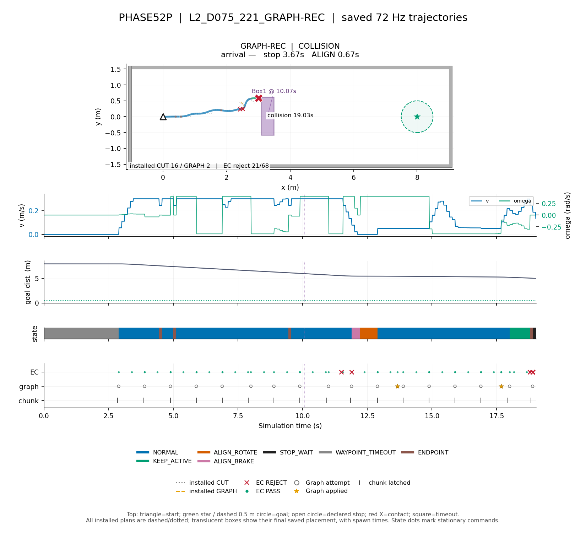

# PHASE52P 대표 주행 기록

저장된 결과·로그만 시각화했다. 시뮬레이션, solver, rollout, EC·성과 지표 재계산은 하지 않았다. PNG 150 dpi; 쌍은 CUT 왼쪽·GRAPH 오른쪽.

| Run | 분류 | 도착시간 | 정지시간 | ALIGN_ROTATE | Graph 채택률 |
|---|---|---:|---:|---:|---:|
| L2_D075_221_GRAPH-REC | COLLISION | — | 3.67s | 0.67s | 11.8% (2/17) |

위: 실제 72Hz 궤적의 명령 상태 색, 설치된 모든 CUT(회색 점선)·GRAPH(주황 파선) 경로, 벽·정적 장애물(회색), 돌발 상자(보라·출현 시각), 목표·선언·접촉. 정지/회전은 위치 점도 표시한다. 아래: 저장 v·ω·목표 거리, 명령 상태 띠, EC·Graph·chunk 수신 시각. 쌍은 같은 좌표·시간 축을 쓰며 종료 이후는 회색이다.

표의 도착시간은 성공 run만 표시한다(—는 미도착). 잘못된 도착도 그림에는 실제 선언 시각·위치를 표시한다. 채택률 분모는 저장 report의 Graph 시도 수이다. `WAYPOINT_TIMEOUT`은 로그 출처명 그대로이며 첫 chunk 이전 missing 대기도 포함할 수 있다. Chunk 표시는 controller에 latch된 시각이며 종료 후 미적용 결과는 제외한다. 한 top-down 그림에 시간 전체를 겹쳤으므로 상자는 출현 전에도 배치 윤곽이 보인다.

재사용 명령: `PYTHONPATH=research /usr/bin/python3 -m nomad_run_plots --phase phase52p --runs L2_D075_221_GRAPH-REC`
