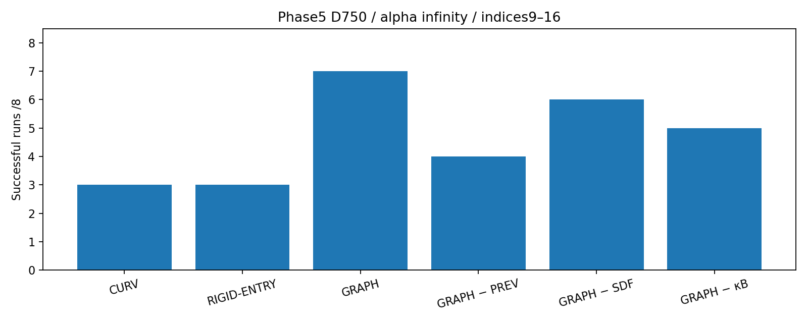
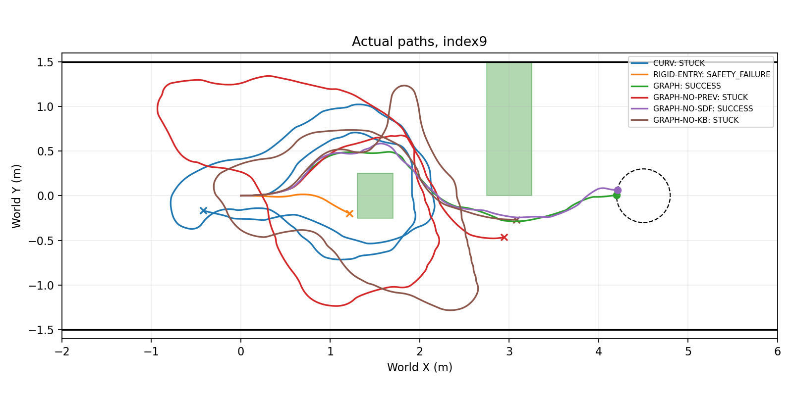

# Phase5 Baseline and Ablation

Git SHA: `ef2cde3fa870a9a914120548a87a3cfcea5c396e`. Oracle geometry; SE(2) kinematic Isaac Sim. N=8 per method; D750, alpha infinity, v_max0.3.

|Method|Success/8|Collision|Corridor|Timeout|Technical|Goal median s|Mean speed m/s|Min clearance m|
|---|---|---:|---:|---:|---:|---:|---:|---:|
|CURV|3/8|1|3|1|0|39.0833|0.1346|-0.0021|
|RIGID-ENTRY|3/8|4|1|0|0|29.7500|0.1591|-0.0016|
|GRAPH|7/8|0|1|0|0|30.0833|0.1541|0.0408|
|GRAPH-NO-PREV|4/8|1|1|2|0|29.4236|0.1522|-0.0019|
|GRAPH-NO-SDF|6/8|0|1|0|1|30.9722|0.1573|0.0088|
|GRAPH-NO-KB|5/8|0|1|2|0|29.9444|0.1523|0.0388|

|Method|Clamp fraction|Curvature saturation|Yaw variation ≥2π runs|Applied staleness median/p95|Corrected staleness median|Switch Δω median/max|Mean margin violation s|
|---|---:|---:|---:|---|---:|---|---:|
|CURV|0.6580|0.1826|5|0.1605/0.5854|N/A|0.4000/0.8000|0.0104|
|RIGID-ENTRY|0.7367|0.0375|4|0.3258/0.6567|0.3258|0.1217/0.8000|0.2309|
|GRAPH|0.6724|0.1336|8|0.2759/0.6701|0.2598|0.3780/0.8000|0.0000|
|GRAPH-NO-PREV|0.6611|0.1544|7|0.2106/0.5969|0.1917|0.4000/0.8000|0.0851|
|GRAPH-NO-SDF|0.6871|0.1043|5|0.2684/0.6689|0.2826|0.3464/0.8000|0.1349|
|GRAPH-NO-KB|0.6725|0.1546|8|0.2164/0.6335|0.2273|0.3803/0.8000|0.0000|

|Method|Calls|Accepted|Nonconverged|Constraint failed|Superseded|Stale|Init rejected|Terminal pending|Solve median/p95/max s|Corrected control fraction|
|---|---:|---:|---:|---:|---:|---:|---:|---:|---|---:|
|CURV|0|0|0|0|0|0|0|0|N/A/N/A/N/A|0.0000|
|RIGID-ENTRY|0|0|0|0|0|0|0|0|N/A/N/A/N/A|0.0000|
|GRAPH|229|168|15|14|0|0|46|0|0.0576/0.1056/0.1880|0.6568|
|GRAPH-NO-PREV|333|256|30|30|0|0|46|1|0.0550/0.1325/0.2072|0.6866|
|GRAPH-NO-SDF|194|138|17|16|0|0|39|0|0.0552/0.1170/0.1827|0.6351|
|GRAPH-NO-KB|344|263|32|31|0|0|49|0|0.0589/0.1347/0.1959|0.6781|

|Index|CURV|RIGID-ENTRY|GRAPH|GRAPH-NO-PREV|GRAPH-NO-SDF|GRAPH-NO-KB|
|---|---|---|---|---|---|---|
|9|STUCK|SAFETY_FAILURE|SUCCESS|STUCK|SUCCESS|STUCK|
|10|SUCCESS|SAFETY_FAILURE|SUCCESS|SUCCESS|SUCCESS|SUCCESS|
|11|SAFETY_FAILURE|SAFETY_FAILURE|SUCCESS|SAFETY_FAILURE|SUCCESS|STUCK|
|12|SAFETY_FAILURE|SAFETY_FAILURE|SUCCESS|SUCCESS|SUCCESS|SUCCESS|
|13|SAFETY_FAILURE|SAFETY_FAILURE|SUCCESS|SAFETY_FAILURE|SAFETY_FAILURE|SAFETY_FAILURE|
|14|SAFETY_FAILURE|SUCCESS|SAFETY_FAILURE|SUCCESS|TECHNICAL_FAILURE|SUCCESS|
|15|SUCCESS|SUCCESS|SUCCESS|STUCK|SUCCESS|SUCCESS|
|16|SUCCESS|SUCCESS|SUCCESS|SUCCESS|SUCCESS|SUCCESS|

C1: `True`; C2: `True`; overall: **GRAPH_SUPPORTED**.

|Ablation|GRAPH−ablation success count|C3|
|---|---:|---|
|GRAPH-NO-PREV|3|CONTRIBUTES|
|GRAPH-NO-SDF|1|NOT_SHOWN|
|GRAPH-NO-KB|2|CONTRIBUTES|

|GRAPH versus|Fisher exact two-sided p (reference only)|
|---|---:|
|CURV|0.1189|
|RIGID-ENTRY|0.1189|
|GRAPH-NO-PREV|0.2821|
|GRAPH-NO-SDF|1.0000|
|GRAPH-NO-KB|0.5692|

Complete technical evidence: `False`. Technical failures are separate and have no imputed goal time. Goal medians use successful runs only. Nonconvergence and constraint-failure diagnostics can overlap.
Applied staleness pools native immediate switches, RIGID replacements, and accepted Graph replacements; corrected-only excludes RAW. Clamp/saturation use all9Hz ticks. Corrected control fraction uses valid PP ticks.
The yaw-variation flag is the literal cumulative absolute heading criterion. Oscillations also count; it is not proof of a spatial loop. NO-SDF retains corridor checks and actual collision monitoring but has no native obstacle acceptance certificate.
Indices9/10 offsets90000/100000 already appear in historical s0_paired_n10_01; not globally unseen seeds. Requested9..16 retained without changes. New Phase5 runs, no Phase4 outcomes reused.
Paired seeds do not ensure identical closed-loop RGB. Fisher p is descriptive and is not used for C1/C2/C3.

|Technical failure|Error|
|---|---|
|S0_14_GRAPH-NO-SDF|RuntimeError("RuntimeError('Launcher exit 1')")|
