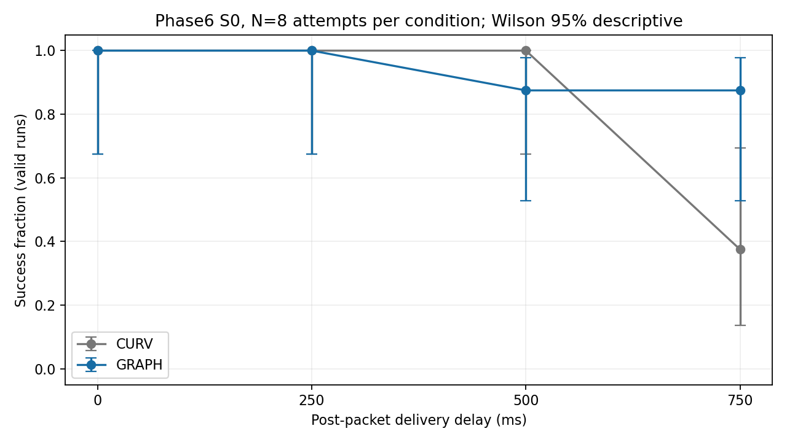
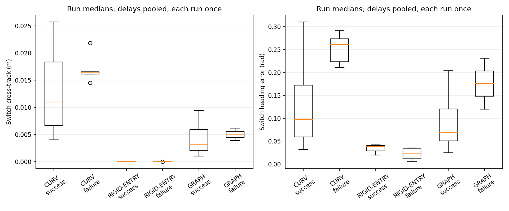

# Phase6 Static Completion

Execution Git SHA: `e6f4715beb07ef6cbc696271d776a8152f9427bc`.
Oracle geometry; SE(2) kinematic Isaac Sim. N=8 exploratory attempts per condition. 56 new attempts; 24 Phase5 references used once. D750 CURV/GRAPH/RIGID are reused, never rerun.

Table 1 — delay sweep

|D ms|Method|Success/attempts|Collision|Corridor|Timeout|Technical|Goal median s|Mean speed m/s|Min clearance m|Wilson 95% (valid)|
|---:|---|---|---:|---:|---:|---:|---:|---:|---:|---|
|0|CURV|8/8|0|0|0|0|20.1528|0.2235|0.0240|0.6756–1.0000|
|0|GRAPH|8/8|0|0|0|0|19.9375|0.2331|0.0427|0.6756–1.0000|
|250|CURV|8/8|0|0|0|0|21.6806|0.2094|0.0322|0.6756–1.0000|
|250|GRAPH|8/8|0|0|0|0|21.7778|0.2137|0.0578|0.6756–1.0000|
|500|CURV|8/8|0|0|0|0|27.2708|0.1755|0.0114|0.6756–1.0000|
|500|GRAPH|7/8|0|0|1|0|25.8333|0.1900|0.0347|0.5291–0.9776|
|750|CURV|3/8|1|3|1|0|39.0833|0.1346|-0.0021|0.1368–0.6943|
|750|GRAPH|7/8|0|1|0|0|30.0833|0.1541|0.0408|0.5291–0.9776|

Table 2 — D750 alternatives

|D ms|Method|Success/attempts|Collision|Corridor|Timeout|Technical|Goal median s|Mean speed m/s|Min clearance m|Wilson 95% (valid)|
|---:|---|---|---:|---:|---:|---:|---:|---:|---:|---|
|750|CURV|3/8|1|3|1|0|39.0833|0.1346|-0.0021|0.1368–0.6943|
|750|RIGID-ENTRY|3/8|4|1|0|0|29.7500|0.1591|-0.0016|0.1368–0.6943|
|750|SELECT|0/8|0|0|0|8|N/A|N/A|N/A|N/A–N/A|
|750|GRAPH|7/8|0|1|0|0|30.0833|0.1541|0.0408|0.5291–0.9776|

Table 3 — equally weighted run summaries, success/failure split

|D ms|Method|Outcome|Window|Runs|Heading median/p95 rad|Cross-track median/p95 m|Curvature median/p95 /m|κ>2 fraction|max abs(y) m|Time abs(y)>1 s|Min wall clearance m|
|---|---|---|---|---:|---|---|---|---:|---:|---:|---:|
|pooled|CURV|SUCCESS|full|27|0.1219/0.3465|0.0124/0.0347|1.8663/10.8603|0.4432|0.7415|1.7773|0.6685|
|pooled|CURV|FAILURE|full|5|0.2521/0.7492|0.0171/0.0773|3.9025/17.7675|0.6422|1.3037|5.9917|0.1063|
|pooled|CURV|FAILURE|last3s|5|0.4310/0.5016|0.0603/0.0794|4.4950/9.0773|0.6370|1.1526|2.4000|0.2574|
|pooled|RIGID-ENTRY|SUCCESS|full|3|0.0334/0.1648|0.0000/0.0000|1.5582/8.2431|0.3929|0.6851|0.0000|0.7249|
|pooled|RIGID-ENTRY|FAILURE|full|5|0.0223/0.1034|0.0000/0.0000|1.1014/12.1286|0.2827|0.7478|1.4389|0.6622|
|pooled|RIGID-ENTRY|FAILURE|last3s|5|0.0248/0.0393|0.0000/0.0000|2.1022/11.5655|0.4229|0.5966|0.6000|0.8134|
|pooled|GRAPH|SUCCESS|full|30|0.0849/0.3230|0.0041/0.0322|1.5807/10.7629|0.3851|0.6255|0.0000|0.7845|
|pooled|GRAPH|FAILURE|full|2|0.1756/0.5871|0.0050/0.0336|3.2415/22.4082|0.6362|1.2716|6.5208|0.1384|
|pooled|GRAPH|FAILURE|last3s|2|0.1951/0.4854|0.0078/0.0279|5.3510/27.8273|0.7222|1.0123|1.5000|0.3977|

Per-run and delay-stratified metrics, valid denominators and last3s failure precursors are in the companion CSV files. Table3 values are means of run statistics; distributions are not pooled across controller ticks. RIGID/SELECT have D750 only.

|Independent preregistered criterion|Result|
|---|---|
|D0_NO_HARM|PASS|
|TREND_SUPPORTED|PASS|
|BEATS_SELECT|PASS|

Δ(D), GRAPH−CURV success counts: `{'0': 0, '250': 0, '500': -1, '750': 4}`.
TREND uses the literal preregistered chained inequality Δ750 ≥ Δ500−1 ≥ Δ250−2 and Δ750 ≥ Δ0+2. No combined verdict.
Technical evidence complete: `False`; technical failures: 8.
Fisher two-sided p, descriptive only: `{'0': 1.0, '250': 1.0, '500': 1.0, '750': 0.11888111888111888, '750_GRAPH_SELECT': None}`.
Goal-time medians use successful runs only; failed times are not replaced with90s. Collision/corridor can co-occur. A2cm margin violation is separate from SUCCESS. Technical failures are not collisions or timeouts; Wilson and Fisher exclude them.
Switches include RAW/SELECT/RIGID applications and accepted GRAPH replacements. Heading uses the actual projected segment tangent only when length≥20mm. Invalid headings and empty last3s event windows remain missing. Wall distance is footprint swept lower bound; |y|>1 duration uses72Hz interval end poses.
Mechanism associations are descriptive, not causal. Same seed offset does not give identical closed-loop RGB; Phase5 references were recorded earlier. No navigation is generated by this report.

|Technical failure|Reason|
|---|---|
|S0_09_D750_SELECT|RuntimeError('AssertionError()')|
|S0_10_D750_SELECT|RuntimeError('AssertionError()')|
|S0_11_D750_SELECT|RuntimeError('AssertionError()')|
|S0_12_D750_SELECT|RuntimeError('AssertionError()')|
|S0_13_D750_SELECT|RuntimeError('AssertionError()')|
|S0_14_D750_SELECT|RuntimeError('AssertionError()')|
|S0_15_D750_SELECT|RuntimeError('AssertionError()')|
|S0_16_D750_SELECT|RuntimeError('AssertionError()')|
