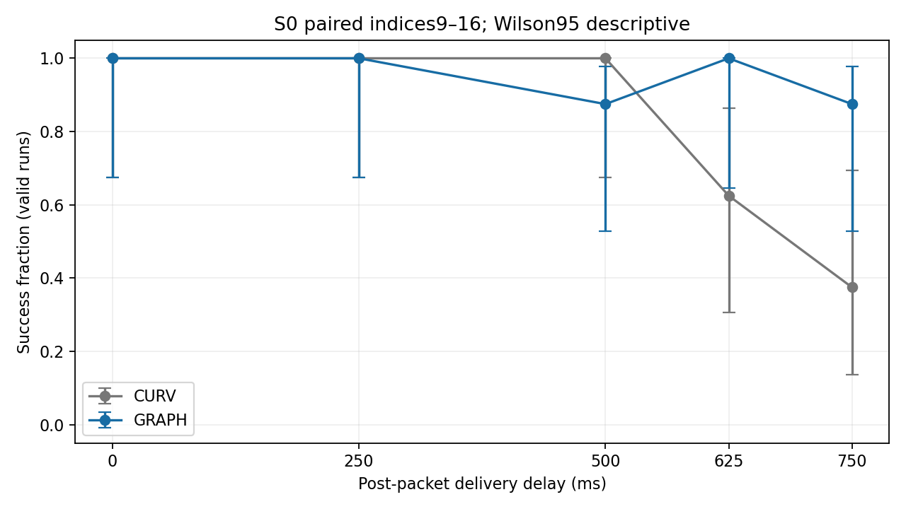
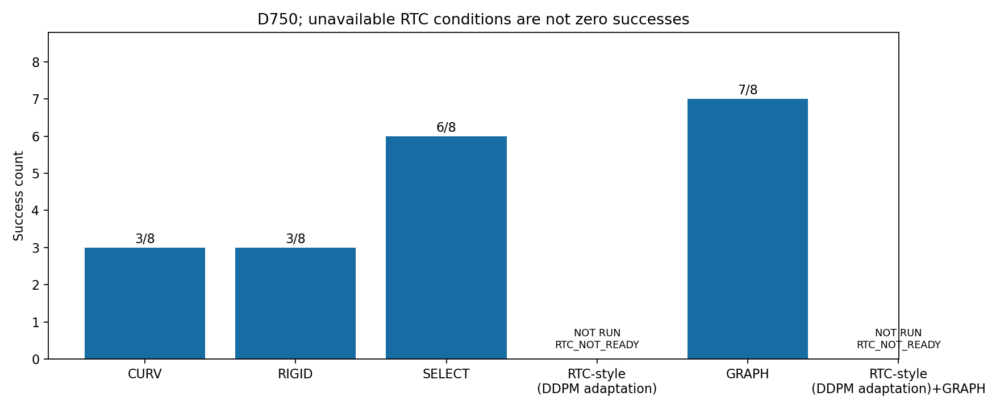

# Phase7 Results

Execution SHA: `3ee8fbc8b1bcb9727362185c6fade4a77606986f`. Oracle geometry; SE(2) kinematic Isaac Sim; N8 paired exploratory conditions.
24 new attempts: SELECT D750×8 and CURV/GRAPH D625×8 each. 72 historical records reused once. RTC-style (DDPM adaptation) and RTC-style (DDPM adaptation)+GRAPH were NOT RUN because readiness failed.

Table 1 — D750

|Method|Success/attempts|Collision|Corridor|Timeout|Technical|Goal median s|Mean speed m/s|Min clearance m|Inference median ms|
|---|---|---:|---:|---:|---:|---:|---:|---:|---:|
|CURV|3/8|1|3|1|0|39.0833|0.1346|-0.0021|35.6117|
|RIGID-ENTRY|3/8|4|1|0|0|29.7500|0.1591|-0.0016|35.8669|
|SELECT|6/8|0|1|0|1|28.7847|0.1574|0.0158|35.7292|
|RTC-style (DDPM adaptation)|NOT RUN|N/A|N/A|N/A|N/A|N/A|N/A|N/A|N/A|
|GRAPH|7/8|0|1|0|0|30.0833|0.1541|0.0408|35.7400|
|RTC-style (DDPM adaptation)+GRAPH|NOT RUN|N/A|N/A|N/A|N/A|N/A|N/A|N/A|N/A|

Table 2 — delay sweep

|D ms|Method|Success/attempts|Valid|Collision|Corridor|Timeout|Technical|Wilson95|
|---:|---|---|---:|---:|---:|---:|---:|---|
|0|CURV|8/8|8|0|0|0|0|0.6756–1.0000|
|0|GRAPH|8/8|8|0|0|0|0|0.6756–1.0000|
|250|CURV|8/8|8|0|0|0|0|0.6756–1.0000|
|250|GRAPH|8/8|8|0|0|0|0|0.6756–1.0000|
|500|CURV|8/8|8|0|0|0|0|0.6756–1.0000|
|500|GRAPH|7/8|8|0|0|1|0|0.5291–0.9776|
|625|CURV|5/8|8|0|0|3|0|0.3057–0.8632|
|625|GRAPH|7/8|7|0|0|0|1|0.6457–1.0000|
|750|CURV|3/8|8|1|3|1|0|0.1368–0.6943|
|750|GRAPH|7/8|8|0|1|0|0|0.5291–0.9776|

Table 3 — mechanism run summaries (pooled delays, same Phase6 definitions)

|Method|Outcome|Window|Runs|Heading median/p95 rad|Cross-track median/p95 m|Time abs(y)>1 s|Min wall clearance m|
|---|---|---|---:|---|---|---:|---:|
|CURV|SUCCESS|full|32|0.1336/0.3668|0.0123/0.0371|1.4996|0.6869|
|CURV|FAILURE|full|8|0.2459/0.7340|0.0154/0.0655|7.1198|0.1584|
|CURV|FAILURE|last3s|8|0.3477/0.4707|0.0420/0.0610|1.8750|0.4404|
|RIGID-ENTRY|SUCCESS|full|3|0.0334/0.1648|0.0000/0.0000|0.0000|0.7249|
|RIGID-ENTRY|FAILURE|full|5|0.0223/0.1034|0.0000/0.0000|1.4389|0.6622|
|RIGID-ENTRY|FAILURE|last3s|5|0.0248/0.0393|0.0000/0.0000|0.6000|0.8134|
|SELECT|SUCCESS|full|6|0.2604/0.5281|0.0164/0.0551|0.0000|0.6941|
|SELECT|FAILURE|full|1|0.3554/1.0563|0.0151/0.0492|6.3194|-0.0004|
|SELECT|FAILURE|last3s|1|0.7716/1.0063|0.0230/0.0300|3.0000|-0.0004|
|GRAPH|SUCCESS|full|37|0.0904/0.3502|0.0041/0.0341|0.2072|0.7727|
|GRAPH|FAILURE|full|2|0.1756/0.5871|0.0050/0.0336|6.5208|0.1384|
|GRAPH|FAILURE|last3s|2|0.1951/0.4854|0.0078/0.0279|1.5000|0.3977|

|Independent criterion|Result|
|---|---|
|BEATS_SELECT|FAIL|
|BEATS_RTC|INCONCLUSIVE|
|GRAPH_ADDS_TO_RTC|INCONCLUSIVE|

Δ(0,250,500,625,750): `{'0': 0, '250': 0, '500': -1, '625': 2, '750': 4}`.
Fisher p (reference only): `{'BEATS_SELECT': 1.0, 'BEATS_RTC': None, 'GRAPH_ADDS_TO_RTC': None}`.
Any involved method with fewer than7 valid runs yields INCONCLUSIVE. Historical Phase6 BEATS_SELECT is corrected to INCONCLUSIVE in the separate addendum; original artifacts were preserved. New SELECT runs are not replaced by the repaired historical audit.
Goal times use successful runs only. Inference is the median of per-run warm medians (first inference excluded). Wilson/Fisher use valid denominators, are descriptive only, and do not account for paired dependence. Identical seeds do not imply identical closed-loop RGB.
Mechanism tables average per-run statistics; short projected segments (<20mm) have invalid heading rather than invented yaw. Failure last3s windows can have no switches (null). Wall clearance is a swept footprint lower bound; |y|>1 duration uses72Hz end poses. Detail and valid denominators are in CSV.

RTC-style (DDPM adaptation) offline validation:
50 frozen inputs, W0 maximum error=0; fixed sample0 prefix median=0.053785m; overlap RMSE improved 50/50. Verdict: **RTC_NOT_READY**.
RAW latency median/p95=30.7504/48.8674ms; guided=64.9793/70.2056ms. No tuning/restart or RTC navigation was performed.
[RTC paper Appendix A.4](https://arxiv.org/html/2506.07339v1#A1.SS4) confirms beta5. The preregistered variance-preconditioned DDPM VJP is an adaptation, not the paper’s flow integration; no hard prefix overwrite. This readiness failure is not evidence that the original RTC algorithm fails.

|Technical failure|Error|
|---|---|
|S0_13_D750_SELECT|RuntimeError("RuntimeError('Launcher exit 1')")|
|S0_14_D625_GRAPH|RuntimeError("RuntimeError('Launcher exit 1')")|
