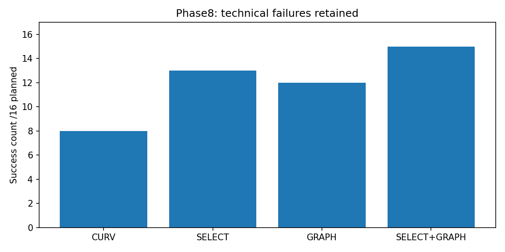
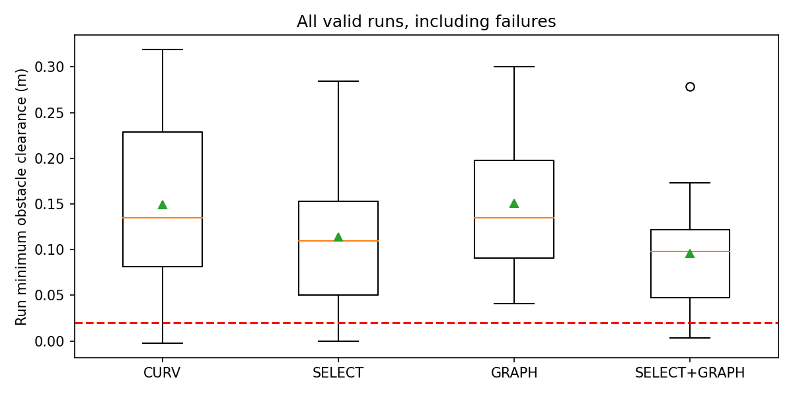

# Phase8 Results

Execution commit: `6d1746015f74f8265ee586735aeb79931cd337f5`; state: `COMPLETE`.
Oracle geometry; SE(2) kinematic Isaac Sim; paired indices do not imply identical RGB.
All failures retained; no retries or parameter tuning. Success = goal + no geometric overlap + corridor containment; 2cm margin is reported separately. Conservative contact stop is not geometric collision. Missing goal times are not imputed.

## n16

|method|delay_ms|planned|valid|success|collision|corridor|timeout|technical|placement_invalid|goal_time_median_s|mean_speed_m_s|clearance_median_m|clearance_p10_m|clearance_min_m|inference_median_ms|rtc_prefix_median_m|
|---|---|---|---|---|---|---|---|---|---|---|---|---|---|---|---|---|
|CURV|750|16|16|8|1|5|2|0|0|44.6250|0.1343|0.1352|0.0232|-0.0021|35.5830|N/A|
|SELECT|750|16|15|13|0|2|0|1|0|29.8750|0.1532|0.1097|0.0224|0.0000|35.5708|N/A|
|GRAPH|750|16|15|12|0|2|1|1|0|29.5972|0.1563|0.1351|0.0687|0.0408|35.4100|N/A|
|SELECT+GRAPH|750|16|16|15|0|1|0|0|0|27.2917|0.1741|0.0981|0.0301|0.0031|35.2736|N/A|

## n8

|method|delay_ms|planned|valid|success|collision|corridor|timeout|technical|placement_invalid|goal_time_median_s|mean_speed_m_s|clearance_median_m|clearance_p10_m|clearance_min_m|inference_median_ms|rtc_prefix_median_m|
|---|---|---|---|---|---|---|---|---|---|---|---|---|---|---|---|---|
|CURV|750|8|8|3|1|3|1|0|0|39.0833|0.1346|0.1427|0.0190|-0.0021|35.6117|N/A|
|RIGID-ENTRY|750|8|8|3|4|1|0|0|0|29.7500|0.1591|0.0032|-0.0015|-0.0016|35.8669|N/A|
|SELECT|750|8|7|6|0|1|0|1|0|28.7847|0.1574|0.0685|0.0257|0.0158|35.7292|N/A|
|GRAPH|750|8|8|7|0|1|0|0|0|30.0833|0.1541|0.1279|0.0651|0.0408|35.7400|N/A|
|SELECT+GRAPH|750|8|8|7|0|1|0|0|0|31.3056|0.1678|0.1092|0.0307|0.0031|35.3144|N/A|
|RTC-soft|750|8|8|2|2|3|1|0|0|33.7361|0.1286|0.1408|-0.0014|-0.0036|69.6397|0.0544|
|RTC-hard|750|8|8|4|1|2|1|0|0|41.7917|0.1290|0.0471|0.0195|-0.0033|69.6096|0.0000|

## selection

|method|planned|selection_switches|selection_replacements|selection_replacement_ratio|all_unsafe|selected_index_counts|
|---|---|---|---|---|---|---|
|SELECT|16|515|463|0.8990|2|{'7': 67, '3': 57, '1': 58, '2': 69, '6': 67, '0': 52, '4': 76, '5': 69}|
|SELECT+GRAPH|16|516|462|0.8953|4|{'7': 66, '3': 53, '5': 61, '4': 75, '1': 65, '0': 54, '2': 75, '6': 67}|
|SELECT|8|194|178|0.9175|1|{'7': 28, '3': 21, '1': 21, '2': 30, '6': 22, '0': 16, '4': 31, '5': 25}|
|SELECT+GRAPH|8|264|242|0.9167|2|{'7': 37, '3': 31, '5': 26, '4': 35, '1': 33, '0': 22, '2': 51, '6': 29}|

## mechanisms

|method|outcome|runs|heading_abs_rad_median_run_mean|heading_abs_rad_p95_run_mean|cross_track_m_median_run_mean|cross_track_m_p95_run_mean|time_abs_y_over1_s|minimum_wall_footprint_clearance_lower_m|
|---|---|---|---|---|---|---|---|---|
|CURV|SUCCESS|8|0.2713|0.6780|0.0146|0.0564|4.5260|0.5142|
|CURV|NON_SUCCESS|8|0.2644|0.7531|0.0158|0.0660|9.1389|0.0684|
|GRAPH|SUCCESS|12|0.1546|0.4997|0.0062|0.0486|0.7222|0.7145|
|GRAPH|NON_SUCCESS|3|0.1907|0.6810|0.0076|0.0659|4.9167|0.0438|
|RIGID-ENTRY|SUCCESS|3|0.0334|0.1648|0.0000|0.0000|0.0000|0.7249|
|RIGID-ENTRY|NON_SUCCESS|5|0.0223|0.1034|0.0000|0.0000|1.4389|0.6622|
|RTC-hard|SUCCESS|4|0.2664|0.8854|0.0275|0.1060|0.0000|0.7170|
|RTC-hard|NON_SUCCESS|4|0.2955|1.3384|0.0309|0.2415|4.3715|0.1644|
|RTC-soft|SUCCESS|2|0.2470|0.5289|0.0134|0.0565|0.0000|0.6457|
|RTC-soft|NON_SUCCESS|6|0.2808|0.8393|0.0160|0.0657|4.1019|0.2948|
|SELECT|SUCCESS|13|0.2588|0.5813|0.0165|0.0574|0.0000|0.7124|
|SELECT|NON_SUCCESS|2|0.3859|0.9797|0.0151|0.0446|7.0625|-0.0002|
|SELECT+GRAPH|SUCCESS|15|0.1551|0.5989|0.0064|0.0549|0.0000|0.7011|
|SELECT+GRAPH|NON_SUCCESS|1|0.2447|1.0632|0.0149|0.0879|6.8056|-0.0006|

## Preregistered decisions

```json
{
  "BEATS_SELECT": "FAIL",
  "COMBO_SUPPORTED": "PASS",
  "COMBO_NO_WORSE": "NOT_EVALUATED_SUPPORTED",
  "MARGIN_ADVANTAGE": [
    {
      "pair": "GRAPH minus SELECT",
      "indices": [
        9,
        10,
        11,
        12,
        14,
        15,
        16,
        17,
        18,
        19,
        20,
        21,
        22,
        24
      ],
      "paired_differences_m": [
        0.060027337366800874,
        0.11550696759224519,
        0.06661086202680125,
        -0.20912515479562138,
        0.2389857827600576,
        -0.09264683173318693,
        -0.06569985839124132,
        0.19045128647156456,
        -0.026376108986258084,
        0.1509233274027425,
        -0.12181978251229857,
        -0.07213629338119978,
        0.12205287575083458,
        0.13172163813604884
      ],
      "mean_difference_m": 0.03489114626480638,
      "bootstrap95_mean": [
        -0.033119538597535886,
        0.10133869250161907
      ],
      "replicates": 20000,
      "seed": 20261025,
      "verdict": "FAIL"
    },
    {
      "pair": "SELECT+GRAPH minus SELECT",
      "indices": [
        9,
        10,
        11,
        12,
        14,
        15,
        16,
        17,
        18,
        19,
        20,
        21,
        22,
        23,
        24
      ],
      "paired_differences_m": [
        -0.03159837421272419,
        0.24646016219084269,
        0.07407020022723307,
        -0.24207270348299534,
        0.15714440152262932,
        -0.11903383417749339,
        0.010011914503263664,
        -0.08273822186592343,
        -0.010351478306382278,
        -0.005148234426875474,
        -0.13519558026274162,
        -0.13406671833372386,
        -0.07843573176937074,
        -0.07116904254186596,
        0.13669070061629238
      ],
      "mean_difference_m": -0.01902883602132234,
      "bootstrap95_mean": [
        -0.07989476781378621,
        0.045484253778967774
      ],
      "replicates": 20000,
      "seed": 20261025,
      "verdict": "FAIL"
    }
  ],
  "BEATS_RTC_SOFT": "PASS",
  "BEATS_RTC_HARD": "PASS"
}
```

Criteria involving <87.5% valid planned runs are INCONCLUSIVE. Paired margin bootstrap uses all valid pairs, the mean difference, 20,000 replicates and seed20261025; at least14 pairs required. Runtime latency/prefix values in tables are medians of run medians. Exact distributions and per-run mechanism values are in JSON/CSV.

RTC-soft is **RTC-style (DDPM adaptation)**, unchanged Phase7 beta5/VJP. Prefix accuracy is diagnostic only. RTC-hard is **RTC hard-masking ablation (DDPM adaptation)**; exact prefix copying is an ablation, not the original flow-policy RTC. Both retain observation-time anchors.





## Technical failures

|key|error|
|---|---|
|S0_13_D750_SELECT|RuntimeError("RuntimeError('Launcher exit 1')")|
|S0_23_D750_GRAPH|RuntimeError('Launcher exit 1')|
