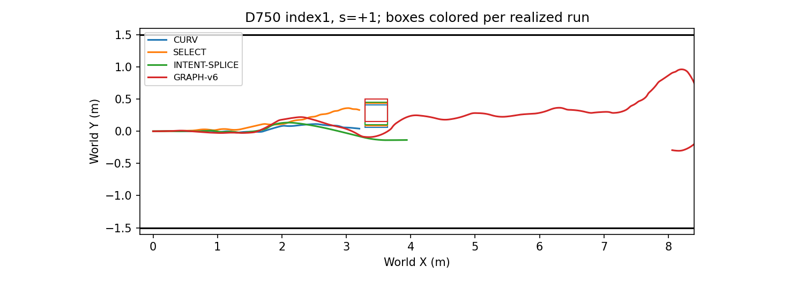
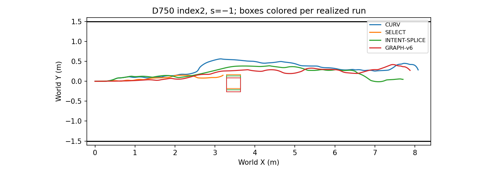

# Phase9 Results

Execution commit: `6d1746015f74f8265ee586735aeb79931cd337f5`; state: `COMPLETE`.
Oracle geometry; SE(2) kinematic Isaac Sim; paired indices do not imply identical RGB.
All failures retained; no retries or parameter tuning. Success = goal + no geometric overlap + corridor containment; 2cm margin is reported separately. Conservative contact stop is not geometric collision. Missing goal times are not imputed.

## method_delay

|method|delay_ms|planned|valid|success|collision|corridor|timeout|technical|placement_invalid|goal_time_median_s|mean_speed_m_s|clearance_median_m|clearance_p10_m|clearance_min_m|inference_median_ms|rtc_prefix_median_m|dynamic_passage_counts|
|---|---|---|---|---|---|---|---|---|---|---|---|---|---|---|---|---|---|
|CURV|750|8|8|3|4|0|1|0|0|52.5972|0.1517|0.0626|-0.0023|-0.0030|35.2559|N/A|{'NOT_PASSED': 4, '+Y': 4}|
|SELECT|750|8|8|3|4|0|1|0|0|43.5000|0.1592|0.0110|-0.0010|-0.0011|35.3825|N/A|{'NOT_PASSED': 4, '-Y': 1, '+Y': 3}|
|INTENT-SPLICE|750|8|8|5|0|1|2|0|0|45.8194|0.1385|0.1097|0.0597|0.0228|35.2581|N/A|{'-Y': 5, '+Y': 3}|
|GRAPH-v6|750|8|8|6|0|1|1|0|0|49.1597|0.1636|0.0827|0.0346|0.0240|35.2698|N/A|{'-Y': 6, '+Y': 2}|
|CURV|0|4|4|2|2|0|0|0|0|31.7222|0.2537|0.0201|-0.0015|-0.0021|34.8361|N/A|{'NOT_PASSED': 2, '-Y': 1, '+Y': 1}|
|GRAPH-v6|0|4|4|1|0|2|1|0|0|31.7222|0.2201|0.0878|0.0540|0.0436|34.8285|N/A|{'-Y': 2, '+Y': 2}|

## sides

|side|method|delay_ms|planned|valid|success|collision|corridor|timeout|technical|placement_invalid|goal_time_median_s|mean_speed_m_s|clearance_median_m|clearance_p10_m|clearance_min_m|inference_median_ms|rtc_prefix_median_m|dynamic_passage_counts|
|---|---|---|---|---|---|---|---|---|---|---|---|---|---|---|---|---|---|---|
|+1|CURV|750|4|4|0|4|0|0|0|0|N/A|0.1465|-0.0015|-0.0027|-0.0030|35.3806|N/A|{'NOT_PASSED': 4}|
|+1|SELECT|750|4|4|1|3|0|0|0|0|43.5000|0.1486|-0.0000|-0.0008|-0.0011|35.5338|N/A|{'NOT_PASSED': 3, '-Y': 1}|
|+1|INTENT-SPLICE|750|4|4|3|0|0|1|0|0|47.4722|0.1357|0.1007|0.0804|0.0755|35.1133|N/A|{'-Y': 4}|
|+1|GRAPH-v6|750|4|4|4|0|0|0|0|0|50.9444|0.1644|0.0813|0.0403|0.0240|35.2698|N/A|{'-Y': 4}|
|-1|CURV|750|4|4|3|0|0|1|0|0|52.5972|0.1569|0.1380|0.1274|0.1254|35.2241|N/A|{'+Y': 4}|
|-1|SELECT|750|4|4|2|1|0|1|0|0|44.0694|0.1697|0.1635|0.0340|-0.0009|35.2094|N/A|{'NOT_PASSED': 1, '+Y': 3}|
|-1|INTENT-SPLICE|750|4|4|2|0|1|1|0|0|43.8472|0.1413|0.1114|0.0490|0.0228|35.3944|N/A|{'+Y': 3, '-Y': 1}|
|-1|GRAPH-v6|750|4|4|2|0|1|1|0|0|48.2153|0.1629|0.0837|0.0517|0.0391|35.2823|N/A|{'+Y': 2, '-Y': 2}|

## mechanisms

|method|outcome|runs|heading_abs_rad_median_run_mean|heading_abs_rad_p95_run_mean|cross_track_m_median_run_mean|cross_track_m_p95_run_mean|time_abs_y_over1_s|minimum_wall_footprint_clearance_lower_m|
|---|---|---|---|---|---|---|---|---|
|CURV|SUCCESS|5|0.1658|0.3765|0.0155|0.0408|0.0000|0.8934|
|CURV|NON_SUCCESS|7|0.1697|0.3528|0.0105|0.0391|0.0000|0.8568|
|GRAPH-v6|SUCCESS|7|0.1184|0.3988|0.0056|0.0404|0.0000|0.8175|
|GRAPH-v6|NON_SUCCESS|5|0.0801|0.4188|0.0061|0.0367|8.2194|0.0559|
|INTENT-SPLICE|SUCCESS|5|0.2483|0.4725|0.0123|0.0423|0.0000|0.8274|
|INTENT-SPLICE|NON_SUCCESS|3|0.1762|0.3764|0.0041|0.0277|2.3843|0.6065|
|SELECT|SUCCESS|3|0.2121|0.6350|0.0132|0.0557|0.0000|0.9100|
|SELECT|NON_SUCCESS|5|0.2733|0.5924|0.0149|0.0434|0.0000|0.8627|

## Graph statistics

|method|delay_ms|graph_calls|graph_accepted|graph_nonconverged|graph_solve_pooled_s|corrected_run_fraction_mean|corrected_distance_fraction_mean|dynamic_passage_counts|
|---|---|---|---|---|---|---|---|---|
|CURV|750|0|0|0|{'n': 0}|0.0000|0.0000|{'NOT_PASSED': 4, '+Y': 4}|
|SELECT|750|0|0|0|{'n': 0}|0.0000|0.0000|{'NOT_PASSED': 4, '-Y': 1, '+Y': 3}|
|INTENT-SPLICE|750|0|0|0|{'n': 0}|0.0000|0.0000|{'-Y': 5, '+Y': 3}|
|GRAPH-v6|750|454|304|56|{'n': 360, 'median': 0.057166552025591955, 'p95': 0.1403961328498554, 'min': 0.043399805028457195, 'max': 0.21596109197707847}|0.5993|0.6606|{'-Y': 6, '+Y': 2}|
|CURV|0|0|0|0|{'n': 0}|0.0000|0.0000|{'NOT_PASSED': 2, '-Y': 1, '+Y': 1}|
|GRAPH-v6|0|810|519|244|{'n': 800, 'median': 0.05727159098023549, 'p95': 0.1657689090876373, 'min': 0.040852112986613065, 'max': 0.21800350199919194}|0.3755|0.4440|{'-Y': 2, '+Y': 2}|

## Preregistered decisions

```json
{
  "INTENT_NEEDED": "PASS",
  "V6_BEATS_SPLICE": "FAIL",
  "V6_BEATS_SELECT": "PASS"
}
```

Criteria involving <87.5% valid planned runs are INCONCLUSIVE. Paired margin bootstrap uses all valid pairs, the mean difference, 20,000 replicates and seed20261025; at least14 pairs required. Runtime latency/prefix values in tables are medians of run medians. Exact distributions and per-run mechanism values are in JSON/CSV.

Oracle geometry is available only after the next completed RGB capture following first visibility; physical collision evaluation includes the obstacle from spawn. Intent is a geometry heuristic. Each colored box is the realized run placement; paired seeds do not fix trajectories. Graph-v6 can reject inputs (including zero previous speed); fallback remains CURV.





