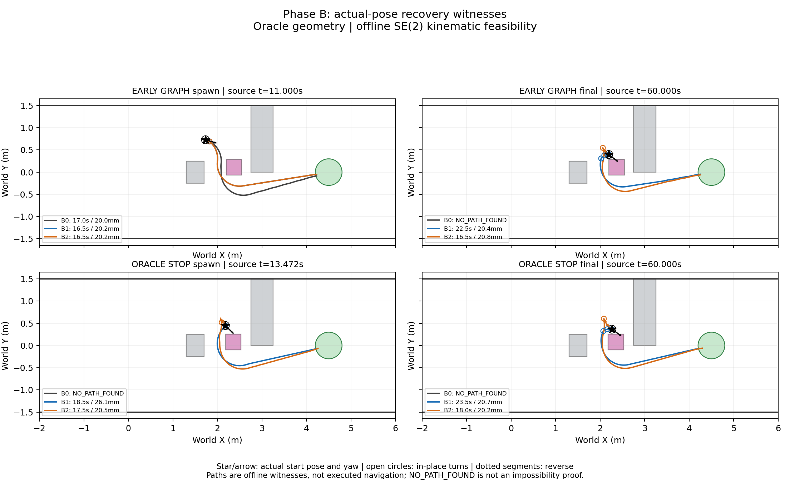

# Phase B — Actual-pose recovery feasibility

범위: **Oracle geometry; offline SE(2) kinematic feasibility**. 기준 `2892c3f913ed3064253efb05798438e0109b61f9`, 동일 `research/phase0-infrastructure`에서 수행한다. 온라인 Recovery는 제자리 회전 우선·후진 비활성 상태를 유지한다.

## 사전 고정

`actual_pose_recovery_protocol.json`에 두 raw run의 spawn/final 네 상태와 B0/B1/B2 동작 집합을 고정했다. Git에 저장된 기존 summary와 raw spawn/72Hz trace/final pose가 정확히 일치하며, 사용자 제공 소수점 pose는 5e−10 절대 허용 오차로 확인한다. 탐색에는 반올림 전 raw pose/yaw 및 실제 spawn box를 사용한다. Oracle STOP의 adaptive placement 좌표를 원본 scenario에 쓰지 않고 별도 메모리 config에만 반영한다.

| 시작 상태 | Source tick / time | 시작 최소 obstacle clearance |
|---|---:|---:|
| EARLY-GRAPH spawn | 792 / 11s | 0.390553469m |
| EARLY-GRAPH final | 4320 / 60s | 0.021406126m |
| Oracle STOP spawn | 970 / 13.472222s | 0.106968936m |
| Oracle STOP final | 4320 / 60s | 0.024828902m |

모두 시작 clearance≥0.02m/corridor>0이다. 실제 동적 중심은 EARLY-GRAPH `(2.372279542,0.110674603)`, Oracle STOP `(2.35439671156368,0.07771649443348477)`m이며 크기0.35×0.35×0.8m를 유지한다. 출현 이후의 고정 geometry만 검사하므로 원래 시간에 따른 전체 navigation feasibility를 판단하지 않는다.

기존 `scenario_feasibility.search()`를 확장해 재사용한다. XY5cm/yaw64bin, primitive0.5s, heuristic weight1.5, 30,000 expansions/최대 경로60s, goal XY반경0.30m/terminal yaw 없음, radius0.09m/obstacle margin0.02m/corridor footprint clearance>0을 유지한다.

- B0: 기존 전진5개 `(v=.2,w=0/−.2/+.2/−.4/+.4)`.
- B1: B0 + 제자리 회전 `(v=0,w=−.4/+.4)`.
- B2: B1 + 후진5개 `(v=−.2,w=0/−.2/+.2/−.4/+.4)`.
- 이번 요청의 **120 process CPU seconds**를 선택형 budget으로 사용하고 wall time도 별도로 기록한다. 기존 Phase0-A의 기본120 wall seconds 설정은 변경하지 않는다.
- 모든 조건에서 side=None으로 직접 탐색한다. 기존 one-pass side gate/certificate는 호출하지 않는다. 뒤로 돌아 다른 쪽으로 우회하는 경로를 허용한다.
- 발견된 모든0.5s 연속 arc는 기존 swept/corridor 함수로 다시 검증한다. 이동 거리는 `sum(abs(v)*dt)`이며 spin 시간/각도와 reverse 구간도 보존한다.

최소 검증: 새3개+기존5개 tests PASS. Spin의 XY 고정/정확한 yaw, 후진 직선·원호 및 역적분, endpoint만 안전한 후진의 연속 충돌 검출, reverse witness의 절댓값 거리, nested 동작 집합과 기존 forward-only 기본 검증을 확인했다. 새로운 navigation/inference, parameter tuning 또는 온라인 controller 변경은 없다.

## 실행 명령

고정 코드 `5bf2fa0`의 clean checkout에서 새 출력 경로로 아래 명령을 한 번 실행했다. 해당 경로는 이미 존재하므로 재실행 대상으로 사용하지 않는다.

```bash
bash research/python.sh -m nomad_phase0.actual_pose_recovery run --output /home/gpuadmin/Workspace/NoMaD/artifacts/phaseb/actual_pose_recovery_01
```

그림은 저장된 witness만 읽어 기존 시스템 matplotlib로 한 번 생성한다.

```bash
PYTHONPATH=research /usr/bin/python3 -m nomad_phase0.actual_pose_recovery plot --output /home/gpuadmin/Workspace/NoMaD/artifacts/phaseb/actual_pose_recovery_01
```

`NO_PATH_FOUND`는 제한된 primitive·bin pruning·예산 내 witness 미발견이다. 불가능 증명이나 후진의 수학적 필요성으로 해석하지 않는다. Weighted Hybrid A*의 첫 witness는 최단/최적 경로가 아니므로 조건별 경로 시간 차이도 최적성 비교가 아니다.

## 12조건 결과

12개 조건을 각각 한 번 평가했다. `FEASIBLE` 9개, `NO_PATH_FOUND` 3개, `INVALID_START` 0개다. 모든 미발견은 `OPEN_SET_EXHAUSTED`이며 CPU/expansion/path 예산 종료로 보고된 사례는 없다. 최대 expansion 14,723, 최대 CPU 2.501s였다.

경로 시간은 **각 실제 시작 pose에서 새로 시작하는 상대 시간**이다. 원래 run의 source simulation time이나 실제 recovery 실행 시간으로 해석하지 않는다. Spin/reverse 열은 해당 witness에서의 사용 시간이다.

| 시작 상태 | 동작 | 결과 | 경로 s | 거리 m | 최소 clearance mm | Spin s | Reverse s | Expansions | CPU s |
|---|---|---|---:|---:|---:|---:|---:|---:|---:|
| EARLY-GRAPH spawn | B0 | FEASIBLE | 17.0 | 3.4 | 20.015 | 0 | 0 | 1,232 | 0.113 |
| EARLY-GRAPH spawn | B1 | FEASIBLE | 16.5 | 3.2 | 20.187 | 0.5 | 0 | 7,024 | 0.793 |
| EARLY-GRAPH spawn | B2 | FEASIBLE | 16.5 | 3.2 | 20.187 | 0.5 | 0 | 9,483 | 1.791 |
| EARLY-GRAPH final | B0 | NO_PATH_FOUND | — | — | — | — | — | 1 | <0.001 |
| EARLY-GRAPH final | B1 | FEASIBLE | 22.5 | 2.9 | 20.365 | 8.0 | 0 | 12,411 | 1.372 |
| EARLY-GRAPH final | B2 | FEASIBLE | 16.5 | 3.2 | 20.781 | 0.5 | 1.0 | 7,959 | 1.508 |
| Oracle STOP spawn | B0 | NO_PATH_FOUND | — | — | — | — | — | 6 | <0.001 |
| Oracle STOP spawn | B1 | FEASIBLE | 18.5 | 3.0 | 26.080 | 3.5 | 0 | 5,386 | 0.647 |
| Oracle STOP spawn | B2 | FEASIBLE | 17.5 | 3.4 | 20.466 | 0.5 | 1.0 | 12,891 | 2.383 |
| Oracle STOP final | B0 | NO_PATH_FOUND | — | — | — | — | — | 1 | <0.001 |
| Oracle STOP final | B1 | FEASIBLE | 23.5 | 3.0 | 20.709 | 8.5 | 0 | 14,723 | 1.624 |
| Oracle STOP final | B2 | FEASIBLE | 18.0 | 3.5 | 20.154 | 0.5 | 1.5 | 13,651 | 2.501 |

9개 witness의 serialized command/pose를 다시 읽고 `verify_witness`를 사용해 모든 연속0.5s primitive를 재검증했다. Pose 재구성 오차0, obstacle lower bound≥0.02m, corridor lower bound>0, goal 거리0.218596…0.295737m, overlap 없음이다. 계산된 최소 clearance는20.014718…26.080095mm, 최소 corridor clearance는0.677979m다. 입력16개 및 frozen source hash 불변도 확인했다.

특히 최소 경로의 threshold 초과 여유는 **0.014718mm**에 불과하다. Oracle geometry와 정확한 원호 적분의 witness이지, localization 오차·추종 오차·로봇 동역학에 강건한 경로가 아니다. 실제 follower나 온라인 recovery 성공을 검증하지 않았다.

## 제자리 회전과 후진의 의미

**B1은 B0에서 미발견인 세 상태 모두에서 goal witness를 확보했다.** 두 final 상태에서는 제자리에서 차체 방향을 바꾼 뒤 양의 전진 속도로 뒤쪽 공간에 진입하고 동적 장애물 아래쪽으로 우회한다. B1의 world X 감소는 허용되지만 body-frame v<0 후진은 사용하지 않는다. 예전 one-pass certificate를 적용했다면 이러한 recovery를 잘못 배제할 수 있으므로 이번에는 사용하지 않았다.

**B2만 새로 feasible해진 상태는 0개다.** 다만 EARLY-GRAPH final / Oracle STOP spawn / Oracle STOP final에서는 시작부터 각각0.2/0.2/0.3m 후진하는 별도 witness를 찾았다. 발견 경로의 시간은 B1보다 각각6.0/1.0/5.5s 짧고 spin 시간은0.5s로 줄었다. 이동 거리는 오히려 각각0.3/0.4/0.5m 늘었다. EARLY-GRAPH spawn의 B1/B2 witness는 동일하고 후진을 사용하지 않는다.

이는 **발견된 witness 간 관찰 차이**다. Weighted search의 첫 해와 quantized duplicate pruning 때문에 더 많은 동작을 허용한 조건이 반드시 더 짧은 경로를 찾거나 적은 계산량을 쓰는 것은 아니다. B2의 시간 감소를 최적성·통계적 성능·온라인 제어 이점으로 주장하지 않는다.

B0의 미발견은 지정된0.2m/s·0.5s primitive와 bin pruning을 적용한 탐색 공간에서의 open-set 소진이다. 더 짧은 primitive나 다른 제어를 포함한 연속 제어 공간의 불가능 증명은 아니다. B1 witness가 이미 있으므로 **검사한 네 상태의 기하학적 탈출에 후진이 반드시 필요하다는 근거는 없다.** 제자리 회전 우선·온라인 후진 비활성 결정을 유지할 근거를 제공하지만, 회전 시점/방향 선택과 실제 추종 가능성은 별도 검증이 필요하다.

## 저장 자료

- [12조건 비교 CSV](../research/results/phaseb_actual_pose_recovery_20261020/comparison.csv), [요약 JSON](../research/results/phaseb_actual_pose_recovery_20261020/summary.json)
- [입력 pose/geometry/hash와 frozen 설정](../research/results/phaseb_actual_pose_recovery_20261020/preflight.json), [연속 witness 재검증](../research/results/phaseb_actual_pose_recovery_20261020/validation.json)
- 조건별 JSON에 전체 command sequence/SE(2) pose, goal 거리, 장애물별 clearance, spin/reverse 구간과 CPU/wall 시간을 보존했다.
- [XY 그림 1장](../research/results/phaseb_actual_pose_recovery_20261020/witnesses_xy.png): 검은 별/화살표는 실제 시작 pose/yaw, 빈 원은 spin, 점선은 후진이다. 좌상단 B1/B2는 같은 경로라 겹친다.



Raw와 원본 scenario는 변경하지 않았다. Isaac navigation/GPU inference/온라인 recovery 구현/새 S1·S3/parameter sweep/추가 탐색은 모두0회다. 수정은 기존 offline checker의 선택형 CPU budget·reverse witness 허용, 네 실제 pose 비교용 wrapper/protocol, 최소 tests 및 문서/작은 결과로 제한했다.
