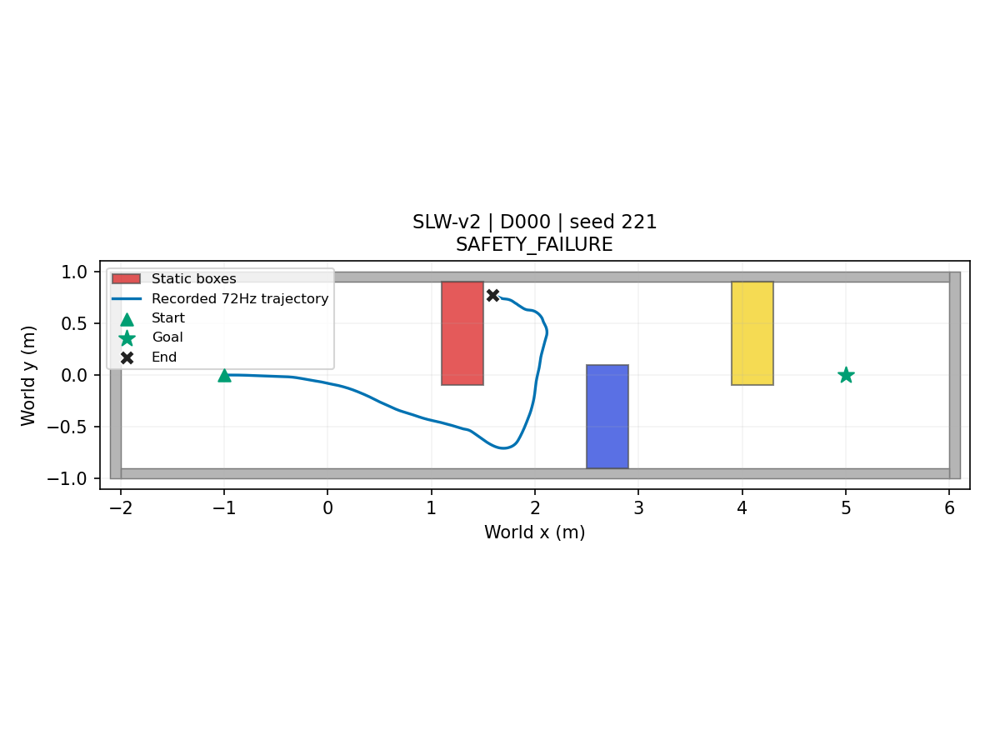
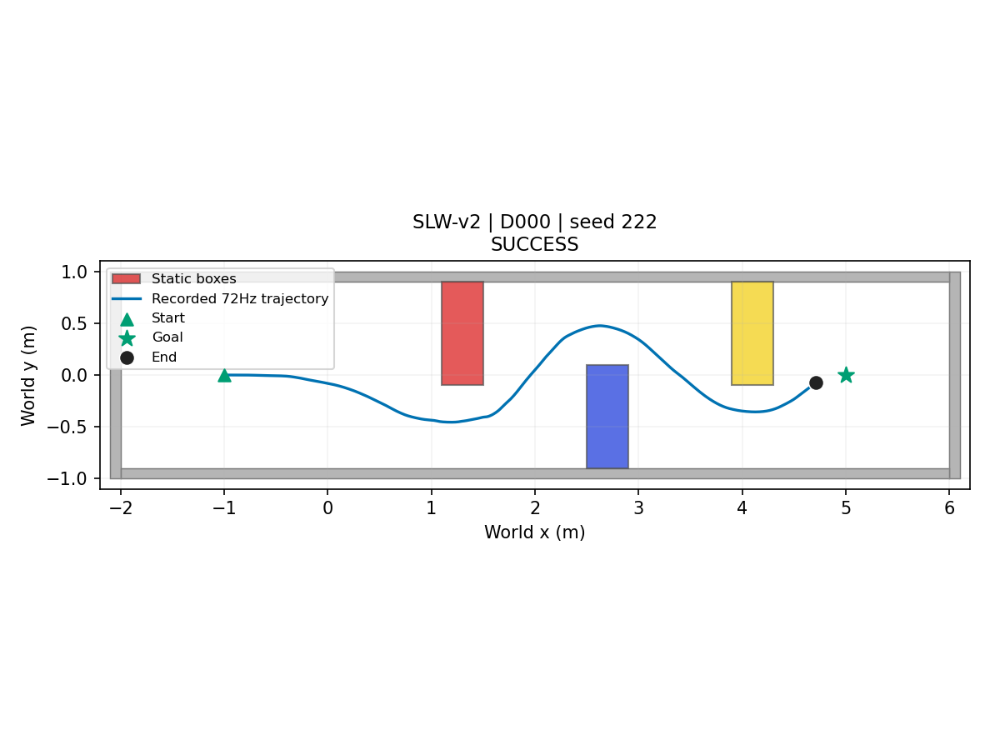
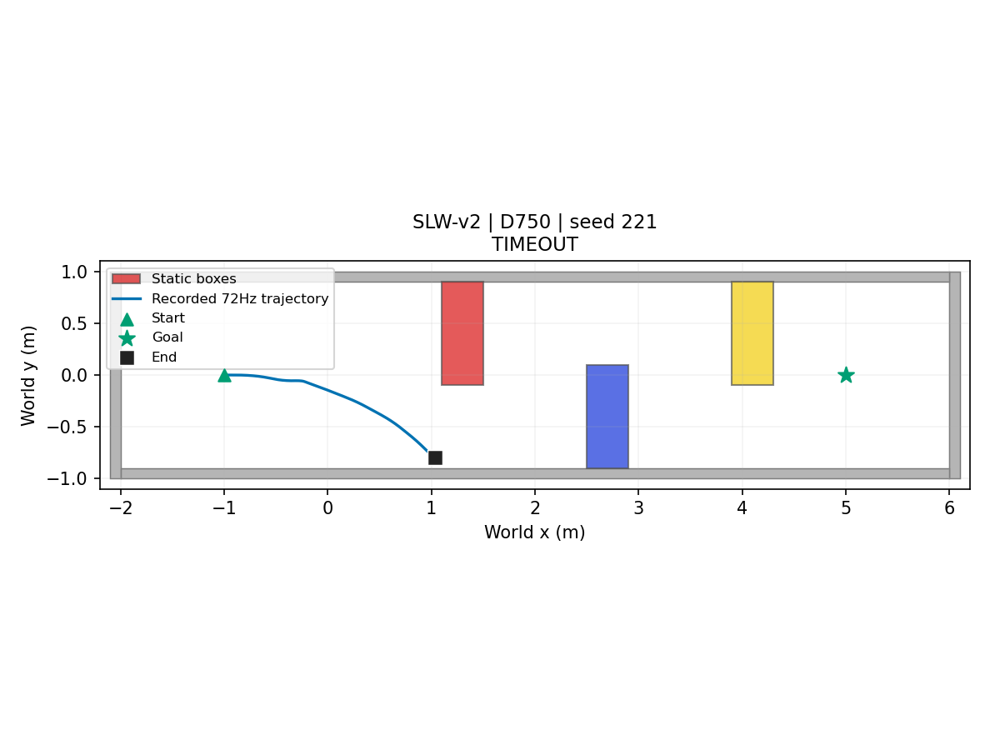

# SLW-v2 — J0 선별

| status | completed | planned | eligible | protocol_sha256 |
| --- | --- | --- | --- | --- |
| COMPLETE | 4 | 4 | False | 7b9b69d1991df02fb663e657fe5cd63adda67205f60631a6accd5c60589a4c5c |

시작 x=-1.0m, 통로 시작벽 xmin=-2.0m, 상자색 빨강·파랑·노랑 외 장면 기하·목표·checkpoint는 SLW와 동일하다. 새 reference와2초 간격 Topomap은 동결 SLW 절차로 준비한 뒤에만 선별 주행한다.

| status | stage | protocol_sha256 | node_count |
| --- | --- | --- | --- |
| COMPLETE | DONE | 7b9b69d1991df02fb663e657fe5cd63adda67205f60631a6accd5c60589a4c5c | 19 |

| axis | direction | box_id | dynamic | threshold_m | formula |
| --- | --- | --- | --- | --- | --- |
| 0 | 1 | Slalom3 | False | 4.6 | last box +x far face +0.30; identical to SLW |

| scene | delay_s | planned | completed | technical_failures | success | collision | wall_intrusion | timeout | checkpoint_n | checkpoint_mean_s | checkpoint_median_s | checkpoint_p95_s |
| --- | --- | --- | --- | --- | --- | --- | --- | --- | --- | --- | --- | --- |
| SLW-v2 | 0 | 2 | 2 | 0 | 1 | 1 | 0 | 0 | 1 | 29.069 | 29.069 | 29.069 |
| SLW-v2 | 0.75 | 2 | 2 | 0 | 0 | 0 | 1 | 1 | 0 | — | — | — |

| scene | zero_success | required_success | complete | all_checkpoints_observed | zero_checkpoint_mean_s | delayed_checkpoint_mean_s | difference_s | passed | reason |
| --- | --- | --- | --- | --- | --- | --- | --- | --- | --- |
| SLW-v2 | 1 | 2 | True | False | — | — | — | False | INCOMPLETE_OR_MISSING_CHECKPOINT |

| index | delay | classification | technical_validation | success | collision | wall_intrusion | timeout | checkpoint_time_s | goal_time_s | error |
| --- | --- | --- | --- | --- | --- | --- | --- | --- | --- | --- |
| 221 | 0 | SAFETY_FAILURE | PASS | False | True | False | False | — | — | — |
| 222 | 0 | SUCCESS | PASS | True | False | False | False | 29.069 | 29.556 | — |
| 221 | 0.75 | TIMEOUT | PASS | False | False | False | True | — | — | — |
| 222 | 0.75 | SAFETY_FAILURE | PASS | False | False | True | False | — | — | — |

종료 판정은 Phase18과 동일(0.3m). J0 OURS-noEC 실행기·선별식 동결: 0s 성공2/2 AND 0.75s checkpoint 평균>0s 평균(각 조건 두 관측 필수, 결측 대체 없음). 0s 두 회 먼저 실행. 기존 SLW 코드·결과는 보존한다.

