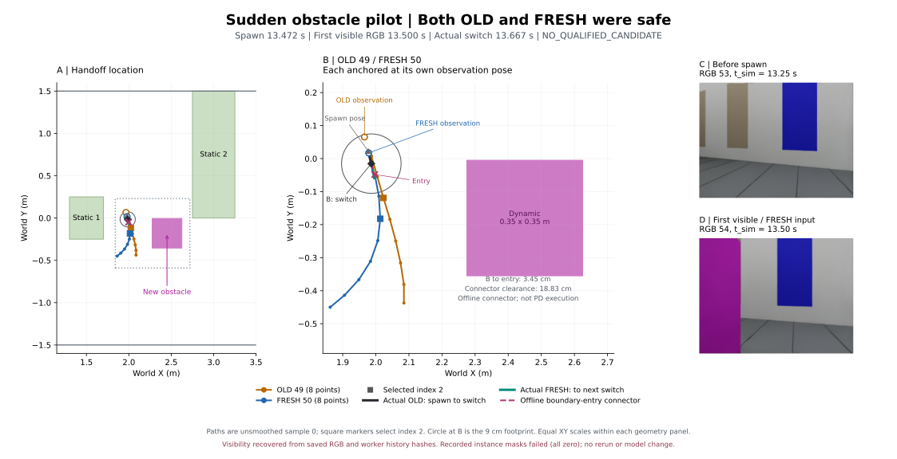

# Sudden obstacle pilot — 실제 결과

**`OLD_SAFE_FRESH_SAFE` / `ALREADY_CONSISTENT` / `NO_QUALIFIED_CANDIDATE`.** 실제 navigation 1회에서 새 장애물이 나타났고, 이를 포함한 RGB로 생성된 FRESH 50이 적용됐다. 그러나 출현 직전 OLD 49도 이미 안전했다. 목표에는 도달했으며 이번 pilot은 “위험한 OLD → 안전한 FRESH → 어려운 연결”이라는 가설을 재현하지 못했다. Instance mask 계측은 실패했으며 RGB 입력 근거를 별도 offline 검증으로 복구했다.

## 변경과 고정 조건

기준 `8e157a73f229b2136ffb9a846baae545cd2df05c`, branch `research/isaac6-sudden-obstacle`. [Protocol](SUDDEN_OBSTACLE_PROTOCOL.md)과 [scenario](../research/nomad_isaac/sudden_obstacle_scenario.json)는 **실행 전 commit `b2155f0`**, 실제 실행은 clean commit **`4dbea71978954cbad06ec2de6b710c2b9a66b60b`**다. 2026-10-17 23:59 KST에 시작해 10-18에 종료했다. 결과 폴더 날짜는 준비 시작일이다.

새 장애물 중심 `(2.45,-0.18)` m, 크기 `(.35,.35,.8)` m, magenta, **tick 970 / 13.472222222 sim s**에 즉시 활성화했다. USD time-sampled visibility와 같은 integer tick의 geometric collision gate를 추가했다. 이전 tick까지 collision 검사는 비활성, spawn tick은 현재 footprint만 검사하고 다음 tick부터 swept interval을 검사한다. RGB는 4 Hz snapshot으로 렌더링하므로 같은 logical simulation timestamp의 상태 일치이며 wall-clock 동시 render를 주장하지 않는다.

기존 두 장애물, .09 m radius, .02 m obstacle margin, .30 m goal tolerance, 4/9/72 Hz, 1초 timeout, sample 0/index 2, 10-step diffusion, seed schedule, 원본 PD를 유지했다. 추가 전달 latency **0 ms**. Fixed-goal adapter를 사용하며 Topomap/Graph/smoothing은 없다. 원본 `train/`, `deployment/` 및 보호 source 9개는 기준 commit과 동일하다. 설치·checkpoint·가상환경을 변경하지 않았다.

## 출현과 실제 FRESH 입력

| 사건 | Simulation time (s) | Host monotonic elapsed (s) |
|---|---:|---:|
| 장애물 활성화 | 13.472222222 | 13.472369432 |
| 최초 visible RGB 54 / FRESH 50 observation | 13.500000000 | capture start 13.500863700 |
| 같은 RGB capture 완료 | snapshot은 위 시각 | 13.553599976 |
| FRESH GPU ready | 13.585353223 (기록 사이 보간값) | 13.585488603 |
| 실제 FRESH switch | 13.666666667 | 13.667212550 |

서로 다른 clock을 직접 빼지 않았다. FRESH 50의 GPU inference는 **29.589732 ms**, observation→ready **84.624903 ms**, observation→switch **166.348850 ms**다. Capture/IPC/controller 대기는 GPU 시간과 구분한다.

Spawn pose는 `(1.977326927, .022482045, -1.334215243 rad)`, 새 장애물 footprint clearance는 **.208938993 m**였다. 출현 직전 적용 OLD는 **49**, 유효 command `(v,w)=(.2,-.004167814)`였다. 첫 visible FRESH까지 다른 prediction switch는 없었다.

FRESH 50의 실제 history는 **RGB [51,52,53,54]**, simulation time `[12.75,12.986111111,13.25,13.50]` s다. 마지막 RGB 54만 장애물을 포함한다. 저장 RGB bytes를 합친 hash가 실제 GPU worker history hash와 일치하며 전체 131 request에서도 동일 검증을 통과했다. 원본 preprocessing만 CPU로 재검사한 `(1,12,96,96)` tensor의 네 frame에서 magenta pixel 수는 `[0,0,0,2491]`이다. 새 inference를 호출한 검증이 아니다.

**계측 제한:** 기록된 instance ID는 모두 빈 목록이고 135개 instance mask가 모두 0이었다. 원래 instance-mask gate는 **FAILED**이며 label mapping을 저장하지 않아 원인을 확정할 수 없다. 원본 RGB 53에는 물체가 없고 54에는 왼쪽 가장자리에 magenta 물체가 보인다. 사전 magenta 식과 20-pixel 기준을 전체 RGB에 적용한 offline 복구에서 출현 전 54개 frame은 모두 0, 최초 출현 frame은 **20,602 pixels**다. 시각 확인 및 worker input hash로 FRESH를 확인했으며 raw mask/metadata를 수정하거나 gate를 PASS로 바꾸지 않았다. [Protocol addendum](SUDDEN_OBSTACLE_PROTOCOL.md#실행-후-계측-제한-및-offline-복구)에 이 계측 방법 변경을 명시했다.

## OLD/FRESH 및 실제 실행

모든 값은 원본 sample 0의 metric trajectory를 각자의 observation pose로 world 변환한 결과다. Switch에 re-anchor하지 않았다. Full은 8개 점을 잇는 polyline, prefix는 0→1→2다. Observation origin→prefix도 별도 검증했으며 안전했다. 예측 polyline, offline connector, 실제 PD 실행은 서로 다른 대상이다.

| 항목 | OLD 49 | FRESH 50 |
|---|---:|---:|
| 새 장애물 full clearance (m) | .101933001 | .171541004 |
| 새 장애물 index 2 prefix clearance (m) | .161912916 | .171541004 |
| 모든 장애물 full clearance (m) | .101933001 | .167397651 |
| 모든 장애물 prefix clearance (m) | .161912916 | .171541004 |
| Full / prefix obstacle margin 및 corridor containment | 안전 / 안전 | 안전 / 안전 |
| 원본 PD `(v,w)` (m/s, rad/s) | `(.2,-.004167814)` | `(.2,-.253528645)` |

실제 switch **B = `(1.986426397,-.015327282,-1.335025651 rad)`**. 출현부터 switch까지 OLD 49가 **.038888889 m**, yaw **−.046433°**를 실행했다. 이 구간 dynamic/static minimum swept clearance는 **.198573583 / .187326907 m**이며 timeout·overlap·corridor 침범이 없었다. 이후 FRESH 50은 다음 switch(13.888888889 s)까지 **.044444444 m**, yaw **−3.228027°**를 실행했고 dynamic/static clearance **.189413022 / .196425174 m**로 안전했다.

기존 spatial correspondence의 공통 forward overlap은 **.359130302 m**. 진행 거리 기반 position RMSE **.073165248 m**, longitudinal/lateral RMS **.010042313 / .072472791 m**, 유효 tangent heading RMS **28.158651°**다. 이는 동일 index 대응이나 native yaw/timestamp가 아니다.

기존 자동 entry는 `(1.996744709,-.048271270)` m. **B→entry 거리 .034522079 m**, B yaw와 tangent 차이 **2.674131°**, 단순 connector clearance **.188255291 m**, corridor clearance **1.361728730 m**다. 검사한 entry 16/16에서 안전 연결 가능하며 **ALREADY_CONSISTENT**로 분류된다. 이 connector는 실제 실행하지 않은 offline diagnostic이다. 원본 PD가 사용하는 local selected point를 B에서 표현한 위치와 observation-anchored point의 차이 **.033324729 m**도 별도 보존했다.



## Navigation 및 검증

**33.680555556 sim s에 goal entry**, 최소 goal 거리 **.298252070 m**. Geometric overlap/corridor 침범 없음. 전체 실제 swept clearance 하한은 정적 1 **.073508257 m**, 정적 2 **.566122074 m**, 동적 장애물 **.180577735 m**다. 동적 장애물 오른쪽(negative Y)으로 통과했다. 최소 corridor clearance **.013217019 m > 0**으로 footprint containment를 만족했다. 벽에 대해 .02 m margin을 만족했다고 주장하지 않는다. Kinematic geometric 판정이며 PhysX collision 결과가 아니다.

실제 GPU request/receive/switch **131/131/131**, busy skip **1**, missed capture **0**, timeout **0**. Timeout 자연 발생은 `NOT_EXERCISED`, synthetic timeout은 통과했다. Warm GPU median/p95 **29.689112/31.502001 ms**, real-time factor **.999996807**, pacing error p95/max **.152915/1.384874 ms**. 기존 async runtime의 원본 PD, raw normalization, anchor, pose integration, next-controller-tick 및 clock 검증은 PASS다. Visibility mask 실패와 이 runtime 판정을 구분한다.

실행 전 최소 spawn/activation 및 기존 async/geometry tests **30 passed**. Spawn 전 970 pose rows에서 동적 collision 검사 없음, 이후 **1,456**회 검사를 기존 swept 함수로 재계산했다. 기존 **698개** 입력 및 새 run **565개** 분석 입력 hash를 보존했다. 실제 navigation **1회**, 재시도 0회, scenario/seed 재조정 0회. 최초 mask audit와 JSON export 실패한 offline 시도도 삭제하지 않았다.

## 해석과 남은 uncertainty

이 단일 pair의 판정은 **`NO_QUALIFIED_CANDIDATE`**다. RGB에 장애물이 나타나고 안전한 FRESH가 생성·적용된 사실은 확인했지만, OLD부터 안전했으므로 위험한 OLD의 수정이나 Graph가 해결할 연결 문제를 입증하지 못했다.

위치 선정에 사용한 과거 baseline에서는 OLD full이 새 장애물과 겹쳤다. 실제 출현 pose는 그 baseline에서 **9.47 cm / −32.63°** 달라졌으며 장애물 중심은 실제 local 전방 .3076 m/왼쪽 .4120 m, bearing **53.26°**였다. 중심은 90° camera의 중심 시야 밖이고 물체의 일부가 왼쪽 RGB에 보였다. 따라서 정면 진로를 막는 의도는 실제 run에서 충분히 재현되지 않았다. 결과를 보고 위치·tick을 수정하지 않았다.

OLD/FRESH noise/DDPM seeds는 **199/200 → 201/202**로 다르다. Observation/pose/history와 diffusion sampling이 함께 달라져 revision을 장애물 반응만의 인과 효과로 볼 수 없다. 보이는 RGB를 포함한 후속 prediction 50–56의 full/prefix도 안전했지만 후보를 유리하게 재선정하지 않았다. Instance ID 계측 복구, 정면 OLD 위험과 안전한 FRESH가 동시에 생기는 재현 조건은 향후 과제이며 이번에는 추가 실행이나 Graph 구현을 하지 않았다.

## 보존 위치 및 offline 재현

- Raw run: `/home/gpuadmin/Workspace/NoMaD/artifacts/isaac6/sudden_obstacle_01/`
- 최초 mask audit: `../artifacts/isaac6/sudden_obstacle_audit_01/`; 첫 RGB 복구의 float32 JSON export 실패 기록: `sudden_obstacle_audit_rgb_01/`; 최종 audit: `sudden_obstacle_audit_rgb_02/`.
- 작은 [summary](../research/results/isaac6_sudden_obstacle_20261017/summary.json), [prediction CSV](../research/results/isaac6_sudden_obstacle_20261017/predictions.csv), [독립 검증](../research/results/isaac6_sudden_obstacle_20261017/independent_review.json), [runtime validation](../research/results/isaac6_sudden_obstacle_20261017/runtime_validation.json), [input hashes](../research/results/isaac6_sudden_obstacle_20261017/input_hashes.json).
- 같은 비교 그림의 PNG/SVG: `../artifacts/isaac6/sudden_obstacle_plot_01/`. SVG와 작은 결과만 Git에 포함한다.

기존 run을 읽는 분석만 다시 수행하려면 **존재하지 않는 새 output 디렉터리**를 지정한다. 아래 명령은 navigation/inference를 시작하지 않는다.

```bash
PYTHONPATH=research python3 -m nomad_isaac.sudden_obstacle_report --run ../artifacts/isaac6/sudden_obstacle_01 --output ../artifacts/isaac6/sudden_obstacle_audit_review --rgb-visibility-recovery
PYTHONPATH=research python3 -m nomad_isaac.plot_sudden_obstacle --audit ../artifacts/isaac6/sudden_obstacle_audit_review --output ../artifacts/isaac6/sudden_obstacle_plot_review
```

## 후속 요청: 출발부터 목표 도달까지 전체 주행

2026-10-18. 사용자 요청으로 기존 Isaac renderer에서 **실제 저장 pose의 전체 구간 t=0…33.680555556 s**를 재생하는 MP4와 native GUI animation을 만들었다. 새 navigation/inference는 0회이며, 실험 당시 실시간 촬영본이 아닌 기록 기반 재렌더링이다.

- MP4: `/home/gpuadmin/Workspace/NoMaD/artifacts/isaac6/sudden_obstacle_video_01/nomad_sudden_obstacle.mp4`
- GUI: 같은 디렉터리의 `recorded_motion_gui.usda`. 기존 Isaac GUI에서 열고 자동 반복 재생을 확인했으며 창을 열어 두었다.
- H.264, 1280×720, 24 fps, **810 frames / 33.75 s**, 26,754,946 bytes. 72 Hz 기록에서 매 3번째 pose와 마지막 실제 goal-entry pose를 사용한다. 마지막 pose의 video slot offset은 +.027777778 s이고 한 frame 표시 시간을 포함한다. 경로 보간·smoothing은 없다.
- DynamicObstacle은 원본 USD visibility time samples를 유지한다. GUI는 정확한 tick 970을 보존하며 MP4에서 마지막 hidden frame은 t=13.458333333 s, 최초 visible frame은 t=13.5 s다. 출현 전 모든 overhead RGB에서 magenta pixels 0, 이후 모든 frame에서 검출됨을 확인했다. 이는 **새 overhead 재렌더링 검증**이며 원래 inference instance-mask 계측 실패를 수정하거나 대체하지 않는다.
- 파란 9 cm footprint·흰 방향 화살표·주황 goal ring·하늘색 기록 경로는 보기용이다. MP4는 진행한 경로만, GUI는 전체 경로를 고정 표시한다. 끝에서 시작으로 돌아가는 것은 저장 기록의 반복 재생이다.

전체 MP4 decode와 frame→source row mapping을 검증했다. GUI의 **2,426개 pose** 최대 오차 6.66e−16, 원래 **104 prim / 682 attributes / 76 relationships 및 visibility time samples** 보존. 실제 GUI `playing=true`와 t=2.013888889 s의 원본 pose 일치, startup Error 0개를 확인했다. Renderer 준비 중 첫 RGB 이전 step 오류 5개는 로그에 보존했으며 렌더링은 exit 0으로 완료했다. 시작·출현 전후·최종 목표 진입 화면을 확인했고 기존 698개 및 새 run 565개 input hash가 유지됐다. [영상/GUI 검증 JSON](../research/results/isaac6_sudden_obstacle_20261017/video.json).

다시 GUI 전체 재생을 열려면:

```bash
bash /home/gpuadmin/Workspace/NoMaD/visualnav-transformer/research/nomad_isaac/open_scene.sh /home/gpuadmin/Workspace/NoMaD/artifacts/isaac6/sudden_obstacle_video_01/recorded_motion_gui.usda --play
```
