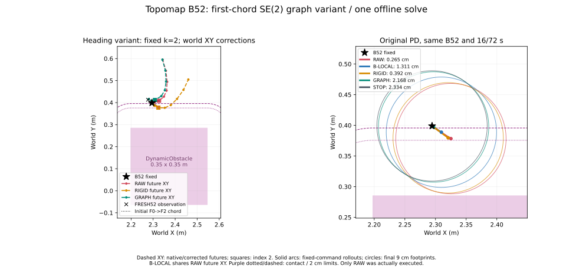

# Topomap B52: 첫 chord heading variant의 단일 Graph solve

2026-10-19. 기준 `5d7f55e2634a365f63de8ee9b75ca909f672b400`, branch `research/isaac6-topomap-b52-chord-heading`. **첫 heading 초기화를 해결해 Graph 1회가 수렴했고, 동일 16/72초 offline PD rollout에서 2.167738cm 여유를 유지하며 2.981454mm 전진했다.** 핵심 실행 효과는 각속도 변경 없이 전진 속도를 약 92% 낮춘 것이다. 단순 감속보다 나은 고유 이점이나 closed-loop 성공은 입증하지 않았다.

## 사전 고정한 variant

기존 `minimal_se2_graph.py`와 protocol은 수정하지 않았다. 새 subclass는 원래 residual group을 재사용하고 **node 0 tangent-consistency residual 하나만** 고정 chord 방향으로 교체한다. 최초 heading이 달라지므로 이를 포함한 FRESH prior/relative-pose 측정값도 새 초기 pose에서 유도되며, factor 수식·scale은 같다. 기존과 완전히 동일한 heading initialization이라는 주장은 하지 않는다.

FRESH52 sample 0의 world XY는 원래 observation pose(13.986111111s)에서 변환했다. 첫 segment 길이는 **17.282994mm**. F0부터 인접 chord 길이를 누적해 최초 20mm 이상이 되는 **k=2**를 선택했다. 누적 길이 **37.820742mm**, 직접 F0→F2 chord **36.763055mm**, 초기 보조 heading **.092822268rad**다. `k=2`는 solve 이전 protocol/입력 snapshot에 고정했으며 반복 중 재선택하지 않았다. 최적화 중에도 X0→X2를 사용했다.

나머지 node는 기존 outgoing/마지막 incoming tangent를 사용한다. **7개 인접 segment의 최소 길이 penalty는 그대로**여서 첫 short segment도 면제되지 않는다. 사전 수치 검증에서 같은 pose에 대해 첫 tangent residual을 제외한 모든 residual 항목이 원래 구현과 정확히 같았다. 인접 segment penalty도 동일했다. 초기 입력의 모든 variant heading은 유효했다.

고정 B52는 tick1016/14.111111111s, pose `(2.294383156108, .399014947316, −.636309014985)`. 종료 tick1032까지 16/72초. Node8개/24변수, fixed B52, prior/relative/boundary/tangent/native-safety/controller-aware-safety, soft target .025m/pass .02m, original PD·SE2·swept/corridor, SciPy TRF/3-point Jacobian/ftol·xtol·gtol 1e−8/max_nfev200/x_scale/zero increments를 유지했다. 사전 commit **`66aebd0`**, solve **1회**, restart/tuning **0회**.

## 수렴과 동일 B52 비교

SciPy `success=True`, **ftol 종료(status2)**, nfev/njev **14/14**, Jacobian 포함 residual 평가 **686회**. 이 반복 평가 수는 solver 재실행 횟수가 아니다. CPU wall **1.782214s**, process CPU **1.772315s**. Objective **27.171028→11.439448**, 최종 residual L2 **4.783189**, 최대 절댓값 **2.297554**, optimality **.026641**. ftol에 따른 수렴이며 gtol 충족/전역 최적성/실시간 적용을 입증하지 않는다.

표의 실행은 모두 동일 B52에서 원본 PD 명령을 고정한 **offline rollout**이다. RAW만 저장된 실제 실행과 대조했고, 다른 방법은 실제 Isaac Sim에서 실행하지 않았다.

| 방법 | PD `(v,w)` m/s,rad/s | Native full / prefix cm | PD swept 최소 cm | 2cm | 전진 mm |
|---|---|---:|---:|---|---:|
| RAW | (.166896, +.4) | 2.648461 / 2.648461 | **.265380** | 미달 | 37.087997 |
| B-LOCAL | (.082564, +.4) | 2.648461 / 2.648461 | **1.310668** | 미달 | 18.347497 |
| RIGID | (.147052, ≈0) | .083843 / .149460 | **.392191** | 미달 | 32.678271 |
| GRAPH | **(.013417, +.4)** | **3.248037 / 3.248037** | **2.167738** | **충족** | **2.981454** |
| STOP | (0,0) | trajectory 없음 | **2.334034** | 충족 | 0 |

모든 rollout은 geometric overlap이 없고 corridor containment를 만족했다. RAW/B-LOCAL/RIGID는 충돌은 없지만 요구 margin에 미달한다. RIGID는 F0 pose를 B52에 맞추는 기존 규칙이며, 이번 첫 chord가 F0→선택 index2이므로 local dy≈0, `w=7.55e−15rad/s`로 사실상 직진이 됐다. Native 안전성과 PD 안전성을 별도로 계산했다. STOP에는 임의의 waypoint나 native trajectory를 만들지 않았다.

GRAPH의 최종 pose는 `(2.296856655893, .397352113610, −.547420126096)`. 최소 margin의 pass threshold 대비 여유는 약 **1.677mm**다. 모든 방법의 종료 pose·rollout 17poses는 JSON/CSV에 저장했다.

## 실제 명령이 달라진 경로와 tradeoff

| 입력 | local `(dx,dy)` m | clipping 전 `(v,w)` | clipping 후 |
|---|---|---|---|
| RAW | (.041723996, .028506184) | (.166895986, +2.397469203) | (.166895986, +.4) |
| B-LOCAL | (.020640934, .026946736) | (.082563738, +3.668559257) | (.082563738, +.4) |
| GRAPH | **(.003354136, .018621287)** | **(.013416543, +5.570334154)** | **(.013416543, +.4)** |

RAW는 원래 observation-local 입력을 유지했다. B-LOCAL은 원본 world index2의 좌표 표현만 바꿨다. GRAPH는 world index2를 `(2.326997129,.408422579)`에서 **`(2.308146213,.411998816)`**로 수정한 뒤 B52 local로 표현했다. 전진 속도는 RAW 대비 **91.961135%**, B-LOCAL 대비 **83.750078%** 감소했다. 모두 v 미포화, w는 +.4로 clipping되어 **RAW/B-LOCAL/GRAPH의 각속도는 같다**. 실행 개선은 수정된 selected waypoint가 매우 작은 전진 속도를 만든 결과다.

| 기하 지표 | RAW / B-LOCAL | RIGID | GRAPH |
|---|---:|---:|---:|
| B→첫 XY 거리 mm | 7.206098 | 0 | **22.688172** |
| B yaw→첫 tangent 차이 ° | 41.776145 | ≈0 | **27.899066** |
| Trajectory position 수정 RMS / max mm | 0 / 0 | 80.637720 / 146.877627 | **11.822696 / 19.187144** |
| 유효 tangent 변화 RMS ° | 0 | 41.776145 | 7.158120 |
| Relative translation 오차 RMS mm | 0 | ≈0 | 2.861532 |
| Relative heading 오차 RMS ° | 0 | ≈0 | 4.083227 |

GRAPH는 boundary 방향 mismatch를 줄였지만 **위치 mismatch는 증가**했다. 모든 consistency 지표가 함께 좋아졌다고 보고하지 않는다. Optimized pose yaw와 B yaw 차이는 22.975544°이며 tangent 기준 27.899066°와도 구분한다.

또한 최종 인접 segment 0/1 길이는 **15.085430/16.231638mm**로 20mm 미달이다. 고정 X0→X2 chord는 **28.798060mm**로 node0 tangent가 유효하지만, **node1 outgoing tangent는 길이 기준상 invalid**로 기록했다. 이는 기존 soft minimum-segment penalty를 유지한 결과이며 hard constraint 충족을 의미하지 않는다. Heading 변화 RMS는 유효 tangent만 대상으로 했다. Native yaw나 intrinsic timestamp를 생성한 것은 아니다.

최종 factor cost: prior **2.562680**, relative **.870139**, boundary **5.247911**, tangent **.267366**, minimum segment **.767071**, native obstacle **.344307**, controller obstacle **1.379974**, 두 corridor factor **0**. 합 **11.439448**. B52 초기 clearance는 **23.340344mm**로 pass20mm보다 크지만 soft25mm보다 작아, B를 고정한 전체 경로의 obstacle residual을 모두 0으로 만들 수는 없다. Cost와 실제 pass 판정은 구분했다. RAW에 표시한 공통 graph cost는 B-local 해석을 사용하는 목적함수 값이며, 실제 RAW 안전성은 원래 local waypoint rollout에서 따로 계산했다.

## 검증·해석·보존

RAW 실제 **17poses/16interval** 대조에서 pose 오차 **0**, swept/corridor 최대 오차 **1.1102230246251565e−16m**. 두 실제 9Hz controller tick 명령도 일치했다. RAW/B-LOCAL/STOP 결과는 이전 B52 audit와 pose 및 clearance가 **정확히 같다**. Source/protocol·원본 NoMaD/PD/geometry는 그대로다. 기존 raw **257개 hash**, 이전 B52 결과 **8개 파일** 보존.

Solver에는 FRESH52 sample0, observation pose, B52, 당시 geometry와 기존 controller·고정 설정만 전달했다. FRESH53나 이후 collision 결과는 입력/설정에 사용하지 않았다. 실제 RAW trace와 이전 결과는 solver snapshot을 저장한 뒤 validation/reference용으로만 읽었다. 신규 navigation/GPU inference/추가 solver/parameter sweep은 없다.

**단일 B52에서 controller-aware waypoint 수정이 원본 PD 명령과 안전성을 바꿀 수 있다는 mechanism은 확인했다.** B-LOCAL·RIGID만으로는 같은 2cm 결과를 얻지 못했다. 그러나 움직임은 0.222초 동안 약 3mm에 그치며, 각속도 변화 없이 감속으로 얻은 안전성이다. 단순 감속 대비 우월성, OLD/FRESH reconciliation 필요성, 전반적인 shape/boundary 개선, closed-loop 성공 또는 실시간 가능성을 입증한 결과는 아니다. STOP도 안전했으며 trivial reference로만 취급한다.

새 artifact: `../artifacts/isaac6/topomap_b52_chord_graph_01/`. 이전 초기화 거부 결과와 raw는 그대로다.

[Summary](../research/results/isaac6_topomap_b52_chord_20261019/summary.json) · [비교 CSV](../research/results/isaac6_topomap_b52_chord_20261019/comparison.csv) · [Solver 원본 결과](../research/results/isaac6_topomap_b52_chord_20261019/solver.json) · [사전 입력 snapshot](../research/results/isaac6_topomap_b52_chord_20261019/solve_inputs.json) · [검증 요약](../research/results/isaac6_topomap_b52_chord_20261019/review.json)



아래는 이미 수행한 유일한 solve 명령의 기록이며, 이번 작업에서 재실행하지 않는다.

```bash
PYTHONPATH=research MPLCONFIGDIR=/tmp/nomad-topomap-mpl /usr/bin/python3 -m nomad_isaac.topomap_b52_chord_graph --run ../artifacts/isaac6/topomap_sudden_01 --out ../artifacts/isaac6/topomap_b52_chord_graph_01
```
