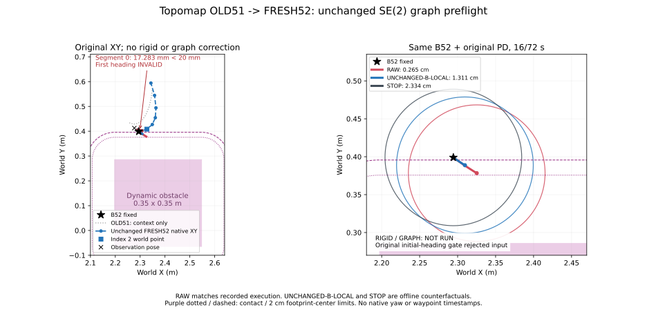

# Topomap B52: 기존 SE(2) Graph 초기화 조건 재검증

2026-10-19. 기준 `830728850b5f4fc6725c3c33894bf26e1d26df1d`, branch `research/isaac6-topomap-b52-graph`. 결론은 **`NOT_RUN_INVALID_INITIAL_HEADING`**이다. RAW 재현은 통과했지만, FRESH52의 첫 segment가 기존 heading 유효 기준보다 짧아 **RIGID/GRAPH는 실행하지 않았다. Solver 호출 0회**이며 수렴 실패 또는 안전성 실패로 집계하지 않는다.

## 기존 구현을 그대로 적용할 수 없었던 이유

기존 Graph branch의 commit `14621b685885b8a58514a00e67c785a8b6932023`에서 `minimal_se2_graph.py`와 `minimal_se2_graph_protocol.json` 두 파일만 byte-identical로 가져왔다. 다른 branch 변경은 가져오지 않았다. Original `read_inputs()`는 7개 initial segment가 **모두 .02m 이상**이어야 한다고 검사하며, node 0–6에는 outgoing tangent, node 7에는 마지막 incoming tangent를 사용한다.

FRESH52 sample 0을 자신의 observation pose로 world 변환한 segment 길이는 다음과 같다.

| Segment | 길이 mm | 기존 heading 기준 |
|---|---:|---|
| 0→1 | **17.282994** | **INVALID (<20)** |
| 1→2 | 20.537748 | 유효 |
| 2→3 | 28.903570 | 유효 |
| 3→4 | 29.901051 | 유효 |
| 4→5 | 39.846933 | 유효 |
| 5→6 | 50.546106 | 유효 |
| 6→7 | 51.828305 | 유효 |

따라서 첫 future node의 유효 heading이 없다. 뒤쪽 tangent로 대체하거나 segment를 합치거나 기준을 낮추면 기존 초기화와 달라지므로 수행하지 않았다. Native XY 자체는 유효하며 원본 full/prefix clearance **.026484613m**는 안전하다. **Heading 판정용 segment 길이 2cm와 obstacle safety margin 2cm는 서로 다른 기준**이다. 이전 handoff audit에서 다른 유효 segment의 entry를 찾았다는 사실도 이 Graph의 모든 node 초기화 조건을 충족하지는 않는다.

RIGID도 원본 첫 pose의 XY·heading을 B52로 맞추는 유일한 SE(2) 변환이므로 같은 이유로 미실행이다. 원본 prior/relative/boundary/tangent/native-safety/controller-safety factor, scale, soft target **.025m**, pass threshold **.02m**, solver 설정은 보존했다. 유효하지 않은 8-pose SE(2) chain을 구성하거나 factor cost를 계산하지 않았다. 수렴/residual/factor cost/optimizer CPU time은 **null / NOT RUN**이다.

## 동일 B52의 실행 가능한 대조군

고정 B52: tick **1016 / 14.111111111s**, pose `(2.294383156108, .399014947316, −.636309014985)`. Initial dynamic clearance **.023340344454m**. Horizon은 사전 고정한 **16/72s**, 종료 tick1032이다.

기존 Graph `Experiment.rollout()` 메서드를 그대로 사용했다. Rollout에 필요한 B52/config/obstacle/dt/radius만 전달했으며 future pose heading은 만들지 않았다. `original_controller`, `integrate_se2`, `swept_clearance`, corridor 함수도 그대로다.

| 방법 | Controller local `(dx,dy)` m | `(v,w)` m/s,rad/s | 최소 swept clearance | 2cm / overlap | 전진 거리 |
|---|---|---|---:|---|---:|
| RAW | (.041723996, .028506184) | (.166895986, +.4) | **.002653804m** | 미달 / 없음 | .037087997m |
| UNCHANGED-B-LOCAL | (.020640934, .026946736) | (.082563738, +.4) | **.013106677m** | 미달 / 없음 | .018347497m |
| RIGID | 미실행 | 미실행 | — | 미평가 | — |
| GRAPH | 미실행 | 미실행 | — | 미평가 | — |
| STOP | waypoint 없음 | (0,0) | **.023340344m** | 충족 / 없음 | 0m |

RAW와 UNCHANGED-B-LOCAL은 **동일한 원본 world trajectory를 유지**한다. Position 수정 RMS는 0, native full/prefix는 둘 다 .026484613m, boundary→첫 XY 거리는 .007206098m다. 첫 tangent가 invalid이므로 boundary heading mismatch 및 전체 relative-SE(2) 오차는 미정으로 둔다. STOP은 trajectory/waypoint 보정이 없는 단순 정지 기준이다. 세 rollout 모두 corridor containment를 만족했다.

RAW의 clipping 전 `(v,w)`는 `(.166895986, +2.397469203)`, B-local은 `(.082563738, +3.668559257)`. 전진 속도는 둘 다 미포화, 각속도는 둘 다 +.4로 clipping됐다. **좌표 표현 변경만으로 v가 50.529824% 감소**하고 clearance가 약 1.0453cm 늘었지만 2cm에는 부족하다. Trajectory 수정/Graph 효과가 아니며, 안전한 최대 속도를 찾는 grid search도 하지 않았다.

종료 pose:

- RAW: `(2.325152421536, .378330016608, −.547420126096)`
- UNCHANGED-B-LOCAL: `(2.309604765852, .388782075701, −.547420126096)`
- STOP: B52 그대로.

## 검증·입력 범위·기존 B51과 비교

사전 raw 명령·B52·native clearance·RAW rollout 값을 고정 기대값과 대조했다. Heading rejection을 terminal 상태로 저장한 뒤 실제 FRESH52의 **17개 pose/16개 interval만 수치 대조**했다. Pose 최대 오차 **0**, static/dynamic swept 및 corridor 최대 오차 **1.1102230246251565e−16m**, 실제 incoming command ID는 모두 52였다. Graph 입력으로 미래 trace를 사용하지 않았으며 **FRESH53 prediction/event와 이후 충돌 결과를 읽어 설정을 정하지 않았다**. Original validation helper가 로그를 읽더라도 비교 대상은 고정 tick1016–1032뿐이다.

기존 Fixed Goal B51은 초기 heading 조건을 통과했고 solver가 수렴했다(nfev5, cost4.418301, residual L2 2.972642, 당시 CPU wall .659856s). 하지만 RAW/RIGID/GRAPH 명령이 모두 `(.2,−.4)`, clearance **.019187881m**로 같았다. 이번 B52는 원본 v가 미포화라 B-local 좌표만으로 실제 명령이 바뀌는 점은 확인했으나, **Graph 초기화 단계에서 중단돼 Graph의 효과를 비교할 수 없다**. 초기 clearance도 B51 **.044174143m**와 B52 **.023340344m**로 다르며, 서로 다른 입력/장면 상태의 단일 구간이다. 기존 B51 결과를 다시 실행하지 않았다.

새 navigation/GPU inference/solver/restart 모두 **0회**. NoMaD·Topomap·PD·geometry·가상환경 변경 없음. Raw **257개 hash** 보존, 기존 Graph source/protocol hash 일치. 추가 test suite 없이 핵심 수치 일치만 검증했다. 사전 protocol과 audit 코드 commit은 `81693d2`다.

이번 결과는 **기존 Graph의 적용 조건 미충족** 및 frame-only 대조군 결과다. Graph가 명령·안전성을 개선하는지, reconciliation인지 controller-aware correction인지에 대한 답은 아직 없다. STOP의 안전성을 reconciliation 성공으로 보지 않으며, 별도 heading 처리 변경이나 새로운 실행은 자동 수행하지 않았다.

Raw: `../artifacts/isaac6/topomap_sudden_01/` (보존). 새 offline 결과: `../artifacts/isaac6/topomap_b52_graph_01/`.

[JSON summary](../research/results/isaac6_topomap_b52_graph_20261019/summary.json) · [5방법 CSV](../research/results/isaac6_topomap_b52_graph_20261019/comparison.csv) · [Heading gate](../research/results/isaac6_topomap_b52_graph_20261019/heading_gate.json) · [검증/보존 기록](../research/results/isaac6_topomap_b52_graph_20261019/review.json)



재현은 새 output 경로에서 offline audit만 실행한다. 이 script는 현재 입력의 heading rejection을 검사하며 solver를 호출하지 않는다.

```bash
PYTHONPATH=research MPLCONFIGDIR=/tmp/nomad-topomap-mpl /usr/bin/python3 -m nomad_isaac.topomap_b52_graph --run ../artifacts/isaac6/topomap_sudden_01 --out /tmp/nomad-topomap-b52-audit-new
```
