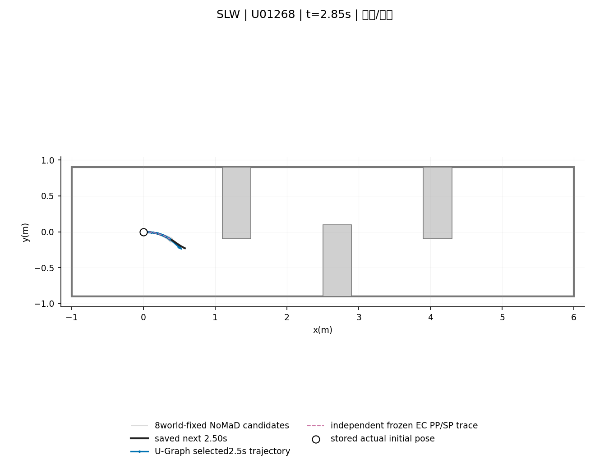
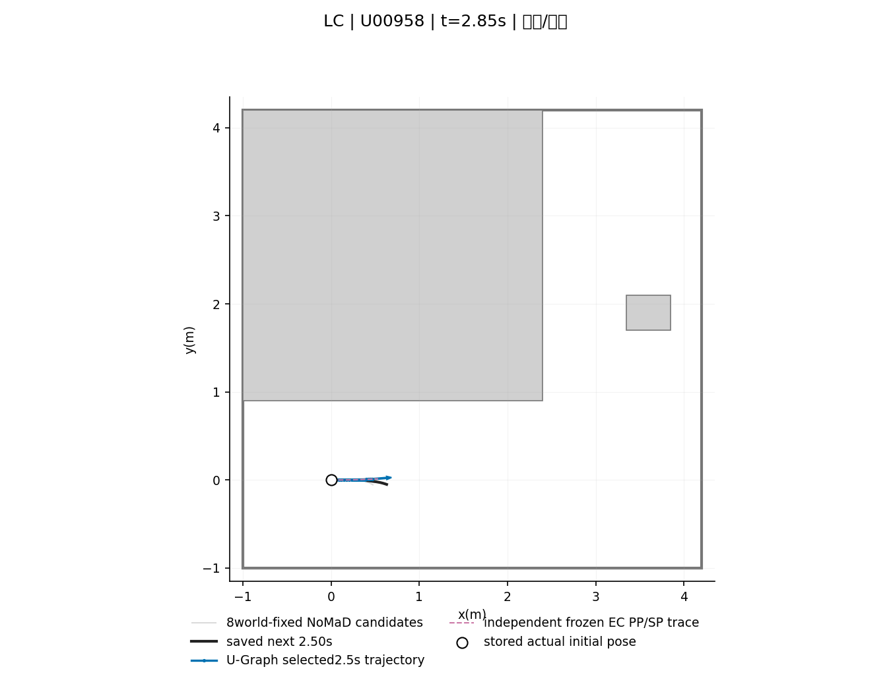
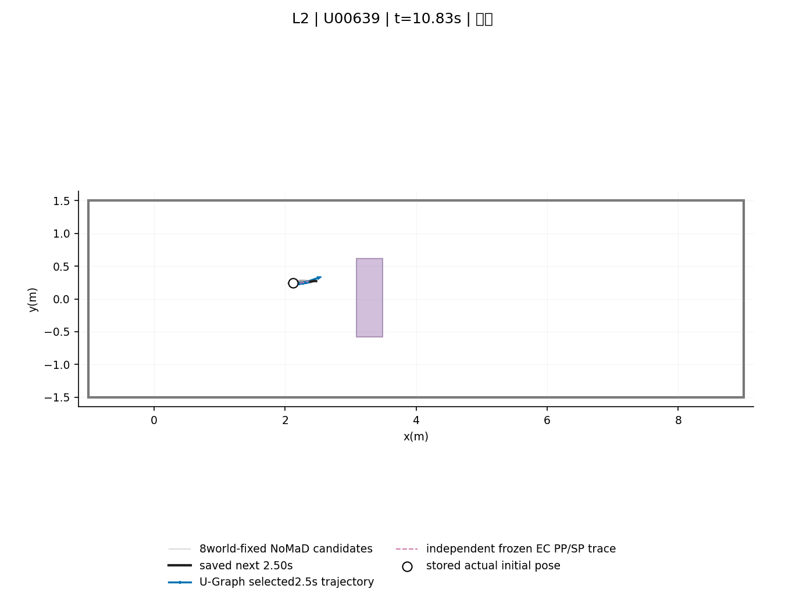
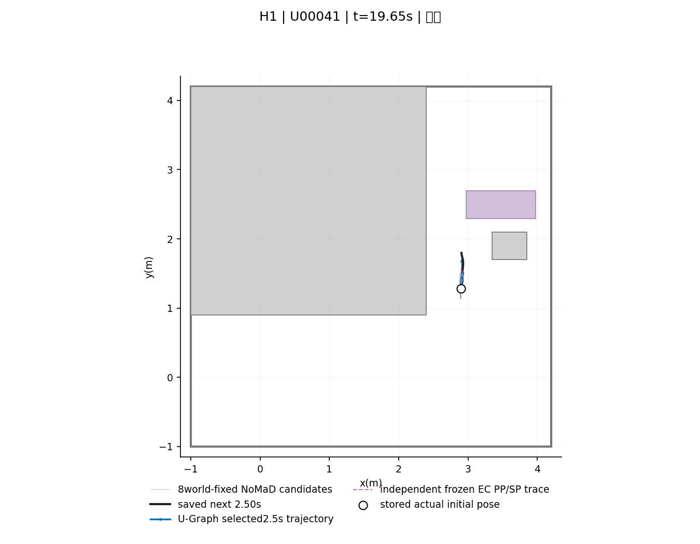
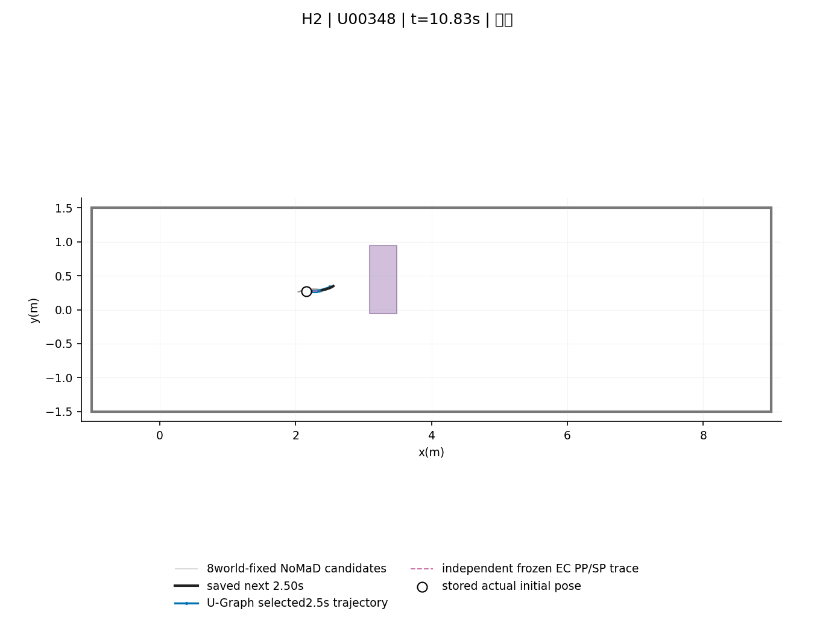
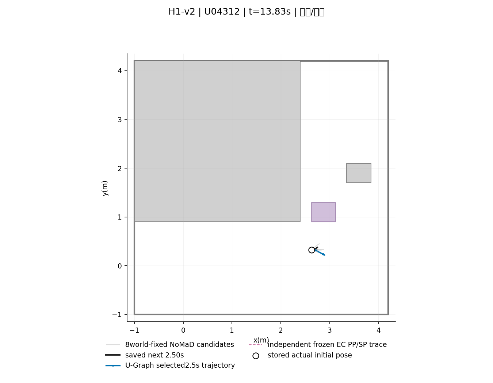

# U-Graph 오프라인 타당성 검증

| status | selected | completed | map_available | protocol_sha256 |
|---|---|---|---|---|
| COMPLETE | 4449 | 4449 | 3096 | a306eaacab407690d7083981b519786d043c7316038f47b3b17bf68a6e5532ed |

실제 개발 입력 풀이 전에는 해 존재율을 보고하지 않는다. 아래 표의 미실행 값은—이다. 기존 동결 코드·원 로그·실험 결과는 수정하지 않는다.

| item | value |
|---|---|
| state/control | x=(x,y,unwrapped theta,v),u=(a,omega),N25,dt.1;actual saved pose/v fixed,first omega fixed to actual saved omega |
| dynamics | Exact constant a/omega unicycle interval;state variables algebraically eliminated,50control unknowns;analytic chained Jacobians. Speed/SDF checked at all26nodes,terminal v25=0;no start relaxation. |
| prior | All8world-fixed candidate suffixes after closest B projection;arc-length26point resampling within actual remaining length;do not discard short/zero-length candidates. Sum all26position errors/sigma.1 squared;minimum component active,lowest index tie. |
| consistency | Immediately preceding sampled state in same run must have an EC-accepted U solution. Linear time alignment on overlapping horizon only,sigma.2;no extrapolation after previous horizon;missing/no solution clears prior. |
| progress | Negative projection -(p25-p0) dot active candidate endpoint direction from B,weight1;no added desired progress length. Zero endpoint direction disables this term. |
| clearance | sum(max(0,.15-d)/.05)^2;d already subtracts radius.09. Hard d>=.025 at26nodes. Field-domain inequalities only keep SDF queries inside recorded grid. |
| smoothness | sum((a[k+1]-a[k])/.5)^2+sum((omega[k+1]-omega[k])/.4)^2;no extra weights/heading/reference factors |
| initialization | 8candidate-derived bounded steering/control seeds + brake-to-stop + brake/rotate-left + brake/rotate-right;actual initial velocity retained;terminal braking seeds;no A* or oracle. |
| EC | Direct frozen Phase52EC braking-tail certify on Graph XY using actual saved pose/v/omega and frozen PP/SP. Graph v/omega are NOT followed by this EC. Exact stationary center and zero velocities use endpoint controller with the same EC;circle footprint invariant,including in-place rotation. No epsilon path. |
| selection | Lowest objective among hard-feasible final iterates that pass independent EC;check sorted final iterates until firstPASS. Convergence status separately reported;hard-feasible nonconverged iterates can be accepted. Tolerance1e-7;no kinematic relaxation. |
| sampling | All four requested development cohorts,144runs,max40uniform ordinal arrivals/run. Select before map check. Latest published snapshot at latch time must physically exist;no older substitute. NIGHT225/226 forbidden. |
| comparison | Actual mode and installed path at same arrival time. Side=end lateral offset relative current robot heading;deadband1cm. Adjacent sampled pairs common to accepted U and recorded path only;not full4Hz reversal rate. |
| types | Travel<=1mm:rotation>1mrad=>in-place rotation,otherwiseSTOP;moving with first a0*v0<-1e-7=>DECEL,otherwiseFORWARD/MOVE;reverse velocity flag always reported because /v/ allows reverse. |
| offline_limit | Saved actual starting states,one fixed2.5s path/snapshot;previous U never physically executed;no new NoMaD/depth/physics. Next2.5s actual trace is visual comparison only. |

## 입력 및 해 존재율 / 시간

| scope | scene | selected | map_available | completed | EC_valid_solutions | solution_rate | job_wall_p50_s | job_wall_p95_s | job_wall_max_s | solve_11starts_p50_s | solve_11starts_p95_s | fixed_start_infeasible | reverse_in_solution | feasible_but_nonconverged |
|---|---|---|---|---|---|---|---|---|---|---|---|---|---|---|
| ALL_SELECTED | SLW | 943 | 662 | 662 | 653 | 0.9864 | 0.36701 | 0.41884 | 0.76468 | 0.28988 | 0.3392 | 6 | 381 | 1 |
| ALL_SELECTED | LC | 758 | 461 | 461 | 461 | 1 | 0.36408 | 0.381 | 0.42189 | 0.28727 | 0.30229 | 0 | 255 | 0 |
| ALL_SELECTED | L2 | 904 | 630 | 630 | 627 | 0.99524 | 0.36601 | 0.3952 | 0.79081 | 0.28605 | 0.30789 | 0 | 315 | 0 |
| ALL_SELECTED | H1 | 772 | 502 | 502 | 498 | 0.99203 | 0.36616 | 0.39031 | 0.6036 | 0.28862 | 0.31161 | 0 | 265 | 0 |
| ALL_SELECTED | H2 | 930 | 699 | 699 | 696 | 0.99571 | 0.36639 | 0.39141 | 0.50469 | 0.28483 | 0.30732 | 0 | 309 | 0 |
| ALL_SELECTED | H1-v2 | 142 | 142 | 142 | 142 | 1 | 0.36529 | 0.38295 | 0.86658 | 0.2867 | 0.3056 | 0 | 86 | 0 |
| ALL_SELECTED | ALL | 4449 | 3096 | 3096 | 3077 | 0.99386 | 0.3659 | 0.39291 | 0.86658 | 0.28748 | 0.31001 | 6 | 1611 | 1 |
| AFTER_BOX_SPAWN | SLW | 0 | 0 | 0 | 0 | — | — | — | — | — | — | 0 | 0 | 0 |
| AFTER_BOX_SPAWN | LC | 0 | 0 | 0 | 0 | — | — | — | — | — | — | 0 | 0 | 0 |
| AFTER_BOX_SPAWN | L2 | 718 | 523 | 523 | 520 | 0.99426 | 0.36584 | 0.39323 | 0.79081 | 0.28559 | 0.30969 | 0 | 237 | 0 |
| AFTER_BOX_SPAWN | H1 | 242 | 184 | 184 | 180 | 0.97826 | 0.36843 | 0.39977 | 0.6036 | 0.29215 | 0.32371 | 0 | 116 | 0 |
| AFTER_BOX_SPAWN | H2 | 762 | 605 | 605 | 602 | 0.99504 | 0.36574 | 0.39082 | 0.50469 | 0.28429 | 0.3083 | 0 | 249 | 0 |
| AFTER_BOX_SPAWN | H1-v2 | 115 | 115 | 115 | 115 | 1 | 0.36551 | 0.38318 | 0.86658 | 0.28667 | 0.30564 | 0 | 70 | 0 |
| AFTER_BOX_SPAWN | ALL | 1837 | 1427 | 1427 | 1417 | 0.99299 | 0.36611 | 0.39304 | 0.86658 | 0.2863 | 0.30996 | 0 | 672 | 0 |

해 존재=hard 제약 허용오차1e−7 이내인 최종iterate 중 독립 EC-tail PASS가 하나 이상. 수렴상태는 별도 기록하며 수렴 실패여도 실제 hard+EC를 통과한 최종iterate는 유효한 feasible 해다. 입력자료 누락은 planner 실패로 세지 않는다. 시간은 SDF 로드·11starts의4worker wall·EC재검증을 포함하는 전체 job이며 solver stage wall도 따로 기록한다. 초기 상태 자체가 hard SDF/속도 한계를 위반하면 즉시 불가능으로 기록한다.

## 채택 해 유형 / 실제 동작 교차표

| scope | type | n |
|---|---|---|
| AFTER_BOX_SPAWN | 감속 | 714 |
| AFTER_BOX_SPAWN | 전진/이동 | 703 |
| ALL | 감속 | 1645 |
| ALL | 전진/이동 | 1432 |

| scope | actual_state | U_type | n |
|---|---|---|---|
| AFTER_BOX_SPAWN | ALIGN_BRAKE | 감속 | 18 |
| AFTER_BOX_SPAWN | ALIGN_BRAKE | 전진/이동 | 3 |
| AFTER_BOX_SPAWN | ALIGN_ROTATE | 전진/이동 | 125 |
| AFTER_BOX_SPAWN | ENDPOINT | 감속 | 20 |
| AFTER_BOX_SPAWN | ENDPOINT | 전진/이동 | 29 |
| AFTER_BOX_SPAWN | KEEP_ACTIVE | 감속 | 8 |
| AFTER_BOX_SPAWN | KEEP_ACTIVE | 전진/이동 | 3 |
| AFTER_BOX_SPAWN | NORMAL | 감속 | 662 |
| AFTER_BOX_SPAWN | NORMAL | 전진/이동 | 256 |
| AFTER_BOX_SPAWN | RECOVER_ROTATE | 전진/이동 | 8 |
| AFTER_BOX_SPAWN | STOP_WAIT | 감속 | 1 |
| AFTER_BOX_SPAWN | STOP_WAIT | 전진/이동 | 12 |
| AFTER_BOX_SPAWN | WAIT_FRESH | 전진/이동 | 6 |
| AFTER_BOX_SPAWN | WAYPOINT_TIMEOUT | 감속 | 5 |
| AFTER_BOX_SPAWN | WAYPOINT_TIMEOUT | 전진/이동 | 261 |
| ALL | ALIGN_BRAKE | 감속 | 41 |
| ALL | ALIGN_BRAKE | 전진/이동 | 7 |
| ALL | ALIGN_ROTATE | 전진/이동 | 257 |
| ALL | ENDPOINT | 감속 | 41 |
| ALL | ENDPOINT | 전진/이동 | 36 |
| ALL | KEEP_ACTIVE | 감속 | 11 |
| ALL | KEEP_ACTIVE | 전진/이동 | 6 |
| ALL | NORMAL | 감속 | 1534 |
| ALL | NORMAL | 전진/이동 | 465 |
| ALL | RECOVER_ROTATE | 전진/이동 | 18 |
| ALL | STOP_WAIT | 감속 | 2 |
| ALL | STOP_WAIT | 전진/이동 | 27 |
| ALL | WAIT_FRESH | 전진/이동 | 14 |
| ALL | WAYPOINT_TIMEOUT | 감속 | 16 |
| ALL | WAYPOINT_TIMEOUT | 전진/이동 | 602 |

유형: 계획 이동거리≤1mm이면 총회전>1mrad일 때 제자리회전, 아니면 정지. 이동 해는 첫 제어 a0·v0<−1e−7이면 감속, 나머지는 전진/이동이다. |v| 제약은 후진도 허용하므로 음의속도 포함수는 별도로 보여 전진으로 오인하지 않게 한다. 표는 채택된 해만 대상으로 한다.

## 좌우 번복

| scope | common_adjacent_pairs | U_flips | actual_flips | U_rate | actual_rate |
|---|---|---|---|---|---|
| ALL | 1864 | 562 | 581 | 0.3015 | 0.3117 |
| AFTER_BOX_SPAWN | 877 | 278 | 267 | 0.31699 | 0.30445 |

각 상태의 현재 heading 기준 endpoint 횡변위>1cm=LEFT,<−1cm=RIGHT,그 사이는CENTER. 직전 추출 입력과현재 입력 모두 채택되고 실제 설치경로도 있는 공통쌍에서 LEFT↔RIGHT를 센다. 균등 추출한 상태의 번복이며 전체4Hz 정책의 번복률은 아니다. 직전 U해는 실제 실행되지 않았으므로 일관성 factor는 순차 오프라인 반사실이다.

## 고정 대표 입력6개

| scene | case_id | status |
|---|---|---|
| SLW | U01268 | EC_PASS |
| LC | U00958 | EC_PASS |
| L2 | U00639 | EC_PASS |
| H1 | U00041 | EC_PASS |
| H2 | U00348 | EC_PASS |
| H1-v2 | U04312 | EC_PASS |

한계: 최신 보존 SDF를 고정한2.5초 단일계획이다. 다음 NoMaD 추론·depth 갱신·3D 물리는 반영하지 않는다. EC는 Graph XY를 동결 PP/SP로 실행하므로 Graph v·ω를 그대로 추종한 안전 증명이 아니다. 정지·제자리회전의 정확히 고정된 중심은 원형footprint 불변성을 사용해 같은 EC 함수의 종료점 제동 경로로 검증한다. 주행 실험 결과나 성공률을 대신하지 않는다.
