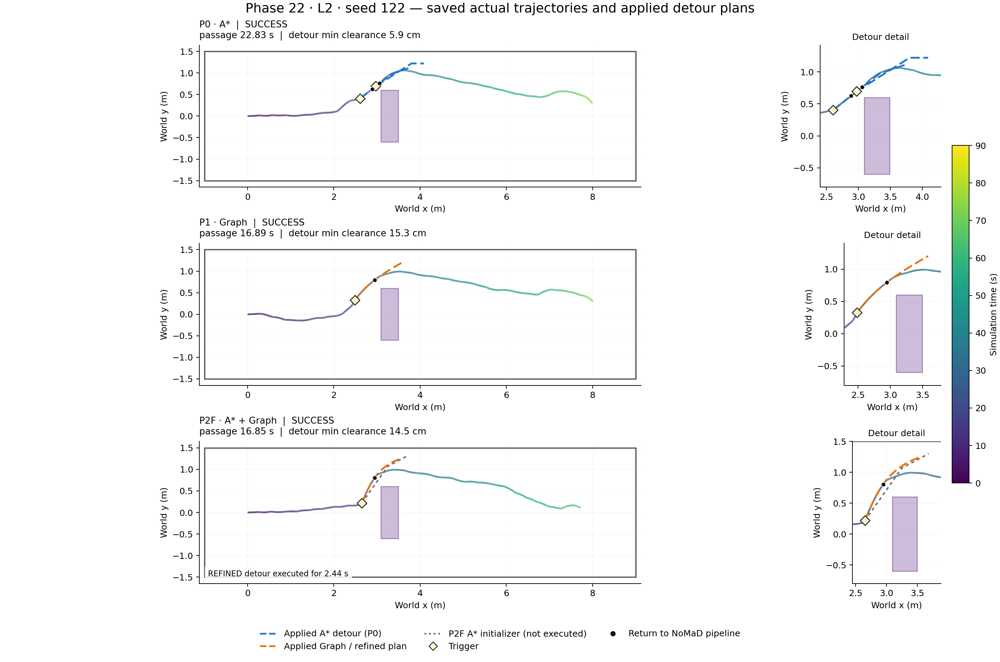
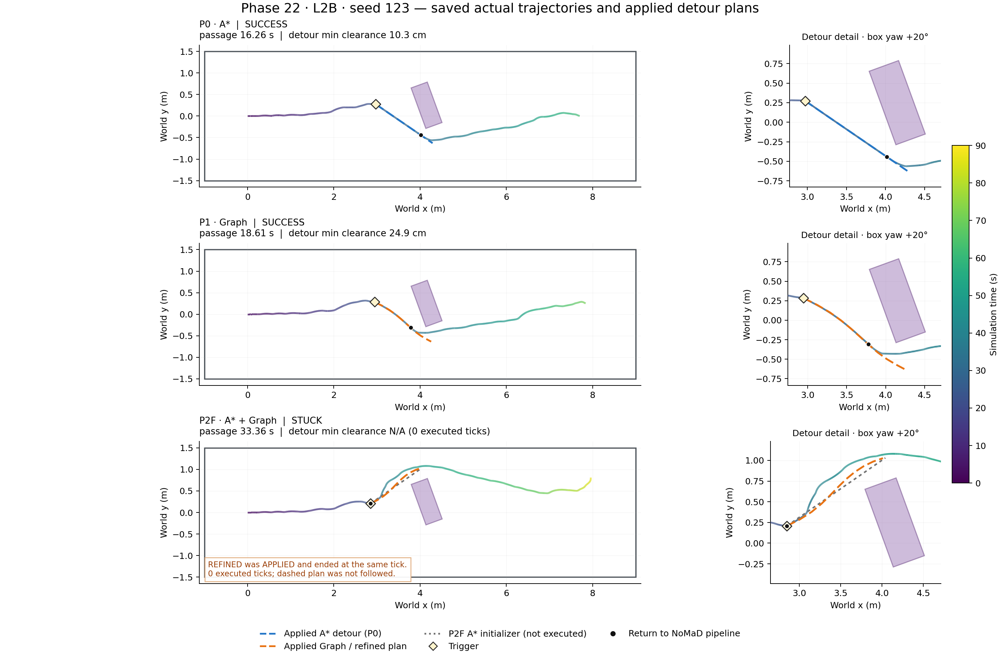

# Phase22 saved-run trajectory figures

No experiment, inference, planning solve, report or runtime code was changed. Passage time is measured from box spawn. Clearance is the stored minimum footprint oracle clearance to box/walls during executed R3 detour intervals; it is not the whole-run minimum. Black circles are logged END positions (return to the normal NoMaD pipeline, not necessarily the next FRESH application).

**L2B seed123 P2F caveat:** REFINED was ACCEPTED/APPLIED at27.1111s and ended with NO_NEW_OBSTACLE_AHEAD at the same tick. It executed0ticks, so detour clearance is N/A. Its dashed refined plan is shown as a logged applied plan, not as a path the robot followed. L2 seed122 P2F did execute its refined detour for2.4444s (176ticks).

## L2 seed 122

- [P0_ASTAR GIF](drive_L2_122_P0_ASTAR.gif)
- [P1_GRAPH GIF](drive_L2_122_P1_GRAPH.gif)
- [P2F_ASTAR_GRAPH GIF](drive_L2_122_P2F_ASTAR_GRAPH.gif)

## L2B seed 123

- [P0_ASTAR GIF](drive_L2B_123_P0_ASTAR.gif)
- [P1_GRAPH GIF](drive_L2B_123_P1_GRAPH.gif)
- [P2F_ASTAR_GRAPH GIF](drive_L2B_123_P2F_ASTAR_GRAPH.gif)

GIFs replay stored72Hz poses at10× (1sim-second per100ms frame), with a0.09m circular footprint and heading. Depth occupancy updates once per simulation second using only snapshots already published by that time. A* gray initializer paths are shown for active P2F refined detours; the zero-duration L2B P2F plan is not displayed as an active executed route. All selected raw paths and output hashes are recorded in manifest.json.
